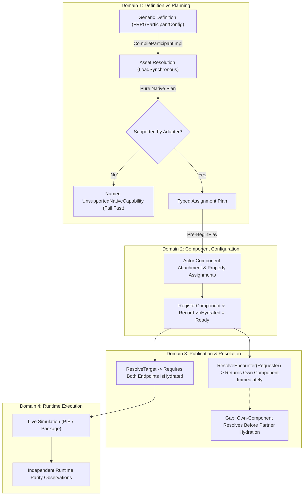

# AG12 Delivery Report: Adversarial Review of Native Capability Proposal (Revision 02)

**Document ID:** `Docs/BossCombatReview/Execution/Antigravity/ADVERSARIAL_NATIVE_CAPABILITY_REVIEW.md`  
**Revision:** Rev 02 (incorporating exact source corrections, type/member name alignments, and proposed-design boundaries from `[X-207]` and `Docs/BossCombatReview/Execution/Codex/AG12_A135_REVIEW.md`)  
**Author:** Antigravity (Assistant)  
**Assigned By:** Codex Technical Lead (`[X-206]`, `[X-207]`, `Docs/BossCombatReview/Execution/Codex/AG11_A134_ACCEPTANCE.md`)  
**Work Order:** AG12 (Adversarial Design-Only Review of Native Capability Model)  
**Date:** 2026-10-27  
**Execution Environment:** Windows / Pure Offline Source & Architectural Review (No Engine, No PIE, No Source/ Edits)

---

## 1. Pinned Source & Proposal Registry

All evaluations, challenges, and proposed review cases are strictly pinned against the following frozen documents and native source files, verified via `review_receipt.py`:

### Governing Proposal:
| Document | Repository Path | Size (Bytes) | Exact Raw SHA256 Hash |
| :--- | :--- | :--- | :--- |
| **Native Capability Proposal** | `Docs/BossCombatReview/Execution/Codex/Step2Preparation/18_NATIVE_CAPABILITY_PROPOSAL.md` | 6,593 | `67de3eb3363f77a57c18eb521eb572dc75ec03fca6e91c0b6c58311b677a0ce5` |

### Step2Preparation Governing Contracts:
| Document | Repository Path | Size (Bytes) | Exact Raw SHA256 Hash | Notes |
| :--- | :--- | :--- | :--- | :--- |
| **09 Parity Crosswalk** | `Docs/BossCombatReview/Execution/Codex/Step2Preparation/09_FIRST_CLUSTER_TYPED_PARITY_CROSSWALK.md` | 9,936 | `13b747fdcfba9951af5a0062e46499cd037d821aed94ac9e7e60eb1dcc03fd13` | Updated snapshot with Codex `[X-199]` addendum |
| **14 Phase Reversal Contract** | `Docs/BossCombatReview/Execution/Codex/Step2Preparation/14_PHASE_REVERSAL_PARITY_CONTRACT.md` | 8,717 | `4d67c93f69b8a1578cc76b2380ca599ff3256cae1d0638e8620676d47595e5a5` | Updated snapshot with Codex `[X-199]` addendum |
| **15 Health Application Contract** | `Docs/BossCombatReview/Execution/Codex/Step2Preparation/15_HEALTH_APPLICATION_PARITY_CONTRACT.md` | 5,700 | `aa11c4cf97c9b22d98fcdb128680c07777399d54ef061c876fa6c0f3b01f304b` | Frozen input pin |
| **16 Topology Contract** | `Docs/BossCombatReview/Execution/Codex/Step2Preparation/16_BINDING_DIAGNOSTIC_TOPOLOGY_CONTRACT.md` | 3,696 | `8109ada9c596176beb34961389f8ae949e342f4d052a43f39e3c5b214553234d` | Updated snapshot with Codex `[X-201]` target-edge addendum |

### C++ Source Files Audited (Independently Verified from Disk Reads):
| Source / Header File | Repository Path | Exact Raw SHA256 Hash | Key Audited Symbols |
| :--- | :--- | :--- | :--- |
| **RPGBossEncounter.h** | `Source/OneBossFight/Player/RPGBossEncounter.h` | `4f3ab203562ef2d3a2d18828feaf5f437a5a7eaff1054e9b6ce60e9150cae9d6` | `float BossMaxHealth = 2000.f;` (:40) |
| **RPGBossEncounter.cpp** | `Source/OneBossFight/Player/RPGBossEncounter.cpp` | `dc149393f2fff1788ea22daf42db0b14f85ac36f58ad59c459b44ee94600c96d` | `if (!bMaxHealthApplied && BossMaxHealth > 1.f)` (:90) |
| **RPGBossPhases.h** | `Source/OneBossFight/Player/RPGBossPhases.h` | `0887f37564a28564261b81ad21a1baf2a4c6f6adae99a3a49c3c15622225a69a` | `float PhaseTwoHealthFraction = 0.6f;` (:31) |
| **RPGBossPhases.cpp** | `Source/OneBossFight/Player/RPGBossPhases.cpp` | `c43615412e1f345d6ed75cc6d6a6b0d9ece6acaaac612e545b42cc24087f7a06` | `ResolveTransition(..., PhaseTwoHealthFraction)` (:95) |
| **RPGBossPosture.h** | `Source/OneBossFight/Player/RPGBossPosture.h` | `bca70f5816a45733f0ea2d5550651da7192ba179a5e31d736eab90fd46cd3ff8` | `EHold`, `PostureMax`, `LastDrainTime` |
| **RPGBossPosture.cpp** | `Source/OneBossFight/Player/RPGBossPosture.cpp` | `b26e184b0410e858d1c504e0b374dbc9e8f4c6b6399b05617559bb6909e88e41` | `RefillAfterBreak` (:148), `Drain` (:105) |
| **RPGBossStagger.h** | `Source/OneBossFight/Player/RPGBossStagger.h` | `7cfaaadbc33934d1dfe66560c0ff8c7fb47ac9e05399a5445b8c1e9a18c3695b` | Stagger lifecycle declarations |
| **RPGBossStagger.cpp** | `Source/OneBossFight/Player/RPGBossStagger.cpp` | `c711d766b4fecb6999c638cf5d8720ca422ba758223f941ea437ebac5b474c98` | Refill at :465 before queued phase at :479; `AbortStagger` :825 |
| **RPGBossMath.h** | `Source/OneBossFight/Player/RPGBossMath.h` | `89ff1aa3c367da2fe84de1583da889dd623bddd11787c416d43792f15cc2ebf0` | `RegenStep` (:17-25) |
| **RPGBossRules.h** | `Source/OneBossFight/Player/RPGBossRules.h` | `e16744219deffffab4de69ddd62e5333c1b59ac43cc670c9e777aee3fd397395` | `ResolveTransition`, priority ordering |
| **RPGEncounterBinding.h** | `Source/OneBossFight/Player/RPGEncounterBinding.h` | `4330f8c416cd75284e829856b5d1cba7001c5ee62f40bdc7b1bf98a8dbf94a80` | `FRPGBossStatsConfig` (:17), `FRPGPhaseConfig` (:27) |
| **RPGEncounterBinding.cpp**| `Source/OneBossFight/Player/RPGEncounterBinding.cpp` | `2fe63bcb78261b9bdd15be33607ea3c696ae33227989facc5b67e15cd91110dc` | `LoadSynchronous` (:71, 75), `ResolveTarget` (:214), `ResolveEncounter` (:225), `Record->bHydrated = Ready` (:339) |
| **RPGBlueprintCall.h** | `Source/OneBossFight/Pack/RPGBlueprintCall.h` | `08ca6403cb85eef36ed15c755a2163fb17f8bcfdb81043b640765d5145b8e19c` | `WriteAttribute`, `WriteMaxAttribute`, `ReadAttribute` |

---

## 2. Executive Assessment & Architectural Stance

The data-model architecture proposed in `18_NATIVE_CAPABILITY_PROPOSAL.md` refines the boundary between generic content definitions and native adapter capabilities. Antigravity **strongly endorses** the following foundational principles of the proposal:
1. **Separation of Generic Validity from Adapter Support:** Generic definitions must remain decoupled from legacy C++ component quirks. A definition that is well-formed under generic rules may be rejected as unsupported by an extracted native adapter without corrupting the broader schema.
2. **Pure Planning Before Component Mutation:** Evaluating adapter compatibility and formulating a typed assignment plan *before* mutating actor properties or attaching components prevents partial-failure state pollution.
3. **Rejection of Silent Coercion:** Explicitly disallowing automatic clamping, default substitution (e.g., silently injecting Boss01 hardcoded values), or parsing provenance text as runtime configuration.

This review presents an **adversarial analysis** of the proposal. It evaluates the proposal *as a proposed design*, identifies where current scaffold code diverges from proposed ideals, checks boundary assumptions against actual C++ declarations, and evaluates proposed candidate options without establishing unapproved mandates or waiving active project requirements.

---

## 3. Adversarial Analysis Across Five Structural Domains



### 3.1 Domain 1: Whole-Encounter Publication Gap vs Scaffold Resolution Paths
- **Proposal Statement:**
  > *"Keep three evidence layers distinct: 1. Pure compile result... 2. Configured/registered state: actual assignments precede registration/BeginPlay; the whole batch publishes only after required preparation succeeds... 3. Runtime parity..."*
- **Actual Source Grounding:**
  In [`Source/OneBossFight/Player/RPGEncounterBinding.cpp:333-340`](file:///c:/UnrealProject/OneBossFight/Source/OneBossFight/Player/RPGEncounterBinding.cpp#L333-L340):
  ```cpp
  Participant->RegisterComponent();
  for (auto& Component : Pending) { Component->RegisterComponent(); }
  bool Ready = Participant->IsRegistered();
  for (const auto& Component : Pending) { Ready &= Component->IsRegistered(); }
  Record = Records.FindByPredicate([&OriginalKey](const FRecord& R) { return R.Key == OriginalKey; });
  if (!Record) { Result.Fail(TEXT("binding invalidated during registration")); return Result; }
  Record->bHydrated = Ready; Record->bPoisoned = !Ready;
  ```
  And in [`RPGEncounterBinding.cpp:214-235`](file:///c:/UnrealProject/OneBossFight/Source/OneBossFight/Player/RPGEncounterBinding.cpp#L214-L235):
  ```cpp
  AActor* URPGCombatContextSubsystem::ResolveTarget(const FRPGParticipantKey& Key, FName TargetSlot) const
  {
      if (!IsHydrated(Key)) { return nullptr; }
      for (const FRecord& R : Records)
      {
          if (R.Key.WorldSession == Key.WorldSession && R.Key.EncounterInstance == Key.EncounterInstance
              && R.Key.Slot == TargetSlot && IsHydrated(R.Key)) { return R.Actor.Get(); }
      }
      return nullptr;
  }

  URPGBossEncounter* URPGCombatContextSubsystem::ResolveEncounter(const AActor& Requester) const
  {
      for (const FRecord& R : Records)
      {
          if (R.Actor.Get() != &Requester || !IsHydrated(R.Key)) { continue; }
          if (auto* Own = Requester.FindComponentByClass<URPGBossEncounter>()) { return Own; }
          AActor* Target = ResolveTarget(R.Key, R.TargetSlot);
          return Target ? Target->FindComponentByClass<URPGBossEncounter>() : nullptr;
      }
      return nullptr;
  }
  ```
- **Adversarial Critique & Actual Gap Identification:**
  1. `ResolveTarget` rigorously enforces bilateral hydration: it checks `if (!IsHydrated(Key))` for the requester AND `&& IsHydrated(R.Key)` for the destination slot within the same world session and encounter instance. It cannot return an unhydrated partner.
  2. However, **`ResolveEncounter` contains an early own-component return** at line 230:
     If the requesting actor has `URPGBossEncounter` and its *own* record is hydrated (`IsHydrated(R.Key)`), it returns `Own` immediately. It does not verify whether `R.TargetSlot` exists, whether the target participant has registered, or whether the partner record is hydrated.
  3. This creates a concrete publication gap: an encounter component can be resolved and begin execution while its duel partner is still unhydrated or failing registration.
  4. The proposal recommends that "the whole batch publishes only after required preparation succeeds." In the current scaffold, no such whole-encounter publication barrier exists; records hydrate individually.
- **Design Evaluation**: A future coordinator latch or whole-encounter readiness check is a proposed design enhancement (candidate for Packet F), not an existing capability of the current C++ scaffold.

---

### 3.2 Domain 2: Asset Loading Allocation Boundaries vs "Before-Mutation" Promises
- **Proposal Statement:**
  > *"After generic compilation, a pure native-plan compiler should either produce a fully typed supported assignment plan or a named UnsupportedNativeCapability result before component allocation/reservation side effects."*
- **Actual Source Grounding:**
  In [`Source/OneBossFight/Player/RPGEncounterBinding.cpp:71-78`](file:///c:/UnrealProject/OneBossFight/Source/OneBossFight/Player/RPGEncounterBinding.cpp#L71-L78):
  ```cpp
  Value->Skeleton.Reset(D.Skeleton.LoadSynchronous());
  if (!Value->Skeleton.IsValid() || D.Animations.IsEmpty()) { Result.Fail(TEXT("required skeleton/animation dependencies missing")); }
  for (const auto& Ref : D.Animations)
  {
      UAnimSequenceBase* Animation = Ref.LoadSynchronous();
      if (!Animation || Animation->GetSkeleton() != Value->Skeleton.Get()) { Result.Fail(...); }
      else { Value->Animations.Emplace(Animation); }
  }
  ```
- **Adversarial Critique & Allocation Clarification:**
  1. The proposal's phrase *"before component allocation/reservation side effects"* is appropriate, but must not be conflated with "zero engine memory allocations."
  2. Generic compilation in `RPGEncounterBinding.cpp` explicitly invokes `TSoftObjectPtr::LoadSynchronous()`. In Unreal Engine, synchronous asset loading reads package data from disk, allocates `UObject` instances on the engine heap, and may trigger internal garbage collector tracking.
  3. A pure planning compiler operates *after* generic compilation. It evaluates the compiled `FRPGParticipantConfig` against native component capabilities.
  4. The boundary must be strictly defined: Planning compilation produces **zero actor-level component attachments, zero component property mutations, and zero UWorld registrations**. It does not and cannot retroactively erase or prevent the memory allocations incurred by `LoadSynchronous()` during prior asset resolution.

---

### 3.3 Domain 3: Explicit Health Intent & The Omitted Assignment Reality
- **Proposal Statement:**
  > *"Explicit intent ApplyConfiguredMaximum requires finite desired health>1 for existing Encounter path; values in(0,1] return Unsupported for that intent. A separately explicit PreserveLegacyMaximum policy is a different capability, not a silently overloaded numeric sentinel. Do not add it by default or treat generic MaxHealth as optional."*
- **Actual Source Grounding:**
  In [`Source/OneBossFight/Player/RPGBossEncounter.h:38-40`](file:///c:/UnrealProject/OneBossFight/Source/OneBossFight/Player/RPGBossEncounter.h#L38-L40):
  ```cpp
  /** The boss's maximum (and starting) health (M14, owner 2026-10-23: a 2 to 4 minute duel; the pack's own value is 500). Applied once at the start and kept by every reset (a reset refills to the maximum). 0 or less = the pack's value. */
  UPROPERTY(EditAnywhere, BlueprintReadWrite, Category = "Encounter")
  float BossMaxHealth = 2000.f;
  ```
  In [`Source/OneBossFight/Player/RPGBossEncounter.cpp:90-107`](file:///c:/UnrealProject/OneBossFight/Source/OneBossFight/Player/RPGBossEncounter.cpp#L90-L107):
  ```cpp
  if (!bMaxHealthApplied && BossMaxHealth > 1.f)
  {
      // ... writes BossMaxHealth and verifies NewMax readback within 0.5
  }
  ```
  In [`Source/OneBossFight/Player/RPGEncounterBinding.h:17-24`](file:///c:/UnrealProject/OneBossFight/Source/OneBossFight/Player/RPGEncounterBinding.h#L17-L24):
  ```cpp
  USTRUCT(BlueprintType)
  struct FRPGBossStatsConfig
  {
      GENERATED_BODY()
      UPROPERTY(EditAnywhere) float MaxHealth = 0.f;
      UPROPERTY(EditAnywhere) float MaxPosture = 0.f;
      UPROPERTY(EditAnywhere) float PostureRegenDelay = 0.f;
      UPROPERTY(EditAnywhere) float PostureRegenRate = 0.f;
  };
  ```
- **Adversarial Critique & Counterexample:**
  1. **Omitted Assignment Does Not Preserve Pack 500**:
     In native C++, `RPGBossEncounter` constructs with `BossMaxHealth = 2000.f`.
     If an adapter omits writing to `BossMaxHealth` (e.g. attempting to "preserve legacy pack maximum"), `BossMaxHealth` remains at its constructor default of `2000.f`. When `Tick` runs, line 90 checks `BossMaxHealth > 1.f` (2000 > 1 is true) and overrides the pack health to 2000!
     Therefore, merely omitting an adapter write **retains the native 2000 override**, rather than preserving the pack's value of 500.
     Per `RPGBossEncounter.h:38`, to actually preserve the pack's value, `BossMaxHealth` must be set to `0.f` or less (or $\le 1.f$), which explicitly prevents the override branch from executing.
  2. **Type Identity & Current Schema Limits**:
     The actual stats struct in code is `FRPGBossStatsConfig`, which defines scalar floats. No `EHealthIntent` enum exists in current source.
     Introducing an explicit intent enum is a proposed data-model design option. If implemented, `PreservePackMaximum` must actively configure `BossMaxHealth = 0.f` (or leave it unmanaged under an adapter that disables `RPGBossEncounter` health management), rather than relying on unassigned property omission.
  3. **Pure Plan vs Runtime Readback**:
     A pure compile plan evaluates input scalars against capability contracts. It can produce a plan to write `BossMaxHealth = 2000.f`, but it cannot verify runtime attribute readback (`FMath::Abs(NewMax - BossMaxHealth) <= 0.5`). That verification belongs strictly to Stage 3/5 runtime observation.

---

### 3.4 Domain 4: Phase Threshold Configuration & Cardinality Options
- **Proposal Statement:**
  > *"Require an explicit mapping from intended transition identity to the native single-threshold phase consumer, with no implicit first/last array-row choice. Exact cardinality/initial-phase representation is still a schema decision. A typed compiled mapping must reject ambiguity, duplicate mapping or unsupported extra transitions..."*
- **Actual Source Grounding:**
  In [`Source/OneBossFight/Player/RPGBossPhases.h:30-31`](file:///c:/UnrealProject/OneBossFight/Source/OneBossFight/Player/RPGBossPhases.h#L30-L31):
  ```cpp
  UPROPERTY(EditAnywhere, BlueprintReadWrite, Category = "Phase", meta = (ClampMin = "0.0", ClampMax = "1.0"))
  float PhaseTwoHealthFraction = 0.6f; // Master Design Freeze 30.1 and 36: phase two starts on the first crossing to 60 % of health or below
  ```
  In [`Source/OneBossFight/Player/RPGBossPhases.cpp:95`](file:///c:/UnrealProject/OneBossFight/Source/OneBossFight/Player/RPGBossPhases.cpp#L95):
  ```cpp
  return RPGBossRules::ResolveTransition(Flags, Health, Max, PhaseTwoHealthFraction);
  ```
  In [`Source/OneBossFight/Player/RPGEncounterBinding.h:27-35`](file:///c:/UnrealProject/OneBossFight/Source/OneBossFight/Player/RPGEncounterBinding.h#L27-L35):
  ```cpp
  USTRUCT(BlueprintType)
  struct FRPGPhaseConfig
  {
      GENERATED_BODY()
      UPROPERTY(EditAnywhere) FName PhaseId;
      UPROPERTY(EditAnywhere) float EntryHealthFraction = 0.f;
      UPROPERTY(EditAnywhere) float SpeedMultiplier = 1.f;
      UPROPERTY(EditAnywhere) float RateMultiplier = 1.f;
      UPROPERTY(EditAnywhere) float AttackMultiplier = 1.f;
  };
  ```
- **Adversarial Critique & Unit Alignment:**
  1. **Configurable Property, Not Hardcoded Constant**:
     `PhaseTwoHealthFraction` is a configurable `UPROPERTY` with default `0.6f` (60%), bounded by `[0.0, 1.0]`. It is not an immutable hardcoded constant in C++.
     In `FRPGPhaseConfig`, the property is `EntryHealthFraction` (in fraction units `0.0 .. 1.0`, matching `PhaseTwoHealthFraction`).
  2. **Single-Transition Consumer Topology**:
     While the threshold value is configurable (e.g. an adapter could assign `PhaseTwoHealthFraction = 0.5f` or `0.6f`), the **topology of the consumer is strictly single-transition**. `RPGBossPhases` maintains a single boolean flag `bPhaseTwo` and a single transition state machine.
  3. **Array Cardinality Options**:
     Generic schemas support an array of phase configurations (`TArray<FRPGPhaseConfig>`).
     - If a generic definition specifies 2 transitions (e.g. Phase 2 at 0.6, Phase 3 at 0.3), `RPGBossPhases` cannot natively execute the third phase.
     - The proposal suggests requiring an explicit mapping from transition identity to consumer.
     - For the `RPGBossPhases` native adapter, the supported capability domain is restricted to configurations representing a single transition. Handling multi-phase combatants is an unresolved architectural choice requiring future multi-phase adapters, not an approved schema clamp on generic definitions.

---

### 3.5 Domain 5: Target Edge Topology vs Project-Wide Requirements
- **Proposal Statement:**
  > *"Fixture/plan has explicit source/target role edges; runtime association uses current actor/key/generation and whole-encounter publication barrier. Boss/Player reciprocity is a reviewed fixture assertion, not a universal schema rule."*
- **Actual Source Grounding:**
  In [`Source/OneBossFight/Player/RPGEncounterBinding.cpp:185, 219`](file:///c:/UnrealProject/OneBossFight/Source/OneBossFight/Player/RPGEncounterBinding.cpp#L185):
  `BindEncounter` stores `TargetSlot` and verifies membership in encounter slots.
  `ResolveTarget` matches `WorldSession`, `EncounterInstance`, and `Slot == TargetSlot` across registered records.
- **Adversarial Critique & Role Flexibility:**
  1. The 4-actor diagnostic topology check (`binding_topology_contract_checks.py`) validates structural consistency (1 world, 2 encounters, 2 Boss/Player pairs sharing uint32 generations). As established in `[X-201]`, it contains no edge input and cannot verify intended target relationships.
  2. In the specific Boss01 duel test fixture, bidirectional reciprocity (`Boss -> Player` and `Player -> Boss`) is the intended relationship.
  3. However, across the broader project (all 83 active requirements), combat encounters may include non-reciprocal targeting or multi-combatant relationships.
  4. The proposal correctly identifies that Boss/Player reciprocity must remain an assertion of the specific duel fixture, rather than a universal schema rule.
  5. The representation of target edges (whether via explicit edge structures, slot attributes, or encounter metadata) remains a candidate design option. The planning compiler should validate that a fixture's declared edges match the target resolution capability of the participating encounter adapters.

---

## 4. Unrun Proposed Review Case Dispositions

The following matrix organizes concrete proposed review cases to evaluate compiler capability decisions under the proposed model. **All cases are UNRUN proposals**, evaluating expected planning dispositions without claiming executed engine results:

| Candidate Input Case | Target Field & Value | Evaluated Capability Intent | Proposed Compiler Disposition | Architectural Justification |
| :--- | :--- | :--- | :---: | :--- |
| **CASE-HLTH-01** | `MaxHealth = 2000.0f` | `ApplyConfiguredMaximum` | **SUPPORTED** | Finite positive scalar $> 1.0f$; plan assigns `BossMaxHealth = 2000.f`. |
| **CASE-HLTH-02** | `MaxHealth = 0.5f` | `ApplyConfiguredMaximum` | **UNSUPPORTED** | Value in `(0.0, 1.0]` enters native bypass domain; fails fast; prevents silent native override omission. |
| **CASE-HLTH-03** | `MaxHealth = 0.5f` | Proposed `PreservePackDefault` | **CANDIDATE OPTION** | Proposed explicit policy; plan sets `BossMaxHealth = 0.f` to prevent native 2000 override. |
| **CASE-HLTH-04** | `MaxHealth = -10.0f` | *Any* | **SCHEMA REJECT** | Violates generic schema invariant `MaxHealth > 0.f` in `CompileParticipantImpl`. |
| **CASE-DMG-01** | `AttackMultiplier = 1.25f` | `InverseArithmeticReversal` | **SUPPORTED** | Value $\ge 1.0f$; native removal arithmetic `AppliedAttack > 0.0` guard verified symmetric. |
| **CASE-DMG-02** | `AttackMultiplier = 0.5f` | `InverseArithmeticReversal` | **UNSUPPORTED** | Subunit multiplier produces negative `AppliedAttack`; native removal fails to restore; fails fast. |
| **CASE-PHSE-01** | `EntryHealthFraction = 0.6f` | `NativeSinglePhaseTransition`| **SUPPORTED** | Matches native `PhaseTwoHealthFraction` default; plan assigns threshold. |
| **CASE-PHSE-02** | `EntryHealthFraction = 0.5f` | `NativeSinglePhaseTransition`| **SUPPORTED** | Valid fraction in `[0.0, 1.0]`; plan assigns configurable `PhaseTwoHealthFraction = 0.5f`. |
| **CASE-PHSE-03** | `Phases` array length $= 2$ | `NativeSinglePhaseTransition`| **UNSUPPORTED** | Native `RPGBossPhases` supports single transition only; rejects multi-phase without silent clamping. |
| **CASE-TOPO-01** | Reciprocal Edges `(0->1, 1->0)` | `DuelFixtureTargeting` | **SUPPORTED** | Reciprocal target edges match duel fixture intent. |
| **CASE-TOPO-02** | Self Edge `(0->0)` | `DuelFixtureTargeting` | **UNSUPPORTED** | Target slot equals source slot; rejected as invalid targeting topology. |
| **CASE-CLUST-01**| Stagger omitted from fixture | `CompleteFirstCluster` | **UNSUPPORTED** | Complete cluster capability requires Stagger for break-before-phase resolution; fails fast. |
| **CASE-CLUST-02**| Stagger omitted from fixture | `IsolatedPhaseComponent` | **SUPPORTED** | Native `RPGBossPhases.cpp:74-77` preserves optional legacy branch semantics when isolated. |

---

## 5. Architectural Recommendations for Replacement Operator

1. **Acknowledge the `ResolveEncounter` Publication Gap**:
   Recognize that in `Source/OneBossFight/Player/RPGEncounterBinding.cpp:230`, `ResolveEncounter` returns an actor's own encounter component as soon as its own record is hydrated, prior to partner hydration. A whole-encounter publication barrier must be introduced at the coordinator layer (Packet F).
2. **Account for Native Constructor Defaults**:
   When designing health management policies, account for the fact that `RPGBossEncounter` constructs with `BossMaxHealth = 2000.f`. Omitted assignments do not preserve pack defaults; preserving pack values requires setting `BossMaxHealth <= 1.f` (or disabling the health management branch).
3. **Preserve Configurable Properties and Fraction Units**:
   Align phase transition mappings with `PhaseTwoHealthFraction` (`0.0 .. 1.0` float fraction, default `0.6f`), reflecting the configurable nature of the native property rather than treating it as an immutable constant.
4. **Distinguish Adapter Restrictions from Global Schemas**:
   Keep capability restrictions (such as `AttackMultiplier >= 1.0` and single-phase topology) strictly bounded to the legacy Boss01 native extraction adapter. Do not restrict generic schemas from supporting subunit debuffs or multi-phase combatants in future adapters.
5. **Bound Pre-Mutation Promises**:
   Do not promise zero engine memory allocations during planning compilation. Distinguish UObject asset loading allocations (`LoadSynchronous`) from actor component attachment and world registration mutations.
