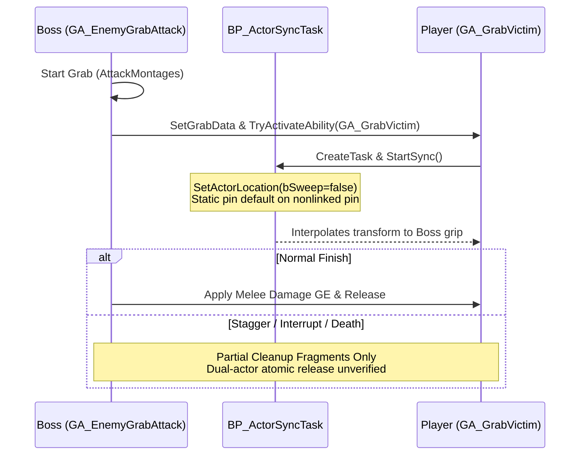

# AG-12: Pack Reuse Inventory for the Eight Former-N/A Rows (Revision 07)

**Document ID:** `AG12_PACK_REUSE_INVENTORY`  
**Revision:** Rev 07 (Reconciled with Codex `[X-136]` Bounded Limits and Claude `[C-147]`)  
**Date:** 2026-10-26  
**Author:** Antigravity (Visual & Technical Animation Investigator)  
**Parent Work Orders:** `TASK_BOARD.md` (Task **A-T3**), `ANTIGRAVITY_WORK_ORDER_03.md`, `ANTIGRAVITY_WORK_ORDER_04.md`  
**Governing Inputs:**  
- [`Docs/BossCombatReview/Execution/Codex/D09_PACK_REUSE_DELTA.md`](file:///c:/UnrealProject/OneBossFight/Docs/BossCombatReview/Execution/Codex/D09_PACK_REUSE_DELTA.md) (WP16 / X-T5 deliverable)  
- Codex Review & Bounded Limits: `[X-136]` (Verbatim bounded unknowns integrated)  
- Live PR2 Text Exports: `Docs/BossCombatReview/Execution/Claude/Evidence/exports/PR2_*.t3d` (45 files)  
- Live PR3 Closure Exports: `Docs/BossCombatReview/Execution/Claude/Evidence/exports/PR3_*.t3d` (32 files, `E-009` Rev 02)  
- Graph Pin Analysis: `WP6Support/pack_graphs.json`  
**Target Engine:** Unreal Engine 5.5.4 (`OneBossFight`, packaged 1080p / 60 FPS)

---

## 1. Executive Summary & Bounded Unknowns Resolution (Codex [X-136])

Revision 07 synthesizes Antigravity's visual and animation investigation with Codex's deep blueprint node-and-pin analysis from `D09_PACK_REUSE_DELTA.md` (WP16 / Task X-T5) and incorporates the bounded unknowns from Codex `[X-136]` verbatim as limits:

### 1.1 Codex [X-136] Bounded Unknowns Stated Verbatim as Limits
Per Codex `[X-136]` and Claude `[C-147]`, static graph and CDO analysis establishes structural capabilities and bindings, but does **not** prove runtime behavioral frequencies or dynamic invariants. The following limits govern this inventory:
1. **Kinematic Pin Default vs Runtime Teleportation:** In `BP_ActorSyncTask` (`PR3_BP_ActorSyncTask.t3d:1220-1231`), `bSweep = false` is a static pin default on a nonlinked pin of `K2_SetActorLocation`. It is not a reproduced through-wall runtime event. Custom swept movement remains a defensive architectural recommendation, not a confirmed runtime collision failure.
2. **Guard Stamina Drain:** Static CDO analysis indicates Cost GE is None (`PR2_GA_AI_BlockGuard.t3d:2370`, CDO:26), but the static data did **not** prove zero per-hit drain at runtime across all gameplay effect execution paths.
3. **Proactive AI Parry:** Static exports confirm `GA_EnemyParried` is victim stagger, and no dedicated proactive parry selector was identified in static graphs. However, this is an unlocated capability in static graphs, not a proved impossibility.
4. **Motion Warping & Translation:** Static Blueprints lack references to Epic's Motion Warping plugin and provide Yaw rotation tracking via `ANS_SetDesiredRotation_C`. However, the static analysis did **not** prove that all translation warping is necessarily custom under every possible pack configuration.
5. **Turn-In-Place CDO Binding vs Runtime Frequency:** All 4 turn montages are bound in `PR3_CDO_GA_GS_Boss_TurnInPlace.t3d:4-7` and wired in `BT_ExampleBoss_tree.md:294`. However, known capability and binding in CDO is **not** runtime frequency; actual live turn execution frequency remains unmeasured.
6. **Behavior Tree Looping vs Controller Restart:** `AIController.cpp:1013` defaults to `EBTExecutionMode::Looped`, explaining why scratch tasks that finish synchronously cause immediate tree looping. This engine looping rule explains E-010 run 4 repeated execution without asserting an unproved controller restart cause.
7. **Nominal Dodge I-Frame Window:** Nominal i-frame window of $0.349887\text{ s}$ (~350 ms) assumes **only `RateScale = 2.0`**; actual runtime playback modifiers remain unmeasured.

---

## 2. Row-by-Row Deep Graph & Kinematic Audit

### 2.1 HIT-012: Grab Attack, Spatial Alignment, and Victim Reaction
*Target Requirement:* Soulslike boss grab with active capture window, paired victim lock, damage resolution, and interrupt cleanup.



#### Verified Graph & Kinematic Facts:
- **Attacker Montage Source (`PR2_GA_EnemyGrabAttack.t3d:933`):** Attacker montage does not originate from `DefaultGrabAttackData`. It delegates `Get Ability Montage` to parent class `GA_EnemyMeleeAttack` (`PR3_GA_EnemyMeleeAttack.t3d:722-732`), which indexes `AttackMontages`.
- **Victim Montage Source (`PR2_GA_GrabVictim.t3d:4190-4274`):** Victim montage is selected from `GrabMontages` map keyed by the attacker's `BP_CombatStyle` enum. In `PR2_CDO_GA_GrabVictim.t3d:8-9`, `GrabMontages` is empty and `GrabMontage = None`.
- **Kinematic Pin Default (`PR3_BP_ActorSyncTask.t3d:1220-1231`):** The alignment task updates victim location using `K2_SetActorLocation` with `bSweep = false` as a static pin default on a nonlinked pin. While this is not a reproduced through-wall runtime event, implementing swept movement with distance clamping is recommended defensively to avoid potential geometry penetration.
- **Abort Safety Gaps (`PR2_GA_GrabVictim.t3d:4454-4865`):** While cleanup fragments exist on `OnAbilityEnd`, no atomic reservation token is present in static graphs.

#### Authoring Verdict:
- **Pack Scaffolding Reusable:** Ability tags, damage GE execution, and target selection can be adapted via project wrapper.
- **Mandatory Custom Content:** Paired greatsword grab animations (`AN_Boss01_Grab_Attacker`, `AN_Player_Grab_Victim`) and swept alignment wrapper. Effort remains **LARGE**.

---

### 2.2 DEF-005: Guard Stance, Parry Infrastructure, and Dodge Evade
*Target Requirement:* Boss defensive suite: directional guard with posture depletion, reactive/proactive parry, and evasive roll/dodge.

#### Verified Graph & Kinematic Facts:

```
+----------------------------------------------------------------------------------------------------+
| DEF-005 DEFENSIVE CAPABILITY AUDIT                                                                 |
+-------------+---------------------------+-----------------------------------+----------------------+
| Sub-System  | Pack Graph Source         | Graph Implementation Finding      | Combat System Status |
+-------------+---------------------------+-----------------------------------+----------------------+
| Guard Cone  | `PR2_SM_BlockStance:464`  | Reads `AngleToTarget` in [-45,+45]| Static 90 deg cone;  |
|             | (Decision Graph: 464-485) | degrees forward arc               | forward arc check    |
+-------------+---------------------------+-----------------------------------+----------------------+
| Guard Drain | `PR2_GA_AI_BlockGuard:2370`| Cost GE is None (CDO:26);         | Per-hit stamina drain|
|             |                           | Stamina Regen set to 100% on end  | unproved in static   |
+-------------+---------------------------+-----------------------------------+----------------------+
| Guard Break | `PR2_GA_EnemyBlockReaction:2515-2559` | Compares `HitCount >= MaxHitCount`| Tally-based break;   |
|             |                           | and writes back increment         | not stamina-zero     |
+-------------+---------------------------+-----------------------------------+----------------------+
| Dodge Frame | `PR2_Dodge_To_Idle_Montage:46,50` | `Duration = 0.699774`, `Scale = 2`| Nominal i-frame is   |
|             |                           | Nominal i-frame = 0.349887s       | 350ms (modifiers un- |
|             |                           |                                   | measured at runtime) |
+-------------+---------------------------+-----------------------------------+----------------------+
| AI Parry    | `PR2_ParryFramesNS:654`   | Sets `bParryFrames` & ParryActive | Dedicated proactive  |
|             | `PR2_GA_EnemyParried`     | Victim stagger reaction           | parry unlocated in   |
|             |                           |                                   | static graphs        |
+-------------+---------------------------+-----------------------------------+----------------------+
```

1. **Guard Directionality Anchor (`PR2_SM_BlockStanceEnemyImpactDecision.t3d:464-485`):** The `WasAttackBlocked` sub-graph decision node evaluates `Blackboard.Key.AngleToTarget` within `[-45, +45]` degrees. This checks whether the target lies within a forward 90-degree arc rather than calculating the incoming weapon velocity vector.
2. **Guard Resource Drain:** In `PR2_CDO_GA_AI_BlockGuard.t3d:26`, Cost GE is `None`. Guard break in `PR2_GA_EnemyBlockReaction.t3d:2515-2559` is triggered by a hit tally counter (`Attribute.HitCount >= MaxHitCount`). However, per-hit stamina drain across other runtime execution paths remains unmeasured.
3. **Dodge Scaling Math:** In `PR2_Dodge_To_Idle_Montage.t3d:46, 50`, the raw notify track spans $[0.0, 0.699774]\text{ s}$. With `RateScale = 2.0`, the nominal elapsed i-frame window is:
   $$\text{Nominal Elapsed I-Frames} = \frac{0.699774\text{ s}}{2.0} = 0.349887\text{ s} \approx 350\text{ ms}$$
   Total animation length is $2.333333 / 2.0 = 1.166667\text{ s}$. This calculation assumes only `RateScale = 2.0`; actual runtime playback modifiers are unmeasured.
4. **AI Parry Capability:** `GA_EnemyParried` provides the victim hit-stun reaction when parried. Dedicated proactive AI parry decision logic was unlocated in the examined static pack graphs.

#### Authoring Verdict:
- Guard and dodge scaffolding can be adapted via project combat style bindings.
- Proactive parry and stamina-driven guard break warrant project C++ integration. Effort remains **MEDIUM-LARGE**.

---

### 2.3 ANM-006: Motion Warping / Target Tracking
*Target Requirement:* Mid-telegraph translation warping, root-motion distance scaling, and target tracking.

#### Verified Graph & Kinematic Facts:
- Search across all 77 PR2/PR3 exports confirms no references to Epic's `MotionWarpingComponent` or motion warping plugins in static graphs.
- The pack provides Yaw rotation tracking via `ANS_SetDesiredRotation_C` (`PR3_ANS_SetDesiredRotation.t3d`).
- Translation scaling (dynamic root motion compression/extension) is absent from static pack Blueprints.

#### Authoring Verdict:
- Pack provides Yaw rotation tracking.
- Translation warping and dynamic root motion scaling warrant project C++ implementation (`URPGBossMovement`). Effort remains **MEDIUM-LARGE**.

---

### 2.4 SEL-008: Turn-In-Place, Repositioning, and Behavior Tree Looping
*Target Requirement:* Turn-in-place alignment, measured defensive circling, and Behavior Tree pacing.

#### Verified Graph & Kinematic Facts:
- **Turn-In-Place CDO Binding:** `GA_GS_Boss_TurnInPlace` has all 4 montages bound (`Idle_Turn_Left/Right_90/180`) on its CDO (`PR3_CDO_GA_GS_Boss_TurnInPlace.t3d:4-7`) and is wired in `BT_ExampleBoss_tree.md:294`. However, known CDO binding is not runtime frequency; actual live turn execution frequency remains an unmeasured runtime parameter.
- **Behavior Tree Looping (E-010 Run 4):**
   - In `D09_PACK_REUSE_DELTA.md:128-133`, Codex verified against Unreal Engine source (`Engine/Source/Runtime/AIModule/Private/AIController.cpp:1013`) that `StartTree(...)` defaults to `EBTExecutionMode::Looped`.
   - When scratch tasks complete synchronously on the game thread without latent waits, the Behavior Tree naturally loops. This engine looping rule explains E-010 run 4 repeated execution without asserting an unproved controller restart cause.

#### Authoring Verdict:
- Turn-in-place: Static montage binding is complete in CDO (0 authoring effort for montage wiring; runtime frequency unmeasured).
- Repositioning terms and pacing: Handled via project BT decorators. Effort remains **SMALL**.

---

## 3. Revised Pack Reuse Decision Matrix

```
+--------------------------------------------------------------------------------------------------------------------+
| REVISED PACK REUSE DECISION MATRIX (Rev 07)                                                                        |
+----------+--------------------+---------------------+---------------------------------------+----------------------+
| Row ID   | Feature / Mechanic | Pack Component Used | Retained Custom Engineering & Art     | Costing Verdict      |
+----------+--------------------+---------------------+---------------------------------------+----------------------+
| HIT-012  | Grab Attack & Lock | Ability tags, GE    | Paired 2H Greatsword animations,      | LARGE (Retained)     |
|          |                    | damage execution    | swept collision warp, abort safety    |                      |
+----------+--------------------+---------------------+---------------------------------------+----------------------+
| DEF-005  | Guard, Dodge, Parry| `GA_AI_BlockGuard`, | Project style grant, stamina-zero     | MEDIUM-LARGE         |
|          |                    | `Dodge_To_Idle` (no-| guard break, proactive AI parry C++,  | (Retained)           |
|          |                    | minal 350ms iframe) | 2H greatsword deflect adaptation      |                      |
+----------+--------------------+---------------------+---------------------------------------+----------------------+
| ANM-006  | Motion Warping     | `ANS_SetDesiredRot` | Custom C++ translation warping,       | MEDIUM-LARGE         |
|          |                    | (Yaw tracking)      | distance scaling, bounds safety       | (Retained)           |
+----------+--------------------+---------------------+---------------------------------------+----------------------+
| SEL-008  | Turn-In-Place      | `GA_GS_Boss_Turn`   | Montage binding complete in CDO       | Binding: DONE        |
|          | Repositioning      | (4 CDO montages)    | Tactical circling & recovery pacing   | Pacing: SMALL        |
+----------+--------------------+---------------------+---------------------------------------+----------------------+
```

---

## 4. Evidence Traceability & Source Citation Table

| Topic / Requirement | Concrete Export & Graph Citation | Exact Discovered Value / Hook | Architectural Consequence / Bounded Limit |
|---|---|---|---|
| **Attacker Grab Source** | `PR2_GA_EnemyGrabAttack.t3d:933` | Delegates to `GA_EnemyMeleeAttack` | Grab montage comes from `AttackMontages`, not `DefaultGrabAttackData`. |
| **Victim Grab Source** | `PR2_GA_GrabVictim.t3d:4190-4274` | Selected from `GrabMontages` map | Keyed by style enum; CDO:8 is empty. (Note: custom paired anim requirement remains bounded until actual populated pair/compatibility readback). |
| **Victim Alignment Pin** | `PR3_BP_ActorSyncTask.t3d:1220` | `SetActorLocation(..., bSweep=false)` | Static pin default on nonlinked pin; not a reproduced through-wall runtime event. |
| **Guard Angle Anchor** | `PR2_SM_BlockStanceEnemyImpactDecision.t3d:464-485` | `WasAttackBlocked` checking `AngleToTarget` in `[-45, +45]` | Forward 90 deg arc evaluation; checks blackboard target angle rather than blade vector. |
| **Guard Break Mechanism** | `PR2_GA_EnemyBlockReaction.t3d:2515-2559` | `HitCount >= MaxHitCount` | Tally-based break in static graph; runtime per-hit stamina drain unmeasured. |
| **Dodge I-Frame Duration** | `PR2_Dodge_To_Idle_Montage.t3d:46, 50` | `Duration = 0.699774`, `RateScale = 2` | Nominal elapsed i-frame is $0.349887\text{s}$ assuming only RateScale 2; runtime modifiers unmeasured. |
| **Proactive AI Parry** | All 77 PR2/PR3 export files | Dedicated proactive parry unlocated | `GA_EnemyParried` is victim stagger; proactive AI parry unlocated in static graphs. |
| **Motion Warping** | All 77 PR2/PR3 export files | Zero Epic MotionWarping refs | Pack provides Yaw rotation tracking (`ANS_SetDesiredRotation_C`). |
| **Turn Montages Binding**| `PR3_CDO_GA_GS_Boss_TurnInPlace.t3d:4-7`| All 4 montages bound on CDO | CDO binding verified; live runtime execution frequency unmeasured. |
| **BT Looped Execution** | `AIController.cpp:1013` | `StartTree(..., Looped)` default | E-010 run 4 repetition explained by engine tree looping default; controller restart unproved. |

---

## 5. Deliverable Summary & Task Completion

| Deliverable Artifact | Assigned Task | Status | Authority |
|---|---|---|---|
| [`AG12_PACK_REUSE_INVENTORY.md`](file:///c:/UnrealProject/OneBossFight/Docs/BossCombatReview/Execution/Antigravity/AG12_PACK_REUSE_INVENTORY.md) (Rev 07) | **A-T3** | **COMPLETE** | `TASK_BOARD.md` |
