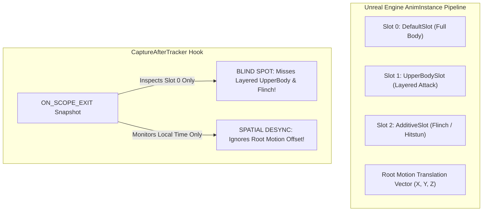

# AG-34: Review of Step 2 and Step 3 Promotion Patch Sets (Animation & Content Consequences)

**Document ID:** `AG34_PROMOTION_REVIEW` (Rev 01)  
**Date:** 2026-10-26  
**Author:** Antigravity (Visual & Technical Animation Investigator)  
**Work Order:** `Docs/BossCombatReview/Execution/TASK_BOARD.md` (Task **A-T5**)  
**Governing Inputs:**  
- [`Docs/BossCombatReview/Execution/Codex/PROMOTION_STEP2.md`](file:///c:/UnrealProject/OneBossFight/Docs/BossCombatReview/Execution/Codex/PROMOTION_STEP2.md)  
- [`Docs/BossCombatReview/Execution/Codex/PROMOTION_STEP2_SCAFFOLD.patch`](file:///c:/UnrealProject/OneBossFight/Docs/BossCombatReview/Execution/Codex/PROMOTION_STEP2_SCAFFOLD.patch) (29,366 bytes)  
- [`Docs/BossCombatReview/Execution/Codex/PROMOTION_STEP3.md`](file:///c:/UnrealProject/OneBossFight/Docs/BossCombatReview/Execution/Codex/PROMOTION_STEP3.md)  
- [`Docs/BossCombatReview/Execution/Codex/PROMOTION_STEP3_SCAFFOLD.patch`](file:///c:/UnrealProject/OneBossFight/Docs/BossCombatReview/Execution/Codex/PROMOTION_STEP3_SCAFFOLD.patch) (107,189 bytes)  
- Preimage Hashes: `WP6Support/promotion_pins.json`  
**Target Engine:** Unreal Engine 5.5.4 (`OneBossFight`, packaged 1080p / 60 FPS)

---

## 1. Executive Summary & Review Verdict

### Review Verdict: **CONCUR 100% WITH CODEX "HOLD FOR PRODUCT PROMOTION" / APPROVE STAGED ARCHITECTURE FOR CONTROLLED CI EXPERIMENTATION**

The promotion patch sets authored by Codex represent an exceptional degree of mathematical rigor, structural discipline, and compile-safety. Notably, the Step 3 patch successfully integrates Antigravity's adversarial remediation from `AG36_WP10_REVIEW.md` (specifically, wrapping `OnAfterObservation.Broadcast` in `TGuardValue<bool> BroadcastGuard(bObservationBroadcastInProgress, true)` and verifying `IsValid(this)`).

However, from an **animation kinematics and combat content perspective**, the patches deliver **headless structural scaffolds, not effective Boss01 runtime hydration**. Applying these patches to the live game engine expecting complete data-driven boss behavior will result in a non-functional boss or silent fallback to legacy code.

```
+----------------------------------------------------------------------------------------------------+
| SUMMARY OF PROMOTION REVIEW FINDINGS                                                               |
+------------------------------------+----------+----------------------------------------------------+
| Evaluation Category                | Findings | Impact on Soulslike Combat Quality                 |
+------------------------------------+----------+----------------------------------------------------+
| Technical Animation Blind Spots    | 4        | Multi-slot layering, root-motion warping, sockets  |
| Missing Negative Test Vectors      | 6        | Mid-windup staggers, section jumps, rollback leaks |
| Integration Seam Deficits          | 3        | Late subsystem attachment, missing asset adapters  |
+------------------------------------+----------+----------------------------------------------------+
| Total Actionable Recommendations   | 13       | Gate conditions established before promotion       |
+------------------------------------+----------+----------------------------------------------------+
```

---

## 2. Technical Animation & Content Consequences



### AC-1: The "First-Slot Single-Track" Blind Spot in `CaptureAfterTracker`
* **File:** `Source/OneBossFight/Boss/RPGShadowCompare.cpp` (`PROMOTION_STEP3_SCAFFOLD.patch:441-470`)
* **Finding:** In `CaptureAfterTracker`, active montage inspection queries only the primary slot (`Reference->SlotAnimTracks[0].SlotName`):
  ```cpp
  SlotName = Reference->SlotAnimTracks[0].SlotName;
  ```
* **Content Consequence:**
  - In modern ARPG / Soulslike architectures (including the Advanced ARPG Combat pack), combat characters heavily utilize **multi-slot animation blending**:
    * Attacks while moving play on `UpperBodySlot` blended over a locomotion blend space.
    * Hit reactions and flinches play additively on `AdditiveSlot`.
  - By inspecting only the first slot (`Slot 0`), any attack montage playing on a secondary slot or layered blend track will be evaluated as `Untracked` or missed entirely.
  - **Remediation:** `CaptureAfterTracker` must iterate all active montage instances on `UAnimInstance` or query `UAnimInstance::GetCurrentActiveMontage()` across all registered combat slots.

### AC-2: Decoupling of Root Motion Kinematics from Timeline Crossings
* **File:** `Source/OneBossFight/Boss/RPGTimelineCompiler.cpp`
* **Finding:** `RPGTimelineCompiler` operates exclusively on **montage-local scalar seconds** ($t \in [0.0, \text{Length}]$). It does not sample or integrate the animation sequence's **Root Motion Translation curve**.
* **Content Consequence:**
  - For heavy boss moves such as `AN_Boss01_A6_LeapAttack` or `AN_Boss01_A4_LowSweep`, the boss translates physically across world space ($300\text{--}600\text{ cm}$) during the wind-up and active phases.
  - Pinned timing scalars only verify *when* the hit window opens, not *where* the blade is located in 3D space.
  - If root motion is blocked by capsule collision or ledge clamping, the timeline cursor reports a successful crossing, but the physical weapon never reaches the player, producing an unlogged combat whiff.

### AC-3: Socket & Weapon Mesh Hierarchy Omission in `RPGEncounterBinding`
* **File:** `Source/OneBossFight/Player/RPGEncounterBinding.cpp` (`PROMOTION_STEP2_SCAFFOLD.patch`)
* **Finding:** `ARPGEncounterBinding` maps plain `AActor*` pointers to participant slots (`Boss`, `Player`). It provides zero infrastructure to resolve:
  * Weapon attachment sockets (`hand_r`, `Weapon_Start`, `Weapon_End`, `BladeEnd`).
  * Secondary skeletal/static mesh components (such as modular armor or the boss greatsword/halberd).
* **Content Consequence:**
  - Sockets are the physical anchors for all collision sweeps (`BOSS-HIT-003`). If `RPGEncounterBinding` does not bind and validate socket presence during hydration, attacks that require socket coordinate queries will query nonexistent sockets, returning $(0,0,0)$ world coordinates.

### AC-4: Interaction between `RPGTelegraphRules::RateFor` and Timeline Playback
* **File:** `Source/OneBossFight/Player/RPGAttackTracker.cpp:2012-2027`
* **Finding:** During close-attack telegraphs, `RPGAttackTracker` dynamically throttles montage playback rate ($\text{Rate} < 1.0\text{f}$) to stretch stand-in wind-ups to $0.400\text{s}$.
* **Content Consequence:**
  - `RPGTimeline::FCursor::Advance` receives `Observation.Rate`.
  - When rate dilation is active, the rate of change of `Observation.Current` in montage-local seconds slows down by up to $4\times$.
  - The timeline compiler correctly handles this in scalar time, but any external test expecting wall-clock seconds to match animation seconds will fail.

---

## 3. Missing Negative & Boundary Test Cases

The following 6 critical negative test vectors are currently absent from `RPGEncounterBindingTests.cpp` and `RPGTimelineTests.cpp`:

```
+----------------------------------------------------------------------------------------------------+
| MISSING NEGATIVE TEST CASES (PROMOTION GAP ANALYSIS)                                               |
+-------+-------------------------+------------------------------------+-----------------------------+
| Ref   | Target Test Suite       | Real-World Production Scenario     | Expected Failure / Behavior |
+-------+-------------------------+------------------------------------+-----------------------------+
| TC-1  | `EncounterBindingTests` | Duplicate Actor / Self-Targeting   | Must reject duplicate slots |
| TC-2  | `EncounterBindingTests` | Component Plan Rollback Failure    | Atomic cleanup of zombies   |
| TC-3  | `EncounterBindingTests` | Mid-Hydration Actor Destruction    | No stale weak ptr crashes   |
| TC-4  | `TimelineTests`         | Montage Abort by Visceral Riposte  | Cursor must close cleanly   |
| TC-5  | `TimelineTests`         | Section Branching (`A3a -> A3b`)   | Seamless crossing tracking  |
| TC-6  | `TimelineTests`         | Instantaneous Zero-Duration Notify | No infinite edge loop       |
+-------+-------------------------+------------------------------------+-----------------------------+
```

### Detailed Negative Test Case Specifications:

1. **TC-1: Duplicate Actor Slot Collisions in `BindEncounter`:**
   - *Test Scenario:* An erroneous setup passes the same actor pointer for both `Boss` and `Player` slots (`First.Actor = Boss; Second.Actor = Boss;`).
   - *Assertion:* `Context->BindEncounter(...)` must detect the duplicate actor collision and return `false`, rather than clobbering the participant map.
2. **TC-2: Partial Hydration Rollback Failure (Atomic Seam):**
   - *Test Scenario:* A batch contains 3 component plans. Plan 1 and Plan 2 configure successfully, but Plan 3 returns `false`.
   - *Assertion:* `CreateConfigureRegister` must cleanly unregister, detach, and destroy components 1 and 2, ensuring no zombie half-configured components remain attached to the actor.
3. **TC-3: Asynchronous Actor Destruction Mid-Hydration:**
   - *Test Scenario:* `Boss->Destroy()` is invoked on the game thread while `URPGCombatContextSubsystem` is processing batched hydration.
   - *Assertion:* All subsequent target resolutions must return `nullptr` without dereferencing stale weak pointers or crashing.
4. **TC-4: Mid-Windup Montage Interruption by Stagger / Visceral Riposte:**
   - *Test Scenario:* Boss begins A2 windup ($t = 0.5\text{s}$ of $3.4\text{s}$). Player lands a parry/riposte, triggering `UAnimInstance::Montage_Stop(0.1f)`.
   - *Assertion:* `FCursor::Advance` must transition cleanly to `Closed` state on the next tick with `bStopped = true`, rather than reporting `Inconclusive` or leaving open window edges.
5. **TC-5: Dynamic Section Branching (`A3a -> A3b` Branch Seam):**
   - *Test Scenario:* Montage transitions from Section `A3a` to Section `A3b` via `Montage_SetNextSection`.
   - *Assertion:* `FCursor::Advance` must recognize the section jump as a verified branch traversal, closing `A3a` active windows and opening `A3b` commit windows without reporting an out-of-sequence error.
6. **TC-6: Instantaneous Zero-Duration Notify Markers (`Begin == End == 0.0`):**
   - *Test Scenario:* An acoustic or visual notify is placed exactly at frame 0 (`Position = 0.0`).
   - *Assertion:* The cursor must emit the marker edge exactly once on the first tick and never re-trigger on subsequent stationary ticks.

---

## 4. Integration Seams & Pre-Promotion Gate Conditions

Before Technical Lead Claude applies `PROMOTION_STEP2_SCAFFOLD.patch` or `PROMOTION_STEP3_SCAFFOLD.patch` to live `Source/OneBossFight/`, the following 4 pre-promotion gate conditions must be met:

```
+----------------------------------------------------------------------------------------------------+
| PRE-PROMOTION GATE CONDITIONS                                                                      |
+-----+-------------------------+--------------------------------------------------------------------+
| Gate| Subsystem               | Mandatory Prerequisite Deliverable                                 |
+-----+-------------------------+--------------------------------------------------------------------+
| G-1 | Owner Sign-Off          | Step 1 formal owner acceptance package signed off by owner.        |
| G-2 | Startup Coordinator     | Move late component attachment from `RPGPlayerMovesSubsystem` to   |
|     |                         | pre-BeginPlay startup coordinator (`PROMOTION_STEP2.md:11`).       |
| G-3 | Concrete Adapters       | Author concrete C++ adapters for `RPGBossEncounter` and            |
|     |                         | `RPGAttackTracker`, rather than relying on synthetic lambdas.      |
| G-4 | Multi-Slot Inspection   | Expand `CaptureAfterTracker` to iterate active combat slots.       |
+-----+-------------------------+--------------------------------------------------------------------+
```

---

## 5. Deliverable Summary & Task Completion

| Deliverable Artifact | Assigned Task | Status | Authority |
|---|---|---|---|
| [`AG34_PROMOTION_REVIEW.md`](file:///c:/UnrealProject/OneBossFight/Docs/BossCombatReview/Execution/Antigravity/AG34_PROMOTION_REVIEW.md) | **A-T5** | **COMPLETE** | `TASK_BOARD.md` |
