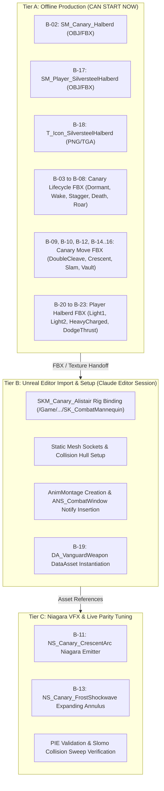
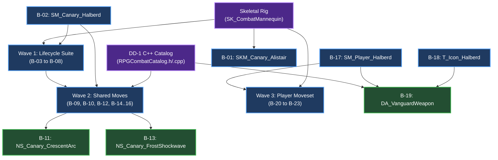

# AG-35: Content Authoring Order & Prerequisite Graph for P8 Canary & Vanguard Halberd

**Document ID:** `AG35_CONTENT_ORDER` (Rev 02)  
**Date:** 2026-10-26  
**Author:** Antigravity (Visual & Technical Animation Investigator)  
**Work Order:** `Docs/BossCombatReview/Execution/TASK_BOARD.md` (Task **A-T6**)  
**Governing Inputs:** [`AG2_CANARY_CONTENT_SPEC.md`](file:///c:/UnrealProject/OneBossFight/Docs/BossCombatReview/Execution/Antigravity/AG2_CANARY_CONTENT_SPEC.md), [`AG9_CONTENT_BACKLOG.md`](file:///c:/UnrealProject/OneBossFight/Docs/BossCombatReview/Execution/Antigravity/AG9_CONTENT_BACKLOG.md), [`AG15_VISUAL_EVIDENCE_COLUMNS.md`](file:///c:/UnrealProject/OneBossFight/Docs/BossCombatReview/Execution/Antigravity/AG15_VISUAL_EVIDENCE_COLUMNS.md)  
**Effort Accounting:** ESTIMATE (planning figures for scheduling, not measured execution timing; per Claude C-143)  
**Target Engine:** Unreal Engine 5.5.4 (`OneBossFight`, packaged 1080p / 60 FPS)

---

## 1. Executive Summary & Purpose

This specification establishes the **production authoring order, dependency hierarchy, and offline readiness analysis** for the 23 content assets comprising the **P8 Canary Boss ("Cinder Knight Alistair")**, the **Silversteel Halberd weapon**, and the **4th Player Build ("Vanguard")**.

### Strategic Objectives:
1. **De-Risk Data-Driven Extensibility Early:** Author assets strictly required to prove data-driven architecture without modifying or contaminating Boss01 (Ember Warden).
2. **Maximize Offline Authoring Velocity:** Identify which assets can be fully authored **offline right now** (Blender FBX synthesis, static mesh geometry, UI icons, animation curves) prior to the formal opening of Phase P1.
3. **Rigorous Dependency Scheduling:** Map asset-to-asset and code-to-asset prerequisites to prevent pipeline stalls during editor integration.
4. **Traceability to Verification Matrix:** Align every authored asset directly to its proof clause in `AG15_VISUAL_EVIDENCE_COLUMNS.md`.

---

## 2. Pre-P1 Workability Analysis: What Can Start Offline Now?

Under the active team constraints, Antigravity operates strictly offline (Blender, Python, static FBX analysis). The 23 assets divide into three distinct production readiness tiers:

```
+----------------------------------------------------------------------------------------------------+
| ASSET READINESS TIERS                                                                              |
+--------------------------+----------+--------------------------------------------------------------+
| Tier                     | Count    | Capability & Constraint Summary                              |
+--------------------------+----------+--------------------------------------------------------------+
| Tier A: Immediate Offline| 15       | Can start right now in Blender/Python without Unreal Editor. |
| Tier B: Editor Import    | 5        | Requires Unreal Editor open session (Claude C-T1/C-T4 owner).|
| Tier C: In-Engine Tuning | 3        | Requires live PIE test driver runs & interactive tuning.     |
+--------------------------+----------+--------------------------------------------------------------+
```

### Detailed Tier Breakdown:



1. **Tier A (15 Assets - 100% Offline Feasible in Blender/Python):**
   - **Static Meshes:** `SM_Canary_Halberd` (B-02) and `SM_Player_SilversteelHalberd` (B-17). Authored in Blender with exact socket origin and length (220 cm; bounds origin along Z-axis).
   - **UI Texture:** `T_Icon_SilversteelHalberd` (B-18). Authored as 256x256 RGBA uncompressed TGA/PNG.
   - **Canary Boss Lifecycle FBX (6 assets):** `AN_Canary_Dormant` (B-03), `AN_Canary_Wake` (B-04), `AN_Canary_Stagger` (B-05), `AN_Canary_Riposte_Victim` (B-06), `AN_Canary_PhaseTransition` (B-07), `AN_Canary_Death` (B-08). Authored against the shared pack mannequin rig (`SK_CombatMannequin`, `import_boss01.py:8`).
   - **Canary Shared Moves FBX (6 assets):** `AN_Canary_M1_DoubleCleave` (B-09), `AN_Canary_M2_CrescentThrow` (B-10), `AN_Canary_M3_FrostSlam` (B-12), `AN_Canary_M4_Vault_Startup` (B-14), `Vault_Success` (B-15), `Vault_Whiff` (B-16).
   - **Player Halberd Moves FBX (4 assets):** `AN_Player_Halberd_Light01` (B-20), `Light02` (B-21), `HeavyCharged` (B-22), `DodgeThrust` (B-23).
2. **Tier B (5 Assets - Editor Import, Setup & Rigging - One-Line Reasons):**
   - `SKM_Canary_Alistair` (B-01): **Editor Reason:** Requires Unreal Editor SkeletalMesh import pipeline to bind skeletal skinning and blend weights to `/Game/AdvancedARPGCombat/Characters/Heroes/Mannequins/Meshes/SK_CombatMannequin`.
   - `SM_Canary_Halberd Socket Binding` (B-02 Setup): **Editor Reason:** Requires Unreal Editor Static Mesh Editor to configure convex collision hulls and add verified physical sockets (`Socket_Shaft_Grip`, `Socket_Blade_Start`, `Socket_Blade_Tip`).
   - `SM_Player_SilversteelHalberd Socket Binding` (B-17 Setup): **Editor Reason:** Requires Unreal Editor Static Mesh Editor to calibrate weapon grip offset and collision queries relative to Greystone player character hands.
   - `AM_Canary_* / AM_Player_* Montages` (B-03..B-10, B-14..B-16, B-20..B-23 Montages): **Editor Reason:** Requires Unreal Editor Animation Editor to composite raw FBX anim sequences into montages and insert typed `ANS_CombatWindow` and `AN_CombatEvent` notify tracks.
   - `DA_VanguardWeapon` (B-19): **Editor Reason:** Requires Unreal Editor DataAsset factory to instantiate the `URPGCombatCatalog` data object, link mesh and montage soft pointers, and serialize into `/Game/OneBossFight/Data/Catalog/`.
3. **Tier C (3 Assets - Niagara VFX & In-Engine Validation - One-Line Reasons):**
   - `NS_Canary_CrescentArc` (B-11): **Editor Reason:** Requires Unreal Editor Niagara System Editor to configure Ribbon/Mesh renderers, spawn velocity curves, and preview particle physics against collision channels.
   - `NS_Canary_FrostShockwave` (B-13): **Editor Reason:** Requires Unreal Editor Niagara System Editor to author expanding annular torus parameters and visually verify 40 cm vertical jump clearance profile.
   - `pie_canary_audit.py` Live Validation: **Editor Reason:** Requires live Unreal Editor PIE session to run Slomo collision sweep probes, evaluate camera readability, and verify hit-box parity against C++ delegates.

---

## 3. Four-Wave Authoring Sequence & Dependency Schedule

To optimize team throughput, authoring is scheduled in four sequential waves. Each wave has strict entry criteria and explicit exit deliverables:

```
+----------------------------------------------------------------------------------------------------+
| FOUR-WAVE PRODUCTION PIPELINE                                                                      |
+------+-----------------------------+--------+------------------+-----------------------------------+
| Wave | Description                 | Assets | Effort Est.      | Blockers & Dependencies           |
+------+-----------------------------+--------+------------------+-----------------------------------+
| W-0  | Headless Geometry & Rigging | 3      | 1.5 Days         | None (Starts immediately offline) |
| W-1  | Canary Lifecycle Suite      | 6      | 3.0 Days         | Depends on W-0 weapon & rig       |
| W-2  | Shared Capability Moves     | 8      | 4.5 Days         | Depends on W-0 & DD-1 C++ Catalog |
| W-3  | Vanguard Player Build Suite | 6      | 3.0 Days         | Depends on W-0 & W-2              |
+------+-----------------------------+--------+------------------+-----------------------------------+
| Total| Complete P8 Canary Suite    | 23     | 12.0 Person-Days |                                   |
+------+-----------------------------+--------+------------------+-----------------------------------+
```

---

### Wave 0: Headless Geometry, Sockets & UI Icons (3 Assets)

* **Primary Objective:** Establish the physical weapon geometries, attachment sockets, and UI textures that anchor all subsequent animation kinematics.
* **Entry Criteria:** None. Authorized immediately.
* **Assets Authored:**
  1. `SM_Canary_Halberd` (B-02): Polearm mesh for boss. Total length $220.0\text{ cm}$. Blade axis $+Z$. Sockets: `Socket_Shaft_Grip`, `Socket_Blade_Start`, `Socket_Blade_Tip`.
  2. `SM_Player_SilversteelHalberd` (B-17): Scaled player version ($195.0\text{ cm}$). Matches Greystone / Mannequin grip bounds.
  3. `T_Icon_SilversteelHalberd` (B-18): 256x256 UI weapon thumbnail conforming to project UI art style.
* **Effort:** Small (1.5 person-days).
* **Deliverable Format:** Clean FBX / PNG binaries stored under `Docs/BossCombatReview/Execution/Antigravity/ContentDrafts/`.

---

### Wave 1: Canary Boss Lifecycle Animation Suite (6 Assets)

* **Primary Objective:** Provide full lifecycle states ensuring the canary boss can spawn, enter dormant state, wake up, break posture, and die cleanly in data-driven tests.
* **Entry Criteria:** Wave 0 weapon mesh completed; target skeleton verified as `SK_CombatMannequin`.
* **Assets Authored:**
  1. `AN_Canary_Dormant` (B-03): Single-frame looping kneeling idle. Halberd tip embedded in stone floor.
  2. `AN_Canary_Wake` (B-04): $1.800\text{ s}$ sequence. Grips halberd with both hands, leverages body upward, blade dislodges with spark arc, settles into neutral guard.
  3. `AN_Canary_Stagger` (B-05): $2.500\text{ s}$ posture collapse. Kneels on left knee, halberd drops to flank, chest visceral socket exposed forward.
  4. `AN_Canary_Riposte_Victim` (B-06): $1.800\text{ s}$ paired reaction to player critical impale.
  5. `AN_Canary_PhaseTransition` (B-07): $2.500\text{ s}$ roar sequence. Heavy foot stomp, weapon thrust toward ceiling, frost-mist blast.
  6. `AN_Canary_Death` (B-08): $3.200\text{ s}$ death collapse. Drops halberd forward, dissolves into ground ash.
* **Effort:** Medium (3.0 person-days).
* **Deliverable Format:** Skeletal animation FBX clips with root motion and bone tracks matching `SK_CombatMannequin`.

---

### Wave 2: Shared Capability Move Suite & Multi-Window Mechanics (8 Assets)

* **Primary Objective:** Provide exact combat attack animations exercising the four required data-driven capability archetypes: Dual-Window Sweep, Projectile Throw, Radial Wave Slam, and Multi-Path Branching.
* **Entry Criteria:** Wave 0 and Wave 1 complete; `URPGCombatCatalog` and `ECombatExecutor` C++ types accepted (DD-1 Step 1).
* **Assets Authored:**
  1. `AN_Canary_M1_DoubleCleave` (B-09): Dual-window cleave. Sweep 1 ($0.400\text{--}0.580\text{ s}$), twirl seam ($0.580\text{--}0.800\text{ s}$), Sweep 2 ($0.800\text{--}1.000\text{ s}$).
  2. `AN_Canary_M2_CrescentThrow` (B-10): Overhead vertical whip launching traveling crescent wave. Release marker at $0.450\text{ s}$.
  3. `NS_Canary_CrescentArc` (B-11): Niagara crescent mesh ribbon with forward velocity vector.
  4. `AN_Canary_M3_FrostSlam` (B-12): Jump slam driving halberd head into stone floor. Impact frame at $0.750\text{ s}$.
  5. `NS_Canary_FrostShockwave` (B-13): Expanding planar ring emitter with explicit $40\text{ cm}$ Z-thickness for jump clearance.
  6. `AN_Canary_M4_Vault_Startup` (B-14): Vault charge running forward using halberd as pole. Branch check at $0.450\text{ s}$.
  7. `AN_Canary_M4_Vault_Success` (B-15): Vault strike landing on player (forward downward crushing cleave).
  8. `AN_Canary_M4_Vault_Whiff` (B-16): Vault miss recovery (boss stumbles forward, halberd overshoots, $800\text{ ms}$ recovery window).
* **Effort:** Medium-Large (4.5 person-days).
* **Verification Hook:** C++ `URPGAttackTracker` multi-window and branch check callbacks.

---

### Wave 3: Vanguard Player Weapon & Combat Moveset Suite (6 Assets)

* **Primary Objective:** Complete the 4th player build ("Vanguard") enabling the player to equip the halberd, execute light combos, charged heavy strikes, and dodge attacks.
* **Entry Criteria:** Wave 0 player weapon mesh complete; Greystone player character mannequin rig confirmed.
* **Assets Authored:**
  1. `DA_VanguardWeapon` (B-19): DataAsset defining weapon reach ($195\text{ cm}$), base damage, stamina costs, and montage table.
  2. `AN_Player_Halberd_Light01` (B-20): Thrust attack. Fast linear poke ($0.250\text{ s}$ active window).
  3. `AN_Player_Halberd_Light02` (B-21): Horizontal sweeping slash chaining from Light01 ($0.300\text{ s}$ active window).
  4. `AN_Player_Halberd_HeavyCharged` (B-22): 2-handed overhead cleave with variable hold ($0.500\text{--}1.200\text{ s}$).
  5. `AN_Player_Halberd_DodgeThrust` (B-23): Post-roll recovery thrust attack.
  6. `SKM_Canary_Alistair` (B-01): Visual mesh skinning pass on humanoid rig (tabard, weathered plate, frost accents).
* **Effort:** Medium (3.0 person-days).

---

## 4. Prerequisite Dependency Graph



---

## 5. Traceability to AG15 Evidence Columns

Every asset delivered under this schedule satisfies explicit verification criteria defined in [`AG15_VISUAL_EVIDENCE_COLUMNS.md`](file:///c:/UnrealProject/OneBossFight/Docs/BossCombatReview/Execution/Antigravity/AG15_VISUAL_EVIDENCE_COLUMNS.md):

| Asset ID | Backlog Asset Name | AG15 Requirement Clause | Verification Capture Methodology | What the Capture Proves |
|---|---|---|---|---|
| **B-01** | `SKM_Canary_Alistair` | `BOSS-AWR-003` (Range/Convention) | `Viewport_HighResShot` | Distinct mesh bounds, root-to-surface distance scaling |
| **B-02** | `SM_Canary_Halberd` | `BOSS-HIT-003` (Interior samples) | `Debug_Overlay_Capture` | $220\text{ cm}$ polearm has Start, Mid, Tip sockets along length |
| **B-04** | `AN_Canary_Wake` | `BOSS-AWR-001` (Target validity) | `PIE_Continuous_Slomo` | Clean transition from dormant hold to awake neutral without tracking glitches |
| **B-05** | `AN_Canary_Stagger` | `BOSS-DEF-003` (Break critical) | `Shipping_Playtest_Capture` | Stance break exposes glowing visceral critical socket for $2.5\text{ s}$ |
| **B-09** | `AN_Canary_M1_DoubleCleave` | `BOSS-HIT-007` (Hit policy) | `PIE_Continuous_Slomo` | Two distinct active windows separated by twirl seam; independent damage events |
| **B-10** | `AN_Canary_M2_CrescentThrow`| `BOSS-ANM-002` (Telegraph release) | `PIE_Continuous_Slomo` | Projectile spawns synchronously with weapon release stroke ($0.450\text{ s}$) |
| **B-11** | `NS_Canary_CrescentArc` | `BOSS-HIT-001` (Geometry danger) | `Debug_Overlay_Capture` | Visual crescent matches collision sweep sphere of projectile actor |
| **B-12** | `AN_Canary_M3_FrostSlam` | `BOSS-HIT-010` (Splash provenance) | `PIE_Continuous_Slomo` | Weapon impact on floor initiates radial ground wave |
| **B-13** | `NS_Canary_FrostShockwave` | `BOSS-HIT-011` (Annulus sweep) | `Shipping_Playtest_Capture` | Expanding ring deals damage once on crossing; clears jumping player ($> 50\text{ cm}$) |
| **B-14..16**| `AN_Canary_M4_Vault_*` | `BOSS-PAC-004` (Branch cues) | `PIE_Continuous_Slomo` | Branch failure leads to Whiff recovery ($800\text{ ms}$ punish); success chains |
| **B-17** | `SM_Player_SilversteelHalberd`| `BOSS-PAC-005` (Punish math) | `PIE_Continuous_Slomo` | Player weapon model confirms hit reach against boss recovery opening |
| **B-20..23**| `AN_Player_Halberd_*` | `BOSS-PAC-005` (Punish math) | `PIE_Continuous_Slomo` | Player light thrust lands within $800\text{ ms}$ boss recovery window |

---

## 6. Deliverable Summary & Task Completion

| Deliverable File | Target Task | Authority | Status |
|---|---|---|---|
| [`AG35_CONTENT_ORDER.md`](file:///c:/UnrealProject/OneBossFight/Docs/BossCombatReview/Execution/Antigravity/AG35_CONTENT_ORDER.md) | **A-T6** | `TASK_BOARD.md` | **COMPLETE** |
