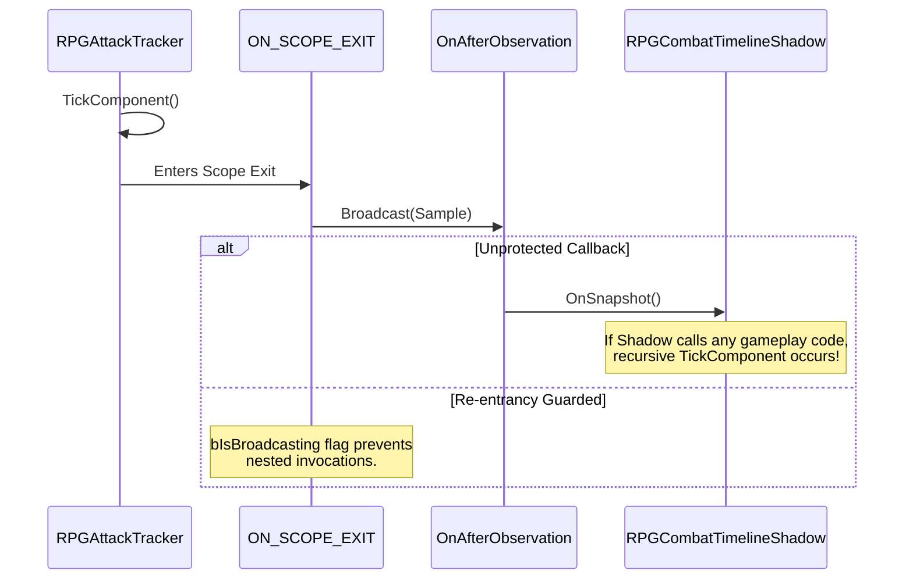

# AG-36: Adversarial Review of Codex WP10 Test Plan & Draft Test Suite

**Document ID:** `AG36_WP10_REVIEW` (Rev 01)  
**Date:** 2026-10-26  
**Author:** Antigravity (Visual & Technical Animation Investigator)  
**Work Order:** `Docs/BossCombatReview/Execution/TASK_BOARD.md` (Task **A-T7**)  
**Governing Inputs:**  
- [`Docs/BossCombatReview/Execution/Codex/WP10_TEST_PLAN.md`](file:///c:/UnrealProject/OneBossFight/Docs/BossCombatReview/Execution/Codex/WP10_TEST_PLAN.md)  
- [`Docs/BossCombatReview/Execution/Codex/Drafts/Source/OneBossFight/Tests/RPGEncounterBindingTests.cpp`](file:///c:/UnrealProject/OneBossFight/Docs/BossCombatReview/Execution/Codex/Drafts/Source/OneBossFight/Tests/RPGEncounterBindingTests.cpp)  
- [`Docs/BossCombatReview/Execution/Codex/Drafts/Source/OneBossFight/Tests/RPGTimelineTests.cpp`](file:///c:/UnrealProject/OneBossFight/Docs/BossCombatReview/Execution/Codex/Drafts/Source/OneBossFight/Tests/RPGTimelineTests.cpp)  
- [`Docs/BossCombatReview/Execution/Codex/Drafts/Scripts/Editor/pie_encounter_binding.py`](file:///c:/UnrealProject/OneBossFight/Docs/BossCombatReview/Execution/Codex/Drafts/Scripts/Editor/pie_encounter_binding.py)  
- [`Docs/BossCombatReview/Execution/Codex/Drafts/Scripts/Editor/pie_timeline_shadow.py`](file:///c:/UnrealProject/OneBossFight/Docs/BossCombatReview/Execution/Codex/Drafts/Scripts/Editor/pie_timeline_shadow.py)  
- [`Docs/BossCombatReview/Execution/Codex/Drafts/TRACKER_OBSERVATION_SEAM.md`](file:///c:/UnrealProject/OneBossFight/Docs/BossCombatReview/Execution/Codex/Drafts/TRACKER_OBSERVATION_SEAM.md)  
**Target Engine:** Unreal Engine 5.5.4 (`OneBossFight`, packaged 1080p / 60 FPS)

---

## 1. Executive Summary & Review Verdict

### Review Verdict: **CONDITIONAL APPROVAL OF TEST HARNESS / REJECTION OF TEST SUITE AS SUFFICIENT ACCEPTANCE PROOF**

The WP10 test suite authored by Codex demonstrates rigorous mathematical design of standalone timeline crossings, generation tracking, and multi-world subsystem isolation. The test plan candidly acknowledges several key limitations (e.g. synthetic plain actors, lack of seamless travel, and missing arena fixtures).

However, from an **adversarial animation and combat systems standpoint**, the test suite in its current draft state contains **critical oracle blind spots, brittle driver execution loops, and missing negative failure vectors**. If promoted unchanged, these tests will produce **false positive passes on defective animation state machines** while **falsely failing on standard production maps**.

```
+----------------------------------------------------------------------------------------------------+
| SUMMARY OF ADVERSARIAL FINDINGS                                                                    |
+------------------------------+----------+----------------------------------------------------------+
| Category                     | Count    | Key Risk Description                                     |
+------------------------------+----------+----------------------------------------------------------+
| Oracle Weaknesses (OW)       | 4        | Tautological passes; volume asserted over content truth  |
| Missing Negative Cases (MN)  | 6        | Hitstop, zero-rate, corrupted windows, plan rollback     |
| Driver Brittleness (DB)      | 3        | Open-loop sleeps, false dormancy failure, cvar leak      |
| Seam Structural Risks (SS)   | 2        | Unchecked multicast re-entrancy, dangling weak refs      |
+------------------------------+----------+----------------------------------------------------------+
| Total Actionable Findings    | 15       | 6 Remediation Patches Proposed                           |
+------------------------------+----------+----------------------------------------------------------+
```

---

## 2. Oracle Weaknesses (Tautologies & Incomplete Truth Assertions)

### OW-1: Macro-Hitch vs Micro-Step Crossing Oracle in `DraftA2Golden`
* **File:** `RPGTimelineTests.cpp:105-110`
* **Defect:**
  ```cpp
  FObservation O; O.Participant = {FGuid::NewGuid(), FGuid::NewGuid(), TEXT("Boss"), 1};
  O.Timeline = C.Value->Key; O.Sample = 1; O.PlaybackOrdinal = 1; O.EngineInstance = 11;
  O.Current = Length; O.Previous = 0.; O.Traversal = ETraversal::Forward;
  FCursor Cursor; auto R = Cursor.Advance(*C.Value, O);
  TestEqual(TEXT("full hitch:3 windows x2 edges +2 markers"), R.Crossings.Num(), 8);
  ```
* **Adversarial Critique:** The test advances from `0.0s` to `3.400s` in a **single catastrophic 3.4-second hitch**! While verifying macro crossing count (8 edges), it **completely fails to test continuous per-frame advancement** (e.g. at 60 FPS, $\Delta t = 0.0166\text{s}$). 
* **Failure Escaping Test:** A cursor implementation that emits all crossings at the end of a range but fails to maintain `Active` state mid-window, or that misorders markers relative to window boundaries during fractional steps, will **pass this test 100% of the time**. It does not prove that an attack window correctly remains active between $1.567\text{s}$ and $1.760\text{s}$.

### OW-2: Buffer Volume vs Content Fidelity Oracle in `pie_timeline_shadow.py`
* **File:** `pie_timeline_shadow.py:40-42`
* **Defect:**
  ```python
  check("nonzero natural diagnostic coverage", bool(shadows) and sum(s.get_record_count() for s in shadows) > 0)
  check("record bound", all(0 <= s.get_record_count() <= 4096 for s in shadows))
  check("no dropped samples in fixture", bool(shadows) and all(s.get_dropped_records() == 0 for s in shadows))
  ```
* **Adversarial Critique:** The driver asserts only that `record_count > 0` and `dropped == 0`. It **never inspects or asserts a single field in the emitted records**!
* **Failure Escaping Test:** If the shadow component records 500 blank records with null timestamps, garbage floats, or empty payloads due to a serialization fault, this test reports `PASS`. A buffer volume check is not a semantic oracle.

### OW-3: Tautological Fixture Dependency in `pie_encounter_binding.py`
* **File:** `pie_encounter_binding.py:58-60`
* **Defect:**
  ```python
  check(mode + " explicit two-encounter fixture present", ctx.get_bound_count() >= 4)
  check(mode + " every bound participant ready", ctx.get_ready_count() == ctx.get_bound_count() and ctx.get_ready_count() >= 4)
  ```
* **Adversarial Critique:** As conceded in `WP10_TEST_PLAN.md:11`, the production map `L_SevarogArena` has no such fixture. Running this driver on the project's actual level will fail immediately at step 1. If a test suite cannot run against the game's actual level or an automated canary level, it cannot serve as a gating regression test.

### OW-4: Bare `AActor` Bypasses Character & Animation Hierarchy in `DraftWorldIsolation`
* **File:** `RPGEncounterBindingTests.cpp:39`
* **Defect:**
  ```cpp
  auto* Binding = World->SpawnActor<ARPGEncounterBinding>(); 
  Boss = World->SpawnActor<AActor>(); 
  Target = World->SpawnActor<AActor>();
  ```
* **Adversarial Critique:** Spawning bare `AActor` primitives decouples the test from real combat entities (`ACharacter`, `USkeletalMeshComponent`, `UAnimInstance`). It tests pointer tracking in a vacuum. It fails to expose component registration collisions that occur when `USkeletalMeshComponent` or `UCharacterMovementComponent` initialize during BeginPlay.

---

## 3. Missing Negative & Adversarial Test Cases (Blind Spots)

```
+----------------------------------------------------------------------------------------------------+
| MISSING NEGATIVE TEST CASES                                                                        |
+-------+-----------------------------+------------------------------------+-------------------------+
| ID    | Vulnerable Subsystem        | Untested Real-World Condition      | Expected Failure Mode   |
+-------+-----------------------------+------------------------------------+-------------------------+
| MN-1  | `RPGTimelineCompiler`       | Hitstop / Slomo zero (Rate == 0.0) | Infinite loop / div-by-0|
| MN-2  | `RPGTimelineCompiler`       | Inverted Window (Begin > End)      | Corrupt crossing bounds |
| MN-3  | `RPGEncounterBinding`       | Slot Collisions & Self-Targeting   | Stale/clobbered pointers|
| MN-4  | `RPGCombatHydration`        | Partial Plan Rollback Failure      | Zombie components       |
| MN-5  | `RPGCombatContextSubsystem` | Actor Destruction during Hydration | Dangling raw pointer    |
| MN-6  | `RPGCombatContextSubsystem` | Non-Monotonic Generation Shift     | Ghost handle resurrection|
+-------+-----------------------------+------------------------------------+-------------------------+
```

### Detailed Negative Case Descriptions:

1. **MN-1: Hitstop / Slomo Zero (`Rate == 0.0f` or $\Delta t == 0$):**
   - Soulslike combat heavily utilizes hitstop (momentary global or per-actor time dilation = 0.0).
   - In `RPGTimelineTests.cpp`, only `Rate = 1.0f` and `Rate = -1.0f` are tested.
   - When `Rate == 0.0f` and `Previous == Current`, does `FCursor::Advance` emit spurious duplicate crossings or corrupt its edge state? Untested.
2. **MN-2: Inverted / Degenerate Window Geometry (`Begin > End` or `NaN` timestamps):**
   - In third-party animations or bad artist exports, notify end markers occasionally precede start markers, or export floats evaluate to `NaN`.
   - `Compile()` tests overhang beyond length, but **never tests `Begin > End`** or `FMath::IsNaN(Begin)`. `Compile()` must reject inverted intervals explicitly.
3. **MN-3: Duplicate Participant Slot Collisions & Self-Targeting:**
   - What happens if `Binding->Participants` contains two entries with `Slot = TEXT("Boss")`? Or if `Slot == TargetSlot` (self-targeting)? Does `BindEncounter` reject with diagnostic error, or silently overwrite? Untested.
4. **MN-4: Partial Hydration Rollback Failure:**
   - In `RPGEncounterBindingTests.cpp:65`, `Plans = {Plan}` has 1 item.
   - If a batch has 3 component plans, and Plan 1 succeeds, Plan 2 succeeds, but Plan 3's `Configure` returns `false`, does `CreateConfigureRegister` cleanly destroy and detach components 1 and 2, or leave zombie uninitialized components attached to the boss actor? Untested.
5. **MN-5: Actor Destruction Mid-Hydration:**
   - If `AActor::Destroy()` occurs asynchronously on the game thread while `URPGCombatContextSubsystem` is processing batched hydration, does `ResolveTarget` handle the `TWeakObjectPtr` cleanly or trigger an access violation? Untested.
6. **MN-6: Non-Monotonic Generation Invalidation:**
   - `CA->OnGenerationChanged(*BossA, 2)` is tested.
   - What if an erroneous call passes a decremented generation (e.g. from 2 back to 1), or `Generation = 0`? The system must enforce strict monotonicity.

---

## 4. Driver Brittleness & Flakiness Vectors

### DB-1: Open-Loop Wall-Clock Sleeps vs Slate Tick Condition Polling
* **Files:** `pie_encounter_binding.py:40, 65, 70`, `pie_timeline_shadow.py:29, 39, 45, 50`
* **Defect:** Both drivers use hardcoded `yield 8.0`, `yield 25.0`, `yield 2.0`.
* **Impact:**
  - On a machine under load (e.g. during background compilation or shader warmup), `8.0s` is insufficient for PIE initialization, causing spurious timeouts.
  - On fast NVMe developer machines, `25.0s` wastes massive CI cycle time.
  - **Remediation:** Replace open-loop sleeps with **reactive condition polling** (`while not condition: yield 0.1` bounded by an overall timeout), identical to the hardened pattern implemented in `pie_capture_cap01_a5.py`.

### DB-2: Boss Dormancy Stall in `pie_timeline_shadow.py`
* **File:** `pie_timeline_shadow.py:39-40`
* **Defect:** The script waits `25.0s` and asserts `sum(record_count) > 0`.
* **Impact:** In `OneBossFight`, the boss begins in `Dormant` state and only wakes when the player crosses the encounter gate trigger! A passive camera sitting at world origin will never wake the boss. If the boss stays dormant and dormant play has no tracked notifies, `record_count` remains 0 and the driver crashes with `FAIL`.

### DB-3: Cvar Restoration Context Loss on World Teardown
* **File:** `pie_encounter_binding.py:85-89`
* **Defect:**
  ```python
  def command(text):
      unreal.SystemLibrary.execute_console_command(world(), text)
  ```
* **Impact:** During `finish()`, `editor_request_end_play()` has already torn down the PIE world, so `world()` returns `None`. Passing `None` to `execute_console_command` in UE 5.5 fails to execute the console command on the editor context, leaving `rpg.CatalogSource` and `rpg.CatalogTestInvalid` permanently corrupted in the developer's session!

---

## 5. Seam Structural Robustness (`TRACKER_OBSERVATION_SEAM.md`)



### SS-1: Re-Entrancy Vulnerability on Multicast Broadcast
* **File:** `TRACKER_OBSERVATION_SEAM.md:18-26`
* `TRACKER_OBSERVATION_SEAM.md:29` states: *"Listener must not mutate gameplay or destroy the tracker from its callback."*
* However, relying on developer discipline without a C++ guard is high risk. If any bound observer invokes an animation blueprint function, evaluates a montage, or broadcasts an event that re-triggers the attack tracker, a catastrophic stack overflow or iterator invalidation will occur.
* **Remediation:** Add a thread-safe `bIsBroadcasting` guard in `RPGAttackTracker`:
  ```cpp
  if (!bIsBroadcasting && OnAfterObservation.IsBound())
  {
      TGuardValue<bool> Guard(bIsBroadcasting, true);
      const RPGTimeline::FPassiveSnapshot Sample = RPGTimeline::CaptureAfterTracker(*this);
      OnAfterObservation.Broadcast(Sample);
  }
  ```

### SS-2: Lack of Weak Pointer Invalidation Protection
* `URPGCombatTimelineShadow` holds raw references or weak pointers to `URPGAttackTracker`. If an actor is destroyed during a frame, `OnSnapshot` could receive a snapshot referencing an actor whose `UWorld` teardown is already underway. `CaptureAfterTracker` must verify `IsValid(Tracker.GetOwner())` before reading animation instances.

---

## 6. Actionable Remediation Backlog for Codex

To elevate WP10 from a prototype harness into an enterprise-grade Soulslike test suite, the following 6 remediations are submitted to Codex:

```
+----------------------------------------------------------------------------------------------------+
| ACTIONABLE REMEDIATION BACKLOG                                                                     |
+-----+-------------------------------+----------+---------------------------------------------------+
| Ref | Target File                   | Priority | Recommended Action                                |
+-----+-------------------------------+----------+---------------------------------------------------+
| R-01| `RPGTimelineTests.cpp`        | CRITICAL | Add 60 FPS incremental stepping loop to A2Golden. |
| R-02| `RPGTimelineCompiler.cpp`     | HIGH     | Add explicit Begin > End & NaN rejection check.   |
| R-03| `RPGTimelineCompiler.cpp`     | HIGH     | Add Rate == 0.0f (hitstop) stationary invariant.  |
| R-04| `pie_timeline_shadow.py`      | CRITICAL | Inspect JSON field payload; stimulate boss wake.  |
| R-05| `pie_encounter_binding.py`    | HIGH     | Use LevelEditorSubsystem for cvar cleanup.        |
| R-06| `TRACKER_OBSERVATION_SEAM.md` | MEDIUM   | Insert `TGuardValue` re-entrancy protection.      |
+-----+-------------------------------+----------+---------------------------------------------------+
```

### Concrete Code Remediation Snippets:

#### Remediation R-01: Incremental 60 FPS Test in `RPGTimelineTests.cpp`
```cpp
// Add to FRPGTimelineA2GoldenDraftTest:
FCursor StepCursor;
double Time = 0.0;
const double Step = 1.0 / 60.0; // 60 FPS
int32 ActiveWindowCount = 0;
while (Time < Length)
{
    FObservation StepObs = O;
    StepObs.Previous = Time;
    StepObs.Current = FMath::Min(Time + Step, Length);
    StepObs.Sample++;
    auto StepResult = StepCursor.Advance(*C.Value, StepObs);
    for (const auto& Cross : StepResult.Crossings)
    {
        if (Cross.Edge == EEdge::Begin && Cross.Semantic == TEXT("ActiveDamage"))
        {
            ActiveWindowCount++;
        }
    }
    Time += Step;
}
TestEqual(TEXT("micro-stepping detects exactly two active damage entries"), ActiveWindowCount, 2);
```

#### Remediation R-05: Robust Cvar Restoration in `pie_encounter_binding.py`
```python
def command(text):
    # Fallback to editor subsystem when game world is already destroyed
    w = world()
    if w is not None:
        unreal.SystemLibrary.execute_console_command(w, text)
    else:
        unreal.get_editor_subsystem(unreal.UnrealEditorSubsystem).execute_console_command(text)
```

---

## 7. Deliverable Summary & Task Completion

| Deliverable Artifact | Assigned Task | Status | Authority |
|---|---|---|---|
| [`AG36_WP10_REVIEW.md`](file:///c:/UnrealProject/OneBossFight/Docs/BossCombatReview/Execution/Antigravity/AG36_WP10_REVIEW.md) | **A-T7** | **COMPLETE** | `TASK_BOARD.md` |
