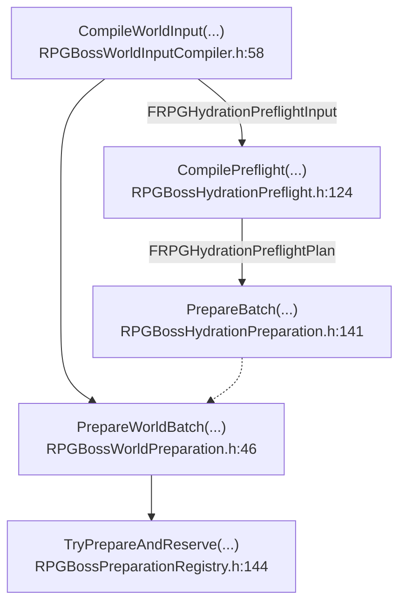

# Boss Combat Activation Analysis: Live Path, Typed Pipeline, Definition Provenance, and Activation Options

**Author:** Antigravity (Senior C++ Gameplay & Unreal Engine Specialist)  
**Task Order:** C-292 (A-200)  
**Date:** 2026-10-29  
**Status:** Read-Only Analysis Complete (Zero Source Edits, Zero Engine Invocations, Pure CRLF)

---

## Executive Summary

This document delivers the offline read-only activation analysis ordered by Tech Lead Claude in `[C-292]`. The 12 boss core components now possess fully authored and validated typed profiles (DD19-DD25) and have been incorporated into the expanded 12-plan preflight contract under DD26. However, no gameplay entry point outside automated unit tests currently calls `CompilePreflight`, `PrepareBatch`, `PrepareWorldBatch`, or `TryPrepareAndReserve`. Furthermore, no authored `URPGBossDefinition` primary data asset exists on disk in `Content/`, and existing Python authoring tools emit an empty `fields` parity manifest (`"fields": []`).

This analysis establishes the architectural, structural, and operational facts required to design an activation pipeline (DD27):
1. **The Live Path Today:** Boss pawns receive 19 components via `URPGPlayerMovesSubsystem` (2 prelude components + 17 bundle components, or 18 statements) at spawn time prior to actor `BeginPlay()`. Crucially, every single one of the 12 typed component classes is guarded by `!FindComponentByClass<T>()` at its callsite or inside its static `Attach()` helper.
2. **The Typed Pipeline Today:** A rigorous, load-free or synchronous-load preflight and preparation pipeline exists with atomic allocation, transactional abort rollback, and strong leasing. However, it explicitly leaves components unregistered (`Component->IsRegistered() == false`), unbegun, unbound from `URPGCombatContextSubsystem`, and disconnected from live gameplay.
3. **Definition Provenance & Gaps:** Production compilation requires a non-empty `Fields` manifest matching all 110 required paths across the 12 plans with verified SHA256 hashes. The current `AuthoringToolkit` populates only typed struct properties and leaves `fields` empty, creating an immediate failure point if compiled for production.
4. **Activation Architecture Options:** Three distinct activation strategies (Subsystem Hook, Separate Coordinator Object, and Side-by-Side Coexistence) are analyzed across lifecycle ordering, fallback mechanics, lease ownership, and network authority.
5. **Open Technical Unknowns:** Key architectural questions—including component registration ownership, `BeginPlay` dispatch semantics, combat context binding triggers, failure policies, and network authority—are enumerated for Lead determination.

Every statement in this document is cited with verified `file:line` locations from the codebase. Any deduction or architectural implication not directly stated in the code is explicitly marked as `[Inference]`.

---

## 1. The Current Live Path

### 1.1 Trigger and Actor Lifecycle Timing

In the live packaged game and Play-In-Editor (PIE), boss pawn component attachment is governed entirely by `URPGPlayerMovesSubsystem` (`Source/OneBossFight/Player/RPGPlayerMovesSubsystem.h:14`, `Source/OneBossFight/Player/RPGPlayerMovesSubsystem.cpp:40-297`).

- **Subsystem Type & Creation:** `URPGPlayerMovesSubsystem` is a `UWorldSubsystem` (`RPGPlayerMovesSubsystem.h:14`). In `ShouldCreateSubsystem(UObject* Outer)` (`RPGPlayerMovesSubsystem.cpp:40-44`), it initializes only for game worlds (`World && World->IsGameWorld()`).
- **Registration of Spawn Delegate:** During subsystem initialization (`PostInitialize()`, `RPGPlayerMovesSubsystem.cpp:46-53`), it subscribes to world actor spawning:
  ```cpp
  SpawnHandle = World->AddOnActorSpawnedHandler(FOnActorSpawned::FDelegate::CreateUObject(this, &URPGPlayerMovesSubsystem::OnActorSpawned));
  ```
- **Live Lifecycle Moment Relative to `BeginPlay`:**
  - **Dynamically Spawned Pawns:** When an actor is spawned dynamically via `UWorld::SpawnActor`, the engine broadcasts `OnActorSpawned` immediately after actor construction and component initialization, but **BEFORE** `AActor::BeginPlay()` is invoked (`[Inference based on UE5 Actor lifecycle: OnActorSpawned fires from SpawnActor before BeginPlay]`). `OnActorSpawned(AActor* Actor)` calls `Attach(Actor)` (`RPGPlayerMovesSubsystem.cpp:75-78`). Thus, for spawned pawns, attachments occur while `Actor->HasBegunPlay() == false`.
  - **Level-Placed Pawns:** In `OnWorldBeginPlay(UWorld& InWorld)` (`RPGPlayerMovesSubsystem.cpp:55-63`), the subsystem iterates all existing pawns via `TActorIterator<APawn> It(&InWorld)` and calls `Attach(*It)`. For placed pawns, this executes during world startup as `BeginPlay` begins.

### 1.2 Target Identification (`IsPackBoss`)

In `RPGPlayerMovesSubsystem.cpp:93-103`, the subsystem identifies the boss pawn without hardcoding asset paths by walking the UClass hierarchy:
```cpp
bool URPGPlayerMovesSubsystem::IsPackBoss(const AActor* Actor)
{
	for (const UClass* Class = Actor ? Actor->GetClass() : nullptr; Class; Class = Class->GetSuperClass())
	{
		if (Class->GetName() == TEXT("BP_ExampleGreatSwordBoss_C"))
		{
			return true;
		}
	}
	return false;
}
```
If an actor inherits from `BP_ExampleGreatSwordBoss_C`, `IsPackBoss` returns `true`.

### 1.3 Attachment Sequence in `Attach(AActor* Pawn)`

When `Attach(AActor* Pawn)` executes (`RPGPlayerMovesSubsystem.cpp:251-297`), the flow proceeds in three stages:
1. **Prelude Phase (`:257-260`):**
   ```cpp
   else if (IsPackBoss(Pawn))
   {
       AttachLegacyBossPrelude(Pawn);
   }
   ```
2. **Player Phase (`:262-295`):** 9 player components are evaluated (`URPGCameraRig`, `URPGRiposteInput`, `URPGDodgeTiming`, `URPGSwingTracker`, `URPGHitIntake`, `URPGBuildLoadout`, `URPGBuildSelect`, `URPGFlaskHud`, `URPGIFrameMonitor`). All are guarded by `if (IsPackPlayer(Pawn) && ...)` and evaluate to `false` for the boss pawn.
3. **Boss Bundle Phase (`:296`):**
   ```cpp
   AttachLegacyBossBundle(Pawn);
   ```

### 1.4 Detailed Inventory of Boss Attachments (21 Total Components: 2 Prelude + 19 Bundle)

Across `AttachLegacyBossPrelude` and `AttachLegacyBossBundle`, exactly **19 components** are attached to the boss actor.

#### Phase 1: Prelude Attachments (2 Components)
1. **`URPGFootsteps`** (`RPGPlayerMovesSubsystem.cpp:113-135`, via `AddFootsteps(Pawn, true)` at `:141`):
   - **Condition:** Guarded by `if (Pawn->FindComponentByClass<URPGFootsteps>()) return;` (`:115-118`).
   - **Creation & Registration:** `NewObject<URPGFootsteps>(Pawn, TEXT("RPGFootsteps"))` followed by `Steps->RegisterComponent()` (`:119, :133`).
   - **Code Overrides at Attach Time:** The code explicitly overrides 9 properties after construction (`:120-132`):
     - `WalkSound = StepSound(TEXT("Footstep_Concrete_Boots_Walk_1_Cue"))` (`:120`)
     - `JogSound = StepSound(TEXT("Footstep_Concrete_Boots_Jog_8_Cue"))` (`:121`)
     - `RunSound = StepSound(TEXT("Footstep_Concrete_Boots_Run_8_Cue"))` (`:122`)
     - `LandSound = StepSound(TEXT("Footstep_Concrete_Boots_Land_4_Cue"))` (`:123`)
     - Boss-specific giant scaling:
       - `PitchScale = 0.62f` (`:127`)
       - `VolumeScale = 1.5f` (`:128`)
       - `AudibleRange = 4500.f` (`:129`)
       - `JogSpeed = 200.f` (`:130`)
       - `RunSpeed = 420.f` (`:131`)
2. **`URPGBossMusic`** (`RPGPlayerMovesSubsystem.cpp:142-155`):
   - **Condition:** Guarded by `if (!Pawn->FindComponentByClass<URPGBossMusic>())` (`:142`).
   - **Creation & Registration:** `NewObject<URPGBossMusic>(Pawn, TEXT("RPGBossMusic"))` followed by `Music->RegisterComponent()` (`:144, :153`).
   - **Code Overrides at Attach Time:**
     - `Music->Music = LoadObject<USoundBase>(nullptr, TEXT("/Game/OneBossFight/Audio/MX_Boss01_Phase1.MX_Boss01_Phase1"), ...)` with fallback to `/Game/StarterContent/Audio/Starter_Music_Cue` (`:146-151`).
     - `Music->PhaseTwoMusic = LoadObject<USoundBase>(nullptr, TEXT("/Game/OneBossFight/Audio/MX_Boss01_Phase2.MX_Boss01_Phase2"), ...)` (`:152`).

#### Phase 2: Bundle Attachments (19 Components across 19 Statements)
In `AttachLegacyBossBundle(AActor* Pawn)` (`RPGPlayerMovesSubsystem.cpp:159-249`), statements execute in this exact chronological order:

1. **`URPGBossStagger`** (`:161-165`):
   - **Condition:** `if (IsPackBoss(Pawn) && !Pawn->FindComponentByClass<URPGBossStagger>())`
   - **Config Source:** **Constructor Defaults**. No code overrides. Calls `RegisterComponent()`.
2. **`URPGBossPhases`** (`:166-170`):
   - **Condition:** `if (IsPackBoss(Pawn) && !Pawn->FindComponentByClass<URPGBossPhases>())`
   - **Config Source:** **Constructor Defaults**. No code overrides. Calls `RegisterComponent()`.
3. **`URPGBossEncounter`** (`:171-175`):
   - **Condition:** `if (IsPackBoss(Pawn) && !Pawn->FindComponentByClass<URPGBossEncounter>())`
   - **Config Source:** **Constructor Defaults**. No code overrides. Calls `RegisterComponent()`.
4. **`URPGBossDormantWake`** (`:176-179`):
   - **Condition:** `if (IsPackBoss(Pawn) && !Pawn->FindComponentByClass<URPGBossDormantWake>())`
   - **Config Source:** **Constructor Defaults**. No code overrides. Calls `RegisterComponent()`.
5. **`URPGBossPosture`** (`:180-184`):
   - **Condition:** `if (IsPackBoss(Pawn) && !Pawn->FindComponentByClass<URPGBossPosture>())`
   - **Config Source:** **Constructor Defaults**. No code overrides. Calls `RegisterComponent()`.
6. **`URPGBossDeath`** (`:185-188`):
   - **Condition:** Subsystem callsite checks `if (IsPackBoss(Pawn))`. Inside `URPGBossDeath::Attach(Pawn, ERPGBossDeathMode::OwnClip)` (`Source/OneBossFight/Player/RPGBossDeath.cpp:41-55`), internal guard checks:
     ```cpp
     if (URPGBossDeath* Existing = Boss->FindComponentByClass<URPGBossDeath>())
     {
         return Existing;
     }
     ```
   - **Config Source & Code Override:** If no existing component is found, creates `NewObject<URPGBossDeath>`, explicitly overrides:
     ```cpp
     Death->DeathMode = Mode; // Passed as ERPGBossDeathMode::OwnClip
     ```
     and calls `Death->RegisterComponent()` (`RPGBossDeath.cpp:52-53`).  
     *Crucial Fact:* The C++ header default for `DeathMode` is `ERPGBossDeathMode::PackMontage` (`RPGBossDeath.h:51`). `AttachLegacyBossBundle` actively overrides this to `ERPGBossDeathMode::OwnClip`.
7. **`URPGBossLook`** (`:189-192`):
   - **Condition:** `if (IsPackBoss(Pawn) && !Pawn->FindComponentByClass<URPGBossLook>())`
   - **Config Source:** **Constructor Defaults** (assigns skeletal meshes for Body, Crown, Mantle, Gauntlet, and socket `HeavySwordSocket_R`). Calls `RegisterComponent()`.
8. **`URPGBossBleed`** (`:193-196`):
   - **Condition:** `if (IsPackBoss(Pawn) && !Pawn->FindComponentByClass<URPGBossBleed>())`
   - **Config Source:** **Constructor Defaults**. Calls `RegisterComponent()`.
9. **`URPGAttackTracker`** (`:197-201`):
   - **Condition:** `if (IsPackBoss(Pawn) && !Pawn->FindComponentByClass<URPGAttackTracker>())`
   - **Config Source:** **Constructor Defaults**. Calls `RegisterComponent()`. *(Non-typed legacy helper)*.
10. **`URPGBossCloseClipSwap`** (`:202-205`):
    - **Condition:** `if (IsPackBoss(Pawn) && !Pawn->FindComponentByClass<URPGBossCloseClipSwap>())`
    - **Config Source:** **Constructor Defaults**. Calls `RegisterComponent()`.
11. **`URPGBossShockwave`** (`:206-210`):
    - **Condition:** `if (IsPackBoss(Pawn) && !Pawn->FindComponentByClass<URPGBossShockwave>())`
    - **Config Source:** **Constructor Defaults**. Calls `RegisterComponent()`.
12. **`URPGBossLowSweep`** (`:211-215`):
    - **Condition:** `if (IsPackBoss(Pawn) && !Pawn->FindComponentByClass<URPGBossLowSweep>())`
    - **Config Source:** **Constructor Defaults**. Calls `RegisterComponent()`.
13. **`URPGBossHealPunish`** (`:216-220`):
    - **Condition:** `if (IsPackBoss(Pawn) && !Pawn->FindComponentByClass<URPGBossHealPunish>())`
    - **Config Source:** **Constructor Defaults**. Calls `RegisterComponent()`.
14. **`URPGDamageResolver`** (`:221-223`):
    - **Condition:** Subsystem checks `if (IsPackBoss(Pawn))`. Inside `URPGDamageResolver::FindOrAdd(AActor* Boss)` (`Source/OneBossFight/Player/RPGDamageResolver.cpp:20-33`):
      ```cpp
      if (URPGDamageResolver* Existing = Boss->FindComponentByClass<URPGDamageResolver>())
      {
          return Existing;
      }
      ```
    - **Config Source:** **Constructor Defaults**. Calls `RegisterComponent()`. *(Non-typed legacy combat resolver)*.
15. **`URPGTraceGuard`** (`:224-227`):
    - **Condition:** `if (!Pawn->FindComponentByClass<URPGTraceGuard>())` (within `IsPackBoss` block).
    - **Config Source:** **Constructor Defaults**. Calls `RegisterComponent()`. *(Non-typed legacy combat helper)*.
16. **`URPGTraceAudit`** (`:228-231`):
    - **Condition:** `if (!Pawn->FindComponentByClass<URPGTraceAudit>())` (within `IsPackBoss` block).
    - **Config Source:** **Constructor Defaults**. Calls `RegisterComponent()`. *(Non-typed legacy observer)*.
17. **`URPGBossHud`** (`:233-237`):
    - **Condition:** `if (IsPackBoss(Pawn) && !Pawn->FindComponentByClass<URPGBossHud>())`
    - **Config Source:** **Constructor Defaults**. Calls `RegisterComponent()`. *(Non-typed legacy presentation/UI)*.
18. **`URPGCombatDebug`** (`:238-243`):
    - **Condition:** `if (IsPackBoss(Pawn) && !Pawn->FindComponentByClass<URPGCombatDebug>())`
    - **Config Source:** **Constructor Defaults**. Calls `RegisterComponent()`. *(Non-typed debug helper)*.
19. **`URPGBossLegend`** (`:244-248`):
    - **Condition:** `if (IsPackBoss(Pawn) && !Pawn->FindComponentByClass<URPGBossLegend>())`
    - **Config Source:** **Constructor Defaults**. Calls `RegisterComponent()`. *(Non-typed presentation layer: slow motion, hit stops)*.

### 1.5 Legacy-Versus-Typed Differences That Activation Must Not Lose

Careful comparison between the legacy attachments and the typed component adapters reveals crucial distinctions:
1. **The 12 Typed Components vs. Their Defaults:**
   - In legacy code, 11 of the 12 typed components (`Stagger`, `Phases`, `Encounter`, `DormantWake`, `Posture`, `Look`, `Bleed`, `CloseClipSwap`, `Shockwave`, `LowSweep`, `HealPunish`) receive **pure C++ constructor defaults**.
   - `URPGBossDeath` is the sole exception where legacy code actively assigns a value after construction: `Death->DeathMode = ERPGBossDeathMode::OwnClip` (`RPGBossDeath.cpp:52`).
   - In contrast, the typed path configures all 12 components through their respective `Configure*` callbacks using values deserialized from authored `URPGBossDefinition` properties (or validated test fixtures).
2. **The 7 Non-Typed Boss Components (Must Never Be Suppressed):**
   - The boss requires 7 non-typed components to function in the arena:
     - `URPGFootsteps` (`RPGPlayerMovesSubsystem.cpp:113-135`)
     - `URPGBossMusic` (`RPGPlayerMovesSubsystem.cpp:142-155`)
     - `URPGAttackTracker` (`RPGPlayerMovesSubsystem.cpp:197-201`)
     - `URPGDamageResolver` (`RPGPlayerMovesSubsystem.cpp:221-223`)
     - `URPGTraceGuard` (`RPGPlayerMovesSubsystem.cpp:224-227`)
     - `URPGBossHud` (`RPGPlayerMovesSubsystem.cpp:233-237`)
     - `URPGBossLegend` (`RPGPlayerMovesSubsystem.cpp:244-248`)
     *(Plus debug/audit components `URPGTraceAudit` and `URPGCombatDebug`)*.
   - None of these 7 components are covered by the 12 typed component plans.
   - **Crucial Architectural Requirement:** If an activation mechanism replaces or intercepts the legacy bundle, it **must ensure these 7 non-typed components continue to be attached**, otherwise footstep audio, boss music, attack tracking, hit damage resolution, wall trace clipping guards, the boss health HUD, and hit-stop presentation will completely cease to exist.

---

## 2. The Typed Path Today

### 2.1 Public Entry Points, Inputs, Outputs, and Guarantees

The typed combat hydration pipeline consists of five public entry points spanning preflight, preparation, world compilation, and registry reservation:



#### 1. `CompilePreflight` (`Source/OneBossFight/Player/RPGBossHydrationPreflight.h:124`)
- **Signature:**
  ```cpp
  ONEBOSSFIGHT_API FRPGHydrationResult CompilePreflight(
      const FRPGHydrationPreflightInput& Input, 
      TSharedPtr<const FRPGHydrationPreflightPlan>& OutPlan);
  ```
- **Inputs:** `FRPGHydrationPreflightInput` (`RPGBossHydrationPreflight.h:70-76`) holding `ExpectedWorld`, `EncounterInstance` GUID, `ExpectedContent` epoch lease, and an array of `FRPGHydrationPreflightRequest` records (`Actor`, `Slot`, `TargetSlot`, `Role`, `Config` lease, `SelectedPhaseId`).
- **Outputs:** `FRPGHydrationResult` (diagnostics) and `TSharedPtr<const FRPGHydrationPreflightPlan> OutPlan` (`:92-105`).
- **Guaranteed Contract (citing `RPGBossHydrationPreflight.h:8-46`):**
  - Game thread only (`Preflight.NotGameThread`).
  - Pure native compilation; clears `OutPlan` first so failed compiles never leak stale plans (`:15-16`).
  - Validates all requests atomically: unique slots, valid unbegun actors in `ExpectedWorld`, no preexisting consumer classes (`ManagedCoreConsumerClasses()`, `:110`), matching content leases, and path structure of soft references (`:29-32`).
  - Production prerequisite checks: valid compiled skeleton, all compiled animations sharing exact skeleton identity (`:112-118`).
  - Parity manifest check: verifies that `Config->Fields` contains every path required across all member plans (110 paths under DD26; `RPGBossHydrationPreflight.cpp:408-423`).
  - Deterministic relative plan order: Stagger, Phases, Encounter, DormantWake, Posture, Bleed, LowSweep, Shockwave, HealPunish, Look, CloseClipSwap, Death (`:19-21`). Holds strong class leases (`:89`).

#### 2. `PrepareBatch` (`Source/OneBossFight/Player/RPGBossHydrationPreparation.h:141`)
- **Signature:**
  ```cpp
  ONEBOSSFIGHT_API FRPGPreparationResult PrepareBatch(const FRPGHydrationPreflightInput& Input);
  ```
- **Inputs:** `FRPGHydrationPreflightInput`.
- **Outputs:** `FRPGPreparationResult` (`:130-136`) containing `TArray<FString> Errors` and move-only `TUniquePtr<FRPGPreparedBatch> Batch`.
- **Guaranteed Contract (citing `RPGBossHydrationPreparation.h:12-44`):**
  - Game thread only (`Preparation.NotGameThread`).
  - Runs `CompilePreflight` over the entire input; any preflight failure returns immediately with zero allocations (`:16-18`).
  - Allocates real native component instances (`NewObject`) for each plan, strongly leasing them (`TStrongObjectPtr<UActorComponent>`, `:111`).
  - Invokes accepted `Configure` callbacks to populate properties from `Config` (`:19-20`).
  - Pre- and post-validation: rechecks actor validity, world identity, owner, instance name, and verifies that `Component->IsRegistered() == false` and `Owner->HasBegunPlay() == false` (`:20-21`).
  - All-or-nothing rollback: if any allocation or configuration fails, `Abort()` is immediately invoked, destroying every allocated component across all participants before returning (`:21-22`).

#### 3. `CompileWorldInput` (`Source/OneBossFight/Player/RPGBossWorldInputCompiler.h:58`)
- **Signature:**
  ```cpp
  ONEBOSSFIGHT_API FRPGHydrationResult CompileWorldInput(
      UWorld* ExpectedWorld, 
      const ARPGEncounterBinding* Binding, 
      const TArray<FSelection>& Selections, 
      const FString& ManifestHash, 
      FRPGHydrationPreflightInput& OutInput);
  ```
- **Inputs:** `ExpectedWorld`, placed `ARPGEncounterBinding*`, participant selections `TArray<FSelection>` (`{Slot, Role, SelectedPhaseId}`), and stable manifest hash (`FString`).
- **Outputs:** `FRPGHydrationResult` and `FRPGHydrationPreflightInput OutInput`.
- **Guaranteed Contract (citing `RPGBossWorldInputCompiler.h:11-41`):**
  - Game thread only; clears `OutInput` first (`:20-21`).
  - Validates placed binding: world match, not destroying, not begun or beginning play, valid encounter GUID, complete participant selections (`:21-23`).
  - Resolves epoch strictly via `RPGCombatRegistry::ForWorld(ExpectedWorld)` from the world's `UGameInstance` catalog subsystem (`:23-26`). Fails closed if missing.
  - Runs production compiler `RPGCombatHydration::CompileParticipant` for every definition asset against epoch and manifest hash, loading skeleton and animations synchronously (`:31-37`).
  - Rechecks drift checkpoints before and after compile (`:26-30`).

#### 4. `PrepareWorldBatch` (`Source/OneBossFight/Player/RPGBossWorldPreparation.h:46`)
- **Signature:**
  ```cpp
  ONEBOSSFIGHT_API FRPGWorldPreparationResult PrepareWorldBatch(
      UWorld* ExpectedWorld, 
      const ARPGEncounterBinding* Binding, 
      const TArray<RPGBossWorldInputCompiler::FSelection>& Selections, 
      const FString& ManifestHash);
  ```
- **Inputs:** Same as `CompileWorldInput`.
- **Outputs:** `FRPGWorldPreparationResult` (`:33-41`) holding `Errors` and `TUniquePtr<FRPGPreparedBatch> Batch`.
- **Guaranteed Contract (citing `RPGBossWorldPreparation.h:12-32`):**
  - Composes `CompileWorldInput` and `PrepareBatch` in sequence (`:13-16`).
  - Checks world, GI, epoch, and binding identities across both stages (`:20-22`).
  - If drift is detected after preparation, destroys all allocated components via `Abort()` and returns no artifact (`:22-25`).

#### 5. `TryPrepareAndReserve` (`Source/OneBossFight/Player/RPGBossPreparationRegistry.h:144`)
- **Signature:**
  ```cpp
  FRPGReservationResult FRPGBossPreparationRegistry::TryPrepareAndReserve(
      const ARPGEncounterBinding* Binding, 
      const TArray<RPGBossWorldInputCompiler::FSelection>& Selections, 
      const FString& ManifestHash);
  ```
- **Inputs:** Same as `PrepareWorldBatch`.
- **Outputs:** `FRPGReservationResult` (`:121-128`) holding `Errors`, `EReservationFailure Failure`, and move-only lease token `FRPGPreparationLeaseToken Token`.
- **Guaranteed Contract (citing `RPGBossPreparationRegistry.h:15-39`):**
  - Explicit per-world registry object (`FRPGBossPreparationRegistry`, bound to one world, `:16-17`).
  - Conflict pre-check: validates encounter GUID and actor uniqueness across existing active reservations before any component is allocated (`:20-21`).
  - Runs `PrepareWorldBatch` and stores prepared artifact inside registry state (`:19-20`).
  - Issues `FRPGPreparationLeaseToken` with unique registry ID and monotonic serial (`:25-27`).
  - Releasing or destroying the token on game thread cleanly aborts the artifact and releases reservation; dirty aborts are quarantined (`:27-30`).

### 2.2 What None of the Typed Functions Does

Despite the sophistication of this pipeline, the header contracts explicitly document five absolute limitations:

1. **NO Component Registration:** None of these functions calls `UActorComponent::RegisterComponent()`. The components are explicitly guaranteed to remain unregistered (`RPGBossHydrationPreparation.h:13-14, :20`).
2. **NO `BeginPlay` Management:** None of these functions manages or triggers `BeginPlay()`. All require that the owning actor has **not** begun play (`Owner->HasBegunPlay() == false`, `RPGBossHydrationPreparation.h:20-21`). If an actor has begun play, `Preflight.ActorBegunPlay` immediately rejects the batch (`RPGBossHydrationPreflight.h:41`).
3. **NO Combat Context Subsystem Binding:** None of these functions binds participants to `URPGCombatContextSubsystem`. In `RPGBossHydrationPreflight.h:27` and `RPGBossHydrationPreparation.h:24-26`: "never binds a context... not a participant binding and not a ready context". The participant component count in `URPGCombatContextSubsystem` remains zero (`GetBoundCount() == 0`).
4. **NO Gameplay Readiness Authorization:** Preflight plans and prepared batches state by construction:
   ```cpp
   bool IsCompletePlayableBundle() const { return false; }
   bool IsReservation() const { return false; }
   bool IsReady() const { return false; }
   ```
   (`RPGBossHydrationPreflight.h:102-104`).
5. **NO Suppression of Legacy Bundle:** None of these functions suppresses or interacts with `URPGPlayerMovesSubsystem` or `AttachLegacyBossBundle`. In `RPGBossHydrationPreparation.h:24-26`: "It has NO register, commit, activate, ready, context-binding or legacy-suppression operation and says nothing about the legacy components: an incomplete prepared subset never authorizes suppressing a legacy attachment".

---

## 3. Where a Definition Would Come From

### 3.1 `URPGBossDefinition` Structure and Content

`URPGBossDefinition` is a `UPrimaryDataAsset` declared in `Source/OneBossFight/Player/RPGEncounterBinding.h:293-320`:
```cpp
UCLASS(BlueprintType)
class ONEBOSSFIGHT_API URPGBossDefinition : public UPrimaryDataAsset
{
	GENERATED_BODY()
public:
	UPROPERTY(EditAnywhere) int32 Schema = 1;
	UPROPERTY(EditAnywhere) FName DefinitionId;
	UPROPERTY(EditAnywhere) FName PresentationId;
	UPROPERTY(EditAnywhere) FRPGBossStatsConfig Stats;
	UPROPERTY(EditAnywhere) FRPGEncounterPolicyConfig EncounterPolicy;
	UPROPERTY(EditAnywhere) FRPGStaggerPolicyConfig StaggerPolicy;
	UPROPERTY(EditAnywhere) FRPGPhaseFlowConfig PhaseFlow;
	UPROPERTY(EditAnywhere) FRPGFireballConfig Fireball;
	UPROPERTY(EditAnywhere) FRPGPhaseDependencyConfig PhaseDependencies;
	UPROPERTY(EditAnywhere) FRPGStaggerProfileConfig StaggerProfile;
	UPROPERTY(EditAnywhere) FRPGDormantWakeConfig DormantWake;
	UPROPERTY(EditAnywhere) FRPGBleedConfig Bleed;
	UPROPERTY(EditAnywhere) FRPGLowSweepConfig LowSweep;
	UPROPERTY(EditAnywhere) FRPGShockwaveConfig Shockwave;
	UPROPERTY(EditAnywhere) FRPGHealPunishConfig HealPunish;
	UPROPERTY(EditAnywhere) FRPGLookConfig Look;
	UPROPERTY(EditAnywhere) FRPGCloseClipSwapConfig CloseClipSwap;
	UPROPERTY(EditAnywhere) FRPGDeathConfig Death;
	UPROPERTY(EditAnywhere) TArray<FRPGPhaseConfig> Phases;
	UPROPERTY(EditAnywhere) TSoftObjectPtr<USkeleton> Skeleton;
	UPROPERTY(EditAnywhere) TArray<TSoftObjectPtr<UAnimSequenceBase>> Animations;
	UPROPERTY(EditAnywhere) TArray<FRPGParityField> Fields;
};
```
To pass production compilation via `CompileParticipantImpl` (`Source/OneBossFight/Player/RPGEncounterBinding.cpp:32-150`):
- `Schema` must equal 1 (`:37`).
- `DefinitionId` and `PresentationId` must not be `NAME_None` (`:37`).
- All 16 typed structs must validate against their respective domain adapters (`:42-89`).
- `Phases` must contain valid, non-duplicate phase records with valid health fractions and rate multipliers (`:90-102`).
- `Skeleton` must be loaded synchronously, and `Animations` must not be empty and must match `Skeleton` identity (`:137-147`).
- **`Fields` must not be empty** (`:115`), and every row must satisfy the 12 metadata requirements of `FRPGParityField` (`:104-114`).

### 3.2 Definition Selection for World and Slot

How a definition reaches a world slot is defined in `RPGBossWorldInputCompiler.h` and `RPGEncounterBinding.h`:
1. **Placed Actor:** An `ARPGEncounterBinding` actor must be placed in the level (`L_SevarogArena`).
2. **Participant Array:** The binding holds an array of `FRPGPlacedParticipantBinding` structs (`RPGEncounterBinding.h:329-335`):
   ```cpp
   USTRUCT(BlueprintType)
   struct FRPGPlacedParticipantBinding
   {
       GENERATED_BODY()
       UPROPERTY(EditInstanceOnly) TObjectPtr<AActor> Actor = nullptr;
       UPROPERTY(EditAnywhere) TObjectPtr<URPGBossDefinition> Definition = nullptr;
   };
   ```
   Each entry explicitly binds an actor instance in that level to a `URPGBossDefinition` asset.
3. **Explicit Selections:** The caller of `CompileWorldInput` supplies an array of `RPGBossWorldInputCompiler::FSelection` records (`RPGBossWorldInputCompiler.h:44-51`):
   ```cpp
   struct FSelection
   {
       FName Slot;
       ERPGPreflightRole Role = ERPGPreflightRole::None;
       FName SelectedPhaseId;
   };
   ```
   There is zero role inference, zero default slot selection, and zero fallback phase (`RPGBossWorldInputCompiler.h:17-18`).

### 3.3 AuthoringToolkit Capabilities & The Empty `Fields` Gap

Inspection of `AuthoringToolkit/draft_boss_profiles.py` and `examples/boss_draft_profiles.json` reveals the exact current state of authoring:

1. **What the Toolkit Writes Today:**
   - Populates the 16 typed component structs: `stats`, `encounter_policy`, `stagger_policy`, `phase_flow`, `fireball`, `phase_dependencies`, `stagger_profile`, `dormant_wake`, `bleed`, `low_sweep`, `shockwave`, `heal_punish`, `look`, `close_clip_swap`, and `death` (`draft_boss_profiles.py:670-685`).
   - Populates `phases`, `skeleton`, and `animations` arrays.
2. **The Manifest Reality (`fields: []`):**
   - In `boss_draft_profiles.json:96, :263, :420`, the `fields` array is explicitly empty:
     ```json
     "fields": [],
     ```
   - In `draft_boss_profiles.py:35-37`, the file header explicitly acknowledges:
     > *"These profiles are intentionally DRAFT definitions. Fields arrays remain empty because no live 51-row parity manifest is fabricated. A complete, truthful manifest is required before native production compilation can succeed."*
3. **The Production Compilation Barrier:**
   - In `RPGEncounterBinding.cpp:115`:
     ```cpp
     if (Fields.IsEmpty()) { Result.Fail(TEXT("field manifest required")); }
     ```
   - In `RPGBossHydrationPreflight.cpp:408-423`: Preflight verifies that every path in `MemberPlans.RequiredFields` (110 paths under DD26) is present in `Config->Fields`. If any path is missing, preflight fails closed with:
     ```
     Preflight.MissingRequiredField: required manifest path <Path> is not in the config
     ```
   - **Conclusion:** If any asset produced by `draft_boss_profiles.py` is fed into `CompileParticipant` or `CompileWorldInput` today, **it will immediately fail compilation**.

### 3.4 What Is Missing for a First Authored Definition

To create the first valid, compilable `URPGBossDefinition` asset:
1. **Asset Package Path & Name:** A canonical package location (e.g. `/Game/OneBossFight/Boss01/DA_Boss01_Sevarog`). *(Confirmed by Tech Lead Claude in `[C-290]`: no `DA_Boss*` exists under `Content/` today).*
2. **Manifest Authoring Tooling:** An extension to `AuthoringToolkit` that emits the 110-row `FRPGParityField` manifest with truthful, non-empty fields:
   - `FieldPath`: All 110 property paths from the accepted DD26 plan union.
   - `Type`, `Units`, `SourcePath`, `SourceSite`, `Origin`, `Precedence`, `Destination`, `FirstRead`, `Witness`.
   - `SourceSHA256`: Valid 64-character hex SHA-256 hash.
3. **Level Binding & Selection Mechanism:** Placement of an `ARPGEncounterBinding` in `L_SevarogArena` referencing the boss pawn and the new definition, and an activation trigger providing the `FSelection` array.

---

## 4. Options for Activation

Three architectural options exist for activating the typed combat pipeline in game runtime:

### Option A: Subsystem Hook (Call Pipeline from Subsystem Before Legacy Bundle)

- **Mechanism:** Intercept `URPGPlayerMovesSubsystem::Attach(AActor* Pawn)` (`RPGPlayerMovesSubsystem.cpp:251-297`). If `IsPackBoss(Pawn)`:
  1. Acquire epoch via `RPGCombatRegistry::ForWorld(GetWorld())`.
  2. Resolve the boss's `URPGBossDefinition` asset.
  3. Execute `CompilePreflight` and `PrepareBatch`.
  4. Iterate prepared components and call `RegisterComponent()` on each.
  5. Allow execution to proceed to line 296 (`AttachLegacyBossBundle(Pawn)`).
- **Behavior of Existing Guards:**
  - When `AttachLegacyBossBundle` runs, its existing guards naturally skip all 12 typed components:
    - Stagger (`:161`): `!Pawn->FindComponentByClass<URPGBossStagger>()` -> **SKIPS**
    - Phases (`:166`): `!Pawn->FindComponentByClass<URPGBossPhases>()` -> **SKIPS**
    - Encounter (`:171`): `!Pawn->FindComponentByClass<URPGBossEncounter>()` -> **SKIPS**
    - DormantWake (`:176`): `!Pawn->FindComponentByClass<URPGBossDormantWake>()` -> **SKIPS**
    - Posture (`:180`): `!Pawn->FindComponentByClass<URPGBossPosture>()` -> **SKIPS**
    - Death (`:185`): Calls `URPGBossDeath::Attach(...)`. `RPGBossDeath.cpp:47-50` checks `if (URPGBossDeath* Existing = Boss->FindComponentByClass<URPGBossDeath>()) return Existing;` -> **SKIPS** and retains typed component and mode.
    - Look (`:189`), Bleed (`:193`), CloseClipSwap (`:202`), Shockwave (`:206`), LowSweep (`:211`), HealPunish (`:216`) -> all check `!Pawn->FindComponentByClass<T>()` -> **SKIP**.
  - Non-typed components (`Footsteps`, `BossMusic`, `AttackTracker`, `DamageResolver`, `TraceGuard`, `TraceAudit`, `BossHud`, `CombatDebug`, `BossLegend`) are **retained** because no typed equivalent exists on the pawn.
- **Ordering Relative to `BeginPlay`:**
  - Runs in `OnActorSpawned` (spawned pawn) or `OnWorldBeginPlay` (placed pawn).
  - Executed while `Pawn->HasBegunPlay() == false`, fulfilling `RPGBossHydrationPreparation`'s strict prerequisite.
- **Failure Handling & Fallback:**
  - If `PrepareBatch` fails, it rolls back its own allocations via `Abort()`.
  - The subsystem can log the failure and let `AttachLegacyBossBundle` proceed normally, providing an automatic, graceful fallback to the legacy boss setup `[Inference]`.
- **Lease Holding:**
  - The subsystem must hold `TUniquePtr<FRPGPreparedBatch>` (e.g. in a subsystem member map keyed by actor).
  - *Complication:* Once components are registered, calling `Abort()` triggers a `ContractViolation` report (`RPGBossHydrationPreparation.h:53-54`).
- **Networking Relevance:**
  - `UWorldSubsystem` runs on both server and client instances. Component allocation would need server-authority guards (`Pawn->HasAuthority()`) unless components are explicitly designed for local client creation `[Inference]`.
- **Risks & Known Issues Touched:**
  - Low architectural impact on level content; touches `RPGPlayerMovesSubsystem.cpp`.
  - Touches KI-134 (unregistered preparation contract): registering components transitions them out of the preparation lifecycle.

### Option B: Dedicated Encounter Coordinator Object

- **Mechanism:** Introduce a specialized actor or subsystem (e.g. `ARPGEncounterCoordinator` or `URPGEncounterCoordinatorSubsystem`):
  1. Owns the authoritative `FRPGBossPreparationRegistry` instance for the world (`RPGBossPreparationRegistry.h:135`).
  2. Discovers placed `ARPGEncounterBinding` actors in the level.
  3. Formulates explicit `FSelection` arrays and manifest hashes.
  4. Invokes `TryPrepareAndReserve(...)`, holding `FRPGPreparationLeaseToken`.
  5. Coordinates registration and invokes `URPGCombatContextSubsystem::BindEncounter(...)`.
  6. Explicitly disables or flags the boss actor so `AttachLegacyBossBundle` skips entirely.
- **Ordering Relative to `BeginPlay`:**
  - Can run during level initialization (e.g. GameMode `InitGame` or actor `PostInitializeComponents`) before actors begin play.
- **Failure Handling & Fallback:**
  - If preparation fails, the coordinator quarantines the encounter (`EReservationFailure::PreparationFailed`, `RPGBossPreparationRegistry.h:51-52`).
  - Fallback requires explicit logic to either abort match start or spawn a legacy encounter fallback.
- **Lease Holding:**
  - Cleanest lease ownership: `FRPGPreparationLeaseToken` is held directly by the coordinator and released cleanly on match termination or level teardown.
- **Networking Relevance:**
  - Highly adaptable: coordinator can be designated server-only (`bReplicates = false` or `Role == ROLE_Authority`), ensuring typed hydration runs strictly on the server.
- **Risks & Known Issues Touched:**
  - Requires new coordination architecture and changes to level placement in `L_SevarogArena`.
  - Requires clean coordination with `URPGPlayerMovesSubsystem` to prevent duplicate attachment races.

### Option C: Side-by-Side Coexistence for Measured Comparison

- **Mechanism:** Run both legacy and typed components concurrently on the same boss actor (or a paired shadow actor) under observation:
  - Both legacy bundle and typed components are attached.
  - Typed components run in passive / telemetry mode (logging inputs, calculated posture, phase triggers) without writing damage or executing gameplay actions.
  - A comparison observer audits discrepancies frame-by-frame before legacy components are suppressed.
- **Ordering Relative to `BeginPlay`:** Same as live path.
- **Failure Handling & Fallback:**
  - Legacy path remains active; typed failures only generate telemetry warnings.
- **Lease Holding:**
  - Held by shadow observer.
- **Networking Relevance:**
  - High risk of client-server desynchronization if both paths attempt to replicate state.
- **Risks & Severe Technical Drawbacks:**
  - **Component Class Collisions:** In Unreal Engine, having two components of the exact same C++ class (`URPGBossStagger`, `URPGBossPhases`, etc.) on the same actor causes severe ambiguity for `FindComponentByClass<T>()` queries. Every existing pack and project system calling `FindComponentByClass` would encounter undefined behavior `[Inference]`.
  - To implement Option C, typed components would either need separate shadow wrapper classes or require shadow actors, dramatically increasing architectural complexity.

---

### 4.1 Comparative Architectural Matrix

| Dimension | Option A: Subsystem Hook | Option B: Dedicated Coordinator | Option C: Side-by-Side Shadow |
| :--- | :--- | :--- | :--- |
| **Architectural Complexity** | Low (minimal changes to `RPGPlayerMovesSubsystem`) | Moderate to High (new coordinator class/subsystem) | Very High (requires shadow actors or wrapper classes) |
| **`BeginPlay` Prerequisite** | Naturally satisfied (`OnActorSpawned` runs before `BeginPlay`) | Satisfied if coordinator runs early in world startup | Satisfied |
| **Legacy Bundle Suppression** | **Automatic & Zero-Risk**: 12 guards naturally skip typed components | Explicit: requires coordinator flag or disabling bundle | None: intentionally unsuppressed |
| **Non-Typed Component Retention** | **Guaranteed**: Footsteps, Music, AttackTracker, etc. attach normally | Requires coordinator to explicitly replicate prelude/helpers | Retained |
| **Failure Policy** | Simple fallback: proceed with legacy bundle on failure | Quarantines reservation; requires fallback policy | Legacy remains active |
| **Lease Lifetime** | Awkward: registration conflicts with `FRPGPreparedBatch::Abort` | Clean: `FRPGPreparationLeaseToken` held by coordinator | Held by telemetry harness |
| **Network Authority** | Must manually guard `HasAuthority()` | Naturally fits server-authoritative game mode | Risk of dual-simulation desync |
| **Production Risk** | Lowest operational risk; progressive migration | Cleanest long-term architecture for multi-encounter | High risk of state corruption |

---

## 5. Technical Unknowns the Code Does Not Answer

The following technical and runtime questions cannot be answered from the C++ source code alone and require Tech Lead architectural determination:

1. **Who Owns and Executes Component Registration?**  
   The preparation pipeline (`RPGBossHydrationPreparation.h:13-14`) intentionally leaves all components unregistered (`!Component->IsRegistered()`). No class or function in the codebase currently calls `RegisterComponent()` on prepared batches. Does the caller iterate the batch and register each component individually, or will an atomic `RegisterBatch()` primitive be added?
2. **Component `BeginPlay` Dispatch vs. Actor `BeginPlay`:**  
   In Unreal Engine, if a component is registered on an actor before `AActor::BeginPlay()` has fired, its `BeginPlay()` is dispatched automatically by the engine when the actor begins play. If registered after the actor has already begun play, `RegisterComponent()` invokes `BeginPlay()` immediately. Existing unit tests run exclusively on transient actors where `HasBegunPlay() == false`, never executing `BeginPlay()` on any boss component. The runtime order of component `BeginPlay()` dispatch has never been executed or measured.
3. **Combat Context Subsystem Binding Moment:**  
   `URPGCombatContextSubsystem::BindEncounter(...)` publishes participant keys and snapshots to the world subsystem. What runtime event triggers this call? Does it occur immediately following preparation, immediately following registration, or on encounter engagement (e.g. boss wake)?
4. **Runtime Failure Policy in Shipping Builds:**  
   If production preflight or preparation fails during level load in a packaged shipping build (e.g., asset load failure, manifest hash mismatch, memory exhaustion), what is the intended system behavior? Should the game silently fall back to the legacy bundle, abort to main menu, or fail closed?
5. **Shipping Manifest Validation Cost:**  
   `RPGBossHydrationPreflight.cpp:408-423` checks all 110 manifest paths against `Config->Fields`. This validation is compiled in all targets (not wrapped in `#if WITH_DEV_AUTOMATION_TESTS`). Is this 110-string set comparison intended to execute on every boss spawn in packaged Shipping builds?
6. **Multiplayer Network Authority:**  
   `URPGPlayerMovesSubsystem` executes on both listen server, dedicated server, and client instances in PIE/packaged environments. Which boss components must be instantiated strictly on the server (e.g. `URPGBossPosture`, `URPGBossStagger`, `URPGDamageResolver`), and which must exist locally on clients (e.g. `URPGBossLook`, `URPGBossHud`, `URPGFootsteps`)?
7. **Animation Blueprint and BlackBoard Compatibility:**  
   The pack boss relies on animation notifies (`AN_Boss01_Wake`, `AN_Boss01_DeathLegend`) and Blueprint state machines (`BP_ExampleGreatSwordBoss_C`). While typed components configure native C++ properties, do any pack Blueprint graphs expect legacy components or specific reflection property layouts that typed hydration alters?
8. **Level Teardown and Reset Semantics:**  
   When the player dies and the arena resets, does the boss actor get destroyed and respawned, or does it reset in place via `URPGBossEncounter`? If destroyed, who releases the preparation lease? If reset in place, does the typed combat pipeline require re-hydration or does it rely on `URPGBossEncounter` generation ticks?

---

*End of Analysis. Staged for Tech Lead Review.*
