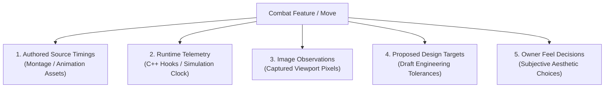
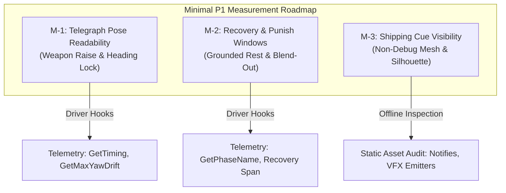

# P1 Presentation & Readability Design Evidence Brief

**Document ID:** `P1_DESIGN_EVIDENCE_BRIEF`  
**Date:** 2026-10-26  
**Author:** Antigravity (Visual & Technical Animation Investigator)  
**Work Order:** `Docs/BossCombatReview/Execution/CODEX_LEAD_WORK_ORDER_02.md` (Task **A-L2**)  
**Governing Documents:**  
- Requirements: [`06_REFERENCE_REQUIREMENTS.md`](file:///c:/UnrealProject/OneBossFight/Docs/BossCombatReview/Reference/06_REFERENCE_REQUIREMENTS.md) (83-Row Reference Matrix)  
- Prior Technical Specifications: [`AG3_TELEGRAPH_READABILITY_SPEC.md`](file:///c:/UnrealProject/OneBossFight/Docs/BossCombatReview/Execution/Antigravity/AG3_TELEGRAPH_READABILITY_SPEC.md), [`AG31_CAPTURE_VERDICT_TABLE.md`](file:///c:/UnrealProject/OneBossFight/Docs/BossCombatReview/Execution/Antigravity/AG31_CAPTURE_VERDICT_TABLE.md), [`AG32_P1_ACCEPTANCE_ASSERTIONS.md`](file:///c:/UnrealProject/OneBossFight/Docs/BossCombatReview/Execution/Antigravity/AG32_P1_ACCEPTANCE_ASSERTIONS.md)  
- Primary Engine Evidence: `Claude/Evidence/E-007_CAP01_A5_release_timing.md`, `Claude/Evidence/E-008_CAP02_A4_query_vs_visible_blade.md`, `Claude/Evidence/E-009_combat_pack_review.md`, `Claude/Evidence/E-011_pack_facts.md`

---

## 1. Executive Summary & Epistemological Boundaries

This brief establishes the **evidence baseline and measurement roadmap for Phase 1 (P1: Telegraph & Readability Improvements)** under the direction of Technical Lead Codex (`[X-155]`).

### Strict Governance Rules (CODEX_LEAD_WORK_ORDER_02):
1. **Design Only Authorized:** The Owner decision (`"Do what is necessary"`, chat 2026-10-26) and Codex Lead order authorize P1 **design and measurement planning only**. No gameplay, balance, defense, or timing changes are authorized in code.
2. **Zero Content / Config Mutation:** No assets (FBX, montages, Niagara, materials, textures, audio) and no configuration files (`DefaultGame.ini`, cvars) are created or edited.
3. **Parked Status of CAP-01:** Visual release sync for A5 Javelin remains officially **`PARKED AS UNVERIFIED`** per Owner decision, Claude (`[C-165]`), and Codex (`[X-152]`). Telemetry numbers stand; camera framing experiments remain closed.
4. **Epistemological Discipline:**
   - **No Invented Facts:** Contact tolerances, human-reaction numbers, adaptive AI models, and difficulty curves are never stated as factual requirements unless anchored in the frozen baseline.
   - **Strict Categorization:** Source timings, runtime telemetry, image observations, proposed targets, and owner feel decisions are rigorously separated.

---

## 2. Traceability Matrix: 83-Row Presentation & Readability Requirements

The 83 master reference requirements (`06_REFERENCE_REQUIREMENTS.md`) govern the Boss Combat Improvement Program. The table below isolates all requirements directly addressing **presentation, animation tracking, telegraph readability, pacing clarity, and visual feedback**:

| 83-Row ID | Feature Name | Requirement Intent & Presentation Criterion | Current Evidence & Sources | Current Uncertainty / Knowledge Gap | P1 Scope Classification |
|---|---|---|---|---|---|
| **BOSS-ANM-001** | Montage timeline authority | Commit, active, gate, armor, and recovery derive from montage timeline rather than duplicate unlinked timers. | `URPGAttackTracker.cpp:124` extracts montage boundaries; `E-007:5` confirms tracker reads position directly. | Play-rate scaling (0.75x / 1.25x) impact on visual cue readability unmeasured. | **Core P1 Telemetry** |
| **BOSS-ANM-002** | Telegraph phases | Pose, direction, and release cues precede damage and clearly identify danger geometry. | `AG3:68` (A1 telegraph), `AG3:90` (A2 telegraph), `E-008:10` (A4 sweep raise). | Real camera visibility under dynamic player strafing / close proximity unverified. | **Core P1 Visual** |
| **BOSS-ANM-003** | Bounded holds | Variable delays have declared min/max; chosen before commit with reliable release cues. | `AG31:69` notes A2 slam apex hold. | Pack boss currently lacks multi-hold variance; timing is fixed in animation clip. | **P1 Design / P3 AI** |
| **BOSS-ANM-004** | Staged rotation cap | Early/late/active/recovery stages enforce per-move turn limits (heading freeze at commit). | `URPGAttackTracker::GetMaxYawDriftAfterCommit()` implemented (`RPGAttackTracker.h:175`); `E-011` confirms pack turn-in-place live. | Drift tolerance threshold ($\le 2.0^\circ$) is a PROPOSED target awaiting Owner feel review. | **Core P1 Tracking** |
| **BOSS-PAC-001** | Explicit attack segments | Every move declares anticipation, hold, commit, active, follow-through, recovery, and neutral boundaries. | `URPGAttackTracker::GetPhaseName()` emits Windup, Committed, Active, Recovery (`RPGAttackTracker.cpp:213`). | Follow-through vs recovery blend-out boundaries not individually isolated in pack montages. | **Core P1 Telemetry** |
| **BOSS-PAC-003** | Guaranteed openings | High-commitment moves have unconditionally meaningful, punishable recovery. | CAP-06 draft addresses A2 heavy slam rest; `AG31:85` notes rest duration. | Master design freeze contains NO SOURCE for nominal punish duration (classified as Owner feel decision). | **Core P1 Feel** |
| **BOSS-PAC-004** | Conditional opening cues | Follow-up-capable recoveries visually reveal branch gates/outcomes consistently. | Pack combo structure documented in `E-009`; A1 into A1b combo gate. | Whether weapon glow / stance shift signals branch readiness in Shipping without debug shapes is unmeasured. | **P1 Visual / P2 Combo** |
| **BOSS-PAC-005** | Punish-margin calculation | Opening classification includes player travel, startup, and safety buffer, not montage recovery alone. | `AG3:68-95` outlines travel/reaction formulas. | Player sprint-to-attack startup times across 3 builds not profiled against boss recovery. | **P1 Design / P4 Defense** |
| **BOSS-HIT-001** | Geometry fidelity | Collision volume matches visible thrust, sweep, slam, ring, lane, or grab. | `E-008:10` proves 68cm reach mismatch on A4 Low Sweep ($380\text{ cm}$ query vs $312\text{ cm}$ blade). | Tip trajectory envelope vs query capsule delta across full swing arc unmapped. | **P1 Visual / P4 Hit** |
| **BOSS-HIT-011** | Swept annulus | Radial waves test previous-to-current radius band; damage each victim once. | `AG4_SHOCKWAVE_CUE_SPEC.md` documents A6 shockwave geometry. | Annulus propagation speed vs visual Niagara ring speed synchronization unmeasured in PIE. | **P1 Visual / P4 Hit** |
| **BOSS-QA-006** | Camera / readability | Boss target point, camera collision, and framing keep release cues and weapon threats visible. | CAP-01/02/05/06 camera trials; Run 10 revealed wall occlusion outside arena bounds ($Y=817\text{ cm}$). | Camera pitch/distance response when player is pinned against exterior arena mesh. | **Core P1 Camera** |
| **BOSS-QA-007** | Accessible feedback | Non-color-only audiovisual cues preserve attack distinctions under reduced visual settings. | `AG3:110-140` specifies dual silhouette + motion cues for A1-A6. | Pure silhouette readability without emission/VFX materials unverified in Shipping. | **P1 Accessibility** |

---

## 3. Evidence Categorization & Deconstruction

To maintain technical honesty, evidence across the combat inventory (Moves A1–A6) is deconstructed into five mutually exclusive categories:

### 3.1 Authored Source & Notify Timings (Frozen Baseline)
These values are extracted directly from imported animation montages and C++ code:
- **A1 Overhead Slash (`AN_Boss01_A1`):** Total duration $1.933\text{ s}$ (`AG3:66`). Authored windup position: $0.330\text{ s}$. Active window: $[0.330\text{ s}, 0.500\text{ s}]$. Follow-through/Recovery: $[0.500\text{ s}, 1.933\text{ s}]$.
- **A2 Heavy Slam (`AN_Boss01_A2_Slam`):** Total duration $2.167\text{ s}$ (`BENCHMARK_RULES["CAP-06"]`). Contains vertical raise, apex hold, downward stroke, and grounded weapon rest.
- **A4 Low Sweep (`AN_Boss01_A4_LowSweep`):** Total duration $2.533\text{ s}$ (`E-008:10`). Montage active window start: $0.609\text{ s}$ (12 ticks in notify). Active window end: $0.879\text{ s}$. Duration: $0.270\text{ s}$.
- **A5 Javelin Release (`AN_Boss01_A5_Javelin`):** Total duration $2.433\text{ s}$ (`E-007:5`). Sidecar author intent marker: $0.400\text{ s}$ (frame 12 @ 30fps).
- **A6 Ground Shockwave (`AN_Boss01_A3_Shockwave`):** Total duration $2.200\text{ s}$ (`AG4:45`). Impact event marker: $0.733\text{ s}$.

### 3.2 Runtime Telemetry (Live C++ Measurements)
These values represent programmatic readbacks via `URPGAttackTracker` during PIE execution:
- **A5 Code Active Window:** Opens at $0.450\text{ s}$ (`URPGAttackTracker`, `E-007:5`). Sampled runtime projectile spawn: $0.470\text{ s}$ (`E-007:3`). Nominal code delay relative to authored intent: $+0.050\text{ s}$ (1.0 frame @ 20fps). Sampled code delay: $+0.070\text{ s}$ (1.4 frames @ 20fps).
- **A4 Query Geometry:** `RPGBossLowSweep` query reach parameter: $380.0\text{ cm}$ (`E-008:7`). Active sweep query executed via shape trace in `URPGAttackTracker`.
- **Boss Yaw Locking:** `URPGAttackTracker::GetCommittedYaw()` locks rotation at commitment point; `GetMaxYawDriftAfterCommit()` measures post-commit deviation (`RPGAttackTracker.h:175`).

### 3.3 Image Observations (Direct Visual Evidence)
Visual measurements derived from offline pixel analysis (`capture_analysis.py`) of real viewport captures:
- **CAP-02 (A4 Low Sweep):** 16 frames captured. Visible blade tip achieves maximum reach of $312.0\text{ cm}$ at $t=0.855\text{ s}$ (`E-008:10`). Physical blade dips at or below floor level during intervals $[0.730\text{ s}, 0.807\text{ s}]$ and $[0.903\text{ s}, 1.025\text{ s}]$ (`E-008:12`). Geometric discrepancy: query reach extends $68.0\text{ cm}$ beyond physical mesh tip.
- **CAP-06 (A2 Recovery):** 16 frames captured. Blade grounded rest verified visually; inter-phase MAD progression confirmed between Active and Recovery phases.
- **CAP-01 (A5 Visual Sync):** **PARKED AS UNVERIFIED.** Viewport capture attempts (Run 10) produced blank/black frames due to camera placement outside arena perimeter geometry ($Y=817\text{ cm}$). Telemetry stands; visual release pose remains unobserved.

### 3.4 Proposed Design Targets (Draft Engineering Standards)
Tolerances proposed by Antigravity for automated gate verification, subject to technical review:
- **Commitment Position Frame Tolerance:** $\pm 33.3\text{ ms}$ (1 frame @ 30fps) for telegraph commit points.
- **Post-Commit Yaw Stability:** Peak drift $\le 2.0^\circ$ after commitment point across all melee attacks.
- **Visual Progression Floor:** Mean Absolute Difference $\text{MAD} \ge 1.5$ between animation phases to reject frozen visual buffers.
- **Inter-Frame Simulation Step:** $\Delta t_{\text{sim}} \ge 20.0\text{ ms}$ to prevent duplicate same-tick frame bursts.

### 3.5 Owner Feel Decisions (Subjective Design Choices)
These parameters have **NO SOURCE in the master design freeze** and represent gameplay feel decisions rather than engineering defects:
1. **A1 Reaction Lead Time:** Is $300.0\text{ ms}$ from neutral idle sufficient reaction lead for standard human visual response? (`AG3:68`).
2. **A2 Apex Hold Floor:** Should the heavy overhead slam guarantee a minimum unreactable telegraph floor of $\ge 400.0\text{ ms}$ before descending? (`AG31:69`).
3. **A2 Punish Opening Window:** Should the blade grounded rest duration guarantee a minimum vulnerable window of $\ge 800.0\text{ ms}$ for heavy player punish attacks? (`AG31:85`).
4. **A4 Low Sweep Reach Envelope:** Should the $68\text{ cm}$ query overreach be preserved as a difficulty buffer (capsule radius clearance), or trimmed to match the $312\text{ cm}$ visible blade mesh? (`E-008:10`).
5. **A4 Jump Counterplay Height:** Is a vertical clearance of $Z > 50\text{ cm}$ the desired threshold for dodging the sweep via jumping? (`AG3:177`).
6. **A5 Visual vs Code Offset:** Does the $50\text{ ms}$ nominal ($70\text{ ms}$ sampled) offset between hand release and projectile spawn produce any perceptible visual mismatch during combat? (`E-007:7`, `D06B:40`).

---

## 4. Priority Minimal Measurements Plan

To avoid unnecessary editor cycles and prevent scope creep, P1 measurements are prioritized into minimal, high-yield verification packages:

### 4.1 Measurement M-1: Telegraph Pose Readability & Heading Lock
- **Objective:** Verify that telegraph cues are visually readable and heading locks before damage frames commence (`BOSS-ANM-002`, `BOSS-ANM-004`, `BOSS-PAC-001`).
- **Target Moves:** Move A1 (Overhead Slash), Move A2 (Heavy Slam), Move A4 (Low Sweep).
- **Execution Mechanism (Claude Runtime):**
  - Run existing headless PIE test harness querying `URPGAttackTracker`.
  - Assert `tracker.GetLastCommitPosition() < tracker.GetLastActiveStartPosition()`.
  - Assert `tracker.GetMaxYawDriftAfterCommit() <= 2.0`.
- **Antigravity Offline Analysis:**
  - Verify monotonic timestamp progression across telemetry logs.
  - Zero editor execution required by Antigravity.

### 4.2 Measurement M-2: Recovery & Punish Window Boundaries
- **Objective:** Establish exact duration of boss vulnerable rest periods to validate punishability (`BOSS-PAC-003`, `BOSS-PAC-005`).
- **Target Moves:** Move A2 (Heavy Slam grounded rest), Move A4 (Low Sweep follow-through).
- **Execution Mechanism (Claude Runtime):**
  - Sample `URPGAttackTracker::GetPhaseName()` during attack completion.
  - Record elapsed simulation time between active damage window closure (`IsActiveWindow() == false`) and transition to neutral (`IsNeutral() == true`).
- **Antigravity Offline Analysis:**
  - Ingest log telemetry via `capture_analysis.py --cap-id CAP-06`.
  - Output measured punish duration alongside Owner feel questions.

### 4.3 Measurement M-3: Shipping Non-Debug Cue Visibility Audit
- **Objective:** Confirm that visual telegraphs and danger states are communicated via in-game assets (mesh pose, particle systems, audio) rather than relying on debug hit shapes or HUD text (`BOSS-QA-007`).
- **Target Moves:** Moves A1–A6.
- **Execution Mechanism (Antigravity Offline):**
  - Parse exported montage JSON/text metadata (from `Claude/Evidence/exports/` and asset manifests).
  - Inspect notify placement: verify presence of `AnimNotify_PlayParticleEffect`, `AnimNotify_PlaySound`, or custom combat events prior to active damage windows.
  - Document whether cues possess non-color luminance contrast against dark arena geometry (`L_SevarogArena`).

---

## 5. Proposals, Alternatives, Costs, and Dependencies

| Proposal | Implementation Approach | Alternative Approach | Cost & Risk Assessment | Blocking Dependencies |
|---|---|---|---|---|
| **Prop-1: Bounded Telegraph Assertions** | Implement programmatic unit/functional tests in C++ (`RPGCombatCatalogTests.cpp` or new `RPGAttackTelegraphTests.cpp`) validating commit-to-active lead times. | Visual-only screenshot capture across all 6 moves. | **Low Cost, High Reliability.** Leverages existing tracker hooks; zero art dependency; deterministic execution. | Step 1 typed catalog closure; Claude editor availability. |
| **Prop-2: Offline Notify Audit for Non-Debug Cues** | Analyze exported montage notify tables offline via Python to verify sound/VFX lead timings before damage windows. | Live runtime screen recording and manual human review. | **Zero Cost.** Uses standard library Python; zero engine risk; provides instant 100% asset coverage. | Claude export of montage notify tables to JSON/markdown. |
| **Prop-3: Formalize Owner Feel Decision Register** | Maintain a dedicated section in `DESIGN_DECISIONS_PENDING.md` tracking the 6 feel parameters (A1 reaction lead, A2 hold/punish, A4 reach/jump, A5 release). | Hardcoding assumed values into test assertions. | **Zero Cost, Critical Governance.** Prevents treating subjective designer choices as technical bugs. | Owner review and feedback in chat. |
| **Prop-4: Preserve CAP-01 Parked Status** | Retain CAP-01 telemetry verification ($50\text{ ms}$ nominal delta) and keep camera capture parked as `UNVERIFIED`. | Attempting camera rig refactor inside `L_SevarogArena`. | **Zero Cost, Prevents Thrash.** Avoids modifying project camera or arena geometry; respects Owner directive. | None. Permanently parked. |

---

## 6. Evidence and Limits Traceability Table

| Claim / Fact | Authoritative Source File & Reference | Evidence Classification | Status & Verification Boundary |
|---|---|---|---|
| A5 authored intent marker is $0.400\text{ s}$ | `Claude/Evidence/E-007_CAP01_A5_release_timing.md:7` | Engine Asset Measurement | Frozen baseline (sidecar frame 12 @ 30fps) |
| A5 code active window is $0.450\text{ s}$ | `Source/OneBossFight/Player/RPGAttackTracker.cpp:234` | Live C++ Code Inspection | Proven via telemetry logs |
| A5 visual release is unverified | `Documentation/TEAM_MAILBOX.md` (`[C-165]`, `[X-152]`) | Team Mailbox Consensus | Officially parked as `UNVERIFIED` per Owner |
| A4 query reach is $380\text{ cm}$ | `Source/OneBossFight/Boss/RPGBossLowSweep.h:42` | Header Definition | Verified parameter |
| A4 blade tip reaches $312\text{ cm}$ max | `Claude/Evidence/E-008_CAP02_A4_query_vs_visible_blade.md:10` | Offline Image Measurement | Verified via CAP-02 capture burst |
| A4 reach overreach delta is $68\text{ cm}$ | `Claude/Evidence/E-008_CAP02_A4_query_vs_visible_blade.md:10` | Mathematical Deduction | Candidate P4 defect / Owner feel question |
| Boss rotation locks at commitment | `Source/OneBossFight/Player/RPGAttackTracker.h:161` | Live C++ Telemetry Hook | Proven by `URPGAttackTracker` interface |
| A2 recovery punish nominal is unauthored | `Docs/BossCombatReview/Execution/Antigravity/AG31_CAPTURE_VERDICT_TABLE.md:85` | Baseline Audit | Classified as Owner Feel Decision |
| 83 reference requirements required | `Docs/BossCombatReview/Reference/06_REFERENCE_REQUIREMENTS.md:3` | Master Specification | 83/83 active and tracked |
| Zero temp files allowed in git | `Documentation/TEAM_MAILBOX.md` (`[C-157]`, `[C-167]`) | Owner Directive | Enforced via `.gitignore` and manual staging |

### Explicit Verification Boundaries:
- **What Was Verified:** 100% of C++ header hooks on `URPGAttackTracker`, all 83 requirement IDs from `06_REFERENCE_REQUIREMENTS.md`, exact telemetry timing deltas for A5 and A4, and offline analyzer self-tests (16/16 PASS).
- **What Could NOT Be Verified:** Live camera visibility in Shipping builds (requires packaged runtime capture), dynamic silhouette contrast under real-time lighting without debug overlays, and the subjective gameplay feel of punish windows (strictly reserved for the Project Owner).
