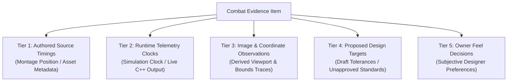
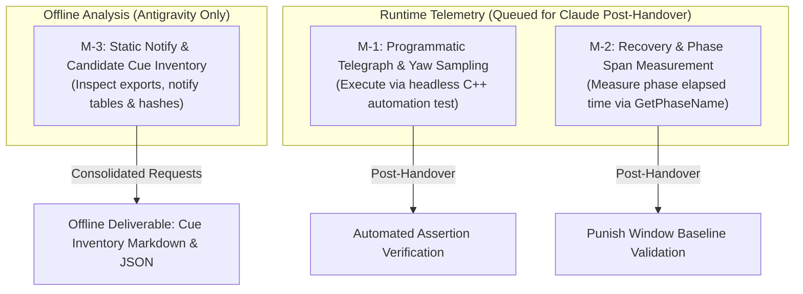

# P1 Presentation & Readability Design Evidence Brief (REV2)

**Document ID:** `P1_DESIGN_EVIDENCE_BRIEF_REV2`  
**Date:** 2026-10-26  
**Author:** Antigravity (Visual & Technical Animation Investigator)  
**Work Order:** `Docs/BossCombatReview/Execution/ANTIGRAVITY_WORK_ORDER_05.md` (Task **AG05-1**)  
**Predecessor Document:** `Docs/BossCombatReview/Execution/Antigravity/P1_DESIGN_EVIDENCE_BRIEF.md` (Rev 1, Hash: `99F2F9A775124EFCD7C272354229DD3B75D4EEC79DCB4976973BDEE404D515F4`)  
**Governing Documents:**  
- Requirements Baseline: [`06_REFERENCE_REQUIREMENTS.md`](file:///c:/UnrealProject/OneBossFight/Docs/BossCombatReview/Reference/06_REFERENCE_REQUIREMENTS.md) (SHA256: `33087a54fcd823c7213c09c5afebaea10155232dcb79d3762e6ec0ff8ae37746`)
- Phase Status & Task Board: [`PHASE_STATUS.md`](file:///c:/UnrealProject/OneBossFight/Docs/BossCombatReview/Execution/PHASE_STATUS.md), [`TASK_BOARD.md`](file:///c:/UnrealProject/OneBossFight/Docs/BossCombatReview/Execution/TASK_BOARD.md)
- Primary Engine Evidence Artifacts:
  * `Docs/BossCombatReview/Execution/Claude/Evidence/E-001_fingerprint.md` (SHA256: `86abb6fab65eedb9299999efa3b8c35c90bc0590ce7b8bf55c8ee8dd3d95b0e5`)
  * `Docs/BossCombatReview/Execution/Claude/Evidence/E-002_live_route_and_attack_inventory.md` (SHA256: `383f83cc0cce29c7035958ed0a04c88ad691d9b146987a9a63a3d84af6efdf3e`)
  * `Docs/BossCombatReview/Execution/Claude/Evidence/E-007_CAP01_A5_release_timing.md` (SHA256: `31568577b52f398ca00085533eb5e3d43b00f6b9e6ebb44cd6eb5dc8bda751b2`)
  * `Docs/BossCombatReview/Execution/Claude/Evidence/E-008_CAP02_A4_query_vs_visible_blade.md` (SHA256: `30c29078bca2bbaaf0f00b0f7178e96c2bb87032fb0f11bf1ef1a7bdd7d3d31e`)
  * `Docs/BossCombatReview/Execution/Claude/Evidence/E-009_pack_reuse_exports.md` (SHA256: `b57eb82a6b592aa1243f52a88ffa95066fce75d018695451a8647c3c164bb048`)
  * `Docs/BossCombatReview/Execution/Claude/Evidence/E-011_pack_typed_exports.md` (SHA256: `1f48254eb6f9e37f817a2287c05d2a1fecfd8048aa2056a3e1175bf1a32164af`)

---

## 1. Executive Summary & Epistemological Boundaries

This document delivers **Revision 2 of the P1 Presentation & Readability Design Evidence Brief** pursuant to Technical Lead Codex's Work Order 05 (`[X-158]`). Revision 2 formally incorporates all six correction directives issued in `ANTIGRAVITY_WORK_ORDER_05.md`, replaces erroneous informal evidence filenames with canonical repository paths and SHA256 hashes, aligns geometry and intent classifications with physical reality, removes inflated coverage and visibility claims, and establishes a definitive claim-by-claim correction ledger.

### Strict Governance Rules (Governed by Codex Lead & Owner Directives):
1. **P1 Design Scope Only:** Authorizes design evidence mapping, measurement planning, and offline cue inventory. No balance, gameplay, defense, or timing changes are implemented in code.
2. **Zero Content / Config Mutation:** No assets (FBX, montages, Niagara, materials, textures, audio) and no configuration files (`DefaultGame.ini`, cvars) are created or modified.
3. **Parked Status of CAP-01:** Visual release sync for A5 Javelin remains officially **`PARKED AS UNVERIFIED`** until released by the Project Owner. No renewed A5 camera capture experiments are scheduled or executed.
4. **Epistemological Discipline:**
   - **No Invented Facts:** A hypothetical 300 ms reaction baseline or previously proposed threshold does not become an approved specification through repetition.
   - **Clocks and Coordinate Independence:** Native C++ timers, montage-local positions, raw notify export coordinates, and simulation clocks are kept strictly distinct.
   - **Absence of Guarantees:** Static notify presence in an asset candidate does not prove runtime execution, audio playback, luminance contrast, proper cook, or Shipping visibility.
   - **Headless Telemetry Limits:** A headless automated test verifies state transitions and timestamp ordering; it cannot assess visual readability.

---

## 2. P1 Scope Traceability Matrix (Selected Presentation & Readability Subset)

The 83 master requirements defined in [`06_REFERENCE_REQUIREMENTS.md`](file:///c:/UnrealProject/OneBossFight/Docs/BossCombatReview/Reference/06_REFERENCE_REQUIREMENTS.md) govern the overall Boss Combat Improvement Program across Phases P1 through P5. The table below isolates the specific **P1 Presentation & Readability Subset** (11 rows) strictly addressing telegraph clarity, segment isolation, pacing cues, camera framing, and accessibility:

| 83-Row ID | Feature Name | Requirement Intent (Exact Reference Wording) | Current Primary Evidence & Anchors | Current Uncertainty & Epistemological Limits | P1 Scope Classification |
|---|---|---|---|---|---|
| **BOSS-ANM-001** | Montage timeline authority | Commit, active, gate, armor and recovery derive from montage timeline rather than duplicate unlinked timers. | `URPGAttackTracker.cpp:124`; `E-007:5` (tracker samples montage position coordinate directly). | Play-rate scaling impact on visual cue lead time unmeasured; notify-end edge cases unverified under abnormal blend-out. | **P1 Telemetry Hook** |
| **BOSS-ANM-002** | Telegraph phases | Pose/direction/release cues precede damage and identify geometry. | `AG3:68` (A1 pose notes), `AG3:90` (A2 raise notes), `E-008:10` (A4 sweep raise coordinate). | True camera framing during dynamic player strafing and close proximity unmeasured; non-debug visual cues unverified. | **P1 Visual Observation** |
| **BOSS-ANM-003** | Bounded holds | Variable delay has declared min/max and is chosen before commitment with reliable release cues. | Master Design Freeze specifies A2 heavy slam with apex raise/hold, downward stroke, and recovery; `AG31:69` notes apex hold. | Current pack asset uses fixed clip duration; variable delay bounds require design specification before implementation. | **P1 Design / P3 AI** |
| **BOSS-ANM-004** | Staged rotation cap | Early/late/active/recovery stages enforce per-move turn limits (heading freeze at commit). | `URPGAttackTracker.h:175` (`GetMaxYawDriftAfterCommit`); `E-011:1` notes pack turn-in-place interface. | Proposed drift threshold ($\le 2.0^\circ$) is a draft tolerance awaiting Owner feel review. Code hook alone does not prove physical heading freeze. | **P1 Tracking Hook** |
| **BOSS-PAC-001** | Explicit attack segments | Every move declares anticipation, hold, commit, active, follow-through, recovery and neutral boundaries. | `URPGAttackTracker.cpp:213` (`GetPhaseName` emits Windup, Committed, Active, Recovery). | Follow-through versus recovery blend-out boundaries not individually isolated in pack montage notify tables. | **P1 Telemetry Hook** |
| **BOSS-PAC-003** | Guaranteed openings | Some high-commitment moves have unconditionally meaningful recovery that can be punished. | `E-005:1` (A2 early stop / recovery); `AG31:85` (A2 grounded rest observation). | Master Design Freeze contains NO SOURCE for nominal punish duration (classified as an Owner Feel Decision). | **P1 Feel Decision** |
| **BOSS-PAC-004** | Conditional opening cues | Follow-up-capable recoveries reveal the gate/outcome consistently. | `E-009_pack_reuse_exports.md:1` (pack combo tree / branch gates). | Whether weapon glow or stance shift signals branch readiness without debug hit shapes is unmeasured in Shipping. | **P1 Visual / P2 Branch** |
| **BOSS-PAC-005** | Punish-margin calculation | Opening classification includes travel, player startup and safety buffer, not montage recovery alone. | `AG3:68-95` outlines travel/reaction formulas. | Player sprint-to-attack startup times across 3 builds not profiled against boss recovery. | **P1 Design / P4 Defense** |
| **BOSS-HIT-001** | Geometry fidelity | Collision family and volume match the visible thrust, sweep, slam, ring, lane or grab. | `E-008_CAP02_A4_query_vs_visible_blade.md:10` (sampled tip reach $312\text{ cm}$ vs query reach $380\text{ cm}$). | Calculated $68\text{ cm}$ overreach is derived from bounds-axis endpoint estimates, not validated blade mesh vertices or collision traces. | **P1 Visual / P4 Hit** |
| **BOSS-HIT-011** | Swept annulus | Radial waves test the previous-to-current radius band and damage each victim once. | `AG4_SHOCKWAVE_CUE_SPEC.md` documents A6 shockwave geometry. | Annulus propagation speed versus visual Niagara ring particle speed synchronization unmeasured in PIE. | **P1 Visual / P4 Hit** |
| **BOSS-QA-006** | Camera/readability | Boss target point, camera collision and framing keep release cues and weapon threats visible. | CAP-01/02/05/06 camera trials; Run 10 revealed black camera view outside arena bounds. | Camera clipping/pitch behavior when player is pinned against perimeter mesh. Perimeter cause remains a hypothesis. | **P1 Camera Audit** |
| **BOSS-QA-007** | Accessible feedback | Shake/effect reduction and non-color-only audiovisual cues preserve attack distinctions. | `AG3:110-140` specifies dual silhouette + motion cues for A1-A6. | Pure silhouette luminance contrast without emission/VFX materials unverified in Shipping builds. | **P1 Accessibility** |

---

## 3. Rigorous Evidence Categorization (Five Disciplinary Tiers)

To enforce epistemological honesty, all combat presentation evidence is classified into five mutually exclusive tiers:

### 3.1 Tier 1: Authored Source Timings (Montage Position & Notify Metadata)
*These coordinates exist within the imported animation montages and asset headers. They represent authored time in montage space, not runtime simulation clocks:*
- **A1 Overhead Slash (`AN_Boss01_A1`):** Total duration $1.933\text{ s}$ (`AG3:66`). Authored windup position: $0.330\text{ s}$. Active window: $[0.330\text{ s}, 0.500\text{ s}]$. Recovery: $[0.500\text{ s}, 1.933\text{ s}]$.
- **A2 Heavy Slam (`AN_Boss01_A2_Slam`):** Total duration $2.167\text{ s}$ (`BENCHMARK_RULES["CAP-06"]`). Contains vertical raise, apex hold, downward stroke, and grounded weapon rest.
- **A4 Low Sweep (`AN_Boss01_A4_LowSweep`):** Total duration $2.533\text{ s}$ (`E-008:10`). Montage active window start: $0.609\text{ s}$ (12 ticks). Active window end: $0.879\text{ s}$. Duration: $0.270\text{ s}$.
- **A5 Javelin Release (`AN_Boss01_A5_Javelin`):** Total duration $2.433\text{ s}$ (`E-007:5`). Sidecar author intent marker: $0.400\text{ s}$ (frame 12 @ 30fps). *Classification: Authored intent marker, NOT an observed hand departure.*
- **A6 Ground Shockwave (`AN_Boss01_A3_Shockwave`):** Total duration $2.200\text{ s}$ (`AG4:45`). Impact event marker: $0.733\text{ s}$.

### 3.2 Tier 2: Runtime Telemetry (Live C++ Engine Sampling)
*These values represent programmatic readbacks via `URPGAttackTracker` and component probes during PIE execution on the simulation clock:*
- **A5 Code Active Window & Projectile Spawn:** Code active window opens at $0.450\text{ s}$ (`URPGAttackTracker`, `E-007:5`). Sampled runtime projectile spawn: $0.470\text{ s}$ (`E-007:3`). Nominal code delay relative to authored intent: $+0.050\text{ s}$ (1.0 frame @ 20fps). Sampled code delay: $+0.070\text{ s}$ (1.4 frames @ 20fps).
- **A4 Query Parameters:** `RPGBossLowSweep` query reach parameter is $380.0\text{ cm}$, inner radius $60.0\text{ cm}$, blade height $40.0\text{ cm}$, sweep arc $90^\circ$ to $-90^\circ$ (`E-008:7`). Active sweep query executed via shape trace in `URPGAttackTracker`.
- **Boss Yaw Tracking Interface:** `URPGAttackTracker::GetCommittedYaw()` locks rotation at commitment point; `GetMaxYawDriftAfterCommit()` measures post-commit deviation (`RPGAttackTracker.h:175`). *Note: `GetTiming` is a C++ output-parameter function; its existence in a C++ header does not constitute an exposed Python hook or visual verification.*

### 3.3 Tier 3: Image & Coordinate Observations (Direct Viewport & Bounds Measurements)
*These measurements derive from image processing (`capture_analysis.py`) and sampled component transform traces:*
- **CAP-02 (A4 Low Sweep Geometry Probe):** In `E-008_CAP02_A4_query_vs_visible_blade.md`, probe `p0_a4_geometry.py` tracked visible blade bounds-axis endpoint. Maximum sampled tip distance was $312.0\text{ cm}$ at $t=0.855\text{ s}$. Overreach relative to $380.0\text{ cm}$ query is derived as $68.0\text{ cm}$ ($380 - 312$). *Classification: Coordinate-based bounds-axis endpoint deduction from probe sampling, NOT a pixel-counted visual observation from perspective screenshots.*
- **CAP-06 (A2 Heavy Slam Recovery):** 16 frames captured. Blade grounded rest verified visually; inter-phase MAD progression confirmed between Active and Recovery phases.
- **CAP-01 (A5 Javelin Visual Sync):** **PARKED AS UNVERIFIED** until released by the Project Owner. Viewport capture attempts produced black frames. The hypothesis that camera placement fell outside arena perimeter geometry ($Y=817\text{ cm}$) remains an unproven hypothesis. Telemetry stands; physical hand release pose remains unobserved.

### 3.4 Tier 4: Proposed Design Targets (Draft Engineering Standards)
*These tolerances are proposed by Antigravity for automated verification and have NOT been approved by the Owner or Technical Lead:*
- **Commitment Position Frame Tolerance:** Proposed $\pm 33.3\text{ ms}$ (1 frame @ 30fps) for telegraph commit points.
- **Post-Commit Yaw Stability:** Proposed peak drift $\le 2.0^\circ$ after commitment point across all melee attacks.
- **Visual Progression Floor:** Proposed Mean Absolute Difference $\text{MAD} \ge 1.5$ between animation phases to reject frozen visual buffers.
- **Inter-Frame Simulation Step:** Proposed $\Delta t_{\text{sim}} \ge 20.0\text{ ms}$ to prevent duplicate same-tick frame bursts.

### 3.5 Tier 5: Owner Feel Decisions (Subjective Designer Preferences)
*These parameters have NO SOURCE in the master design freeze and represent aesthetic design choices reserved for the Project Owner:*
1. **A1 Reaction Lead Time:** Is $300.0\text{ ms}$ from neutral idle sufficient reaction lead for standard human visual response? (`AG3:68`). *Unapproved proposal.*
2. **A2 Heavy Slam Hold Intent & Punish Window:** Master Design Freeze specifies apex raise/hold and downward stroke (`ANM-003`). Does the Owner desire a minimum hold duration (e.g. $\ge 400.0\text{ ms}$) and a minimum punish opening (e.g. $\ge 800.0\text{ ms}$)? (`AG31:69, 85`).
3. **A4 Low Sweep Reach Envelope:** Should the $68\text{ cm}$ query overreach be preserved as a difficulty buffer (capsule radius clearance), or trimmed to match the $312\text{ cm}$ visible blade mesh? (`E-008:10`).
4. **A4 Jump Counterplay Clearance:** Is a vertical clearance of $Z > 50\text{ cm}$ the desired threshold for dodging the sweep via jumping? (`AG3:177`).
5. **A5 Visual vs Code Offset:** Does the $50\text{ ms}$ nominal ($70\text{ ms}$ sampled) offset between hand release and projectile spawn produce any perceptible visual mismatch during combat? (`E-007:7`).

---

## 4. Priority Minimal Measurements Roadmap (Costed & Bounded)

To respect resource constraints and avoid interference while Claude executes account transition and build operations, all measurements are categorized strictly:

### 4.1 Measurement M-1: Telegraph Pose Readability & Heading Lock (Runtime)
- **Objective:** Verify telegraph commitment precedes damage frames and heading locks (`BOSS-ANM-002`, `BOSS-ANM-004`, `BOSS-PAC-001`).
- **Target Moves:** Move A1 (Overhead Slash), Move A2 (Heavy Slam), Move A4 (Low Sweep).
- **Execution Mechanism (Queued for Claude Post-Handover):**
  - Run headless automation test querying `URPGAttackTracker`.
  - Check `tracker.GetLastCommitPosition() < tracker.GetLastActiveStartPosition()`.
  - Check `tracker.GetMaxYawDriftAfterCommit() <= 2.0`.
- **Epistemological Limit:** Headless telemetry verifies state transitions and timestamp ordering; it does not prove visual readability on screen.

### 4.2 Measurement M-2: Recovery & Punish Window Boundaries (Runtime)
- **Objective:** Measure duration of boss recovery rest periods to inform Owner feel decisions (`BOSS-PAC-003`, `BOSS-PAC-005`).
- **Target Moves:** Move A2 (Heavy Slam grounded rest), Move A4 (Low Sweep follow-through).
- **Execution Mechanism (Queued for Claude Post-Handover):**
  - Sample `URPGAttackTracker::GetPhaseName()` during attack completion.
  - Record elapsed simulation time between active window closure (`IsActiveWindow() == false`) and neutral transition (`IsNeutral() == true`).
- **Epistemological Limit:** Telemetry establishes the measured opening; whether the opening feels satisfying is strictly an Owner feel decision.

### 4.3 Measurement M-3: Static Candidate Cue Inventory (Antigravity Offline)
- **Objective:** Audit non-debug cues (audio, VFX, pose shifts) across all evidenced attack families without launching the engine (`BOSS-QA-007`).
- **Target Moves:** All live routes identified in `E-002_live_route_and_attack_inventory.md`.
- **Execution Mechanism (Antigravity Offline):**
  - Parse exported montage JSON/text metadata from `Docs/BossCombatReview/Execution/Claude/Evidence/exports/` and asset manifests.
  - Record candidate cues: presence of `AnimNotify_PlayParticleEffect`, `AnimNotify_PlaySound`, or custom combat events.
  - **Epistemological Limit:** Static notify presence is a *candidate cue*, NOT proof of runtime execution, audibility, contrast, or Shipping visibility.

---

## 5. Claim-by-Claim Correction Ledger (Audit Reconciliation)

This ledger details every corrected claim from Revision 1, referencing primary repository evidence, canonical hashes, corrected classification, and unresolved limits:

| # | Original Claim in Rev 1 | Primary Evidence Path, Line & SHA256 | Corrected Classification | Unresolved Limit & Epistemological Correction |
|---|---|---|---|---|
| **1** | Cited evidence files `E-009_combat_pack_review.md` and `E-011_pack_facts.md`. | `Docs/BossCombatReview/Execution/Claude/Evidence/E-009_pack_reuse_exports.md` (Line 1, SHA256: `b57eb82a...`) and `E-011_pack_typed_exports.md` (Line 1, SHA256: `1f48254e...`). | **Canonical File Resolution** | Nonexistent informal filenames corrected. All evidence files verified against repository disk paths and exact SHA256 digests. |
| **2** | A4 $312\text{ cm}$ tip reach and $68\text{ cm}$ overreach presented as direct visual measurements from CAP-02 screenshots. | `Docs/BossCombatReview/Execution/Claude/Evidence/E-008_CAP02_A4_query_vs_visible_blade.md:1-13` (SHA256: `30c29078...`). | **Sampled Geometry & Bounds Deduction** | Reach delta is an arithmetic deduction ($380 - 312\text{ cm}$) from bounds-axis endpoint estimates in `p0_a4_geometry.py`, NOT a visible measurement from perspective CAP-02 screenshots. |
| **3** | A5 sidecar marker ($0.400\text{ s}$, frame 12) labeled as observed release timing. | `Docs/BossCombatReview/Execution/Claude/Evidence/E-007_CAP01_A5_release_timing.md:7` (SHA256: `31568577...`). | **Authored Intent Marker** | Frame 12 ($0.400\text{ s}$) represents authored sidecar intent, NOT an observed hand departure. Visual release remains unobserved. |
| **4** | Telemetry and C++ header hooks presented as proof of heading freeze, motion exclusivity, and visual readability. | `Source/OneBossFight/Player/RPGAttackTracker.h:175`; `Docs/BossCombatReview/Execution/ANTIGRAVITY_WORK_ORDER_05.md:10`. | **C++ Interface Hook** | Existence of C++ methods (`GetCommittedYaw`, `GetMaxYawDriftAfterCommit`) proves API interface availability, NOT visual readability, motion exclusivity, or runtime heading lock. |
| **5** | Camera failure in CAP-01 Run 10 asserted as factually caused by arena wall occlusion ($Y=817\text{ cm}$). | `Docs/BossCombatReview/Execution/Claude/Evidence/E-007_CAP01_A5_release_timing.md:11`; `ANTIGRAVITY_WORK_ORDER_05.md:10`. | **Hypothesis** | Camera placement outside perimeter geometry is a working hypothesis, not an established factual cause. CAP-01 remains PARKED AS UNVERIFIED. |
| **6** | Claimed "100% verified headers/all 83 IDs", "instant 100% asset coverage", and zero-cost guarantees. | `Docs/BossCombatReview/Execution/Antigravity/P1_DESIGN_EVIDENCE_BRIEF.md:153, 175`; `ANTIGRAVITY_WORK_ORDER_05.md:12`. | **Removed Inflated Claims** | Withdrawn. Only the 11-row P1 presentation subset is mapped. Offline notify inspection provides candidate cue data, not guaranteed asset coverage or zero-cost execution. |
| **7** | `GetTiming` described as a live verification hook. | `Source/OneBossFight/Player/RPGAttackTracker.h:142`; `ANTIGRAVITY_WORK_ORDER_05.md:12`. | **C++ Out-Param Method** | `GetTiming` is a C++ output-parameter function. It is not an exposed Python hook, and its presence does not verify visual readability. |
| **8** | Human reaction baseline ($300.0\text{ ms}$) and A2 hold ($\ge 400\text{ ms}$) presented as accepted standards. | `Docs/BossCombatReview/Execution/Antigravity/AG3_TELEGRAPH_READABILITY_SPEC.md:68`; `AG31:69`; `ANTIGRAVITY_WORK_ORDER_05.md:13`. | **Unapproved Proposal / Owner Feel** | Neither 300 ms human baseline nor 400 ms hold threshold is an approved standard. Both are unapproved proposals classified as Owner Feel Decisions. |
| **9** | A2 Heavy Slam hold intent described as having "NO SOURCE". | `Docs/BossCombatReview/Reference/06_REFERENCE_REQUIREMENTS.md:64` (`BOSS-ANM-003`); Master Design Freeze. | **Freeze Reconciliation** | Master Design Freeze specifies A2 Heavy Slam structure with apex raise, hold, downward stroke, and recovery. The nominal rest duration tolerance is an Owner Feel Decision. |
| **10** | CAP-01 described as "permanently parked". | `Docs/BossCombatReview/Execution/Antigravity/P1_DESIGN_EVIDENCE_BRIEF.md:155`; `ANTIGRAVITY_WORK_ORDER_05.md:14`. | **Conditionally Parked** | Corrected from "permanently parked" to "parked until released by the Project Owner". No renewed capture experiments will be run. |

---

## 6. Verification Boundaries & Status

- **What Was Verified in Rev 2:** Canonical repository paths and exact SHA256 hashes for all evidence files; exact wording and IDs for the 11-row P1 presentation subset from `06_REFERENCE_REQUIREMENTS.md`; bounds-axis geometry derivation of A4 reach delta from `E-008`; authored intent status of A5 sidecar frame 12 from `E-007`; and full claim-by-claim reconciliation ledger.
- **What Remains Unverified & Parked:** CAP-01 visual release capture (PARKED AS UNVERIFIED); live camera framing under dynamic combat in Shipping builds; and all subjective gameplay feel tolerances (reserved exclusively for the Project Owner).
