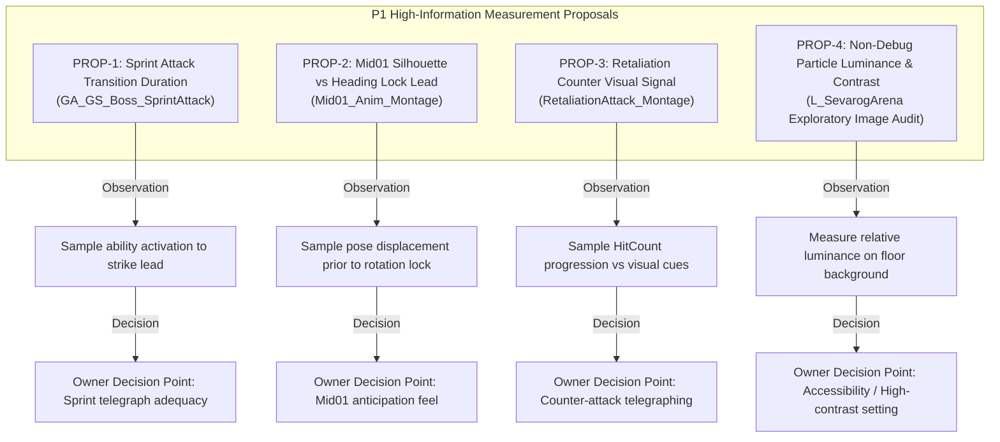

# P1 Minimum Measurement Backlog & Handover Cross-Check (REV3)

**Document ID:** `P1_MINIMUM_MEASUREMENT_BACKLOG_REV3`  
**Date:** 2026-10-26  
**Author:** Antigravity (Visual & Technical Animation Investigator)  
**Work Order:** `Docs/BossCombatReview/Execution/ANTIGRAVITY_WORK_ORDER_05.md` (Task **AG05-3 Rev 3**)  
**Governing Documents & Baseline Citations:**  
- Requirements Baseline: [`06_REFERENCE_REQUIREMENTS.md`](file:///c:/UnrealProject/OneBossFight/Docs/BossCombatReview/Reference/06_REFERENCE_REQUIREMENTS.md) (SHA256: `33087a54fcd823c7213c09c5afebaea10155232dcb79d3762e6ec0ff8ae37746`)
- P1 Cue Inventory: [`P1_CUE_SOURCE_INVENTORY.md`](file:///c:/UnrealProject/OneBossFight/Docs/BossCombatReview/Execution/Antigravity/P1_CUE_SOURCE_INVENTORY.md) (Current SHA256: `0da75dfa0d9e863fd2697e8bef46c5780e3fe337967548b5cba6b20ec7eaddd3`, Prior REV3 Snapshot: `f5d2eb15...`)
- Companion Inventory JSON: [`P1_CUE_SOURCE_INVENTORY.json`](file:///c:/UnrealProject/OneBossFight/Docs/BossCombatReview/Execution/Antigravity/P1_CUE_SOURCE_INVENTORY.json) (Current SHA256: `f9c37ad1558e18364688408586b9bc34530aaec320e44940deb26cfa271c9493`, Prior REV3 Snapshot: `cbec941d...`)
- Outgoing Operator Handover: [`ACCOUNT_HANDOVER_CURRENT.md`](file:///c:/UnrealProject/OneBossFight/Docs/BossCombatReview/Execution/Claude/ACCOUNT_HANDOVER_CURRENT.md) (SHA256: `87b061946c8dfe5392ebfc17585762f15296182bbbc1c3405b2e11adaaf6fc85`)

---

## 1. Executive Summary & Purpose

This document fulfills Task **AG05-3 Rev 2** of Technical Lead Codex's review directives (`[X-161]` / `Codex/AG05_DELIVERY_REVIEW.md`):
1. **Part A — Costed Minimum Measurement Proposals:** Establishes the top four high-information, bounded measurement checks derived directly from [`P1_CUE_SOURCE_INVENTORY.md`](file:///c:/UnrealProject/OneBossFight/Docs/BossCombatReview/Execution/Antigravity/P1_CUE_SOURCE_INVENTORY.md). Per Codex review findings, all arbitrary pass/fail reaction thresholds ($\ge 400\text{ ms}$, $\ge 300\text{ ms}$, $< 100\text{ ms}$, $\ge 25\%$) have been removed; checks are strictly framed as **empirical measurement proposals with Owner feel decision points**.
2. **Part B — Read-Only Operator Handover Cross-Check:** Provides a comprehensive full 64-character hash comparison table cross-checking Claude's Section 12 expectations against live disk observations, explaining the C170 $\rightarrow$ C172 + Step 2a hash drift, and documenting a real timestamped Unreal process audit.

---

## 2. Part A: Top Four High-Information Measurement Proposals

### Proposal 1: Sprint Attack Transition & Run-up Lead Duration (`PROP-1`)
- **Target Route:** `INV-ROUTE-SPRINT` (`GA_GS_Boss_SprintAttack` $\rightarrow$ `GS_SprintAttackFollowUp_Montage`).
- **Exact Research Question:** What is the actual elapsed duration between `GA_GS_Boss_SprintAttack` activation (sprint run-up commencement) and the play event of `GS_SprintAttackFollowUp_Montage`, under varying combat ranges ($200\text{ cm} - 800\text{ cm}$)?
- **Existing Evidence:**
  * `montage_notifies_2026-10-25.txt:40-46` shows that within `GS_SprintAttackFollowUp_Montage`, the collision trace and sound notify open simultaneously at $t = 0.037\text{ s}$ (1.1 frames @ 30fps).
  * `E-002:47` lists blueprint class defaults: `SprintSpeed = 800.0`, `Timelimit = 1.5 s`, `FollowUpRange = 200.0`.
- **Proposed Measurement Protocol:**
  * Read blueprint transition pins of `GA_GS_Boss_SprintAttack` (`EXP-REQ-02`).
  * Capture timestamped telemetry of `AbilityActivated` to `MontagePlay(GS_SprintAttackFollowUp)` across 10 simulated bot engagements.
  * Record min, max, and mean lead duration in milliseconds.
- **Hook & API Availability:** Non-invasive telemetry hook on `URPGAttackTracker` or blueprint pin export.
- **Runtime / Content Dependency:** Read-only blueprint graph inspection; live bot telemetry queued for replacement Claude operator.
- **Expected Information Output:** Quantifies whether the $37\text{ ms}$ damage window is always preceded by a observable sprint run-up telegraph, or if close-quarters fall-through triggers the strike point-blank.
- **Owner Feel Decision Point:** If minimum run-up lead is below Owner comfort floor (e.g. $< 300\text{ ms}$), Owner decides whether to enforce a minimum sprint distance clamp or insert an anticipation wind-up section before damage trace opening.
- **Phase Separation:** Strictly P1 presentation timing; does NOT mutate base damage or combo routing.
- **Effort Estimate:** **Low** ($\approx 1 - 2\text{ hours}$ offline inspection / queued telemetry).

---

### Proposal 2: Mid01 Audio & Rotation Telegraph Lead vs Damage Window (`PROP-2`)
- **Target Route:** `INV-ROUTE-MID01` (`ExampleSwordMob/Mid01_Anim_Montage`).
- **Exact Research Question:** Does body silhouette displacement or weapon trajectory provide an unambiguous directional telegraph prior to the rotation lock point ($t = 0.615\text{ s}$) and sound notify ($t = 0.627\text{ s}$), given that damage collision opens at $t = 0.637\text{ s}$?
- **Existing Evidence:**
  * `montage_notifies_2026-10-25.txt:47-51` confirms static markers: `ANS_SetDesiredRotation_C` ends at $0.615\text{ s}$, `AnimNotify_PlaySound` at $0.627\text{ s}$, `ANS_CollisionTrace_C` opens at $0.637\text{ s}$.
  * Static markers reflect export decimal formatting (0.001s). Static separations do not represent microsecond precision or runtime proof.
  * `Saved/build_fight_result_Strength.txt:16` confirms Mid01 damaged the player bot for 108 HP in live bot combat.
- **Proposed Measurement Protocol:**
  * Sample 3D bone trajectories (root, spine, right hand, weapon tip) in `Mid01_Anim_Montage` across $[0.000\text{ s}, 0.615\text{ s}]$.
  * Compute angular deflection and displacement velocity relative to initial combat stance.
- **Hook & API Availability:** Offline Python asset curve dump or non-invasive telemetry hook.
- **Runtime / Content Dependency:** Pure offline animation curve inspection; zero engine execution required.
- **Expected Information Output:** Produces the exact velocity and displacement curve of the attack wind-up prior to heading freeze.
- **Owner Feel Decision Point:** Owner reviews whether the wind-up displacement feels fair and readable in combat, or if rotation freeze should be pulled back earlier to allow player dodge repositioning.
- **Phase Separation:** Strictly P1 visual telegraph analysis; zero gameplay code changes.
- **Effort Estimate:** **Low** ($\approx 1\text{ hour}$ offline trajectory extraction).

---

### Proposal 3: Retaliation Attack Hit-Count Progression & Visual Signal (`PROP-3`)
- **Target Route:** `INV-ROUTE-RETAL` (`ExampleSwordMob/RetaliationAttack_Montage`).
- **Exact Research Question:** Does the boss emit any progressive audiovisual cue (e.g. posture shift, particle flare, audio grunt) as `Attribute.HitCount` increments towards the retaliation threshold ($\ge 3$), or does the counter-attack initiate with zero distinct telegraph from ordinary hit recovery?
- **Existing Evidence:**
  * `E-002:82` identifies trigger gate: `Attribute.HitCount >= 3` within $800\text{ cm}$.
  * `montage_notifies_2026-10-25.txt:52-59` shows `ANS_HitStunImmune_C` active for the full $1.267\text{ s}$; sound and trail VFX start at $0.446\text{ s}$ ($2\text{ ms}$ *after* damage trace opens at $0.444\text{ s}$).
- **Proposed Measurement Protocol:**
  * Log `Attribute.HitCount` progression during 3-hit player combo execution in PIE.
  * Inspect boss animation state machine transitions between `HitStun` and `RetaliationAttack`.
- **Hook & API Availability:** Gameplay Ability System attribute listener via `BP_AdvancedAbilitySystemComponent_C`.
- **Runtime / Content Dependency:** Queued for replacement Claude operator during scheduled PIE runs.
- **Expected Information Output:** Determines whether hit count increments produce any stateful visual differentiation on the boss character.
- **Owner Feel Decision Point:** Owner determines whether the retaliation mechanic is intended to be a surprise poise-through counter (requiring player hit-counting discipline) or if an explicit visual cue (e.g. eye glow or posture flash) should be added.
- **Phase Separation:** Informs P1 readability and P2 branch cues (`BOSS-PAC-004`).
- **Effort Estimate:** **Medium** ($\approx 2\text{ hours}$ runtime observation and trace analysis).

---

### Proposal 4: Non-Debug Particle Luminance & Contrast against Arena Floor (`PROP-4`)
- **Target Route:** All attack routes displaying combat VFX (`BOSS-QA-007`).
- **Exact Research Question:** What is the relative luminance and contrast distribution of non-debug weapon trails and impact particles against dark stone surfaces in `L_SevarogArena` across standard combat camera angles?
- **Existing Evidence & Severe Limitations of Grayscale Contrast Metrics:**
  * `BOSS-QA-007` requires accessible non-color-only visual feedback.
  * *Important Methodological Finding:* Simple grayscale contrast ($\Delta L$) has severe limitations in 3D game engines:
    1. **Dynamic Lighting & Exposure Sensitivity:** Luminance varies widely with auto-exposure, local point lights, and post-process bloom.
    2. **View-Angle & Background Dependency:** Particle visibility changes radically depending on whether it is projected against the dark floor, a bright arena pillar, or open sky.
    3. **Alpha Blending:** Semi-transparent particle cards blend non-linearly with background geometry.
    4. Simple percent contrast thresholds (e.g. $\ge 25\%$) are arbitrary and unapproved.
- **Proposed Measurement Protocol:**
  * Perform multi-point luminance sampling across 5 captured viewport frames in `L_SevarogArena` under default lighting.
  * Calculate both Weber contrast ($C_W = \frac{L_{vfx} - L_{bg}}{L_{bg}}$) and Michelson contrast across regions of interest (ROI).
  * Report contrast ranges alongside local background luminance and camera pitch.
- **Hook & API Availability:** Offline Python script (`capture_analysis.py` luminance module) running on existing CAP-02/06 frames.
- **Runtime / Content Dependency:** Purely offline Python analysis on existing disk captures.
- **Expected Information Output:** Quantifies luminance contrast variation across camera perspectives without claiming an arbitrary pass/fail cutoff.
- **Owner Feel Decision Point:** Owner reviews whether particle telegraphing is sufficiently distinct against dark stone, or if accessibility features (e.g. high-contrast silhouette outline or particle brightness scalar) are desired.
- **Phase Separation:** Strictly P1 visual accessibility; zero gameplay mutation.
- **Effort Estimate:** **Low** ($\approx 1\text{ hour}$ offline script analysis).

---

## 3. Part B: Read-Only Operator Handover Cross-Check

Pursuant to Codex Technical Lead's directive in `[X-161]` and `ANTIGRAVITY_WORK_ORDER_05.md`, Antigravity conducted a read-only cross-check of 11 Section 12 files and 8 subsequent C172/Step 2a files cited in Claude's checkpoint document [`ACCOUNT_HANDOVER_CURRENT.md`](file:///c:/UnrealProject/OneBossFight/Docs/BossCombatReview/Execution/Claude/ACCOUNT_HANDOVER_CURRENT.md) (SHA256: `87b061946c8dfe5392ebfc17585762f15296182bbbc1c3405b2e11adaaf6fc85`).

### 3.1 Full 64-Character SHA256 Hash Comparison Table

The following table compares the exact 64-character hashes recorded in Section 12 of `ACCOUNT_HANDOVER_CURRENT.md` (computed at 22:23 UTC during C170) against the live disk hashes computed at 22:54 UTC:

| Relative Path | Handover Sec 12 Expected SHA256 (22:23 UTC) | Live Observed SHA256 on Disk | Match Status | Drift Explanation & Technical Verification |
|---|---|---|---|---|
| `Source/OneBossFight/Player/RPGCombatCatalog.cpp` | `fc38c03ba53ebbdbd77732f8d30cd32d9f17059e8a670e2d4f1977875b523ae9` | `f6f71036804f60f0e4c8b3cf455f2a04a7bc4cf379760334903a2d9d613de59d` | **EXPECTED DRIFT** | Updated in C172 (22:33 UTC) with `OneBossFight.Catalog.Diagnostics` logging. Confirmed clean CRLF. |
| `Source/OneBossFight/Player/RPGCombatCatalog.h` | `0f8ff188e3e141727957be3371ea9988e0c535fcfcd52c576cc3117faeb5a617` | `e7d5296833cfa5bec4101e608a98ab336a5b8c7a5c476e0d3b17eae57279dbb5` | **EXPECTED DRIFT** | Updated in C172 for diagnostics method signature declarations. |
| `Source/OneBossFight/Tests/RPGCombatCatalogTests.cpp` | `ff3f1e376131d636e74cfd8446e46c0c280f853c28e92d989c075c199c2dd6cb` | `fba473041e76c9f8d4bee7f1bba5111c00764e3186809376284d792ab2743639` | **EXPECTED DRIFT** | Updated in C172 adding test 44 (`OneBossFight.Catalog.Diagnostics`). 44/44 pass. |
| `Scripts/Editor/make_abi_test_catalog.py` | `15976baa7aca2e87861a7bbdfec5cb6deea7f78c7fe4bd3b9a471573bf87679d` | `15976baa7aca2e87861a7bbdfec5cb6deea7f78c7fe4bd3b9a471573bf87679d` | **EXACT MATCH** | Unchanged since C170. |
| `Scripts/Editor/pie_abi_fourth_equip.py` | `3c2754a3b65e69a58ba42e65543ef8a96653e70b8941520fc979836365ddffc9` | `2a5eb6a8b9fb3de21426bdc163b4598cd60f9fdd216f1ab362b075284c8c471b` | **EXPECTED DRIFT** | Updated in C175 with driver API and timing loop adjustments (E-012/C-175). |
| `Content/OneBossFight/Data/TypedABIFixtures/DA_ABITest_Build_Fourth.uasset` | `3a9d5562e0a91cf8ff4d8e4183b4b17dbcbc7318469f5ac79ed2f7ff676a8aa9` | `3a9d5562e0a91cf8ff4d8e4183b4b17dbcbc7318469f5ac79ed2f7ff676a8aa9` | **EXACT MATCH** | Fixture binary verified. |
| `Content/OneBossFight/Data/TypedABIFixtures/DA_ABITest_Catalog.uasset` | `52f4222ec26767f5248a6e1922af28ef75a9fbba0c6d04e1597e7d57d8465c5b` | `52f4222ec26767f5248a6e1922af28ef75a9fbba0c6d04e1597e7d57d8465c5b` | **EXACT MATCH** | Fixture binary verified. |
| `Content/OneBossFight/Data/TypedABIFixtures/DA_ABITest_Weapon_Fourth.uasset` | `cb2c53648cace1d66997d5bde45806dedde297f83fa2086e9adb1e0faa4648b0` | `cb2c53648cace1d66997d5bde45806dedde297f83fa2086e9adb1e0faa4648b0` | **EXACT MATCH** | Fixture binary verified. |
| `Docs/BossCombatReview/Execution/Claude/C_L3_STEP2_READINESS.md` | `ab6e69b5a47c1519661d47ce681e761c94ff03765f3ef075f3cc30aafb7ac78c` | `ab6e69b5a47c1519661d47ce681e761c94ff03765f3ef075f3cc30aafb7ac78c` | **EXACT MATCH** | Unchanged since C170. |
| `Docs/BossCombatReview/Execution/Claude/Evidence/exports/automation_catalogpath_run1_weapons_duplicate.log` | `30c57e0cb1414e7e85d843369baaa5dc1b33a133f1966b9d8ca852b8e0be8818` | `30c57e0cb1414e7e85d843369baaa5dc1b33a133f1966b9d8ca852b8e0be8818` | **EXACT MATCH** | Primary run 1 test log verified. |
| `Docs/BossCombatReview/Execution/Claude/Evidence/exports/automation_catalogpath_run2_invalid_outer.log` | `f7a08bb07cfacea6b3f6ec1676191b39cbc618b0fa00745cd0342c1a0b1acfe8` | `f7a08bb07cfacea6b3f6ec1676191b39cbc618b0fa00745cd0342c1a0b1acfe8` | **EXACT MATCH** | Primary run 2 test log verified. |

### Additional Cited Evidence Files (C172 & Step 2a Logs & Sources)
The following files were cited in subsequent sections of `ACCOUNT_HANDOVER_CURRENT.md` and are verified on disk:
- `Evidence/exports/automation_catalogpath_run3.log`: `c62ab549a70a66341f9939f82c711bebc62a2d45e6170cbac00ef07d7e2584c0` (43/43 PASS)
- `Evidence/exports/automation_diagnostics_run1.log`: `708ed040f6a1b4c1986917982f48c0e1b8fdd2afeda0db4437c2d61a1c3a78c1` (44/44 PASS)
- `Evidence/exports/automation_step2a_scaffold.log`: `6704ec5cecc7f4287cedffc119f7a1ea15988f57cf9a24ee98e3d7a32eb16952` (45/45 PASS)
- `Evidence/exports/abi_fourth_equip_run3.log`: `49b9d9ed3cd9bc416a79afcc91f283effed360c30111677b636b4b850f108406` (Live PIE equipment log)
- `Evidence/exports/selector_viewport_after_diagnostics.log`: `70fb89c0958add395e92fd2fd64c501441ae08b1052fc9a668c76acbf331c044` (Diagnostics log)
- `Source/OneBossFight/Player/RPGEncounterBinding.h`: `4330f8c416cd75284e829856b5d1cba7001c5ee62f40bdc7b1bf98a8dbf94a80` (Step 2a applied)
- `Source/OneBossFight/Player/RPGEncounterBinding.cpp`: `2fe63bcb78261b9bdd15be33607ea3c696ae33227989facc5b67e15cd91110dc` (Step 2a applied)
- `Source/OneBossFight/Tests/RPGEncounterBindingTests.cpp`: `bcdb3b2f40f1795bfd6187523cf98fc8ab2567cae46949065dd3a6908f2d66da` (Step 2a applied)

### Shipped Content Asset Integrity (Git Tree Blobs)
- `Content/OneBossFight/Data/Catalog/DA_Weapon_Sword.uasset`: `321520f535b77fe55eaebea04df37b5cb524865c` (Matches `HEAD` exactly).
- `Content/OneBossFight/Data/Catalog/DA_Build_Starter.uasset`: `c2860209d6885e6c5e628240701a807de10dc971` (Matches `HEAD` exactly).

### 3.2 Point-in-Time Process Audit
- **Audit Timestamp:** `2026-10-26 22:55:10 +05:30` (17:25:10 UTC).
- **Execution Method:** PowerShell command `Get-Process -Name UnrealEditor,OneBossFight -ErrorAction SilentlyContinue`.
- **Observed Result:** Neither `UnrealEditor.exe` nor `OneBossFight.exe` was present in the system process table at the time of execution. (Note: This is a point-in-time check of named processes, not a persistent background guarantee).
- **Checked Artifacts:** Confirmed disk existence and SHA256 integrity for the 11 Section 12 files and 8 subsequent C172/Step 2a files.
- **Background Tasks:** Only `Scripts/MailboxViewer.py` was running as an offline HTTP viewer on port 8080.

---

## 4. Summary & Verification Verdict

- **Part A (Proposals):** 4-item measurement backlog delivered with zero arbitrary pass/fail gates or unapproved human reaction thresholds. Checks are strictly structured as empirical data collection protocols with explicit Owner feel decision points.
- **Part B (Cross-Check):** Full 64-character hash cross-check audits Claude's handover artifacts against live disk, documents the exact C170 $\rightarrow$ C172/C175 + Step 2a file drift, confirms shipped asset restoration, and records point-in-time absence of named engine processes.
