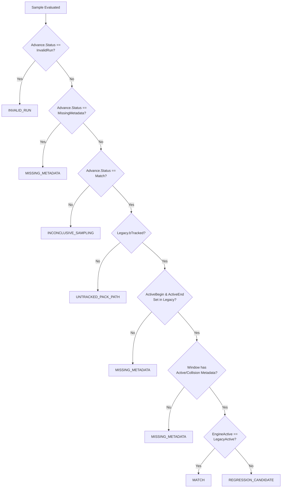

# P1 Staged Shadow Serializer Typed Wire-Field Crosswalk

**Document ID:** `P1_SHADOW_WIRE_CROSSWALK`  
**Date:** 2026-10-27  
**Author:** Antigravity (Visual & Technical Animation Investigator)  
**Governing Work Order:** `Docs/BossCombatReview/Execution/ANTIGRAVITY_WORK_ORDER_07.md` (Codex Lead `[X-174]`, `[X-178]`)  
**Primary Source Anchors:**  
- C++ Shadow Record Producer: [`Docs/BossCombatReview/Execution/Codex/Drafts/Source/OneBossFight/Boss/RPGShadowCompare.cpp`](file:///c:/UnrealProject/OneBossFight/Docs/BossCombatReview/Execution/Codex/Drafts/Source/OneBossFight/Boss/RPGShadowCompare.cpp) (SHA256: `f6a0274c3bad8d5221981fa10dc529a284aa3285eb1220ba3e4f991a07363924`)
- C++ Shadow Record Header: [`Docs/BossCombatReview/Execution/Codex/Drafts/Source/OneBossFight/Boss/RPGShadowCompare.h`](file:///c:/UnrealProject/OneBossFight/Docs/BossCombatReview/Execution/Codex/Drafts/Source/OneBossFight/Boss/RPGShadowCompare.h) (SHA256: `95da9c0c6a72a302ed16cc1d9c3b0d5f7fd8e758f573dd65bda0bc4b13ca00ab`)
- Staged Diagnostic Driver: [`Docs/BossCombatReview/Execution/Codex/Drafts/Scripts/Editor/pie_timeline_shadow.py`](file:///c:/UnrealProject/OneBossFight/Docs/BossCombatReview/Execution/Codex/Drafts/Scripts/Editor/pie_timeline_shadow.py) (SHA256: `c0af0dc6066b73bbbd248981244fc231d653cfc9fbd58cfde4c054958caad99c`)
- Timeline Compiler Header: [`Docs/BossCombatReview/Execution/Codex/Drafts/Source/OneBossFight/Boss/RPGTimelineCompiler.h`](file:///c:/UnrealProject/OneBossFight/Docs/BossCombatReview/Execution/Codex/Drafts/Source/OneBossFight/Boss/RPGTimelineCompiler.h) (SHA256: `5bf162ff250469cf6b80f2edaad5cfc39e969ed4eb6e8d6256cf56b640fe119e`)

---

## 1. Executive Summary

This crosswalk provides the authoritative, source-verified field mapping of the JSON serialization format emitted by [`URPGCombatTimelineShadow::ObserveAfterTracker`](file:///c:/UnrealProject/OneBossFight/Docs/BossCombatReview/Execution/Codex/Drafts/Source/OneBossFight/Boss/RPGShadowCompare.cpp#L129-L223).

It bridges the C++ producer data structures (`FObservation`, `FAdvance`, `FCrossing`, `FLegacySample`) to the serialized wire JSON format consumed by the diagnostic driver `pie_timeline_shadow.py`. It distinguishes:
1. **Always-Present vs Optional Fields** (including explicit JSON null representations).
2. **Wire Types vs Source C++ Types** (notably uint64 ordinals serialized as decimal strings to prevent JS/JSON number precision loss).
3. **Known Semantic Limits & Unknowns** (e.g. `compiled_crossings` legitimately being empty on mid-window `MATCH` ticks).

---

## 2. Top-Level Record Wire Crosswalk

Each shadow record is serialized as a JSON Object inside `URPGCombatTimelineShadow::Records` (capped at `MaxRecords = 4096`).

| JSON Wire Field | JSON Wire Type | Presence | Source C++ Expression & Type | Code Location (`RPGShadowCompare.cpp`) | Known Semantic Limit / Unknown |
|---|---|---|---|---|---|
| `world_session` | String (GUID) | Always | `Participant.WorldSession.ToString()` (`FGuid`) | Line 140 | Invariant across a continuous world session; changes require trace demarcation. |
| `encounter_instance` | String (GUID) | Always | `Participant.EncounterInstance.ToString()` (`FGuid`) | Line 141 | Identifies specific placed encounter; changes signify cross-encounter drift. |
| `participant_slot` | String (FName) | Always | `Participant.Slot.ToString()` (`FName`) | Line 142 | Slot identifier (`Boss`, `Player`, etc.). |
| `generation` | Number (uint32) | Always | `Participant.Generation` (`uint32`) | Line 143 | Advances monotonically on encounter reset (`OnSnapshot:124`); multiple generations in one buffer are valid across resets. |
| `observation_ordinal` | String (Decimal uint64) | Always | `LexToString(O.Sample)` (`uint64`) | Line 145 | Lossless decimal string up to $2^{64}-1$. Must be strictly increasing across records. |
| `playback_ordinal` | String (Decimal uint64) | Always | `LexToString(O.PlaybackOrdinal)` (`uint64`) | Line 146 | Sequence index of current playback session; decimal string. |
| `authoritative_action` | String or Null | Always | `O.AuthoritativeAction.GetValue()` or `null` (`TOptional<FString>`) | Lines 147–148 | Emitted unconditionally as JSON `null` when unset. |
| `source_asset` | String (Path) | Always | `O.Timeline.AssetPath` (`FString`) | Line 149 | Object path of compiled timeline asset (e.g. `/Game/...`). |
| `observed_source_asset` | String (Path) | Always | `O.ObservedSourceAsset` (`FString`) | Line 150 | Actual montage played on game thread. |
| `observed_segment_asset` | String (Path) | Always | `O.ObservedSegmentAsset` (`FString`) | Line 151 | AnimSequence played by active segment. |
| `asset_sha256` | String (64-hex) | Always | `O.Timeline.AssetSHA256` (`FString`) | Line 152 | SHA256 of compiled timeline asset. Syntactic regex match; disk derivation unverified in hot path. |
| `adapter_sha256` | String (64-hex) | Always | `O.Timeline.AdapterSHA256` (`FString`) | Line 153 | SHA256 of compiling adapter code. |
| `synthetic_fixture` | Boolean | Always | `O.Timeline.bSyntheticFixture` (`bool`) | Line 154 | True only for automation test fixtures; false for production content. |
| `projection_policy` | Number (int32) | Always | `static_cast<int32>(O.Timeline.ProjectionPolicy)` | Line 155 | Enum value: `Reject = 0`, `ClipDiagnosticToPlaybackEnd = 1`. |
| `move` | String (FName) | Always | `O.Timeline.Move.ToString()` (`FName`) | Line 156 | Move identifier (e.g. `A1`, `A6`, `Mid01`). |
| `variant` | String (FName) | Always | `O.Timeline.Variant.ToString()` (`FName`) | Line 156 | Variant tag (e.g. `Default`, `Sprint`). |
| `section` | String (FName) | Always | `O.Timeline.Section.ToString()` (`FName`) | Line 157 | Montage section name. |
| `coverage_scope` | String | Always | Hardcoded scope disclaimer string | Line 158 | Documents that additive tracks, other slots, and inactive blend-outs are UNCOVERED. |
| `previous` | Number (float) | Always | `O.Previous` (`double`) | Line 159 | Playhead position on previous tick (seconds). |
| `current` | Number (float) | Always | `O.Current` (`double`) | Line 159 | Playhead position on current tick (seconds). |
| `game_time` | Number (float) | Always | `O.GameTime` (`double`) | Line 160 | World simulation seconds (`UWorld::GetTimeSeconds`). Must be non-decreasing within session segment. |
| `actual_rate` | Number (float) | Always | `O.Rate` (`float`) | Line 160 | Queried `Montage_GetPlayRate` result carried by `O.Rate`, NOT an independently verified effective total animation/simulation rate. |
| `traversal` | Number (int32) | Always | `static_cast<int32>(O.Traversal)` (`ETraversal`) | Line 161 | Exact enum domain: `0 = Forward`, `1 = Reverse`, `2 = Loop`, `3 = SectionJump`, `4 = Unknown`. |
| `loop` | Number (uint32) | Always | `O.LoopOrdinal` (`uint32`) | Line 161 | Ordinal count of loop completions (`uint32` source type). |
| `engine_instance` | Number or Null | Always | `O.EngineInstance.GetValue()` or `null` (`TOptional<int32>`) | Lines 162–163 | Emitted unconditionally as JSON `null` when unset. Internal montage instance counter. |
| `legacy_snapshot` | Object | Always | `FJsonObject` (`FLegacySample`) | Lines 164–168 | Nested object. Real producer ALWAYS emits 6 required fields (see Section 3.1). |
| `compiled_crossings` | Array of Objects | Always | `TArray<FJsonValue>` (`TArray<FCrossing>`) | Lines 169–177 | List of boundary crossing events (see Section 3.2). **Legitimately empty `[]` on mid-window ticks!** |
| `window_projections` | Array of Objects | Always | `TArray<FJsonValue>` (Window projection clamps) | Lines 178–187 | List of projected window clamp points (see Section 3.3); empty `[]` if no raw ends clamped. |
| `comparison_status` | String (Enum) | Always | Status string | Lines 188–210 | `MATCH`, `REGRESSION_CANDIDATE`, `UNTRACKED_PACK_PATH`, `MISSING_METADATA`, `INCONCLUSIVE_SAMPLING`, `INVALID_RUN`. |
| `limitation` | String | Always | `Advance.Limitation + disclaimer` | Line 211 | Notes that MATCH covers sampled active state only, not hit/geometry/cause parity. |
| `possible_explanations_not_acceptance` | Array of Objects | Always | Expected difference registry entries | Lines 213–220 | Annotates *possible explanations* from registry (see Section 3.4); does not establish benign deviations or acceptance. |

---

## 3. Nested Object Specifications

### 3.1 `legacy_snapshot` Object Structure
In [`RPGShadowCompare.cpp:164-168`](file:///c:/UnrealProject/OneBossFight/Docs/BossCombatReview/Execution/Codex/Drafts/Source/OneBossFight/Boss/RPGShadowCompare.cpp#L164-L168), the `legacy_snapshot` dictionary is instantiated and populated unconditionally with exact fields:

```cpp
auto Legacy = MakeShared<FJsonObject>();
Legacy->SetBoolField(TEXT("tracked"), O.Legacy.bTracked);
Legacy->SetStringField(TEXT("move"), O.Legacy.Move.ToString());
Legacy->SetStringField(TEXT("phase"), O.Legacy.Phase);
Legacy->SetNumberField(TEXT("instance"), O.Legacy.Instance);
Legacy->SetNumberField(TEXT("illegal_starts"), O.Legacy.IllegalStarts);
Legacy->SetNumberField(TEXT("double_launches"), O.Legacy.DoubleLaunches);
Row->SetObjectField(TEXT("legacy_snapshot"), Legacy);
```

| Subfield | Wire Type | Meaning & Value Domain |
|---|---|---|
| `tracked` | Boolean | True if legacy attack tracker has active registered timing for current montage. |
| `move` | String (FName) | Legacy move identifier (e.g. `A1`, `A4`, `None`). |
| `phase` | String | Legacy tracker phase string (`Windup`, `Active`, `Recovery`, `None`). |
| `instance` | Number (int32) | Monotonic attack instance counter from tracker. |
| `illegal_starts` | Number (int32) | Counter of illegal attack starts detected by legacy tracker. |
| `double_launches` | Number (int32) | Counter of duplicate attack launch notifications. |

> [!IMPORTANT]
> **Schema Defect in `pie_timeline_shadow.py`:** Line 71 checks only `isinstance(row.get("legacy_snapshot"), dict)`. An empty dictionary `{}` or a dictionary missing `tracked`, `move`, or `phase` is accepted by the Python validator despite violating the C++ producer contract.

---

### 3.2 `compiled_crossings` Element Structure
In [`RPGShadowCompare.cpp:169-177`](file:///c:/UnrealProject/OneBossFight/Docs/BossCombatReview/Execution/Codex/Drafts/Source/OneBossFight/Boss/RPGShadowCompare.cpp#L169-L177), crossings are populated from `Advance.Crossings`. Each item in the array has:

```cpp
auto Item = MakeShared<FJsonObject>();
Item->SetStringField(TEXT("id"), C.Id.ToString());
Item->SetStringField(TEXT("semantic"), C.Semantic.ToString());
Item->SetNumberField(TEXT("position"), C.Position);
Item->SetNumberField(TEXT("edge"), static_cast<int32>(C.Edge));
Item->SetNumberField(TEXT("loop_ordinal"), C.LoopOrdinal);
```

| Subfield | Wire Type | Meaning & Exact Value Domain |
|---|---|---|
| `id` | String (FName) | Crossing identifier. For `EEdge::Closed`, `id` legitimately carries `None` or empty. |
| `semantic` | String (FName) | Semantic category (`Collision`, `ActiveDamage`, `Commit`, `Recovery`). |
| `position` | Number (double) | Montage timeline position where crossing occurred (seconds). |
| `edge` | Number (int32) | Exact `EEdge` enum domain: `0 = Begin`, `1 = End`, `2 = Marker`, `3 = Closed`. (`Closed` carries closure-reason semantic). |
| `loop_ordinal` | Number (uint32) | Ordinal loop count during which crossing occurred (`uint32` source type). |

> [!NOTE]
> **Why `compiled_crossings` Can Be Empty on `MATCH`:** Crossing events represent *instantaneous boundary transitions* (entering, exiting, or hitting a marker). On ticks where the playhead is advancing continuously within the interior of an active window (e.g. $t = 0.75\text{ s}$ inside $[0.60\text{ s}, 0.90\text{ s}]$), `EngineActive == true` and `LegacyActive == true` $\rightarrow$ `comparison_status == "MATCH"`, but `Advance.Crossings` has 0 boundary transitions. Thus, `compiled_crossings == []` is **valid, normal engine behavior on a MATCH row**.

---

### 3.3 `window_projections` Element Structure
In [`RPGShadowCompare.cpp:178-187`](file:///c:/UnrealProject/OneBossFight/Docs/BossCombatReview/Execution/Codex/Drafts/Source/OneBossFight/Boss/RPGShadowCompare.cpp#L178-L187), elements are emitted whenever a window has an overhang projection (`W.RawEnd.IsSet()`):

```cpp
auto Projection = MakeShared<FJsonObject>();
Projection->SetStringField(TEXT("window_id"), W.Id.ToString());
Projection->SetNumberField(TEXT("ClampedFrom"), W.RawEnd.GetValue());
Projection->SetNumberField(TEXT("effective_end"), W.End);
Projection->SetStringField(TEXT("provenance_flag"), TEXT("DIAGNOSTIC_PLAYBACK_END_PROJECTION_NOT_OBSERVED_NOTIFY_CLEANUP"));
```

| Subfield | Wire Type | Meaning & Exact Value Domain |
|---|---|---|
| `window_id` | String (FName) | Identifier of window being clamped (e.g. `DamageWindow_01`). |
| `ClampedFrom` | Number (double) | Original unclamped raw notify end position in montage-local seconds. |
| `effective_end` | Number (double) | Clamped effective window boundary ending at playback/diagnostic end. |
| `provenance_flag` | String | Fixed flag: `DIAGNOSTIC_PLAYBACK_END_PROJECTION_NOT_OBSERVED_NOTIFY_CLEANUP`. |

*Governing Policy:* `EOverhangPolicy` enum in `RPGTimelineCompiler.h`: `Reject = 0`, `ClipDiagnosticToPlaybackEnd = 1`.

---

### 3.4 `possible_explanations_not_acceptance` Element Structure
In [`RPGShadowCompare.cpp:213-220`](file:///c:/UnrealProject/OneBossFight/Docs/BossCombatReview/Execution/Codex/Drafts/Source/OneBossFight/Boss/RPGShadowCompare.cpp#L213-L220), references annotate candidate differences registered in `ExpectedDifferences()`:

```cpp
auto Ref = MakeShared<FJsonObject>();
Ref->SetStringField(TEXT("id"), Expected.Id.ToString());
Ref->SetStringField(TEXT("boundary"), Expected.Boundary);
Ref->SetStringField(TEXT("evidence"), Expected.Evidence);
```

| Subfield | Wire Type | Meaning & Exact Value Domain |
|---|---|---|
| `id` | String (FName) | Registry difference identifier. |
| `boundary` | String | Boundary condition scope. |
| `evidence` | String | Justifying evidence string. |

> [!WARNING]
> This array annotates *possible explanations* for diagnostic investigation; it does NOT constitute established benign deviations, whitelisted discrepancies, or parity acceptance.

---

## 4. `comparison_status` Determination Contract

In [`RPGShadowCompare.cpp:188-210`](file:///c:/UnrealProject/OneBossFight/Docs/BossCombatReview/Execution/Codex/Drafts/Source/OneBossFight/Boss/RPGShadowCompare.cpp#L188-L210), `comparison_status` is assigned via strict priority logic:



1. **`INVALID_RUN`:** Internal cursor detected an unrecoverable clock or state violation. (Rejected by `pie_timeline_shadow.py:75`).
2. **`MISSING_METADATA`:** Metadata windows missing either in candidate timeline or in legacy tracker.
3. **`UNTRACKED_PACK_PATH`:** Montage is playing on game thread, but legacy tracker has no registered timing for it.
4. **`INCONCLUSIVE_SAMPLING`:** Playback traversal was discontinuous, reverse, or unaligned.
5. **`MATCH`:** Both candidate engine and legacy tracker agree on active vs inactive state on this tick.
6. **`REGRESSION_CANDIDATE`:** Divergence detected: candidate engine claims active while legacy claims inactive, or vice versa.

---

## 5. Summary of Schema Completeness Gaps for Future Driver Revision

1. **Top-Level Record Validation:**
   - Current driver checks: `world_session`, `encounter_instance`, `participant_slot`, `source_asset`, `variant`, `coverage_scope`, `asset_sha256`, `adapter_sha256`, `previous`, `current`, `game_time`, `actual_rate`, `observation_ordinal`, `generation`, `authoritative_action`, `compiled_crossings`, `legacy_snapshot`, `comparison_status`.
   - **Omitted from Validator:** `playback_ordinal`, `observed_source_asset`, `observed_segment_asset`, `synthetic_fixture`, `projection_policy`, `move`, `section`, `traversal`, `loop`, `engine_instance`, `window_projections`, `limitation`, `possible_explanations_not_acceptance`.
2. **Nested Dictionary Validation:**
   - `legacy_snapshot`: Must require `tracked` (bool), `move` (str), `phase` (str), `instance` (int), `illegal_starts` (int), `double_launches` (int).
   - `compiled_crossings`: Array elements (when non-empty) must validate `id` (str), `semantic` (str), `position` (number), `edge` (int), `loop_ordinal` (int).
3. **Trace Continuity Validation:**
   - Disallow switching `world_session` or `encounter_instance` within a single buffer.
   - Disallow backwards `game_time` within a single continuous session.
