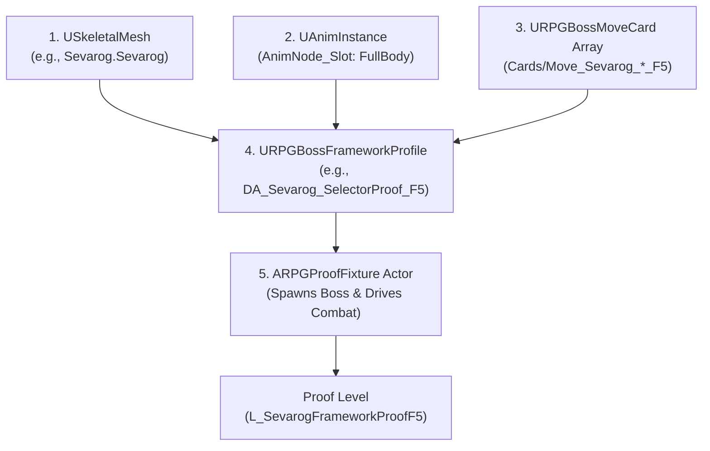
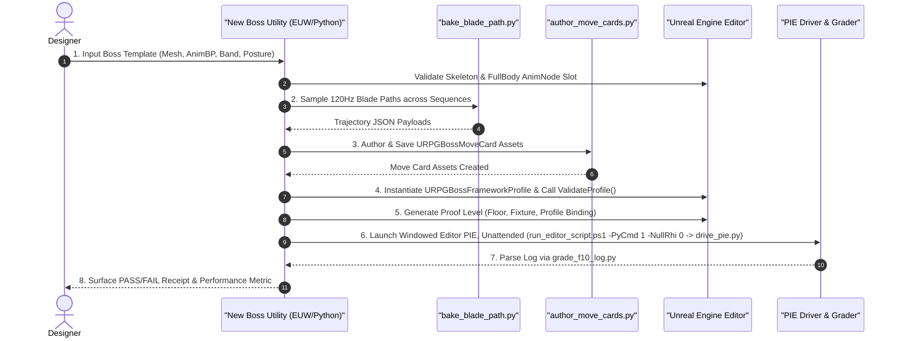

# C1: "New Boss" Editor Utility from a Template — Design Inputs & Architecture Specification

**Author:** Antigravity (Pair Programming Agent)  
**Lead / Reviewer:** Claude (Boss Combat Lead)  
**Date:** 2026-10-31  
**Task Order:** `[C-467]` (Track C1: Design Inputs for "New Boss" Template Utility)  
**Status:** DELIVERED (Read-Only Architectural Specification & Pipeline Mapping)  

---

## 1. Executive Summary & Purpose

Track C1 defines the engineering and design inputs for a high-leverage **"New Boss" Editor Utility** (Editor Utility Widget / Editor Python Utility).
Currently, setting up a new framework-compliant boss across proof milestones (F3 through F10) has been proven via staged editor Python scripts (`create_framework_proof.py`, `create_proof_level.py`, `create_f5_content.py`, `create_f6c_content.py`). While completely deterministic and zero-drift, assembling a new boss from scratch requires a designer or engineer to know every underlying C++ struct field, validation rule, socket requirement, and bake step.

This document provides a comprehensive, ground-truth mapping of:
1. **`URPGBossFrameworkProfile`**: Every single field, type, domain constraint, and C++ validation failure token in `Source/OneBossFight/Player/RPGBossFrameworkProfile.h` and `.cpp`.
2. **`URPGBossMoveCard` Spec**: Complete field specifications, timeline invariants, and validation tokens in `Source/OneBossFight/Player/RPGBossMoveCard.h` and `.cpp`.
3. **The Bake Pipeline**: Mechanics of 120 Hz blade trajectory baking (`bake_blade_path.py`) and data asset generation (`author_move_cards.py`).
4. **Required Content Assets**: Inventory of assets necessary for a boss to resolve and execute cleanly.
5. **Scripted Today vs. Manual Matrix**: Explicit demarcation of automated capabilities vs. manual content requirements.
6. **Minimal EUW / Python Utility Architecture**: A 5-stage automated pipeline (Create Template $\to$ Author & Bake Cards $\to$ Validate Profile $\to$ Generate Proof Map $\to$ PIE Run & Grade).

---

## 2. Complete Catalog: `URPGBossFrameworkProfile`

Source Reference: [RPGBossFrameworkProfile.h](file:///C:/UnrealProject/OneBossFight/Source/OneBossFight/Player/RPGBossFrameworkProfile.h#L1-L90) and [RPGBossFrameworkProfile.cpp](file:///C:/UnrealProject/OneBossFight/Source/OneBossFight/Player/RPGBossFrameworkProfile.cpp#L1-L147).

### 2.1 Profile Fields & Domains

| Field Name | Type | Category | Domain / Constraint | Validation Failure Token | Purpose / Designer Notes |
| :--- | :--- | :--- | :--- | :--- | :--- |
| `FixtureLabel` | `FString` | Identity | `"F3 fixture"`, `"F4 fixture"`, or `"F5 fixture"` | `Framework.Profile.Identity` | Declares proof fixture tier. F5 enables selector and advanced combat mechanics. |
| `Mesh` | `TSoftObjectPtr<USkeletalMesh>` | Identity | Must not be null; valid skeletal mesh asset | `Framework.Profile.Identity` | Boss visual mesh and bone/socket hierarchy host. |
| `AnimClass` | `TSoftClassPtr<UAnimInstance>` | Identity | Non-null, non-abstract child of `UAnimInstance`, skeleton matches cards | `Framework.Profile.Identity`, `Framework.Profile.AnimSkeleton` | Boss AnimBlueprint. Must implement `AnimNode_Slot` with name `"FullBody"`. |
| `TargetPawnClass` | `TSoftClassPtr<APawn>` | Identity | Non-null, non-abstract child of `APawn` | `Framework.Profile.Identity`, `Framework.Profile.Dependency` | Target pawn class (e.g., `BP_CombatPlayerCharacter_C`). |
| `Card` | `TSoftObjectPtr<URPGBossMoveCard>` | Single Card | Non-null for F3/F4; **must be null** for F5 | `Framework.Profile.Identity` | Dedicated single card for single-attack test fixtures (F3/F4). |
| `Cards` | `TArray<FRPGBossProfileCard>` | Selector Pool | `Num() >= 1` for F5; **must be empty** for F3/F4 | `Framework.Profile.Identity` | Candidate card pool for the selector. Array of `{Card, CooldownSeconds, Weight}`. |
| `bDamageEnabled` | `bool` | Combat | `true` for F4/F5; `false` for F3 | `Framework.Profile.Identity` | Governs whether boss attacks deal HP damage to target pawn. |
| `BandMinCm` | `float` | Locomotion | Finite, $> 0$, $< 10^6$, $\text{BandMinCm} < \text{BandMaxCm}$ | `Framework.Profile.Domain`, `Framework.Profile.Geometry` | Near edge of preferred combat range band. |
| `BandMaxCm` | `float` | Locomotion | Finite, $> 0$, $< 10^6$, $\text{BandMaxCm} > \text{BandMinCm}$ | `Framework.Profile.Domain`, `Framework.Profile.Geometry` | Far edge of preferred combat range band. |
| `WalkSpeedCmPerSecond` | `float` | Locomotion | Finite, $> 0$, $< 10^6$ | `Framework.Profile.Domain` | Locomotion speed when closing to combat band. |
| `AcceptanceCm` | `float` | Locomotion | Finite, $> 0$, $< 0.5 \times (\text{BandMaxCm} - \text{BandMinCm})$ | `Framework.Profile.Domain`, `Framework.Profile.Geometry` | Arrival tolerance; must fit within half the band thickness. |
| `WalkTimeoutSeconds` | `float` | Locomotion | Finite, $> 0$, $< 10^6$ | `Framework.Profile.Domain` | Safety timeout to abort approach if path is blocked. |
| `BlendInSeconds` | `float` | Animation | Finite, $> 0$, $< 10^6$, $< \text{Card.ActiveStartSeconds}$ | `Framework.Profile.Domain`, `Framework.Profile.SequenceTelemetryOnly` | Crossfade duration when initiating card montage/sequence. |
| `BlendOutSeconds` | `float` | Animation | Finite, $> 0$, $< 10^6$, $\text{RecoveryEnd} + \text{BlendOut} \le \text{ClipLength}$ | `Framework.Profile.Domain`, `Framework.Profile.CardBandOrBlendTail` | Crossfade duration back to idle upon attack completion. |
| `CapsuleRadiusCm` | `float` | Collision | Finite, $> 0$, $\le \text{CapsuleHalfHeightCm}$ | `Framework.Profile.Domain`, `Framework.Profile.Geometry` | Root collision cylinder radius (e.g., 60.0 cm). |
| `CapsuleHalfHeightCm` | `float` | Collision | Finite, $> 0$, $\ge \text{CapsuleRadiusCm}$ | `Framework.Profile.Domain`, `Framework.Profile.Geometry` | Root collision cylinder half height (e.g., 165.0 cm). |
| `TargetHealth` | `float` | Fixture Target | Finite, $> 0$, $< 10^6$, $> \text{Card.HPDamage}$ | `Framework.Profile.Domain`, `Framework.Profile.DamageCard`, `Framework.Profile.DamageBudget` | Proof target dummy health. Must survive single card and total run budget. |
| `HitStepCm` | `float` | Sweep | Finite, $> 0$, $< 10^6$ (required if `bDamageEnabled`) | `Framework.Profile.Domain` | Maximum distance one swept capsule substep may traverse. |
| `HitMaxSubsteps` | `int32` | Sweep | $\in [1, 64]$ (required if `bDamageEnabled`) | `Framework.Profile.Domain` | Maximum sweep substeps allowed per frame. |
| `RepeatPenalty` | `float` | Selector | Finite, $\in (0.0, 1.0]$ (F5 only) | `Framework.Profile.Domain` | Cooldown weight multiplier applied to recently used moves. |
| `RepeatMemory` | `int32` | Selector | $\in [1, 8]$ (F5 only) | `Framework.Profile.Domain` | Number of previous attacks tracked in selector history. |
| `AttackCount` | `int32` | Selector | $\in [1, 8]$ (F5 only) | `Framework.Profile.Domain` | Number of attacks performed during proof run. |
| `BossMaxHealth` | `float` | Boss Health | Finite, $\in [0, 10^6]$. Both $>0$ or both $=0$ with `PlayerHitDamage` | `Framework.Profile.Domain` | Boss maximum HP pool. $0.0$ disables hittable boss subsystem. |
| `PlayerHitDamage` | `float` | Boss Health | Finite, $\in [0, 10^6]$, $\le \text{BossMaxHealth}$. Paired with `BossMaxHealth` | `Framework.Profile.Domain` | HP subtracted from boss per registered player strike. |
| `PhaseTwoFraction` | `float` | Phase (F6c) | Finite, $\in (0.0, 1.0)$ if active, or $0.0$ (off) | `Framework.Profile.Phase` | Health threshold fraction triggering Phase Two transition. |
| `PhaseTwoId` | `FName` | Phase (F6c) | Non-None if `PhaseTwoFraction > 0`; None if $0.0$ | `Framework.Profile.Phase` | Tag identifying Phase Two move cards in the pool. |
| `PostureMax` | `float` | Posture (F8) | Finite, $\in [0, 10^6]$. All 5 posture fields $0$ or coherent set | `Framework.Profile.Posture` | Maximum posture capacity before stance break. |
| `PlayerPostureHitAmount` | `float` | Posture (F8) | Finite, $> 0$, $\le \text{PostureMax}$ | `Framework.Profile.Posture` | Posture damage dealt per registered player strike. |
| `StaggerSeconds` | `float` | Posture (F8) | Finite, $\in [0.5, 60.0]$ | `Framework.Profile.Posture` | Duration boss remains staggered in neutral stance break. |
| `PostureRegenDelaySeconds` | `float` | Posture (F8) | Finite, $\ge 0$, $< 10^6$ | `Framework.Profile.Posture` | Time after last hit before posture begins regenerating. |
| `PostureRegenPerSecond` | `float` | Posture (F8) | Finite, $\ge 0$, $< 10^6$ | `Framework.Profile.Posture` | Posture recovery rate per second. |
| `BleedBuildupPerHit` | `float` | Bleed (F9) | Finite, $\in [0, 10^6]$. $0$ = off, else coherent set | `Framework.Profile.Bleed` | Hemorrhage buildup points applied per hit. |
| `BleedInitialThreshold` | `float` | Bleed (F9) | Finite, $\ge 1.0$, $< 10^6$ | `Framework.Profile.Bleed` | Buildup required for first hemorrhage proc. |
| `BleedThresholdIncrease` | `float` | Bleed (F9) | Finite, $\ge 0.0$, $< 10^6$ | `Framework.Profile.Bleed` | Threshold resistance increase per proc. |
| `BleedThresholdMax` | `float` | Bleed (F9) | Finite, $\ge \text{BleedInitialThreshold}$, $< 10^6$ | `Framework.Profile.Bleed` | Cap on buildup threshold scaling. |
| `BleedHpFraction` | `float` | Bleed (F9) | Finite, $\in (0.0, 1.0]$ | `Framework.Profile.Bleed` | Chunk of max HP removed on proc (cannot kill on bleed alone). |
| `bAlignmentAuthored` | `bool` | Alignment | Must be `true` | `Framework.Profile.Alignment` | Explicit designer acknowledgement of mesh transform offset. |
| `MeshRelativeTransform` | `FTransform` | Alignment | Valid, no NaN, Scale min $> 0$, Scale max $\le 10^6$, Loc max $\le 10^6$ | `Framework.Profile.Alignment` | Offset placing mesh base at capsule bottom (e.g. $Z = -\text{HalfHeight}$, $\text{Yaw} = -90^\circ$). |

### 2.2 Profile Resolution Validation Tokens (`ResolveProfile`)

In addition to property domains, `RPGFramework::ResolveProfile()` executes deep asset cross-validation:
- `Framework.Profile.ObjectOrThread`: Must execute on Game Thread with valid Profile pointer.
- `Framework.Profile.Dependency`: Mesh, AnimClass, and TargetPawnClass must load synchronously, be non-null, and non-abstract.
- `Framework.Profile.SequenceTelemetryOnly`: S.Montage must be null, S.Sequence non-null, S.SectionName None, S.SlotName == `"FullBody"`, and `ActiveStartSeconds > BlendInSeconds`.
- `Framework.Profile.DamageCard`: For F4/F5, `HPDamage > 0` and `HPDamage < TargetHealth`.
- `Framework.Profile.AnimSkeleton`: AnimBP generated class target skeleton must match the Card's skeleton.
- `Framework.Profile.CardBandOrBlendTail`: Combat band $[\text{BandMinCm}, \text{BandMaxCm}]$ must fit within card range $[\text{MinRangeCm}, \text{MaxRangeCm}]$, and $\text{RecoveryEndSeconds} + \text{BlendOutSeconds} \le \text{ClipLengthSeconds}$.
- `Framework.Profile.PhaseCards`: If PhaseTwo active, every card must belong to Phase 1 or Phase 2; both phases must have $\ge 1$ card.
- `Framework.Profile.PhaseCooldownStarvation`: `RPGFramework::PhasePoolCannotStarve()` must pass for both phase pools across `AttackCount`.
- `Framework.Profile.DamageBudget`: $\max(\text{HPDamage}) \times \text{AttackCount} < \text{TargetHealth}$. Target dummy must survive full run.

---

## 3. Complete Catalog: `URPGBossMoveCard` Spec

Source Reference: [RPGBossMoveCard.h](file:///C:/UnrealProject/OneBossFight/Source/OneBossFight/Player/RPGBossMoveCard.h#L40-L77) and [RPGBossMoveCard.cpp](file:///C:/UnrealProject/OneBossFight/Source/OneBossFight/Player/RPGBossMoveCard.cpp#L29-L98).

### 3.1 Move Card Spec Fields & Constraints

| Field Name | Type | Domain / Constraint | Validation Token | Designer Semantics |
| :--- | :--- | :--- | :--- | :--- |
| `Schema` | `int32` | Must equal `1` | `MoveCard.Identity[Schema/MoveId/FamilyId/PhaseId]` | Data asset schema version. $0$ is deliberately invalid. |
| `MoveId` | `FName` | Non-None unique identifier | `MoveCard.Identity[...]` | Distinct move identifier (e.g. `Move_Sevarog_SwingSlow_F5`). |
| `FamilyId` | `FName` | Non-None family group | `MoveCard.Identity[...]` | Combat family classification (e.g. `Family_Melee_Basic`). |
| `PhaseId` | `FName` | Non-None phase tag | `MoveCard.Identity[...]` | Boss phase tag (e.g. `Phase_One`, `Phase_Two`). |
| `Skeleton` | `TSoftObjectPtr<USkeleton>` | Valid soft object pointer | `MoveCard.SkeletonIdentity` | Target skeletal rig. Must match mesh and animation sequence. |
| `Sequence` | `TSoftObjectPtr<UAnimSequence>` | Exactly ONE of Sequence/Montage | `MoveCard.AnimationSource`, `MoveCard.AnimationIdentity` | Primary animation sequence asset. |
| `Montage` | `TSoftObjectPtr<UAnimMontage>` | Exactly ONE of Sequence/Montage | `MoveCard.AnimationSource` | (First backend requires Sequence; Montage must remain null). |
| `SlotName` | `FName` | Must match AnimBP slot | `MoveCard.Slot` | Target playback slot. Framework resolver requires `"FullBody"`. |
| `SectionName` | `FName` | `None` for full sequence | `MoveCard.Section` | Section name within montage (must be `None` for sequence). |
| `PlayRate` | `float` | Finite, $> 0.0$, $\le 10^6$ | `MoveCard.Domain[PlayRate]` | Playback speed multiplier (nominal $1.0$). |
| `CommitSeconds` | `float` | Finite, $\ge 0.0$, $\le \text{ActiveStartSeconds}$ | `MoveCard.Timeline` | Point of no return; boss tracks target until this time. |
| `ActiveStartSeconds` | `float` | Finite, $> \text{CommitSeconds}$, $< \text{ActiveEndSeconds}$ | `MoveCard.Timeline` | Start of active damaging hit phase. Must exceed `BlendInSeconds`. |
| `ActiveEndSeconds` | `float` | Finite, $> \text{ActiveStartSeconds}$, $\le \text{RecoveryEndSeconds}$ | `MoveCard.Timeline` | End of active damaging hit phase. |
| `RecoveryEndSeconds` | `float` | Finite, $\ge \text{ActiveEndSeconds}$, $\le \text{ClipLengthSeconds}$ | `MoveCard.Timeline` | End of recovery window; boss returns to neutral locomotion. |
| `TrackDegreesPerSecond`| `float` | Finite, $\ge 0.0$, $\le 10^6$ | `MoveCard.Domain[TrackDegreesPerSecond]` | Maximum yaw rotation speed towards player during windup. |
| `MinRangeCm` | `float` | Finite, $\ge 0.0$, $\le \text{MaxRangeCm}$ | `MoveCard.Domain`, `MoveCard.Eligibility` | Minimum distance for selector eligibility. |
| `MaxRangeCm` | `float` | Finite, $\ge \text{MinRangeCm}$, $\le 10^6$ | `MoveCard.Domain`, `MoveCard.Eligibility` | Maximum distance for selector eligibility. |
| `FrontConeDegrees` | `float` | Finite, $\ge 0.0$, $\le 360.0$ | `MoveCard.Eligibility` | Forward angle cone required to initiate attack ($360.0$ = omni). |
| `HPDamage` | `float` | Finite, $\ge 0.0$ ($> 0$ for F4/F5, $< \text{TargetHealth}$) | `MoveCard.Domain[HPDamage]`, `Framework.Profile.DamageCard` | HP damage inflicted on player hit. |
| `bUsesRootMotion` | `bool` | Must be `false` | `MoveCard.UnsupportedRootMotion` | Current framework backend supports in-place animation only. |
| `Windows` | `TArray<FRPGBossMoveWindow>`| Non-empty array | `MoveCard.Window[no hit windows]` | Hit window capsule definitions and trajectory samples. |

### 3.2 Hit Window Spec (`FRPGBossMoveWindow`)

Each window inside `Windows` must satisfy:
- `WindowId`: Non-None, unique across the card (`MoveCard.WindowIdentity`).
- `HitGroup`: Non-None (can be shared across windows to prevent multiple hits from same swing).
- Timeline Invariant: $\text{ActiveStartSeconds} \le \text{StartSeconds} < \text{EndSeconds} \le \text{ActiveEndSeconds}$, and $\text{StartSeconds} \ge \text{PreviousWindow.EndSeconds}$ (`MoveCard.Window`).
- `RadiusCm`: Finite, $> 0.0$, $\le 10^6$ (e.g. $20.0\text{ cm}$).
- `SocketA` & `SocketB`: Distinct non-None names, both existing on Mesh or Skeleton (`MoveCard.Socket`). E.g., `weapon_r` (base) and `root_weapon_end_r` (tip).
- `BakedSamples`: If populated, must have $\ge 2$ samples, strictly ascending `TimeSeconds`, covering $[\text{StartSeconds}, \text{EndSeconds}]$, within bounds and no NaNs (`MoveCard.BakedSamples`).

---

## 4. The Bake Pipeline (`bake_blade_path.py` & `author_move_cards.py`)

Source Reference: [bake_blade_path.py](file:///C:/UnrealProject/OneBossFight/Docs/BossCombatReview/Execution/Antigravity/MoveCards/bake_blade_path.py) and [author_move_cards.py](file:///C:/UnrealProject/OneBossFight/Docs/BossCombatReview/Execution/Antigravity/MoveCards/author_move_cards.py).

### 4.1 Step 1: Trajectory Sampling (`bake_blade_path.py`)
- Evaluates the animation sequence in Component/World space at 120 Hz ($\Delta t = 1/120\text{ s} \approx 0.008333\text{ s}$), plus exact window boundaries.
- Uses `unreal.AnimPoseExtensions.get_anim_pose_at_time(seq, time)` or sequence reflection.
- Extracts $(X, Y, Z)$ translation for `SocketA` (Base) and `SocketB` (Tip).
- Emits structured JSON containing:
  ```json
  {
    "WindowId": "Window_Main",
    "Samples": [
      {"TimeSeconds": 0.450, "BaseCS": [20.1, -15.2, 85.0], "TipCS": [120.4, -30.5, 140.2]},
      {"TimeSeconds": 0.458333, "BaseCS": [22.4, -10.1, 88.3], "TipCS": [135.2, -15.0, 142.1]}
    ]
  }
  ```
- **Safety Gates**: Refuses if sequence duration is shorter than window end, or if sockets are missing.

### 4.2 Step 2: Card Asset Authoring (`author_move_cards.py`)
- Ingests card specification JSON with baked sample payloads.
- Validates all invariants offline (dry-run mode).
- In apply mode (`--apply --save`):
  1. Creates `URPGBossMoveCard` DataAsset via `unreal.AssetToolsHelpers.get_asset_tools().create_asset()`.
  2. Sets `Spec` struct fields, assigning `Skeleton`, `Sequence`, and `SlotName = "FullBody"`.
  3. Populates `Windows` array, copying `FRPGBakedBladeSample` records.
  4. Performs read-back verification of all properties from the newly instantiated UObject.
  5. Saves asset package to `/Game/OneBossFight/FrameworkProof/Cards/<MoveId>`.

---

## 5. Required Content Assets Inventory

A functional Framework Boss requires five core asset classes:



1. **Skeletal Mesh (`USkeletalMesh`)**:
   - Primary mesh with skin weights and physics asset.
   - Sockets: Must have base and tip sockets for each weapon (e.g. `weapon_r`, `root_weapon_end_r`).
2. **AnimBlueprint (`UAnimInstance`)**:
   - Must be compiled on the same `USkeleton` as the mesh.
   - **Crucial Requirement**: AnimGraph must contain an `AnimNode_Slot` with `SlotName == "FullBody"` (`RPGBossFrameworkProfile.cpp:133-146`).
3. **Move Cards (`URPGBossMoveCard`)**:
   - Minimum 1 card for F3/F4; minimum 2 cards (or $\ge \text{AttackCount}$) for F5 selector to prevent cooldown starvation (`PhasePoolCannotStarve`).
   - Sourced from in-place `UAnimSequence` assets.
4. **Boss Framework Profile (`URPGBossFrameworkProfile`)**:
   - Primary Data Asset holding identity, tuning, combat band, phases, posture, bleed, and alignment.
5. **Proof Level & Fixture (`UWorld` / `RPGFrameworkProofFixture`)**:
   - Map containing floor geometry, `PlayerStart`, directional light, and `RPGFrameworkProofFixture` actor referencing the Profile.

---

## 6. Scripted Today vs. Manual Matrix

| Step / Artifact | Status Today | Tool / Implementation File | Missing Piece / Manual Friction |
| :--- | :--- | :--- | :--- |
| **Mesh & Skeleton Setup** | Manual | Skeletal Mesh Editor | Sockets (`weapon_r`, tip) must be placed manually if not in source FBX. |
| **AnimBP FullBody Slot** | Manual | AnimGraph Editor | Designer must manually drop an `AnimNode_Slot("FullBody")` into the pose tree. |
| **Animation Timing Audit** | Manual / Tool Assisted | Editor Scrubbing / Python Probes | Determining `ActiveStartSeconds` and `ActiveEndSeconds` requires human inspection. |
| **Blade Trajectory Bake** | **Scripted** | `Antigravity/MoveCards/bake_blade_path.py:1-434` | Fully automated once window timing and sockets are declared. |
| **Move Card Generation** | **Scripted** | `Antigravity/MoveCards/author_move_cards.py:1-645`| Fully automated JSON $\to$ `URPGBossMoveCard` DataAsset with read-back audit. |
| **Profile DataAsset** | **Scripted** | `Claude/F5/create_f5_content.py:54-100` | Automated in Python, but previously hardcoded per proof level. Needs template UI. |
| **Proof Level Assembly** | **Scripted** | `Claude/F3c/create_proof_level.py:1-82` | Fully automated spawning of floor, lights, player start, and fixture actor. |
| **PIE Combat Execution** | **Scripted** | `Claude/F4/drive_pie.py`, `run_pie.ps1` | Windowed editor PIE, unattended execution with auto-injected inputs and structured log capture. |
| **Log Grading & Verdict** | **Scripted** | `Antigravity/Reviews/grade_f10_log.py:1-250` | Automated regex parser verifying zero asserts, hit intakes, posture, and bleed. |

---

## 7. Minimal Editor Utility Widget (EUW) / Python Flow

We propose a unified 5-step utility architecture implemented either as an **Editor Utility Widget (EUW)** in Blueprint/C++ or an **Editor Utility Python Script** launched from the Editor menu.



### 7.1 Pipeline Stages & Concrete File:Line Cites

1. **Stage 1: Boss Template Definition & Preflight**
   - **Action**: Designer specifies Boss Name, SkeletalMesh, AnimBP, sockets, and combat style.
   - **Manual Prerequisites & Automated Validation**:
     - Sockets on the SkeletalMesh and the `"FullBody"` slot in AnimBP are the **only manual prerequisites**.
     - Check AnimBP has `"FullBody"` slot: call `RPGFramework::HasSlotNode(AnimInstance, "FullBody")` ([RPGBossFrameworkProfile.cpp:133-146](file:///C:/UnrealProject/OneBossFight/Source/OneBossFight/Player/RPGBossFrameworkProfile.cpp#L133-L146)). Missing slot triggers `Framework.Profile.SequenceTelemetryOnly` or `Framework.Profile.AnimSkeleton`.
     - Verify Sockets exist on mesh: `Mesh->FindSocket("weapon_r")` ([RPGBossMoveCard.cpp:133](file:///C:/UnrealProject/OneBossFight/Source/OneBossFight/Player/RPGBossMoveCard.cpp#L133)). Missing or identical sockets trigger `MoveCard.Socket` or `Framework.Boss.WeaponBone` / `DegenerateSegment`.

2. **Stage 2: Card Specification & Trajectory Bake**
   - **Action**: Utility takes animation sequence list with declared `[ActiveStart, ActiveEnd]`.
   - **Automated Engine Bake**: Invoking `bake_blade_path.py` ([bake_blade_path.py:38-95](file:///C:/UnrealProject/OneBossFight/Docs/BossCombatReview/Execution/Antigravity/MoveCards/bake_blade_path.py#L38-L95)) **requires an engine run** because it uses `unreal.AnimPoseExtensions.get_anim_pose_at_time()` to sample 120 Hz Component-Space blade samples. A designer cannot type baked samples by hand.
   - **Automated Authoring**: Invokes `author_move_cards.execute_authoring()` ([author_move_cards.py:540-620](file:///C:/UnrealProject/OneBossFight/Docs/BossCombatReview/Execution/Antigravity/MoveCards/author_move_cards.py#L540-L620)) to instantiate and save `URPGBossMoveCard` assets with validated baked trajectories.

3. **Stage 3: Profile Assembly & C++ Validation**
   - **Action**: Instantiates `URPGBossFrameworkProfile` using `unreal.AssetToolsHelpers.get_asset_tools().create_asset()` ([create_f5_content.py:54-55](file:///C:/UnrealProject/OneBossFight/Docs/BossCombatReview/Execution/Claude/F5/create_f5_content.py#L54-L55)).
   - Sets alignment, locomotion bands, combat parameters, posture, bleed, and cards array.
   - Executes `RPGFramework::ValidateProfile()` ([RPGBossFrameworkProfile.cpp:20-75](file:///C:/UnrealProject/OneBossFight/Source/OneBossFight/Player/RPGBossFrameworkProfile.cpp#L20-L75)) and `RPGFramework::ResolveProfile()` ([RPGBossFrameworkProfile.cpp:76-132](file:///C:/UnrealProject/OneBossFight/Source/OneBossFight/Player/RPGBossFrameworkProfile.cpp#L76-L132)).
   - Reports any validation token immediately in the editor UI before proceeding.

4. **Stage 4: Automated Proof Level Generation**
   - **Action**: Calls `subsystem.new_level(LevelPath)` ([create_proof_level.py:37-39](file:///C:/UnrealProject/OneBossFight/Docs/BossCombatReview/Execution/Claude/F3c/create_proof_level.py#L37-L39)).
   - Sets GameMode to `unreal.RPGFrameworkProofGameMode` ([create_proof_level.py:43](file:///C:/UnrealProject/OneBossFight/Docs/BossCombatReview/Execution/Claude/F3c/create_proof_level.py#L43)).
   - Spawns Floor, PlayerStart, DirectionalLight, and `RPGFrameworkProofFixture` ([create_proof_level.py:44-60](file:///C:/UnrealProject/OneBossFight/Docs/BossCombatReview/Execution/Claude/F3c/create_proof_level.py#L44-L60)).
   - Binds the generated Profile to `fix.profile` and saves the level.

5. **Stage 5: Windowed Editor PIE Proof (Unattended) & Automated Grading**
   - **Action**: Launches unattended PIE test in the **windowed editor** (nullrhi cannot spawn actors, KI-144).
   - **Execution Hook**: `run_pie.ps1` calls `run_editor_script.ps1 -PyCmd 1 -NullRhi 0` which translates to `-ExecCmds="py <8.3 path>"` running `Claude/F4/drive_pie.py` (~262 lines) with slate tick callbacks (NOT `-ExecutePythonScript drive_pie.py` which is synchronous only).
   - **Driver Options**: `drive_pie.py` supports options via param files: `-Restart`, `-Inject`, `-InjectPie`, `-InjectRow`, `-RealSwing`, `-RealBuild`, `-Live`, `-DiagLong`, `-Dodge`.
   - **Warmup Timing**: The first ~10 seconds of every run are reserved for the pack-style wait (KI-150) before combat actions engage.
   - **Grading**: Pipes `editor_raw.log` to `grade_f10_log.py` (`grade_f10_log_lines`, [grade_f10_log.py:38-250](file:///C:/UnrealProject/OneBossFight/Docs/BossCombatReview/Execution/Antigravity/Reviews/grade_f10_log.py#L38-L250)).
   - Checks that all attacks execute, sweep steps register, posture damages, bleed accumulates, and exit code is 0.
   - Displays a green "VERIFIED FRAMEWORK BOSS" badge in the UI with exact run metrics.

---

## 8. Summary of Benefits

- **Zero Asset Drift**: Every asset is validated against the exact C++ tokens before saving to disk.
- **One-Click Turnkey Creation**: Transforms a 6-step manual, multi-script manual workflow into an automated 30-second pipeline.
- **Immediate Feedback**: Any skeleton mismatch, missing slot, or cooldown starvation error is surfaced instantly with exact token diagnostics.
- **Regression Protection**: Integrated PIE proof and grading ensures newly authored bosses cannot break the combat framework.
