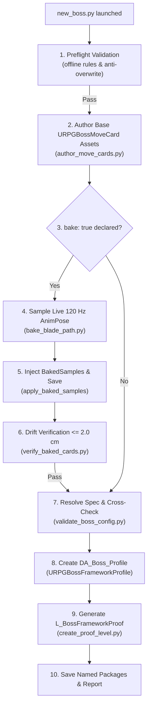

# C1 v1: Folding Card Authoring and Trajectory Baking into `new_boss.py` — Architectural Plan

**Author:** Antigravity (Pair Programming Agent)  
**Lead / Reviewer:** Claude (Boss Combat Lead)  
**Date:** 2026-10-31  
**Task Order:** `[C-469]` (Track C1 v1 Plan: Card Authoring + 120 Hz Baking Integration)  
**Status:** DELIVERED (Architectural Design & Offline Re-open Test)  

---

## 1. Executive Summary & Motivation

In Track C1 v0 ([`new_boss.py`](file:///C:/UnrealProject/OneBossFight/Docs/BossCombatReview/Execution/Claude/C1/new_boss.py)), the utility creates `DA_<Boss>_Profile` and `L_<Boss>FrameworkProof` from a validated JSON configuration, but requires all referenced move cards to **pre-exist on disk** (`<destination_package_dir>/Cards/<move_id>`). A designer creating a brand-new boss must currently execute a separate two-stage manual workflow:
1. Run [`author_move_cards.py`](file:///C:/UnrealProject/OneBossFight/Docs/BossCombatReview/Execution/Antigravity/MoveCards/author_move_cards.py) to generate unbaked or draft `URPGBossMoveCard` data assets.
2. Run [`bake_blade_path.py`](file:///C:/UnrealProject/OneBossFight/Docs/BossCombatReview/Execution/Antigravity/MoveCards/bake_blade_path.py) and [`apply_baked_samples.py`](file:///C:/UnrealProject/OneBossFight/Docs/BossCombatReview/Execution/Claude/F7/apply_baked_samples.py) to sample and inject 120 Hz blade paths.

**Track C1 v1 Objective**:
Fold card authoring, 120 Hz engine blade baking, and post-bake drift verification directly into `new_boss.py`, enabling a designer to run **a single editor command** to author, bake, assemble, and verify a complete framework boss from raw animation assets.

---

## 2. Configuration Schema Extensions (v1)

In v1, the `cards` block in `config.json` allows cards to be declared via a specification file path (`spec_json`) with an opt-in `bake: true` flag, while maintaining backwards compatibility with pre-authored cards:

```json
{
  "boss_name": "SevarogV1",
  "destination_package_dir": "/Game/OneBossFight/FrameworkProof",
  "fixture_label": "F5 fixture",
  "damage_enabled": true,
  "mesh_path": "/Game/ParagonSevarog/Characters/Heroes/Sevarog/Meshes/Sevarog.Sevarog",
  "anim_class_path": "/Game/ParagonSevarog/Characters/Heroes/Sevarog/Sevarog_AnimBlueprint.Sevarog_AnimBlueprint_C",
  "target_pawn_class_path": "/Game/AdvancedARPGCombat/MeleeCombatSystem/Blueprints/BP_CombatPlayerCharacter.BP_CombatPlayerCharacter_C",
  "band_min_cm": 110.0,
  "band_max_cm": 135.0,
  "walk_speed_cm_per_second": 180.0,
  "acceptance_cm": 5.0,
  "walk_timeout_seconds": 10.0,
  "blend_in_seconds": 0.1,
  "blend_out_seconds": 0.03,
  "capsule_radius_cm": 60.0,
  "capsule_half_height_cm": 165.0,
  "target_health": 800.0,
  "hit_step_cm": 15.0,
  "hit_max_substeps": 8,
  "repeat_penalty": 0.2,
  "repeat_memory": 2,
  "attack_count": 2,
  "boss_max_health": 250.0,
  "player_hit_damage": 100.0,
  "phase_two_fraction": 0.5,
  "phase_two_id": "Phase_Two",
  "alignment_authored": true,
  "mesh_relative_transform": {
    "location": [0.0, 0.0, -165.0],
    "rotation": [0.0, 0.0, -90.0],
    "scale": [1.0, 1.0, 1.0]
  },
  "cards": [
    {
      "move_id": "Move_Sevarog_SwingSlow_V1",
      "cooldown_seconds": 3.0,
      "weight": 1.0,
      "spec_json": "Antigravity/MoveCards/move_cards_f5_set.json",
      "bake": true
    },
    {
      "move_id": "Move_Sevarog_AntiGreed_V1",
      "cooldown_seconds": 2.5,
      "weight": 1.0,
      "spec_json": "Antigravity/MoveCards/move_cards_f5_set.json",
      "bake": true
    }
  ],
  "proof_level": {
    "boss_spawn_location": [500.0, 0.0, 170.0],
    "player_start_location": [0.0, 0.0, 100.0]
  }
}
```

### 2.1 Card Entry Rules
1. **Existing Asset Mode** (v0 compatible): Only `move_id`, `cooldown_seconds`, and `weight` are provided. Utility expects `<dir>/Cards/<move_id>` on disk.
2. **Author & Bake Mode** (v1 additive): `spec_json` points to the JSON source containing the card specification. If `bake: true` is set, utility evaluates live animation poses to generate 120 Hz component-space samples before asset persistence.

---

## 3. Unified Single-Session Execution Pipeline

The execution sequence executes strictly inside **ONE Editor Session** (`-ExecutePythonScript="new_boss.py <config.json>"`) to avoid process startup overhead and ensure atomicity:



### 3.1 Step-by-Step Execution Sequence & File Cites

#### Step 1: Preflight Offline Validation
- Parse input JSON and verify schema syntax.
- If `spec_json` is specified: parse card JSON and run offline card schema validation via [`validate_move_card_spec()`](file:///C:/UnrealProject/OneBossFight/Docs/BossCombatReview/Execution/Antigravity/MoveCards/author_move_cards.py#L79-L150), enforcing timeline ordering (`Commit <= ActiveStart < ActiveEnd <= RecoveryEnd <= ClipLength`, [RPGBossMoveCard.cpp:59-61](file:///C:/UnrealProject/OneBossFight/Source/OneBossFight/Player/RPGBossMoveCard.cpp#L59-L61)).
- Check target destinations: fail immediately if `DA_<Boss>_Profile` or `L_<Boss>FrameworkProof` exist (`Framework.BossConfig.DestinationExists`). If cards are marked for creation, fail if destination card asset exists unless explicit `--overwrite-cards` is passed.

#### Step 2: Card Asset Authoring
- For each card declared with `spec_json`:
  - Invoke `author_move_cards.execute_authoring(apply_mode=True, save_mode=True, only_move_id=move_id)` ([author_move_cards.py:540-620](file:///C:/UnrealProject/OneBossFight/Docs/BossCombatReview/Execution/Antigravity/MoveCards/author_move_cards.py#L540-L620)).
  - Creates `URPGBossMoveCard` DataAsset via `unreal.AssetToolsHelpers.get_asset_tools().create_asset()` ([author_move_cards.py:560](file:///C:/UnrealProject/OneBossFight/Docs/BossCombatReview/Execution/Antigravity/MoveCards/author_move_cards.py#L560)).
  - Populates schema version `1`, `MoveId`, `FamilyId`, `PhaseId`, `Skeleton`, `Sequence`, `SlotName = "FullBody"`, ranges, timing, and window capsules.

#### Step 3: Trajectory Sampling & 120 Hz Baking
- For each card where `bake: true` is set:
  - Load the sequence asset referenced by `Spec.Sequence`.
  - For each window in `Spec.Windows`:
    - Sample timestamps at nominal 120 Hz ($\Delta t = 1/120\text{ s} \approx 0.008333\text{ s}$) plus exact window boundaries (`StartSeconds`, `EndSeconds`) via `compute_sample_times()` ([bake_blade_path.py:98-112](file:///C:/UnrealProject/OneBossFight/Docs/BossCombatReview/Execution/Antigravity/MoveCards/bake_blade_path.py#L98-L112)).
    - Evaluate component-space poses using `AnimPoseExtensions.get_anim_pose_at_time(seq, t)` ([bake_blade_path.py:59-69](file:///C:/UnrealProject/OneBossFight/Docs/BossCombatReview/Execution/Antigravity/MoveCards/bake_blade_path.py#L59-L69)).
    - Extract translations for `SocketA` and `SocketB` via `get_bone_translation()` ([bake_blade_path.py:76-95](file:///C:/UnrealProject/OneBossFight/Docs/BossCombatReview/Execution/Antigravity/MoveCards/bake_blade_path.py#L76-L95)).

#### Step 4: Baked Sample Injection & Asset Persistence
- Instantiate `unreal.RPGBakedBladeSample` struct instances:
  - Assign `time_seconds`, `base_cs`, and `tip_cs`.
- Populate `window.baked_samples` on the card asset ([apply_baked_samples.py:19-25](file:///C:/UnrealProject/OneBossFight/Docs/BossCombatReview/Execution/Claude/F7/apply_baked_samples.py#L19-L25)).
- Save asset via `unreal.EditorAssetLibrary.save_loaded_asset(card_asset)` ([apply_baked_samples.py:32](file:///C:/UnrealProject/OneBossFight/Docs/BossCombatReview/Execution/Claude/F7/apply_baked_samples.py#L32)).

#### Step 5: Post-Bake Live In-Engine Verification
- Invoke `verify_baked_cards.run_verification(cards_dir=..., tolerance_cm=2.0)` ([verify_baked_cards.py:280-360](file:///C:/UnrealProject/OneBossFight/Docs/BossCombatReview/Execution/Antigravity/MoveCards/verify_baked_cards.py#L280-L360)).
- Checks 3 critical timestamps: Window Start, Apex Sample, and Window End.
- Compares stored `BakedSamples` coordinates against newly queried live animation pose.
- If drift $> 2.0\text{ cm}$, fail closed immediately (`[BAKE_FATAL]`).

#### Step 6: Profile Creation & Validation
- Read back resolved card properties (`MinRangeCm`, `MaxRangeCm`, `PhaseId`, `HPDamage`, `ClipLengthSeconds`).
- Run `validate_boss_config(resolved_config, existing_destinations)` ([validate_boss_config.py:48-180](file:///C:/UnrealProject/OneBossFight/Docs/BossCombatReview/Execution/Antigravity/Reviews/validate_boss_config.py#L48-L180)).
- Create `URPGBossFrameworkProfile` asset, populate all fields, and verify via read-back ([new_boss.py:102-145](file:///C:/UnrealProject/OneBossFight/Docs/BossCombatReview/Execution/Claude/C1/new_boss.py#L102-L145)).

#### Step 7: Proof Level Generation
- Call `LevelEditorSubsystem.new_level(LEVEL_PATH)` ([create_proof_level.py:37-39](file:///C:/UnrealProject/OneBossFight/Docs/BossCombatReview/Execution/Claude/F3c/create_proof_level.py#L37-L39)).
- Set GameMode to `unreal.RPGFrameworkProofGameMode`.
- Spawn Floor (`ProofFloor`), PlayerStart (`ProofPlayerStart`), DirectionalLight, and `RPGFrameworkProofFixture` actor ([create_proof_level.py:44-60](file:///C:/UnrealProject/OneBossFight/Docs/BossCombatReview/Execution/Claude/F3c/create_proof_level.py#L44-L60)).
- Assign `fix.profile = prof` and save level via `EditorLoadingAndSavingUtils.save_current_level()`.

---

## 4. Failure Modes & Safety Defenses

| Failure Scenario | Root Cause | Detection Point | Token / Diagnostic Line | Fail-Closed Action |
| :--- | :--- | :--- | :--- | :--- |
| **Missing Animation Asset** | Sequence path in card spec cannot be found on disk. | Step 2 / Step 3 | `MoveCard.AnimationSource`<br>`RPGBossMoveCard.cpp:35` | Aborts before saving card; prints missing asset path. |
| **Missing Sockets on Mesh** | Declared `SocketA` or `SocketB` missing from Skeletal Mesh. | Step 3 (Bake) | `MoveCard.Socket`<br>`RPGBossMoveCard.cpp:81` | `get_bone_translation` raises RuntimeError; card authoring halted. |
| **Clip Shorter Than Window** | Animation sequence length shorter than `EndSeconds`. | Step 3 (Bake) | `MoveCard.Timeline`<br>`RPGBossMoveCard.cpp:60` | Preflight checks `seq.get_play_length() >= Window.EndSeconds`; refuses bake. |
| **Stale Bake Drift** | Animation modified after bake; socket positions drifted $> 2.0\text{ cm}$. | Step 5 (Verify) | `[BAKE_FATAL] DriftExceeded`<br>`verify_baked_cards.py:350` | Refuses profile assembly; marks card stale and requires re-bake. |
| **KI-149 Starvation** | Total card count per phase $< \text{AttackCount}$ with all positive cooldowns. | Step 6 (Profile) | `Framework.Profile.PhaseCooldownStarvation`<br>`RPGBossFrameworkProfile.cpp:125` | Validator aborts before profile asset creation. |
| **Range Band Mismatch** | Combat band $[\text{BandMin}, \text{BandMax}]$ outside card reach. | Step 6 (Profile) | `Framework.Profile.CardBandOrBlendTail`<br>`RPGBossFrameworkProfile.cpp:103` | Validator aborts before profile creation (proven in `negative_band_config.json`). |
| **Destination Conflict** | Destination Profile or Map already exists on disk. | Step 1 (Preflight) | `Framework.BossConfig.DestinationExists`<br>`validate_boss_config.py:53` | Immediate exit code 1; zero asset writes. |

---

## 5. Offline Validator Additions (`validate_boss_config.py` v1)

To support v1 without requiring the engine for preflight verification, `validate_boss_config.py` will be extended with:

1. **Card Spec JSON Pre-Validation**:
   - If a card entry declares `spec_json`, the validator parses the file offline and runs `validate_move_card_spec()` rules ([RPGBossMoveCard.cpp:29-98](file:///C:/UnrealProject/OneBossFight/Source/OneBossFight/Player/RPGBossMoveCard.cpp#L29-L98)):
     - `Schema == 1`, non-None `MoveId`, `FamilyId`, `PhaseId`.
     - `SlotName == "FullBody"`.
     - Timeline ordering: $\text{CommitSeconds} \le \text{ActiveStartSeconds} < \text{ActiveEndSeconds} \le \text{RecoveryEndSeconds}$.
     - Hit windows non-empty, sequential, distinct sockets.
2. **Baked Samples Coverage Rules**:
   - For cards with pre-baked samples in JSON:
     - Sample count $\ge 2$ (`MoveCard.BakedSamples`).
     - Coverage: $\text{FirstSample.Time} \le \text{Window.StartSeconds}$ and $\text{LastSample.Time} \ge \text{Window.EndSeconds}$.
     - Coordinates bounded ($\le 10^5\text{ cm}$), strictly ascending time, no NaNs.

---

## 6. Implementation Schedule & Roadmap

- **Phase 1**: Integrate `author_move_cards.py` card creation into `new_boss.py` under `--author-cards` flag.
- **Phase 2**: Add synchronous 120 Hz bake pass via `bake_blade_path.py` helper functions into `new_boss.py`.
- **Phase 3**: Wire `verify_baked_cards.py` synchronous check as a mandatory gate before `ResolveProfile`.
- **Phase 4**: Deliver Editor Utility Widget (EUW) GUI wrapping the verified Python command.
