# Track C3 v1: Weapon Catalog Registration & Loadout Switch Design Specification

**Author:** Antigravity (Pair Programming Agent)  
**Lead / Reviewer:** Claude (Boss Combat Lead)  
**Date:** 2026-10-31  
**Task Order:** `[C-479]` / `[C-480]` (Track C3 v1: Catalog Entry Part)  
**Status:** DELIVERED (Read-Only Architectural Specification & Offline Validator Extension)  
**Reference Document:** `Docs/BossCombatReview/Execution/Antigravity/Reviews/C3_NEW_WEAPON_UTILITY_DESIGN.md`  

---

## 1. Executive Summary & Purpose

Following the delivery and verification of Track C3 v0 (table tuning rows in `DA_WeaponAttacks.uasset`, proven via `-InjectRow` in BUILD-91), this specification establishes the design inputs for **Track C3 v1: The Catalog Entry Part**.

In One Boss Fight, adding rows to `DA_WeaponAttacks` allows hit intake to look up damage/posture/hyperarmor values by combat style name. However, for a player to equip, hold, cycle to, or switch to the weapon via `rpg.Build <console_name>`, the weapon and its build loadout must be registered in the **Data-Driven Combat Catalog** (`URPGCombatCatalog`).

This document details:
1. **Catalog Registration Architecture**: How `URPGWeaponDefinition`, `URPGBuildDefinition`, and `DA_CombatCatalog` interact.
2. **Current C++ Engine Validations**: Detailed inventory of checks in `RPGCombatCatalog.cpp:124-234` with exact code citations.
3. **Exact Asset Properties**: Field-by-field schema for creating the definition assets and updating the root catalog.
4. **Failure Tokens**: Structured diagnostic tokens for offline preflight validation.
5. **Runtime Switch Path**: Complete execution flow of `rpg.Build <console_name>` via `FEpoch::Parse` and `URPGBuildLoadout::CallEquip`.
6. **Offline Validator Extension**: Declarative schema and validator rules for the catalog block in `validate_weapon_config.py`.

---

## 2. Catalog Registration Architecture

The data-driven combat catalog replaces the legacy hardcoded enum `ERPGBuild` with an extensible, immutable data epoch compiled at engine startup.

Registration requires three interconnected asset tiers:

```
[DA_CombatCatalog.uasset] (URPGCombatCatalog)
  |-- Weapons: Array of TSoftObjectPtr<URPGWeaponDefinition>
  |     |-- DA_Weapon_Sword.uasset
  |     |-- DA_Weapon_Claymore.uasset
  |     |-- DA_Weapon_DualSwords.uasset
  |     +-- DA_Weapon_FengMaoPolearm.uasset  <-- NEW (URPGWeaponDefinition)
  |
  +-- Builds: Array of TSoftObjectPtr<URPGBuildDefinition>
        |-- DA_Build_Starter.uasset
        |-- DA_Build_Strength.uasset
        |-- DA_Build_Dex.uasset
        +-- DA_Build_FengMaoPolearm.uasset   <-- NEW (URPGBuildDefinition)
```

### 2.1 The Asset Tiers

1. **Root Catalog Asset** (`URPGCombatCatalog`, [RPGCombatCatalog.h:63-71](file:///c:/UnrealProject/OneBossFight/Source/OneBossFight/Player/RPGCombatCatalog.h#L63-L71)):
   - Location: `/Game/OneBossFight/Data/Catalog/DA_CombatCatalog.DA_CombatCatalog`
   - Shipped SchemaVersion: `1`.
   - Contains soft object reference arrays `Weapons` and `Builds`.
   - `URPGCombatCatalogSubsystem::Initialize` synchronously loads each referenced asset and calls `Compile()`.

2. **Weapon Definition Asset** (`URPGWeaponDefinition`, [RPGCombatCatalog.h:48-53](file:///c:/UnrealProject/OneBossFight/Source/OneBossFight/Player/RPGCombatCatalog.h#L48-L53)):
   - Primary data asset wrapping `FRPGCatalogWeapon Definition`.
   - Defines physical pack asset references (`StyleAsset`, `ItemPath`, `ItemBaseClass`, `ActorClass`, `AbilityClass`), HUD display word (`HudWeaponWord`), combat style name (`StyleName`), aliases, and supported attack actions (`Actions`).

3. **Build Definition Asset** (`URPGBuildDefinition`, [RPGCombatCatalog.h:55-61](file:///c:/UnrealProject/OneBossFight/Source/OneBossFight/Player/RPGCombatCatalog.h#L55-L61)):
   - Primary data asset wrapping `FRPGCatalogBuild Definition`.
   - Links a user-facing build command (`ConsoleName`, `Aliases`, `DisplayName`, `UiOrder`) to a technical `WeaponId`.
   - Enforces legacy slot rules (`LegacySlot = INDEX_NONE` for any authored expansion weapon).

---

## 3. What `RPGCombatCatalog.cpp` Validates Today

`RPGCombatRegistry::Compile()` ([RPGCombatCatalog.cpp:124-234](file:///c:/UnrealProject/OneBossFight/Source/OneBossFight/Player/RPGCombatCatalog.cpp#L124-L234)) executes rigorous structural and reference checks before publishing an immutable `FEpoch`.

### 3.1 Structural & Naming Constraints

| Check / Domain Rule | Source Line Citation | Engine Failure String |
| :--- | :--- | :--- |
| Catalog arrays non-empty | [RPGCombatCatalog.cpp:129](file:///c:/UnrealProject/OneBossFight/Source/OneBossFight/Player/RPGCombatCatalog.cpp#L129) | `Catalog.Builds/Weapons: empty` |
| WeaponId non-empty & unique | [RPGCombatCatalog.cpp:133](file:///c:/UnrealProject/OneBossFight/Source/OneBossFight/Player/RPGCombatCatalog.cpp#L133) | `Weapons.WeaponId: empty/duplicate` |
| Weapon mandatory fields present | [RPGCombatCatalog.cpp:135](file:///c:/UnrealProject/OneBossFight/Source/OneBossFight/Player/RPGCombatCatalog.cpp#L135) | `<WeaponId>.Style/Item/HudWord/Actions: required` |
| StyleName & Aliases non-empty and unconflicted | [RPGCombatCatalog.cpp:136-141](file:///c:/UnrealProject/OneBossFight/Source/OneBossFight/Player/RPGCombatCatalog.cpp#L136-L141) | `<WeaponId>.StyleAliases: empty/conflict` |
| BuildId non-empty, unique, known WeaponId, non-empty DisplayName | [RPGCombatCatalog.cpp:146](file:///c:/UnrealProject/OneBossFight/Source/OneBossFight/Player/RPGCombatCatalog.cpp#L146) | `Builds.Id/WeaponId/DisplayName: invalid` |
| LegacySlot valid (0..2 or INDEX_NONE) and unique | [RPGCombatCatalog.cpp:148](file:///c:/UnrealProject/OneBossFight/Source/OneBossFight/Player/RPGCombatCatalog.cpp#L148) | `<BuildId>.LegacySlot: invalid/duplicate` |
| ConsoleName / Aliases non-empty, unreserved, unique | [RPGCombatCatalog.cpp:150-156](file:///c:/UnrealProject/OneBossFight/Source/OneBossFight/Player/RPGCombatCatalog.cpp#L150-L156) | `<BuildId>.Aliases: empty/reserved/collision` |
| Exactly 3 legacy compatibility slots present | [RPGCombatCatalog.cpp:158](file:///c:/UnrealProject/OneBossFight/Source/OneBossFight/Player/RPGCombatCatalog.cpp#L158) | `Builds.LegacySlot: three compatibility slots required` |
| Pinned 3-build contract preserved (Starter, Strength, Dex) | [RPGCombatCatalog.cpp:161-172](file:///c:/UnrealProject/OneBossFight/Source/OneBossFight/Player/RPGCombatCatalog.cpp#L161-L172) | `Builds.LegacySlot: pinned three-build contract changed` |

### 3.2 Reference Resolution & Typed ABI Constraints (`bResolveAssets = true`)

| Check / Domain Rule | Source Line Citation | Engine Failure String |
| :--- | :--- | :--- |
| `ItemPath` loadable and inherits from `ItemBaseClass` | [RPGCombatCatalog.cpp:183-187](file:///c:/UnrealProject/OneBossFight/Source/OneBossFight/Player/RPGCombatCatalog.cpp#L183-L187) | `<WeaponId>.References: unresolved/wrong type/cook policy` |
| `ItemBaseClass` loadable and is `UClass` | [RPGCombatCatalog.cpp:185-187](file:///c:/UnrealProject/OneBossFight/Source/OneBossFight/Player/RPGCombatCatalog.cpp#L185-L187) | `<WeaponId>.References: unresolved/wrong type/cook policy` |
| `ActorClass` loadable and child of `AActor` | [RPGCombatCatalog.cpp:186-187](file:///c:/UnrealProject/OneBossFight/Source/OneBossFight/Player/RPGCombatCatalog.cpp#L186-L187) | `<WeaponId>.References: unresolved/wrong type/cook policy` |
| `AbilityClass` loadable | [RPGCombatCatalog.cpp:186-187](file:///c:/UnrealProject/OneBossFight/Source/OneBossFight/Player/RPGCombatCatalog.cpp#L186-L187) | `<WeaponId>.References: unresolved/wrong type/cook policy` |
| `StyleAsset` loadable and `GetFName() == StyleName` | [RPGCombatCatalog.cpp:186-187](file:///c:/UnrealProject/OneBossFight/Source/OneBossFight/Player/RPGCombatCatalog.cpp#L186-L187) | `<WeaponId>.References: unresolved/wrong type/cook policy` |
| Typed ABI checks (`ValidateWeaponReferences`) | [RPGCombatCatalog.cpp:191](file:///c:/UnrealProject/OneBossFight/Source/OneBossFight/Player/RPGCombatCatalog.cpp#L191) | Varies per ABI check (from `RPGCombatCatalogABI.cpp`) |
| Attack Table Exact Row Coverage (if `bRequireExactRows`) | [RPGCombatCatalog.cpp:198](file:///c:/UnrealProject/OneBossFight/Source/OneBossFight/Player/RPGCombatCatalog.cpp#L198) | `<WeaponId>.Actions: required exact row missing` |

---

## 4. Exact Properties to Set

When `new_weapon.py` establishes the catalog assets, it sets the following exact UObject properties:

### 4.1 Asset 1: `URPGWeaponDefinition` (`DA_Weapon_<WeaponId>`)
Target Asset Path: `/Game/OneBossFight/Data/Catalog/DA_Weapon_<WeaponId>.DA_Weapon_<WeaponId>`

```json
{
  "Definition": {
    "WeaponId": "FengMaoPolearm",
    "StyleName": "PolearmCombatStyle",
    "StyleAsset": "/Game/AdvancedARPGCombat/MeleeCombatSystem/Blueprints/Weapons/Polearms/PolearmCombatStyle.PolearmCombatStyle",
    "ItemPath": "/Game/AdvancedARPGCombat/MeleeCombatSystem/Blueprints/Weapons/Polearms/FengMaoWeapon.FengMaoWeapon",
    "ItemBaseClass": "/Game/AdvancedARPGCombat/AdvancedCombatFramework/CoreCombatSystem/DataAssets/Items/WeaponItem.WeaponItem",
    "ActorClass": "/Game/AdvancedARPGCombat/MeleeCombatSystem/Blueprints/Weapons/Polearms/BP_FengMaoWeapon.BP_FengMaoWeapon_C",
    "AbilityClass": "/Game/AdvancedARPGCombat/MeleeCombatSystem/Blueprints/Weapons/Polearms/GA_Polearm_Melee.GA_Polearm_Melee_C",
    "HudWeaponWord": "Polearm",
    "StyleAliases": [],
    "AliasHudWords": {},
    "Icon": "/Game/OneBossFight/UI/Art/T_Boss01_Icon_Strength.T_Boss01_Icon_Strength",
    "Actions": [
      "Light",
      "Strong",
      "Charged",
      "JumpLight",
      "JumpHeavy",
      "Knockdown"
    ],
    "bRequireExactRows": true,
    "ReferenceProvenance": "AuthoringToolkit C3 v1 automated authoring"
  }
}
```

### 4.2 Asset 2: `URPGBuildDefinition` (`DA_Build_<BuildId>`)
Target Asset Path: `/Game/OneBossFight/Data/Catalog/DA_Build_<BuildId>.DA_Build_<BuildId>`

```json
{
  "Definition": {
    "BuildId": "FengMaoPolearmBuild",
    "ConsoleName": "polearm",
    "Aliases": [
      "fengmao",
      "halberd"
    ],
    "DisplayName": "Feng Mao Polearm",
    "UiOrder": 4,
    "LegacySlot": -1,
    "WeaponId": "FengMaoPolearm",
    "Icon": "/Game/AdvancedARPGCombat/MeleeCombatSystem/UI/InventoryEquipmentUI/Icons/Icon_FengMao_Weapon.Icon_FengMao_Weapon"
  }
}
```

> [!CRITICAL]
> **LegacySlot Constraint (`-1`)**:  
> In `FRPGCatalogBuild`, `LegacySlot` MUST be `-1` (`INDEX_NONE`). Only the three shipped legacy builds (`Starter`=0, `Strength`=1, `Dex`=2) are allowed positive slots. Any expansion build specifying `LegacySlot >= 0` fails `RPGCombatCatalog.cpp:148` with `<BuildId>.LegacySlot: invalid/duplicate`.

### 4.3 Asset 3: `URPGCombatCatalog` (`DA_CombatCatalog.uasset`)
Target Asset Path: `/Game/OneBossFight/Data/Catalog/DA_CombatCatalog.DA_CombatCatalog`
- Append soft reference `/Game/OneBossFight/Data/Catalog/DA_Weapon_<WeaponId>.DA_Weapon_<WeaponId>` to `Weapons`.
- Append soft reference `/Game/OneBossFight/Data/Catalog/DA_Build_<BuildId>.DA_Build_<BuildId>` to `Builds`.

---

## 5. Offline Validator Extension Schema & Failure Tokens

The Track C3 offline validator (`validate_weapon_config.py`) is extended to validate the catalog block before the engine is launched.

### 5.1 JSON Configuration Schema (`catalog` block)

```json
{
  "mode": "new_weapon",
  "weapon_id": "FengMaoPolearm",
  "style_name": "PolearmCombatStyle",
  "hud_weapon_word": "Polearm",
  "style_asset_path": "/Game/AdvancedARPGCombat/MeleeCombatSystem/Blueprints/Weapons/Polearms/PolearmCombatStyle.PolearmCombatStyle",
  "item_path": "/Game/AdvancedARPGCombat/MeleeCombatSystem/Blueprints/Weapons/Polearms/FengMaoWeapon.FengMaoWeapon",
  "item_base_class": "/Game/AdvancedARPGCombat/AdvancedCombatFramework/CoreCombatSystem/DataAssets/Items/WeaponItem.WeaponItem",
  "actor_class": "/Game/AdvancedARPGCombat/MeleeCombatSystem/Blueprints/Weapons/Polearms/BP_FengMaoWeapon.BP_FengMaoWeapon_C",
  "ability_class": "/Game/AdvancedARPGCombat/MeleeCombatSystem/Blueprints/Weapons/Polearms/GA_Polearm_Melee.GA_Polearm_Melee_C",
  "style_aliases": [],
  "catalog": {
    "register": true,
    "weapon_asset_path": "/Game/OneBossFight/Data/Catalog/DA_Weapon_FengMaoPolearm.DA_Weapon_FengMaoPolearm",
    "build_asset_path": "/Game/OneBossFight/Data/Catalog/DA_Build_FengMaoPolearm.DA_Build_FengMaoPolearm",
    "catalog_root_path": "/Game/OneBossFight/Data/Catalog/DA_CombatCatalog.DA_CombatCatalog",
    "require_exact_rows": true,
    "legacy_slot": -1,
    "icon_path": "/Game/OneBossFight/UI/Art/T_Boss01_Icon_Strength.T_Boss01_Icon_Strength"
  },
  "build": {
    "build_id": "FengMaoPolearmBuild",
    "console_name": "polearm",
    "aliases": ["fengmao", "halberd"],
    "display_name": "Feng Mao Polearm",
    "ui_order": 4
  },
  "attack_rows": [ ... ]
}
```

### 5.2 Failure Tokens

| Rule Description | Diagnostic Token |
| :--- | :--- |
| `catalog` block must be an object if present | `[Weapon.Config.Catalog.Structure]` |
| `weapon_asset_path` and `build_asset_path` must be valid asset paths under `/Game/OneBossFight/Data/Catalog/` | `[Weapon.Config.Catalog.Path]` |
| `legacy_slot` must be `-1` for any newly authored expansion build | `[Weapon.Config.Catalog.LegacySlot]` |
| `item_base_class` must end with `_C` (Cast<UClass> in RPGCombatCatalog.cpp:185) | `[Weapon.Config.ItemBaseClassPath]` |
| `icon_path` if specified must reside in `DirectoriesToAlwaysCook` roots (DefaultGame.ini:19-44) | `[Weapon.Config.Catalog.IconCookRoot]` |
| `icon_path` if specified must be a valid Unreal asset path and exist on disk | `[Weapon.Config.Catalog.IconPath]` / `[Weapon.Config.PathMissing[<path>]]` |
| `console_name` or aliases cannot be reserved words (`"none"`, `"off"`) | `[Weapon.Config.Catalog.ReservedName]` |
| `console_name` or aliases collide with existing catalog builds (`Starter`, `Strength`, `Dex`, `sword`, `str`, `dexterity`) | `[Weapon.Config.Catalog.AliasCollision[<name>]]` |
| `require_exact_rows` must be a boolean | `[Weapon.Config.Catalog.ExactRows]` |

---

## 6. How `rpg.Build <console_name>` Switches to the Weapon

At runtime, typing `rpg.Build polearm` (or passing `-RealBuild polearm` to `run_pie.ps1`) executes an automated sequence across the catalog and loadout systems:

```mermaid
sequenceDiagram
    autonumber
    actor Driver as Driver / Console ("rpg.Build polearm")
    participant Loadout as URPGBuildLoadout
    participant Subsystem as URPGCombatCatalogSubsystem
    participant Epoch as RPGCombatRegistry::FEpoch
    participant Equip as BP_EquipmentComponent_C
    participant Combat as BP_CombatComponent

    Driver->>Loadout: Set CVar "rpg.Build" = "polearm"
    Note over Loadout: ReadChoice() polled on TickComponent
    Loadout->>Subsystem: GetEpoch()
    Subsystem-->>Loadout: Immutable FEpoch
    Loadout->>Epoch: Parse("polearm", OutBuildId)
    Note over Epoch: Matches B.ConsoleName ("polearm")
    Epoch-->>Loadout: EResolve::Found, OutBuildId="FengMaoPolearmBuild"
    Note over Loadout: Set ChosenId="FengMaoPolearmBuild", bExplicit=true
    
    Note over Loadout: Tick checks !IsPlayerBusy() && ReadStyle() != WantedStyle
    Loadout->>Epoch: Find("FengMaoPolearmBuild")
    Epoch-->>Loadout: FRPGCatalogBuild (WeaponId="FengMaoPolearm")
    Loadout->>Epoch: Weapon("FengMaoPolearm")
    Epoch-->>Loadout: FRPGCatalogWeapon (ItemPath="FengMaoWeapon")
    
    Loadout->>Loadout: Wanted->ItemPath.TryLoad() -> FengMaoWeapon
    Loadout->>Equip: Update Equip Slot Item(Slot=Weapon, Item=FengMaoWeapon)
    Equip->>Combat: SetCurrentCombatStyle(PolearmCombatStyle)
    Equip->>Equip: Attach BP_FengMaoWeapon to Socket
    
    Note over Loadout: Next Tick: ReadStyle() returns "PolearmCombatStyle"
    Loadout->>Epoch: Matches("PolearmCombatStyle", "FengMaoPolearmBuild")
    Epoch-->>Loadout: true
    Note over Loadout: Log: "build Feng Mao Polearm chosen", Equip Done
```



### 6.1 Critical Runtime Requirements for Successful Switch
1. **Catalog Subsystem Latched Data**:  
   `URPGCombatCatalogSubsystem` must run in `data` (or successful `auto`) mode. If `Compile()` failed, the subsystem latches `legacy` fallback, ignoring all data assets.
2. **Item Class Hierarchy**:  
   `FengMaoWeapon` must inherit from `UWeaponItem` (`Item->IsA(NeededClass)` in `RPGBuildLoadout.cpp:698`), otherwise `CallEquip` logs a type mismatch and aborts.
3. **Equip Slot Type Match**:  
   `Update Equip Slot Item` expects `GWeaponSlotByte` (`11` for weapon slot). If the player is currently holding the starter staff, the loadout cycles to the weapon slot first (`RPGBuildLoadout.cpp:713`).
4. **Style Resolution**:  
   `BP_CombatComponent.CurrentCombatStyle` must report `PolearmCombatStyle`, which satisfies `FEpoch::Matches(Style, BuildId)`.

---

## 7. Verification & PIE Proof Seam for Catalog Switching

Once `new_weapon.py --apply` writes `DA_Weapon_FengMaoPolearm`, `DA_Build_FengMaoPolearm`, and updates `DA_CombatCatalog`, the unattended verification command is:

```powershell
powershell -NoProfile -ExecutionPolicy Bypass -File Docs\BossCombatReview\Execution\Claude\F4\run_pie.ps1 `
  -Map "/Game/OneBossFight/FrameworkProof/L_SevarogC1v1FrameworkProof" `
  -OutDir "C:\UnrealProject\OneBossFight\Docs\BossCombatReview\Execution\Claude\C3\runs\pie_catalog_proof" `
  -Task "PIE_NewWeapon_Catalog_Proof" `
  -RealBuild polearm `
  -InjectRow "0.5:PolearmCombatStyle:Light,1.0:PolearmCombatStyle:Strong"
```

### Verification Milestones in `editor_raw.log`:
1. `epoch=... source=data reason=` (Subsystem loads data catalog successfully).
2. `rpg.Build is 'polearm'` (Loadout reads CVar).
3. `build Feng Mao Polearm chosen (rpg.Build 'polearm')` (`FEpoch::Parse` resolves console name).
4. `Update Equip Slot Item ... item FengMaoWeapon returned true` (Pack equipment component equips item).
5. `attack_row weapon=PolearmCombatStyle kind=Light ... found=1 posture=16` (Hit intake matches attack table).
6. `[F3D_RESULT] CompletedWithDamage` (Driver finishes cleanly).
