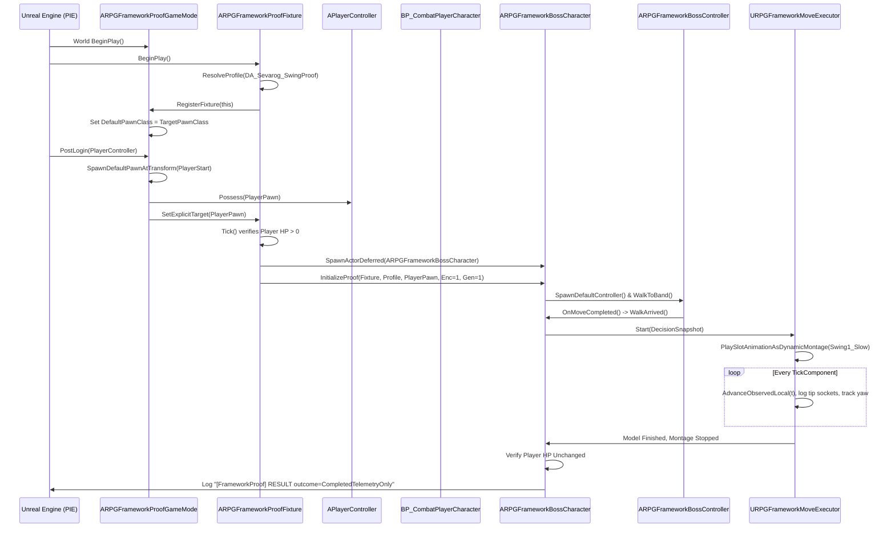

# F3b Execution Plan: Level, Assets, Fixture Binding & Python Authoring

**Author**: Antigravity (Second Reviewer / Offline Lane)  
**Order**: A-259 Item 3 (per Lead Orders [C-392] & [C-393])  
**Target Slice**: F3b (Live PIE Telemetry Proof on Sevarog Animation)  
**Execution Authority**: Claude (Lead + Implementer launches engine / authors assets)  
**File Mode**: Read-only offline planning; pure CRLF line endings.

---

## 1. Overview & Scope

Slice **F3b** executes the end-to-end telemetry playback proof in Play-In-Editor (PIE) headless mode, validating that:
1. `ARPGFrameworkProofFixture` and `ARPGFrameworkProofGameMode` initialize cleanly without project default changes.
2. The player pawn is spawned at an explicit `APlayerStart` and verified alive with finite health.
3. `ARPGFrameworkBossCharacter` spawns deferred, initializes dependencies, and navigates to the distance band $[250\text{ cm}, 350\text{ cm}]$ using `ARPGFrameworkBossController`.
4. Upon arrival, `URPGFrameworkMoveExecutor` plays `Swing1_Slow` as a dynamic montage on slot `FullBody`, validates active slot graph weight, advances `FRPGBossMoveModel`, logs weapon socket positions, and completes cleanly.
5. Target health remains identical before and after (`damageAPIInvocationsByThisExecutor=0`), proving the invariant `RESULT outcome=CompletedTelemetryOnly`.

---

## 2. Exact List of New Content for F3b Proof

All new assets are strictly isolated in a new directory: `/Game/OneBossFight/FrameworkProof/`. Zero existing project assets or default game modes are altered.

### 2.1 Level Asset: `L_SevarogFrameworkProof.umap`
- **Package Path**: `/Game/OneBossFight/FrameworkProof/L_SevarogFrameworkProof`
- **Disk Path**: `Content/OneBossFight/FrameworkProof/L_SevarogFrameworkProof.umap`
- **WorldSettings Override**:
  - `DefaultGameMode`: `ARPGFrameworkProofGameMode` (`/Script/OneBossFight.RPGFrameworkProofGameMode`).
- **Actors Placed in Persistent Level**:
  1. `APlayerStart`:
     - Location: `(X=0.0, Y=0.0, Z=100.0)`
     - Rotation: `(Pitch=0.0, Yaw=0.0, Roll=0.0)`
  2. `ARPGFrameworkProofFixture`:
     - Location: `(X=0.0, Y=0.0, Z=0.0)`
     - Property `TargetStart`: Object reference pointing to the placed `APlayerStart`.
     - Property `BossSpawnTransform`:
       - Translation: `(X=500.0, Y=0.0, Z=100.0)` (500 cm distance along X-axis, facing player).
       - Rotation: `(Pitch=0.0, Yaw=180.0, Roll=0.0)` (facing $-X$ toward player).
       - Scale: `(X=1.0, Y=1.0, Z=1.0)`.
     - Property `EncounterId`: `1` (uint64 > 0).
     - Property `Generation`: `1` (uint64 > 0).
     - Property `Profile`: SoftObjectPtr pointing to `/Game/OneBossFight/FrameworkProof/DA_Sevarog_SwingProof.DA_Sevarog_SwingProof`.
  3. `ANavMeshBoundsVolume`:
     - Location: `(X=250.0, Y=0.0, Z=100.0)` (centered between player and boss spawn).
     - Extents (Brush / Box Extent): `(X=2000.0, Y=2000.0, Z=500.0)` (sufficient to cover the 500 cm walking corridor, or full arena dimensions $25000 \times 25000 \times 3647$ cm).
  4. Floor / Geometry:
     - Simple static mesh plane or collision floor actor at $Z=0$ spanning $4000 \times 4000$ cm to ensure characters are grounded (`IsMovingOnGround() == true`).
  5. Directional Light / Sky Light: Minimal lighting actors for headless renderer initialization.

---

### 2.2 Profile Data Asset: `DA_Sevarog_SwingProof.uasset`
- **Package Path**: `/Game/OneBossFight/FrameworkProof/DA_Sevarog_SwingProof`
- **Class**: `URPGBossFrameworkProfile` (`/Script/OneBossFight.RPGBossFrameworkProfile`)
- **Properties**:
  | Property Name | Value | Purpose / Constraint |
  | :--- | :--- | :--- |
  | `FixtureLabel` | `TEXT("F3 fixture")` | Required exact string by `RPGFramework::ValidateProfile` |
  | `Mesh` | `/Game/ParagonSevarog/Characters/Heroes/Sevarog/Meshes/Sevarog.Sevarog` | Sevarog skeletal mesh (154 bones, weapon sockets) |
  | `AnimClass` | `/Game/ParagonSevarog/Characters/Heroes/Sevarog/Sevarog_AnimBlueprint.Sevarog_AnimBlueprint_C` | AnimInstance class containing `FullBody` slot |
  | `TargetPawnClass` | `/Game/AdvancedARPGCombat/MeleeCombatSystem/Blueprints/BP_CombatPlayerCharacter.BP_CombatPlayerCharacter_C` | Player character blueprint |
  | `Card` | `/Game/OneBossFight/FrameworkProof/DA_Card_SwingSlow_Telemetry.DA_Card_SwingSlow_Telemetry` | Proof move card |
  | `BandMinCm` | `250.0` | Minimum combat arrival band distance |
  | `BandMaxCm` | `350.0` | Maximum combat arrival band distance |
  | `WalkSpeedCmPerSecond` | `180.0` | Walking navigation pace |
  | `AcceptanceCm` | `5.0` | $5.0 < (350 - 250) \times 0.5 = 50.0$ cm |
  | `WalkTimeoutSeconds` | `10.0` | Watchdog timeout for arrival |
  | `BlendInSeconds` | `0.1` | Montage blend in duration |
  | `BlendOutSeconds` | `0.1` | Montage blend out duration |
  | `CapsuleRadiusCm` | `40.0` | Boss collision radius |
  | `CapsuleHalfHeightCm` | `100.0` | Boss collision half-height |
  | `MeshRelativeTransform` | `Location=(0, 0, -100), Rotation=(0, -90, 0), Scale=(1, 1, 1)` | Standard humanoid mesh offset |
  | `bAlignmentAuthored` | `true` | Required boolean guard |

---

### 2.3 MoveCard Data Asset: `DA_Card_SwingSlow_Telemetry.uasset`
- **Package Path**: `/Game/OneBossFight/FrameworkProof/DA_Card_SwingSlow_Telemetry`
- **Class**: `URPGBossMoveCard` (`/Script/OneBossFight.RPGBossMoveCard`)
- **Specification (`FRPGCompiledBossMoveCard` / `FRPGBossMoveSpec`)**:
  - `Schema`: `1`
  - `MoveId`: `TEXT("Move_Sevarog_SwingSlow")`
  - `FamilyId`: `TEXT("Family_01_DelayedOverhead")`
  - `PhaseId`: `TEXT("Phase_1")`
  - `Skeleton`: `/Game/ParagonSevarog/Characters/Heroes/Sevarog/Meshes/Sevarog_Skeleton.Sevarog_Skeleton`
  - `Sequence`: `/Game/ParagonSevarog/Characters/Heroes/Sevarog/Animations/Swing1_Slow.Swing1_Slow`
  - `Montage`: `nullptr` (dynamic montage generated at runtime)
  - `SlotName`: `TEXT("FullBody")`
  - `SectionName`: `NAME_None`
  - `PlayRate`: `1.0`
  - `ClipLengthSeconds`: `1.7000`
  - `CommitSeconds`: `0.3000`
  - `ActiveStartSeconds`: `0.3500`
  - `ActiveEndSeconds`: `0.4917`
  - `RecoveryEndSeconds`: `1.6500`
  - `TrackDegreesPerSecond`: `90.0`
  - `MinRangeCm`: `200.0`
  - `MaxRangeCm`: `400.0`
  - `FrontConeDegrees`: `100.0`
  - `HPDamage`: `0.0` (**strictly 0.0 for F3 telemetry**)
  - `bUsesRootMotion`: `false`
  - `Windows[0]`:
    - `WindowId`: `TEXT("Window_SwingSlow_Primary")`
    - `HitGroup`: `TEXT("HitGroup_ScytheBlade")`
    - `StartSeconds`: `0.3500`
    - `EndSeconds`: `0.4917`
    - `SocketA`: `TEXT("weapon_r")`
    - `SocketB`: `TEXT("root_weapon_end_r")`
    - `RadiusCm`: `15.0`

---

## 3. Fixture & GameMode World Binding Architecture

The binding mechanism operates strictly via standard Unreal Engine world settings and lifecycle calls:

---

## 4. Python Authoring Script Steps (Lead Execution)

The authoring script executes via:
`UnrealEditor-Cmd.exe <ProjectPath> -nullrhi -nosound -ExecutePythonScript=<ScriptPath>`

### Step-by-Step Execution Sequence:
1. **Package Directory Preparation**:
   - Verify or create `/Game/OneBossFight/FrameworkProof`.
2. **MoveCard Creation**:
   - Instantiate `URPGBossMoveCard` via `unreal.AssetToolsHelpers.get_asset_tools().create_asset()`.
   - Set `Spec` fields via reflected properties using probe timings ($L=1.70, C=0.30, S=0.35, E=0.4917, R=1.65, \text{HP}=0.0$).
   - Save package `/Game/OneBossFight/FrameworkProof/DA_Card_SwingSlow_Telemetry`.
3. **Profile Asset Creation**:
   - Instantiate `URPGBossFrameworkProfile`.
   - Assign properties: `FixtureLabel = "F3 fixture"`, `BandMinCm = 250.0`, `BandMaxCm = 350.0`, `WalkSpeedCmPerSecond = 180.0`, `AcceptanceCm = 5.0`, `bAlignmentAuthored = True`, etc.
   - Reference `DA_Card_SwingSlow_Telemetry`.
   - Save package `/Game/OneBossFight/FrameworkProof/DA_Sevarog_SwingProof`.
4. **Map Creation (`L_SevarogFrameworkProof`)**:
   - Create new blank world via `unreal.EditorLevelLibrary.new_level("/Game/OneBossFight/FrameworkProof/L_SevarogFrameworkProof")`.
   - Set `WorldSettings.DefaultGameMode` to `ARPGFrameworkProofGameMode`.
5. **Actor Placement & Wiring**:
   - Spawn `APlayerStart` at `(0, 0, 100)`.
   - Spawn `ARPGFrameworkProofFixture` at `(0, 0, 0)`.
   - Set fixture properties: `TargetStart = PlayerStartActor`, `Profile = DA_Sevarog_SwingProof`, `BossSpawnTransform = ((500, 0, 100), (0, 180, 0), (1, 1, 1))`, `EncounterId = 1`, `Generation = 1`.
   - Spawn floor collision actor at `(0, 0, 0)` with box collision.
   - Spawn `ANavMeshBoundsVolume` at `(250, 0, 100)` with extents `(2000, 2000, 500)`.
   - Build Paths via `unreal.EditorLevelLibrary.build_paths()`.
   - Save level package via `unreal.EditorLevelLibrary.save_current_level()`.

---

## 5. Read-Back & Verification Checks

Upon authoring, the Lead executes verification via headless PIE:
`UnrealEditor-Cmd.exe <ProjectPath> /Game/OneBossFight/FrameworkProof/L_SevarogFrameworkProof -game -ExecCmds="Automation RunTests OneBossFight.Framework; Quit" -nullrhi -nosound -log=f3b_pie.log`

### Expected Proof Tokens to Grep:
1. `[FrameworkProof] dependencies mesh=... resolved=1 label=F3_fixture`
2. `[FrameworkProof] slot_graph name=FullBody nodeClass=AnimNode_Slot verified=1 label=F3_fixture`
3. `[FrameworkProof] nav request=... fullPath=1`
4. `[FrameworkProof] walk start=... distanceCm=... rangeCm=...`
5. `[FrameworkProof] playback_start encounter=1 generation=1 instance=1 montage=... slot=FullBody`
6. `[FrameworkProof] playback instance=1 position=... nodeWeight=... base=... tip=...`
7. `[FrameworkProof] event encounter=1 generation=1 instance=1 kind=Open window=Window_SwingSlow_Primary`
8. `[FrameworkProof] event encounter=1 generation=1 instance=1 kind=Close window=Window_SwingSlow_Primary`
9. `[FrameworkProof] event encounter=1 generation=1 instance=1 kind=Finished`
10. `[FrameworkProof] cleanup reason=Finished modelIdle=1 ownedMontageStopped=1`
11. `[FrameworkProof] invariant targetHPBefore=... targetHPAfter=... damageAPIInvocationsByThisExecutor=0`
12. `[FrameworkProof] RESULT outcome=CompletedTelemetryOnly`
13. Strict negative assertion: **Zero occurrences of `[FrameworkProof] ERROR`**.
