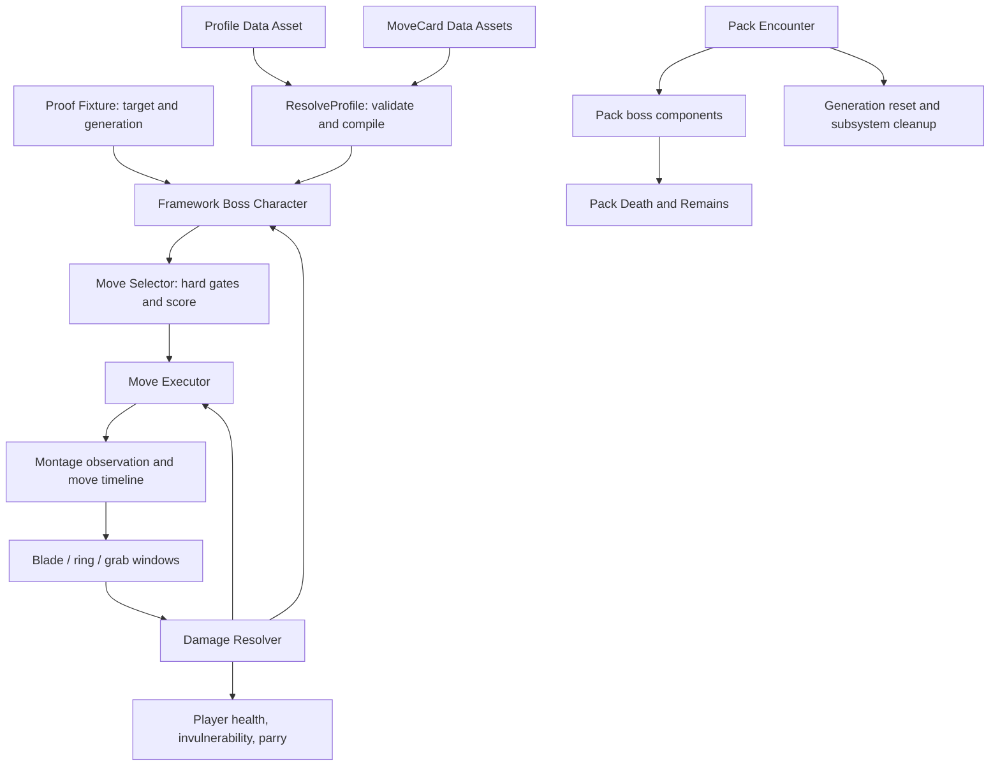

# Boss combat architecture

The project has two related but distinct combat paths: pack-facing components that extend the Advanced ARPG Combat player/boss, and a native framework proof boss that owns a compiled profile/card pipeline. A shared source folder does not mean those actors share the same authority.

## Main ownership boundaries

- `URPGBossFrameworkProfile` and `URPGBossMoveCard` are authored inputs. `ResolveProfile` validates the complete profile and resolves soft dependencies before runtime use (`RPGFrameworkProfile.cpp:44-117,168-289`).
- `ARPGFrameworkBossCharacter` owns framework health, phase, posture, bleed, target-health invariants, encounter decisions, and its executor (`RPGFrameworkBossCharacter.h:23-60,69-127`).
- `FRPGBossMoveSelector` is deterministic decision logic: model eligibility and cooldown first, then scoring and optional seeded top-tier tie selection (`RPGBossMoveSelector.cpp:33-80`).
- `URPGFrameworkMoveExecutor` observes montage playback and advances the move model; its windows call `URPGDamageResolver` and cleanup owns montage/movement restoration (`RPGFrameworkMoveExecutor.cpp:175-273,274-300,571-596`).
- The player parry and resolver share the timed contact decision (`RPGPlayerParry.h:13-16`; `RPGDamageResolver.cpp:151-185`).
- `URPGBossEncounter`, `URPGBossDeath`, and `ARPGBossRemains` are the pack-facing encounter/death path, separate from the framework boss's proof fixture restart and native `Die` (`RPGBossEncounter.cpp:299-349`; `RPGBossDeath.cpp:360-375`; `RPGFrameworkBossCharacter.cpp:854-895`).

For detailed paths see [one attack](DATA_FLOW_ATTACK.md), [one parry](DATA_FLOW_PARRY.md), [executor](REF_EXECUTOR.md), [encounter reset](REF_ENCOUNTER_RESET.md), the [player subsystem attachment guide](PLAYER_SUBSYSTEM_ATTACH_GUIDE_S157.md), the [pack boundary guide](PACK_BOUNDARY_GUIDE_S158.md), and the [telemetry onboarding example](TELEMETRY_ONBOARDING_S159.md).
