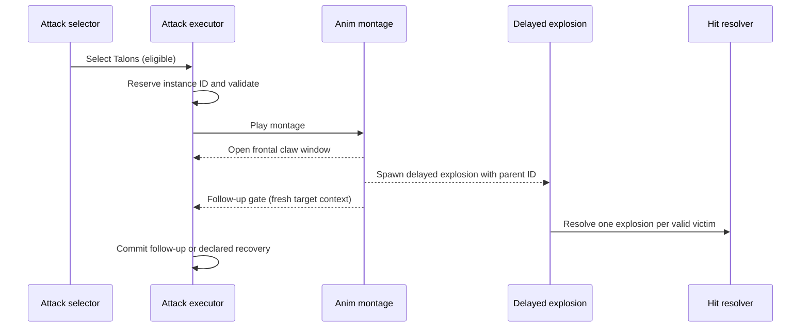
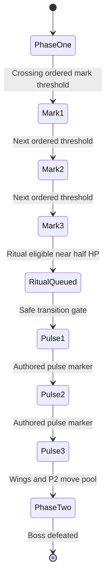

# Implementation patterns — Mohg-inspired boss in Unreal Engine 5.5.4

> This is a technical design pattern, not FromSoftware source code. Integrate it into your active gameplay framework rather than rebuilding working code.

## What can be reproduced?

**Yes:** identifiable delayed attacks, trident geometry, multiple casting patterns, distinct direct hit / impact / DOT, ritual special event state, aerial movement, anti-repetition and phase gates. **Not knowable from public gameplay:** FromSoftware's exact scoring formulas, animation frames, code architecture, RNG and timing of every internal event.

## Ownership contracts

- `AttackExecutor` owns the currently committed action, animation, hit ledger and cleanup, and has an ID before playback.
- `ComboGraph` only proposes legal next moves at authored gates and does not own collision.
- `HazardManager` owns independently detached bloodflame instances and their periodic ticks.
- `RitualController` owns ordered marks/pulses and prevents repeated or out-of-order transitions.
- `HitResolver` resolves iframe, guard, direct HP damage, status buildup and posture, including ritual-specific mitigation.
- `PhaseController` guarantees monotonic Phase1→Transition→Phase2 and defines interrupt precedence.
- `CombatContext` snapshots target and hazard state only at legal selection/reaction gates.

## Event sequence: Bloodflame Talons



## Event sequence: Bloodboon pools

```mermaid
sequenceDiagram
  participant EX as Attack executor
  participant AN as Montage
  participant HZ as Hazard manager
  participant HR as Hit resolver
  EX->>AN: Play bloodboon throw
  AN->>HZ: Spawn landing zones with HazardIDs
  HZ->>HZ: Land / arm / expire
  HZ->>HR: Fire damage and bleed buildup on DOT tick
  EX->>EX: Finish attack; release executor
  Note over EX,HZ: Hazard lives beyond attack instance
  HZ->>HZ: Remove on expiry / encounter reset policy
```

## Event sequence: Bloodboon Ritual



**Special edge cases:** rapid burst DPS crossing multiple thresholds, one remaining mark if boss dies, shackle while countdown is queued, stance break on a pulse frame, ritual protection active/inactive, healing above threshold after transition, despawned player, package restart, and 150 ms frame hitch.

## Recommended staged implementation

1. First create direct trident sweep, slam and Talons without bloodflame DOT. Confirm trace/Notify validity and recovery.
2. Add delayed Talons burst and ensure its timer belongs to a detached event with the correct parent AttackInstanceID.
3. Add Bloodboon lob with pooled ground hazards: lifetime, cap, damage interval, and visual/collision agreement.
4. Add 3 ordered marks and exactly 3 pulse transition with protection and boss heal separated.
5. Add winged attack path and P2 trident fire trails with hazard-aware positional selection.
6. Run automated tests including FPS hitches and arena boundary cases. Capture complete boss fight before calling it polished.

## What to require from Codex/Claude/Antigravity

- Claude: C++/Blueprint integration, attack instance state, hazard manager, ritual controller, damage policy and validation.
- Antigravity: animation Notify timing, delayed explosion VFX, curse marks/pulse cues, winged takeoff/dive and bloodflame ground readability.
- Codex Astra: review real changes, validate graph edge/trigger conditions, ensure damage timelines cannot duplicate, and reject weak implementation even if it compiles.

Use the comprehensive 82 requirement document for a per-feature acceptance matrix.
