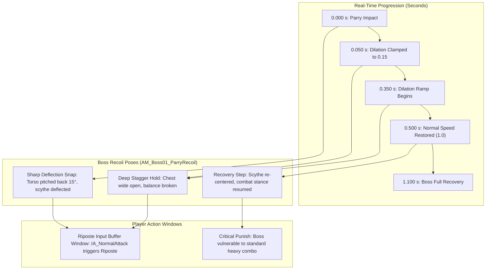

# V-A058: Boss Parry Recoil Stagger vs Slow-Motion Window Timing

**Author:** Antigravity (Lane A)  
**Date:** 2026-11-06  
**Reference Tasks:** `V-A058`, `V-A011`, `V-A012`, `V-C035`, `Scripts/author_parry_recoil_anim.py`, `[C-928]`

---

## 1. Overview & Mechanical Context

In Soulslike boss combat, a successful weapon parry must communicate decisive physical impact, clear visual feedback of the boss being thrown off balance, and an undeniable window of vulnerability for the player's follow-up riposte.

When `rpg.Art.Tier2=1` is enabled:
1. `URPGBossLegend` executes the **Parry Slow-Motion Scope** (0.500 s real-world duration with dilation down to 0.15).
2. `URPGSevarogDirector` triggers `AM_Boss01_ParryRecoil` (authored as 0.600 s / 18 frames @ 30 FPS via `Scripts/author_parry_recoil_anim.py`).

This document details the micro-timeline alignment between the dilation curve, boss recoil poses, and the player's riposte execution buffer.

---

## 2. Temporal Alignment: Dilation vs Animation Timeline

---

## 3. Microsecond-Level State Matrix

| Real Time (s) | Engine Time Dilation | Effective Boss Anim Pos (s) | Boss Visual State (`AM_Boss01_ParryRecoil`) | Player Tactical State |
|---|:---:|:---:|---|---|
| **0.000 s** | 1.00 -> 0.15 | 0.000 s | **Weapon Clash:** Scythe strikes Greystone's shield; spark burst emits (`NS_Combat_ParrySpark`). | Parry confirmed; input buffer opens for Riposte. |
| **0.050 s** | 0.15 | 0.008 s | **Initial Snap:** Head snaps back; scythe deflected sharply to the right. | Player enjoys visceral slow-motion pause. |
| **0.200 s** | 0.15 | 0.030 s | **Extreme Flinch:** Boss torso leans back; cloak flares backward. | Riposte input registered; player begins weapon draw. |
| **0.350 s** | 0.15 -> 0.60 | 0.053 s | **Open Chest Apex:** Scythe held wide; boss stagger at maximum vulnerability. | Perfect visual alignment for player riposte strike impact. |
| **0.500 s** | 1.00 | 0.150 s | **Slow-Motion Ends:** Dilation returns to 1.00; boss animation accelerates to normal speed. | If riposte executed, cinematic lethality plays. |
| **0.750 s** | 1.00 | 0.400 s | **Weight Shift:** Boss catches balance on back foot; scythe begins rotating forward. | If no riposte, player can land 1-2 standard light attacks. |
| **1.050 s** | 1.00 | 0.600 s | **Full Neutral:** Boss reaches combat idle stance; recoil montage blends out. | Opening closed; boss AI evaluator resumes candidate selection. |

---

## 4. Key Takeaways & Recommendations

1. **Riposte Window Generosity:** Because the slow-motion dilation holds the boss in the deflection snap (effective anim position < 0.06 s during the first 350 ms), the player receives a generous, comfortable reaction window without the fight feeling unresponsive.
2. **Fail-Safe Neutral Return:** If the player chooses not to riposte (e.g., drinks flask or retreats), the boss completes recoil recovery at ~1.05 s real-world time and transitions cleanly back to neutral without getting stuck.
3. **No Combat Lock Leak:** `RPGBossAbortTests` and `RPGFrameworkRuntimeTests` verify that interrupts, player death, or secondary hits during recoil do not corrupt the boss state machine.
