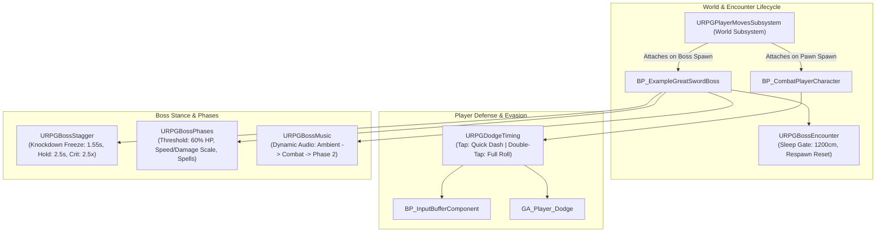

# Elden Ring-Inspired UE5 Combat: Master Design Freeze & AI-Executable Technical Specification v1.2

**Document Status:** Scope and architecture frozen; numeric tuning values remain provisional until playtested  
**Version:** 1.2, implementation-precision and conflict-resolution pass  
**File Location:** `Documentation/Master_Design_Freeze_v1_2_AI_Implementation_Ready.md`  
**Target Engine:** Unreal Engine 5.5 (always verify the installed version and plugin APIs before implementation)  
**Core Framework:** Advanced ARPG Combat System + reported native C++ subsystems in `Source/OneBossFight/`  
**Scope:** 1 original humanoid boss with 2 phases + 2 contrasting player builds (Strength and Dexterity/Bleed)  
**Supersedes:** This document incorporates `Master_Design_Freeze_v1.md` and the v1.1 AI-implementation clarification pass. The v1.2 rules near the end of this document have the highest authority and override conflicting statements in all earlier sections.  
**Evidence warning:** Asset paths and behaviors listed here are reported by the project audit. They are not independently verified by this document. The implementation agent must confirm code behavior and runtime behavior before changing systems.  

> **READ FIRST: implementation authority.** This is a design specification, not evidence that a reported feature works. Start with Milestone 0 and make no gameplay changes during the audit. The implementation order is: (1) v1.2 conflict-resolution rules and explicit decisions; (2) v1.1 normative implementation contract; (3) baseline v1.0 tables, only where they do not conflict with the newer sections. Numerical values are starting hypotheses unless explicitly labeled frozen. Never invent a source file, class, API, asset, runtime result, or reference. If an asset or API differs in the actual UE 5.5 project, report the actual result and adapt minimally.

**Approved scope:** one original humanoid boss, one arena, two phases, custom two-stage dodge, boss posture break plus deliberate frontal riposte, two contrasting builds, offline single-player vertical slice. The first implementation target is only one delayed overhead slam.

---

## 1. Project Vision & Executive Principles

### 1.1 The Golden Rule: Quality Over Quantity
> **Combat feel and single-encounter polish take 100% precedence over content quantity.**  
> A recruiter, gameplay lead, or player decides whether combat is good in the first **90 seconds** of play. A single boss fight with crisp dodge i-frames, readable delayed roll-catches, punchy weapon traces, fair healing punishes, and a bone-crushing stance-break riposte is an elite portfolio piece. Five buggy, floaty bosses with clunky hitboxes is an instant disqualifier.

### 1.2 Non-Negotiable Tenets
1. **Readable Commitment:** Every boss attack communicates its intention clearly. Tracking happens during windup; commitment happens before release; active frames trace exact weapon arcs; recovery is real and punishable.
2. **Deterministic Action Economy:** Dodging, attacking, and healing have distinct startup, active, and recovery windows. The player cannot cancel arbitrarily out of committed recoveries.
3. **Evidence-Based Development:** No gameplay code or Blueprints will be edited based on assumptions. Every system is audited at the C++ and runtime level first.
4. **Data-Driven Architecture:** Timing windows, damage numbers, posture thresholds, and speeds are exposed as editable data (DataAssets, UPROPERTYs, or AnimNotifyStates), never hardcoded inside logic branches.
5. **No Scope Creep:** We do not touch additional bosses, magic spells, open worlds, inventory systems, or multiplayer until the core vertical slice meets all acceptance criteria.

---

## 2. The 7 Frozen Consensus Pillars

These seven pillars represent the reconciled agreement between gameplay research and engine architecture:

```
┌────────────────────────────────────────────────────────────────────────────────────────────────────────┐
│                                       THE 7 CONSENSUS PILLARS                                          │
├──────────────────────────┬─────────────────────────────────────────────────────────────────────────────┤
│ 1. Dodge System          │ Two-stage custom dodge: Single tap = quick evasive dash (0.43s, 3m).        │
│                          │ Double-tap within 0.30s = full roll (0.92s, 5m). Implemented via C++.        │
├──────────────────────────┼─────────────────────────────────────────────────────────────────────────────┤
│ 2. Stance vs. Stagger    │ Separated into 2 layers: Layer A = 100-pt posture accumulation & regen;     │
│                          │ Layer B = Knockdown stagger & riposte state via C++ URPGBossStagger.        │
├──────────────────────────┼─────────────────────────────────────────────────────────────────────────────┤
│ 3. Animation Pipeline    │ Prototype delayed attacks with authored hold poses / montage sections. │
│                          │ Verify foot planting and root motion at runtime; use Blender MCP if available.│
├──────────────────────────┼─────────────────────────────────────────────────────────────────────────────┤
│ 4. Phase 2 Metamorphosis │ Unified at 60% Boss HP. Idempotent trigger, roar invulnerability, weapon    │
│                          │ spawn, speed/damage scaling, and moveset expansion via URPGBossPhases.      │
├──────────────────────────┼─────────────────────────────────────────────────────────────────────────────┤
│ 5. Frontal Riposte       │ Deliberate interaction: stance break exposes frontal cone -> player walks   │
│                          │ up -> presses Light Attack -> synchronized execution montage -> 1 hit dmg. │
├──────────────────────────┼─────────────────────────────────────────────────────────────────────────────┤
│ 6. Decoupled Damage      │ Separated into: (1) HP Damage, (2) Guard Stamina Damage, (3) Poise Impact,  │
│                          │ and (4) Boss Posture Damage.                                                │
├──────────────────────────┼─────────────────────────────────────────────────────────────────────────────┤
│ 7. Evidence-Based Audit  │ Strict audit before code modification: Asset, Code Behavior, Runtime       │
│                          │ Behavior, Defect/Gap, Smallest Change, and Verification Test.               │
└──────────────────────────┴─────────────────────────────────────────────────────────────────────────────┘
```

---

## 3. Deep Technical Architecture: The Existing C++ Subsystems

The project audit reports that several core mechanics already have native C++ implementations. Treat these as existing implementation candidates, not automatically as verified working features. The agent must confirm source behavior, runtime behavior, ownership, and cleanup before changing or reusing them.



### 3.1 `URPGDodgeTiming` (Player Evasion)
- **File:** `Source/OneBossFight/Player/RPGDodgeTiming.h` / `.cpp`
- **Mechanism:** Listens to `IA_Dodge` via Enhanced Input.
- **Single Tap:** Fires the quick evasive dash immediately upon release (`Dodge_Small_Forward_Roll_Montage`, `QuickPlayRate = 1.3f`). If no directional input is held, it calculates the camera heading and executes an automatic backward turn/dash away from the target.
- **Double Tap:** If a second press arrives within `DoubleTapWindow = 0.30f`, it calls `ForceFullRoll()`, consumes the buffer key to prevent triple-rolling, ends the quick dash, and immediately activates `FullMontage` (`Dodge_To_Idle_Montage`) from the character's current position, continuing momentum cleanly.

### 3.2 `URPGBossStagger` (Boss Knockdown & Vulnerability)
- **File:** `Source/OneBossFight/Player/RPGBossStagger.h` / `.cpp`
- **Mechanism:** Watches `GA_GS_Boss_HitStun_C`. When a poise break triggers hit-stun, this component interrupts the flinch, applies `GE_HitStunImmune` (preventing flinch clipping), holds AI behavior, stops character movement, and plays `FallMontage` (`KnockdownStart_Anim_Montage`).
- **Knockdown Freeze:** Freezes the montage at `FreezeAtPosition = 1.55s` so the boss stays flat on the arena floor for `StaggerSeconds = 2.5s`.
- **Critical Damage Window:** During this window, incoming damage is multiplied by `CriticalMultiplier = 2.5f`.
- **Recovery:** Plays `GetUpMontage` (`Knockdown_Getup_Anim_Montage`), resumes AI behavior, refills poise, and starts `CooldownSeconds = 5.0f`.

### 3.3 `URPGBossPhases` (Phase 2 Metamorphosis)
- **File:** `Source/OneBossFight/Player/RPGBossPhases.h` / `.cpp`
- **Mechanism:** Monitors `Attribute.Health`. When health drops to `PhaseTwoHealthFraction = 0.6f`, it triggers once.
- **Transition Execution:** Holds AI behavior, applies `GE_HitStunImmune`, and plays `TransitionMontage` (`Ability_R_Intro_Anim_Montage`, 1.5s roar).
- **Phase 2 Buffs:** Permanently scales `MovementScale = 1.2f`, `AttackRateScale = 1.2f`, and `DamageScale = 1.25f`.
- **Ranged Moveset:** Grants `FireballAbility` (`GA_Fireball_Enemy_C`), casting on cooldown (6–10s) when the player is between 500cm and 1500cm.

### 3.4 `URPGBossEncounter` (Arena Gate & Clean Resets)
- **File:** `Source/OneBossFight/Player/RPGBossEncounter.h` / `.cpp`
- **Mechanism:** Boss remains dormant with AI behavior held until the player enters `GateRadius = 1200cm` or damages the boss.
- **Encounter Reset:** When the player dies and respawns, the component automatically aborts any active stance break, restores health and poise to 100%, moves the boss back to `HomeTransform`, clears AI perception/targets, and puts the boss back to sleep.

---

## 4. Complete Boss Moveset & Combat Data Specification

All combat values are data-driven starting hypotheses to be tuned during Milestone 1 & 2 playtesting. **The table in this baseline section is a summary only. For implementation, use the field definitions in Section 15, per-attack behavior contracts in Section 16, and the v1.2 conflict-resolution rules at the end.** Where a legacy cell such as “Windup” could mean either a duration or a timestamp, do not encode it until it has been translated into the canonical fields defined in Section 15.

```
                      ATTACK TIMELINE SCHEMA (Seconds)
┌──────────────┬───────────────────┬──────────────┬────────────────────────┐
│   Windup     │  Commitment Point │ Active Trace │    Recovery Punish     │
│ [0.00 - 1.15]│     [1.15s]       │[1.40 - 1.52] │     [1.52 - 2.72]      │
│  Tracks Yaw  │ Rotation Clamped  │ Damage Deals │ Boss Open for Counters │
└──────────────┴───────────────────┴──────────────┴────────────────────────┘
```

### The 6 Core Attacks

| Attack ID & Name | Combat Purpose | Windup (s) | Commitment Point (s) | Active Trace (s) | Recovery Punish (s) | Player HP Dmg | Guard Stamina Dmg | Player Poise Impact | Boss Posture Taken | Branch / Counterplay Rules |
| :--- | :--- | :---: | :---: | :---: | :---: | :---: | :---: | :---: | :---: | :--- |
| **A1: Quick Horizontal Slash** | Punishes greedy close-range attacking | 0.35 | 0.15 before hit | 0.15 | 0.70 | 35 | 40 | Light Flinch | 0 | Branches to A3 if player remains in close arc. Roll right. |
| **A2: Delayed Overhead Slam** | The signature roll-catch; teaches commitment timing | 1.40 (Apex Hold) | 0.25 before hit | 0.12 | 1.20 | 90 | 120 (Guard Break) | Heavy Knockdown | 0 | Committed recovery. Dodge late on downward snap. Major punish window. |
| **A3: Two-Hit Branch Combo** | Prevents predictable single-hit fighting | 0.40 | 0.18 before hit | 0.20 + 0.25 | 0.90 | 40 + 45 | 45 + 50 | Medium Stun | 0 | Slash 2 executes only if player is in 120° frontal cone. Dodge twice or backstep. |
| **A4: Low Sweeping Cane** | Introduces jump counter & low evasion | 0.60 | 0.20 before hit | 0.30 | 0.85 | 50 | 70 | Knockdown | 0 | Low horizontal sweep across floor. Jump over or time i-frame roll through blade. |
| **A5: Golden Dagger Toss** | Fair heal punish; punishes mid-range flask drinking | 0.40 (Telegraph) | At release | Flight | 0.60 | 30 | 25 | Light Flinch | 0 | Triggered only if player heals at 4-10m range. 4.0s internal cooldown. Dodgeable on heal exit. |
| **A6: Leaping Hammer Slam** *(Phase 2)* | High-altitude aerial gap-closer & radial shockwave | 0.90 (Ascent) | At apex descent | Shockwave | 1.50 | 120 | 180 (Guard Break) | Flatten Knockdown | 0 | Unlocked in Phase 2 at 60% HP. Central impact + radial ground shockwave (jumpable). |

---

## 5. Player Build Specifications (The Two Contrasting Archetypes)

Both builds must be capable of defeating the boss, but require completely different tactics:

| Strength / Bonk | Dexterity / Bleed |
|---|---|
| Colossal greatsword; high-risk, high-reward spacing. | Dual curved swords or katana; rapid hit-and-run pressure. |
| Light attack posture damage: 18 (starting hypothesis). | Light attack posture damage: 6 (starting hypothesis). |
| Jumping-heavy posture damage: 38. Three eligible hits total 114 posture damage, enough to break a 100-point pool if regeneration does not erase the gain between hits. | Jumping-heavy posture damage: 14 (starting hypothesis). A light hit at 6 posture damage requires 17 eligible hits to exceed 100 posture damage if no regeneration occurs; four 6-point hits contribute 24. Do not claim a 10–14 hit stance break without changing the attack data. |
| Stamina cost: 35 per swing (confirm resource scale during audit). | Stamina cost: 10 per swing (confirm resource scale during audit). |
| Hyperarmor only during the authored portion of the downswing; HP damage still applies unless a separate defense rule says otherwise. | First bleed proc at 100 buildup, with 20 buildup per eligible hit, is five valid buildup applications before resistance/decay/threshold increases. Initial boss HP burst: 10.5% as a tunable custom rule. |
| Strategy: create space, bait A2, punish the real recovery window with a high-value hit. | Strategy: create more frequent openings through rapid attacks and status pressure, while still respecting stamina and recovery. |

---

## 6. The 4-Stage Development Roadmap & Acceptance Criteria

```
                              THE PRODUCTION GATES
                                       │
┌──────────────────────────────────────▼──────────────────────────────────────┐
│                     MILESTONE 0: THE EVIDENCE-BASED AUDIT                   │
│ Objective: Zero code changes. Inspect C++ & Blueprints; document reality.   │
│ Exit Gate: Complete audit report distinguishing working from gaps.          │
└──────────────────────────────────────┬──────────────────────────────────────┘
                                       │
┌──────────────────────────────────────▼──────────────────────────────────────┐
│                MILESTONE 1: COMBAT FEEL & SINGLE-ATTACK PROTOTYPE           │
│ Objective: Player dodge i-frames + swept weapon trace + 1 delayed slam.     │
│ Exit Gate: Player can 100% reliably dodge, punish, and read the slam.      │
└──────────────────────────────────────┬──────────────────────────────────────┘
                                       │
┌──────────────────────────────────────▼──────────────────────────────────────┐
│                MILESTONE 2: FULL BOSS ENCOUNTER (PHASES 1 & 2)              │
│ Objective: All 6 moves, fair heal-punish, posture break, riposte, Phase 2.  │
│ Exit Gate: Complete fight playable start to finish; defeatable & fair.      │
└──────────────────────────────────────┬──────────────────────────────────────┘
                                       │
┌──────────────────────────────────────▼──────────────────────────────────────┐
│                MILESTONE 3: TWO BUILDS & STATUS BALANCING                   │
│ Objective: Strength Bonk vs. Dex Bleed fully functional against boss.       │
│ Exit Gate: Both builds defeat boss with distinct, balanced playstyles.      │
└──────────────────────────────────────┬──────────────────────────────────────┘
                                       │
┌──────────────────────────────────────▼──────────────────────────────────────┐
│                MILESTONE 4: POLISH, BENCHMARK & PACKAGED .EXE               │
│ Objective: Dynamic audio, arena visuals, 60 FPS profile, standalone .exe.   │
│ Exit Gate: Executable runs independently without editor; portfolio-ready.   │
└─────────────────────────────────────────────────────────────────────────────┘
```

---

### Milestone 0: The Evidence-Based Audit
* **Goal:** Verify what exists, what works, and what is broken in the codebase without making speculative edits.
* **Tasks:**
  1. Inspect `BP_CombatPlayerCharacter` and `URPGDodgeTiming`: verify `DodgeAction` binding, quick montage, full montage, and buffer consumption.
  2. Inspect `ANS_CollisionTrace` and `BP_SweepingSocketTraceTarget`: check tick logic, previous-to-current socket sweep, and deduplication set.
  3. Inspect `BP_ExampleGreatSwordBoss` and `GA_GS_Boss_CloseAttack`: check rotation behavior during attack execution.
  4. Inspect `URPGBossStagger`: verify how `GA_GS_Boss_HitStun_C` triggers, knockdown duration, and critical multiplier.
* **Acceptance Area:**
  - Written audit table filling all 6 fields: *Asset/Function, Code Behavior, Runtime Behavior, Defect/Gap, Smallest Change, Verification Test*.
* **Expected Output After Milestone 0:**
  - A crystal-clear blueprint of exact surgical edits needed—zero guesswork remaining.

---

### Milestone 1: Combat Feel & The Single-Attack Foundation
* **Goal:** Establish the core combat verbs. The player must be able to fight against **one single, perfectly executed delayed overhead slam**.
* **Tasks:**
  1. **Dodge Evasion & i-Frames:** Validate `URPGDodgeTiming` in Play-In-Editor (PIE). Ensure tap produces quick dash; double-tap produces full roll. Inspect and tune the invulnerability window independently for the quick-dash and full-roll montages. Use montage-local seconds as the source of truth; frame numbers are only a display aid. A roughly 26-frame-at-60-FPS window may be used as an initial roll test, but it is not a frozen value and must not be copied blindly to both actions.
  2. **Swept Weapon Trace:** Validate `ANS_CollisionTrace` on the boss's greatsword. Confirm swept traces between frame $t-1$ and $t$ with zero tunneling on fast swings, and confirm `HitActorsThisSwing` prevents multi-hit damage ticks.
  3. **Animation-Driven Rotation Commitment (`ANS_BossRotationLock`):**
     - Create `ANS_BossRotationLock`.
     - In the boss's Overhead Slam montage, place the notify from the commitment point ($0.25\text{s}$ before downswing) through the follow-through.
     - While active, clamp boss rotation tracking to `0.0 deg/s`.
  4. **Apex Hold Cadence:** Edit the Overhead Slam montage with a dedicated hold-frame or short hold section at the peak of the windup ($1.2\text{s}$) while tracking, then snap down fast ($1.4\times$ speed) with rotation locked.
* **Acceptance Area:**
  - Player can reliably dodge through the active frames of the slam using correctly timed roll.
  - Early panic-rolling gets roll-caught and punished.
  - Walking sideways during the windup avoids the attack *only* if the player moves after the rotation commits.
  - Weapon traces register cleanly; no damage is taken during valid i-frames; no ghost hits.
  - Whiffing the slam leaves the boss locked in recovery for $1.2\text{s}$, allowing the player to land 1–2 punish hits.
* **Expected Output After Milestone 1:**
  - A playable, repeatable 1v1 duel against one attack that passes the explicit readability, dodge, trace, recovery, and repeatability tests below.

---

### Milestone 2: The Complete Boss Encounter (Phases 1 & 2)
* **Goal:** Expand the single attack into a full, multi-phase encounter inspired by Margit.
* **Tasks:**
  1. **Moveset Expansion:** Author and configure moves A1, A3, and A4 with individual commitment notifies, active windows, and recovery windows.
  2. **Fair Heal-Punish (Move A5):**
     - Hook an observer in the boss AI listening for player tag `Combat.State.Drinking` / `Combat.State.Healing`.
     - Evaluate preconditions: Boss is in `Neutral`/`Approach`, distance $\in [400, 1000]\text{ cm}$, clear line of sight, and `PunishCooldown == 0`.
     - Queue Golden Dagger toss. Boss telegraphs off-hand glow, flicks dagger, and starts 4.0s cooldown.
  3. **Posture Accumulation & Frontal Riposte:**
     - Implement 100-point posture tracking. Each player hit subtracts posture. Inactivity for 6.0s begins recovery at 13 pts/sec.
     - When posture hits 0: `URPGBossStagger` triggers. Boss enters knockdown state for 2.5s.
     - Add frontal interaction cone: if player approaches within 150cm, faces the boss, and presses Light Attack, play synchronized execution montage, apply 2.5x critical damage once, and resume fight.
  4. **Phase 2 Transition (Move A6):**
     - Set `PhaseTwoHealthFraction = 0.6f` in `URPGBossPhases`.
     - At 60% HP, trigger once: boss roars with hit-stun immunity, active traces clear, secondary glowing hammer spawns in off-hand socket, speed scales by 1.2x, and Leaping Hammer Slam (A6) unlocks.
  5. **Dynamic Audio:** Hook `URPGBossMusic` to transition dynamically from Phase 1 battle theme to Phase 2 choral climax upon threshold trigger.
* **Acceptance Area:**
  - Boss transitions smoothly between Phase 1 and Phase 2 without desyncing player camera lock-on or AI perception.
  - Healing while boss is committed to a slam is safe; healing during neutral at mid-range triggers a fair, dodgeable dagger punish.
  - Heavy attacks reliably break posture; riposte executes smoothly with aligned animations.
  - Full encounter loop works: player death resets boss to home position and restores health/poise; defeating boss triggers victory state.
* **Expected Output After Milestone 2:**
  - A fully realized, playable boss fight that can be fought and beaten repeatedly from start to finish.

---

### Milestone 3: Two Contrasting Builds & Status Balancing
* **Goal:** Provide two distinct mechanical playstyles that interact differently with the boss's posture and recovery windows.
* **Tasks:**
  1. **Strength Build ("Bonk"):**
     - Equip Colossal Greatsword.
     - Tune Light Attack (18 posture dmg) and Jumping Heavy (38 posture dmg).
     - Add hyperarmor window (`ANS_HyperArmor`) during active frames of jumping heavy.
     - Set high stamina cost (35 pts) and long recovery.
  2. **Dexterity / Bleed Build:**
     - Equip Dual Curved Swords / Katanas.
     - Tune Light Attack (6 posture dmg) and rapid 4-hit combo chain.
     - Implement Hemorrhage status meter on the boss (threshold = 100 pts, each hit applies 20 pts).
     - Upon 100% meter: spawn blood burst VFX, play heavy impact sound, and chunk 10.5% of boss max HP. Reset meter with increased threshold.
  3. **Build Selector:** Add a simple in-game switch or shrine interaction to select between Strength and Dexterity before entering the arena.
* **Acceptance Area:**
  - Strength build defeats the boss by timing jumping heavies during recovery windows to break posture in 3 hits and land ripostes.
  - Dexterity build defeats the boss through relentless hit-and-run pressure, dodging through slashes, and triggering bleed bursts.
  - Neither build is strictly overpowered; both require learning the boss's timings.
* **Expected Output After Milestone 3:**
  - A rich combat prototype demonstrating weapon variety, status effects, and deep combat design.

---

### Milestone 4: Polish, Benchmark & Standalone Executable
* **Goal:** Package the project into an independent, presentation-grade Windows executable (.exe).
* **Tasks:**
  1. **Performance Profiling & Optimization:**
     - Run Unreal Insights / `stat fps` / `stat unit` in `L_SevarogArena`.
     - Target 60 FPS on explicitly recorded reference hardware. Profile frame time and identify the Game, Draw, or GPU bottleneck before optimizing. Do not claim a hardware-independent guarantee.
  2. **Visual & Audio Polish:**
     - Refine arena lighting, fog, and torch flickering.
     - Add camera shake on the boss's heavy slam impact and phase-transition roar.
     - Balance audio levels (weapon impacts, parry chimes, voice lines, orchestral music).
  3. **UI / HUD Clean-Up:**
     - Boss Health Bar with custom name plate, phase 2 subtitle, and posture break flash.
     - Player HUD: Health bar, Stamina bar, Flask counter, and active build indicator.
  4. **Standalone Packaging:**
     - Package project as Windows Shipping Build (.exe).
     - Verify executable launches, runs smoothly without editor dependencies, and cleanly resets encounters.
* **Acceptance Area:**
  - Standalone `.exe` launches from desktop with zero missing DLLs or cooked asset crashes.
  - Game runs at 60 FPS without hitches during weapon sweeps, phase transitions, or particle bursts.
  - Complete boss fight is playable, recordable, and presentation-ready for portfolio review.
* **Expected Output After Milestone 4:**
  - A distribution-ready Windows executable and high-resolution gameplay capture demonstrating professional combat engineering.

---

## 7. The End-State Portfolio Experience (What the World Sees)

When a studio technical director, combat lead, or recruiter plays the final build, they will experience:

1. **A Clean Entry:** The player spawns in the ruined arena, selects their build (Strength Greatsword or Dexterity Bleed), and approaches the dormant boss.
2. **First Contact:** Crossing the 1200cm gate wakes the boss. Orchestral battle music begins.
3. **The Rhythm of Combat:**
   - The boss lifts its weapon for a delayed overhead slam, tracking the player's movement.
   - The player watches for the commitment point ($0.25\text{s}$ before release), dodges cleanly through the downswing, and counters with a heavy jumping strike.
   - Healing at the wrong time is instantly met with a telegraphed golden dagger flick that catches careless play.
4. **The Stance Break Climax:** After 3 solid heavy hits, a loud metallic chime rings out. The boss staggers and collapses flat on the ground. The player steps into the frontal cone, presses Light Attack, and executes a cinematic, high-damage riposte.
5. **Phase 2 Escalation:** At 60% HP, the boss roars with invulnerability, summons a giant golden warhammer in its off-hand, and leaps 8 meters into the air, crashing down with a radial shockwave that forces the player to jump to survive.
6. **Victory & Polish:** Defeating the boss triggers a victory stinger, clears combat states, and provides an option to reset the arena immediately.

**This document is now the definitive single source of truth for Project OneBossFight.**


---

# v1.1 Normative Clarifications and AI Execution Contract (Historical Base)

> **Authority rule:** This section defines the v1.1 implementation contract. Where it or any earlier v1.0 paragraph conflicts with the v1.2 addendum at the end of this file, follow v1.2. The goal is not to redesign the agreed game. The goal is to remove ambiguous interpretation, contradictory timing, missing edge cases, and unverified assumptions.

## 8. What “Frozen” Means

### 8.1 Frozen decisions

The following are design commitments, not implementation suggestions:

1. The first deliverable is one original humanoid boss, two phases, one arena, and two player builds.
2. Combat responsiveness, telegraph readability, hit detection, defensive timing, recovery, posture break, and riposte take priority over new content.
3. Preserve and extend the existing Advanced ARPG Combat System and native C++ code where verified; do not duplicate existing ownership of a mechanic.
4. Keep the custom two-stage dodge: first tap requests a quick evasive dash; a second tap within the configured window requests a full roll.
5. Keep HP damage, player guard stamina damage, player poise/interruption impact, boss posture damage, and status buildup logically separate.
6. Boss attacks must use readable anticipation, a clearly defined commitment point, animation-synchronized active frames, and a real recovery window.
7. A boss response to healing must never cancel an attack that is already in a committed phase.
8. Boss phase two begins at the configurable 60% health threshold for the current prototype.
9. A posture break creates a deliberate frontal critical interaction. It is not merely a temporary universal damage multiplier.
10. No additional boss roster, broad magic system, open-world systems, multiplayer, or inventory expansion before the vertical slice passes its acceptance tests.

### 8.2 Provisional values

The values in the tables are initial tuning hypotheses. They must be data-driven and may be changed during playtesting without changing the design contract:

- Dodge and roll duration/distance.
- Invulnerability start and end times.
- Input buffer and double-tap windows.
- Attack windup, tracking, commitment, active and recovery durations.
- HP damage, guard stamina damage and poise impact.
- Posture pool, regeneration delay, regeneration rate and stance-break cooldown.
- Healing-punish range, cooldown and projectile speed.
- Phase-transition duration and stat multipliers.
- Bleed buildup, threshold increase, and proc damage.

Do not describe provisional values as exact Elden Ring constants. This project recreates observable combat principles; it does not claim to reproduce proprietary FromSoftware engine internals.

### 8.3 Evidence vocabulary

The audit and implementation log must use these labels precisely:

- **Present:** An asset, class, function or variable exists.
- **Code-confirmed:** Static source inspection confirms the relevant logic is present.
- **Runtime-confirmed:** The behavior was reproduced in PIE or a packaged build and evidence was recorded.
- **Partially working:** Some acceptance checks pass, but known checks fail or remain untested.
- **Missing:** The required behavior is not present.
- **Blocked:** The behavior cannot be checked because of a build, asset, tool, plugin, or environment blocker.

Never convert “Present” into “Working” without runtime evidence. Never state that Blender MCP, an editor bridge, a plugin, or a target asset is available until it has been checked in the actual environment.

## 9. Implementation Agent Operating Rules

The coding agent must follow this sequence for every task:

1. Read this specification and identify the exact milestone and acceptance test affected.
2. Inspect the current project state and relevant assets/source files before editing anything.
3. Search for existing implementations, usages, delegates, tags, notifies, and dependencies before adding a new class/component.
4. Produce a short audit finding with the relevant file/class/function and the smallest safe proposed change.
5. Implement only the approved task. Avoid unrelated refactors, broad renaming, plugin replacement, asset deletion, or architecture migration.
6. Compile the C++ project after native-code changes. Report the exact build result and relevant compiler errors if it fails.
7. Run the most direct runtime test available. Do not mark a task complete based on code generation or a successful compile alone.
8. Re-test nearby behaviors that could regress: dodge input, ability cancellation, hit traces, phase transitions, death/reset, and animations.
9. Report changed files, behavior changes, unverified assumptions, test results, and remaining gaps.
10. Do not silently change a frozen design decision. If a conflict requires a design change, explain the trade-off and request approval rather than quietly implementing a different game.

### 9.1 Required response format for the coding agent

After each task, report:

- **Task:** what was attempted.
- **Inspected:** source files, Blueprints, montages, Gameplay Effects, and settings actually opened.
- **Findings:** what the existing implementation does.
- **Changed:** exact files/assets/functions changed.
- **Tests:** exact runtime actions and outcomes.
- **Pass/fail:** which acceptance checks passed.
- **Known gaps:** anything not tested, broken, or dependent on assumptions.
- **Next smallest step:** one task only, aligned with the next gate.

Do not use “done,” “fixed,” “verified,” “perfect,” or “Elden Ring accurate” unless the relevant acceptance test was actually completed.

## 10. System Ownership and State Coordination

### 10.1 Single-owner rule

Every gameplay effect must have one authoritative owner. Before implementation, identify the owner for each responsibility. The following is the intended responsibility split; confirm it against the existing code and preserve existing architecture where it already works.

| Responsibility | Intended authority | Must not happen |
|---|---|---|
| Interpret first tap / second tap and request dash or roll | `URPGDodgeTiming` or the already-existing equivalent | A second independent Blueprint also interprets the same input sequence differently. |
| Decide whether a dodge ability can start | Existing GAS ability/ability activation flow, if this is how the project is wired | Both the component and ability independently deduct stamina or play separate dodge montages. |
| Play movement and defensive montage | One existing dodge execution owner | Two overlapping dodge montages or a movement impulse that fights root motion. |
| Apply invulnerability | The existing damage-resolution path plus montage notify state/tag, after audit | The trace decides invulnerability separately from the damage receiver, producing inconsistent results. |
| Select the next boss action | Existing AI/behavior system | AI Blueprint and C++ component both launch competing attacks. |
| Define attack timing | Attack montage and its authored notify events, with data values where needed | Timer code and montage notifies independently enable/disable the same hit window. |
| Resolve hit and apply damage | One damage-resolution path using a hit payload | Damage is applied once by the trace and again by a Gameplay Effect or hit reaction. |
| Accumulate boss posture | One posture component/attribute/service identified during audit | Posture, poise, and knockdown counters silently share or overwrite a value. |
| Own posture-break knockdown/recovery | `URPGBossStagger` if the audit confirms it is suitable | A new component starts a second stagger or independently resumes AI. |
| Trigger phase two | `URPGBossPhases` if verified | Health delegate and AI Blueprint independently trigger phase two twice. |
| Encounter reset | `URPGBossEncounter` or the existing reset authority | Reset logic is duplicated across death, stagger, phase, and pawn-spawn events. |

### 10.2 Proposed boss state vocabulary

Use the existing AI architecture. These are conceptual states for clear behavior, not a mandate to replace an existing Behavior Tree or StateTree:

`Dormant -> Approach -> SelectAttack -> WindupTracking -> Committed -> Active -> Recovery -> SelectAttack`

Additional interrupt/terminal states:

- `Staggered`: posture break, hit-stun/knockdown, or critical opportunity.
- `PhaseTransition`: the boss is executing the one-time phase change.
- `Dead`: terminal state; no new attack, heal-punish, posture, or phase-transition events may execute.
- `Resetting`: temporary state while the encounter restores the boss and clears old state.

### 10.3 State transition rules

- `Dormant` begins no combat attack. A valid encounter trigger transitions to `Approach` or the existing combat-start state.
- `WindupTracking` may rotate toward a valid target only according to the current attack's tracking rules.
- `Committed` has a fixed intended attack direction. Player actions cannot redirect the attack unless that attack explicitly permits limited tracking.
- `Active` enables only the attack's defined collision/hit window.
- `Recovery` disables the attack trace and offers the specified player punish opportunity.
- `Staggered` clears all active boss attack collision, prevents normal attack selection, and owns the critical-window lifecycle.
- `PhaseTransition` blocks ordinary attack selection and performs transition cleanup before phase-two actions are enabled.
- `Dead` wins over every other state. Death during a phase transition or stance break cancels those systems cleanly.
- `Resetting` cancels active montages/abilities/effects and resets all state, delegates, timers, traces, tags, target references, phase flags, posture/poise and music before returning to `Dormant`.

Do not build a second complete state machine if the existing AI system already provides these constraints. Map existing states to this vocabulary in the audit report.

## 11. Dodge Input and Defensive Behavior Contract

### 11.1 Chosen controls

The project keeps the two-stage custom dodge for this prototype. Do not replace it with a strict one-tap Elden Ring roll unless the project owner explicitly changes the design.

- First accepted tap: request quick evasive dash immediately at the intended input event currently used by the component. The audit must determine whether the implementation uses Started, Triggered, Completed, or another event and whether “release” is intentional.
- Second accepted tap: if it arrives within `DoubleTapWindow` of the documented timestamp anchor, request transition to the full roll.
- No second accepted tap: the quick dash completes; no full roll should occur accidentally.
- The second tap must be consumed exactly once. It must not also trigger a third dodge, attack, or duplicate ability activation.
- Do not delay the initial dash while waiting to see whether a second tap will arrive.

### 11.2 Required input details to audit

The specification reports `DoubleTapWindow = 0.30s`, `QuickPlayRate = 1.3`, quick-dash nominal duration `0.43s` and displacement `3m`, full-roll nominal duration `0.92s` and displacement `5m`. Verify these values in source and measure actual motion in PIE. Do not assume nominal montage length equals effective gameplay duration after play-rate scaling or interruption.

Explicitly document:

1. Does the 0.30-second clock begin on first press, first release, or quick-dash start?
2. Does the second tap need a release, or is the second press sufficient?
3. What happens if the second press arrives on the exact window boundary?
4. Can a second tap transition immediately, or must it queue until a montage transition point?
5. Does the player retain the first dash's velocity/root-motion displacement when the full roll begins?
6. What happens if dodge is pressed while attacking, staggered, healing, riposting, dead, or out of stamina?
7. How does direction work with free movement, lock-on, no direction input, and camera-relative movement?
8. Does the dash choose forward, toward-target, away-from-target, or movement-vector direction? State the rule explicitly for every case.
9. Is the quick evade invulnerable, partially invulnerable, or just displacement? Treat this as an explicit tuning decision, not an assumption.
10. Can movement input redirect the dodge after it starts? Default: no mid-action redirection except whatever the current dodge was explicitly authored to allow.

### 11.3 I-frame policy

- Use an animation notify state or equivalent time-synchronized mechanism to open and close the invulnerability window.
- Keep the quick-dash and full-roll windows separately configurable.
- Specify window times in montage-local seconds and record the montage play rate. A frame count is only meaningful when the sample rate and play rate are known.
- The first prototype may test a roll window around 26–28 frames at 60 FPS, but this is a test baseline, not a frozen requirement and not automatically valid for the quick dash.
- On a valid i-frame hit, direct HP damage, guard impact, poise interruption and hit reaction must follow one documented policy. For the initial prototype, the default is: **no direct hit damage, no hit reaction, and no guard/poise impact during successful invulnerability**. Any status buildup that should bypass invulnerability must be explicitly configured by the damage type rather than happening accidentally.
- The damage receiver must validate invulnerability at the moment damage is resolved. Do not rely only on the visible montage or on the weapon trace to infer invulnerability.
- A trace may physically overlap the capsule during i-frames; that can be valid if the damage resolver rejects the hit. Debug output must distinguish `trace overlap` from `damage accepted`.

### 11.4 Dodge cleanup

Every dodge exit path must clear invulnerability and input state correctly: montage natural end, montage interruption, attack/stagger interruption, death, respawn/reset, missing montage, ability cancellation, and pawn destruction. A player must never remain invulnerable after the dodge animation is no longer active.

## 12. Damage Payload and Resolution Order

The project must keep these concepts separate. Where the existing system uses different names, map them in the audit rather than creating duplicates.

| Field | Meaning | Applied when |
|---|---|---|
| `HPDamage` | Direct health loss after resistance/mitigation rules | A valid unblocked hit is accepted. |
| `GuardStaminaDamage` | Stamina/guard resource lost by defending with a valid guard | Only when the target is actively guarding and the attack can be blocked. It is not automatically applied to every hit. |
| `PoiseImpact` | Interruption/stagger pressure on the player or target | Only if the attack and target state allow poise impact. If the project has no numeric player-poise meter, represent the value as an explicit stagger tier or map it to the existing interrupt system. |
| `BossPostureDamage` | Reduces the boss's hidden 100-point posture value | Applied by valid player hits on the boss, according to player weapon/attack data. Boss attacks do not populate this field unless a special mechanic explicitly says otherwise. |
| `StatusBuildup` | Adds progress to a named status meter, such as Bleed | Applied only when the hit's status rules allow it. It is independent of HP damage and posture damage. |
| `CriticalMultiplier` | Multiplier for a validated, single critical interaction | Applied exactly once to the critical hit's designated base damage. It must not multiply unrelated later ticks or bleed bursts. |

### 12.1 Required processing order

Use one consistent damage path. The exact native classes may differ, but the logic should follow this order:

1. Validate attacker, target, attack instance, target life state and collision result.
2. Reject self-hit, friendly/owner hit, invalid actor, duplicate hit within the same active strike, or hit after attack cancellation.
3. Read target state: invulnerable, guarding, staggered, phase transitioning, dead, or other relevant status.
4. If invulnerable, reject direct damage and interruption according to the stated i-frame policy.
5. If guarding, resolve block rules and guard stamina damage; determine whether any chip damage/poise impact is explicitly allowed.
6. Calculate and apply HP damage once.
7. Apply poise/interruption impact if the target/action permits it.
8. Apply boss posture damage if the target is the boss and the hit is an eligible player attack.
9. Apply status buildup if eligible.
10. Dispatch hit reaction, camera, audio and VFX feedback once for the accepted hit.
11. Write diagnostic details in debug mode: attack ID, target, damage outcome, reject reason, hit count and active montage time.

Do not use a visual Gameplay Cue as the sole authority for gameplay state. Gameplay Cues are appropriate for feedback; gameplay damage/state must be resolved in the authoritative ability/damage logic. [R3]

### 12.2 Attack-instance identity

Each active swing or hit stage must have a unique attack-instance identity. The damage system must know whether two trace overlaps are:

- Repeated trace samples from the same swing, which must damage a target only once; or
- A new authored hit stage, such as the second slash in A3, which may be allowed to hit again.

The hit-deduplication set is reset only when a new attack instance or explicitly new hit stage begins, not on every trace tick.

## 13. Weapon Trace Specification

### 13.1 Required trace behavior

Audit `ANS_CollisionTrace` and `BP_SweepingSocketTraceTarget` before editing them. The desired behavior is:

1. At trace begin, validate attacker, weapon mesh, socket names, collision channel, and the attack instance; clear the hit set for this instance.
2. Cache the initial weapon socket transforms/positions before the first active sample.
3. On each active sample, obtain current and previous socket positions.
4. Sweep from previous to current positions using the existing project trace approach. If one centerline sweep does not cover the weapon's rotating arc, use multiple segments or a supported swept shape from base toward tip. Choose the smallest trace design that catches missed contacts without producing obvious hits outside the blade.
5. Ignore attacker, attached owner, weapon actor, invalid components, ignored collision types, dead targets, and already-hit targets where appropriate.
6. On accepted hit, add target to the per-instance hit set before invoking damage logic so re-entrant callbacks cannot duplicate damage.
7. Apply one damage resolution per target per swing/hit stage unless the attack data explicitly allows multiple hits.
8. Stop tracing immediately when the notify state ends, montage is interrupted, boss enters stagger/transition/death, or the attack is canceled.
9. Reset previous positions and hit set on the next valid attack instance. Do not allow stale data to create a long sweep across an idle period.
10. Ensure debug drawing can show previous/current base and tip positions, sweep paths, hit location, accepted/rejected result and reason.

### 13.2 Trace acceptance tests

- Slow swing at a stationary target produces a hit at the correct visible contact.
- Fast swing at the same target still registers without tunneling.
- A weapon that visibly misses does not deal damage.
- One continuous swing touching the same target over multiple frames deals damage only once.
- A3's second slash can hit again only if it is configured as a new hit stage.
- Trace is disabled immediately on interruption, montage stop, phase transition, stagger, death or reset.
- Trace does not hit through walls unless the attack explicitly allows it.
- Trace radius/channel/weapon sockets are reported in an on-screen debug mode or audit note.

## 14. Boss Tracking and Rotation Commitment

### 14.1 Rule

Tracking is an authored property of each attack. It is not a global boss behavior.

- During `WindupTracking`, rotate toward the current target according to the attack's tracking policy and turn rate.
- At the attack's commitment point, capture/retain the intended attack heading and prevent further target-driven rotation for the configured commitment window.
- During `Active`, weapon motion and collision follow the committed animation trajectory. Do not rotate the boss toward the player's newest location to make the weapon hit artificially.
- During recovery, restore tracking only according to the attack's authored recovery and state policy.

### 14.2 Implementation constraints

- Use an animation notify/state or equivalent montage-synchronized event to mark commitment. Unreal Animation Notifies are designed to trigger events synchronized to animation assets; Notify States can represent duration windows. [R1]
- Do not assume that setting one interpolation rate to zero is sufficient. Inspect all possible rotation owners: AI Controller focus, controller desired rotation, CharacterMovement `Orient Rotation to Movement`, root motion, animation root rotation, and any custom `RInterpTo` logic.
- Do not globally disable perception to stop rotation. Perception detects and updates knowledge; rotation/focus control should be adjusted independently unless the existing architecture proves otherwise.
- Store the previous tracking/rotation configuration and restore it on normal notify end and all interruption paths.
- Never leave the boss permanently unable to rotate because the montage was canceled before `NotifyEnd`.
- The commitment point value in each move is relative to the first active hit frame unless the data field explicitly says it is an absolute montage timestamp.

### 14.3 Rotation commitment test

Record a short video or frame sequence of the same attack with the player circling during the windup. Confirm that tracking follows during the authored tracking period, stops at commitment, and does not snap to the player during the actual swing. Repeat with lock-on on/off if both are supported.

## 15. Corrected Attack Timeline Contract

The legacy timeline graphic in Section 4 is an example, not a universal timeline for all six attacks. Every attack has its own montage-local timeline.

For all attacks, define:

- `MontageStart`: time zero of the attack montage or attack section.
- `WindupDuration`: time from attack start to the authored commit point, including any anticipation/hold as defined in that attack.
- `CommitTime`: exact montage-local timestamp when tracking stops or changes to the committed policy.
- `ActiveStartTime`: timestamp when the first damaging trace/projectile/AOE becomes active.
- `ActiveEndTime`: timestamp when the attack can no longer begin a new valid hit.
- `RecoveryEndTime`: timestamp when the boss may legally select a new action.
- `RecoveryPunishWindow`: the interval after active end in which the intended punish is possible. This is not necessarily identical to the total recovery duration if the boss has turn-in-place or get-up animation afterward.

**Naming rule:** use durations for fields ending in `Duration`; use timestamps for fields ending in `Time`. Avoid a table field called “Active Trace (s)” when it is unclear whether the value is a duration or an absolute timestamp.

**Play-rate rule:** montage local time, real elapsed time, animation play rate and world movement are not interchangeable. If play rate changes inside a montage, verify when notifies fire in effective gameplay time and whether root motion remains consistent. Animation Montages support sections and ordered section transitions, but sections alone do not create a physically stable hold pose. [R2]

## 16. Boss Attack Data: Detailed Behavior Contracts

These behaviors extend the six attacks already frozen in Sections 4 and 5. The numeric timings/damage in the baseline table remain initial hypotheses; the following rules clarify exactly how they should work.

### A1: Quick Horizontal Slash

**Purpose:** Stop repeated light-attack spam at close range while remaining fast enough to read.

- Start only when the boss is alive, not staggering, not transitioning, not committed to another move, and the target is within the configured close range/angle.
- Telegraph through a visible weapon/body preparation pose. The quick move may have a shorter tell than A2, but the active hit must still correspond to visible weapon motion.
- Track during windup according to its own setting, then commit before the first damaging frame.
- Activate trace only during the authored active window. Disable it at active end even if the montage continues.
- If the player remains in the combo branch cone after A1 resolves, A3 may be selected only if the boss's current state and combo rule allow it. Do not launch A3 twice because both a montage notify and AI timer requested it.
- If the player dodges through the active window, resolve the collision through the shared damage path and do not apply hit reaction/HP damage during successful i-frames.
- End in the configured recovery. The recovery is shorter than A2, but must still prevent illegal animation cancellation.

**Pass checks:** The attack punishes greedy close attacks, is dodgeable, can whiff, never hits outside the weapon arc, and cannot retrigger continuously without a legal new attack decision.

### A2: Delayed Overhead Slam (Milestone 1 reference attack)

**Purpose:** Teach commitment timing and late dodge timing. This is the first attack to implement and validate end to end.

- Use a clear windup that raises the weapon into a readable overhead pose.
- The proposed `1.40s` anticipation/hold is the initial test value, not a rule for every heavy attack. State explicitly how much of this time is lift versus hold.
- Continue the configured target tracking during the intended windup/hold period.
- Lock the boss's attack heading around `0.25s` before the first active frame as the initial test value. Move the notify after observing the actual animation and testing the dodge; do not set the lock solely by copying a generic number.
- The downswing accelerates or otherwise communicates the release. If changing play rate, retest the root motion, trace window, notify times, montage blend and recovery.
- Enable the weapon sweep only over the frames where the weapon can physically strike. The initial active duration is approximately `0.12s`, subject to trace/animation validation.
- Recovery target is approximately `1.20s` of genuine punish opportunity after the last active hit frame. Verify that the boss cannot secretly rotate, attack, or cancel during this intended punish window.
- Early dodge may be punished only when the authored timing genuinely catches the dodge's recovery. Do not add hidden tracking after commitment simply to force a hit.
- A successful dodge through the active trace should allow the player to reposition and punish. Walking out after commitment should avoid the committed strike if the attack path no longer intersects the player.

**Pass checks:** Early dodge and correctly timed dodge have different outcomes for explainable reasons; a late but valid dodge succeeds; movement after commitment can evade the attack; a whiff creates the specified punish opportunity; a visibly missed swing never creates damage.

### A3: Two-Hit Branch Combo

**Purpose:** Avoid a one-attack loop and teach chained defensive timing.

- A1's branch may select A3 only after validating player distance/angle, boss state and combo availability.
- Each slash needs its own commitment point, active trace window, recovery/transition window and attack-stage ID.
- Slash 2 executes only when the configured frontal cone/range condition passes at the specified branch-check time. Use a tunable angle and distance, not an undocumented magic literal.
- State explicitly whether the second hit follows automatically, has a delay, or can be canceled by a defined state transition. It must not switch direction arbitrarily after its own commitment point.
- Deduplication applies per slash stage. Slash 2 is allowed to hit the same target again only because it is a new explicitly authored hit stage.
- Each slash can be dodged separately. The combo must not produce duplicate hits from trace samples within either slash.

**Pass checks:** The boss can stop after slash 1 when branch conditions fail; the second slash is predictable from the animation; the player can dodge twice, backstep out of range, or interrupt only where the design allows it.

### A4: Low Sweeping Cane

**Purpose:** Introduce a low attack that rewards correctly timed rolls or jumping.

- The collision shape must match the actual cane/weapon arc and its height above the floor.
- The attack should not damage a character merely because a large generic sphere overlaps the character when their body is clearly above the low sweep, unless the attack has a separate upper-body hitbox.
- For jump counterplay, implement and test a height-aware collision rule or a distinct ground-level sweep hitbox. Do not label it “jumpable” unless actual airborne gameplay bypasses the collision reliably.
- Rotation commitment and trace begin/end are animation-synchronized.
- Do not extend the 270-degree arc beyond what the visible animation can plausibly reach. Use the current asset's tested weapon trajectory to tune the arc.

**Pass checks:** Jumping over the low volume works reliably, rolling with i-frames works, visibly out-of-range characters are not hit, and the trace cannot hit through arena geometry by default.

### A5: Golden Dagger Toss / Healing Punish

**Purpose:** Teach that healing has a cost without allowing the boss to cheat.

- The player heal ability must broadcast a clear state/event for the committed drink interval. Candidate tags are `Combat.State.Drinking` and/or `Combat.State.Healing`; audit the tag dictionary first and choose one canonical tag or a documented parent/child relationship. Do not add two tags that mean the same thing unless existing code needs them.
- The tag/event begins at the actual action-start point used by the current flask animation/ability and is removed on success, completion, interruption, death, or reset.
- On heal start, the boss listener may evaluate the punish request. Required conditions: boss is alive, in a legal neutral/approach/cancelable-idle state; target is alive; distance is within the configured `[400, 1000] cm` range; line of sight is clear; phase transition and stagger are inactive; cooldown is ready; and no punish is already queued/active.
- Do not interrupt an attack that has passed its commitment point, an active attack, a stagger, phase transition, death, or other non-cancelable state. In those cases, discard the special dagger-punish request and let the already-committed attack/state resolve normally.
- “Healing during committed slam is safe” means **it does not trigger a special dagger/AI interrupt**. It does not mean the player's healing animation is invulnerable to the committed slam itself.
- The response is a legal queued attack: the boss must enter its own readable setup, show the off-hand/dagger tell, then release the projectile. Do not spawn the projectile at heal start.
- At projectile release, revalidate that the target is valid/alive and that the projectile path/line of sight is still legal. Do not teleport the projectile to the player. It must travel through the world using its configured speed and collision.
- A `4.0s` internal cooldown is a starting test value. Start the cooldown at one documented event, preferably attack commitment/release, and do not reset it from repeated tag notifications.
- If the player dies, the boss dies, the encounter resets, or the attack montage is canceled before release, clear the pending punish safely.

**Pass checks:** A legal heal can trigger a telegraphed dodgeable dagger; repeated tag callbacks produce only one punish; healing out of range/line of sight does not trigger it; a heal during the boss's committed slam does not cancel that slam or spawn a dagger; reset clears pending requests and cooldown according to the documented reset policy.

### A6: Phase-Two Leaping Hammer Slam

**Purpose:** Demonstrate phase escalation, gap closing, and a radial ground threat.

- This is the signature phase-two move for the first vertical slice. Do not add unrelated fireball attacks simply because a legacy phase component currently grants a fireball ability. Audit that legacy ability and keep it inactive/out of the initial moveset unless the project owner explicitly approves it.
- The phase transition must finish before the attack becomes selectable.
- Before starting the leap, check target distance/angle, valid navigation/landing area, boss state, and cooldown.
- Decide whether the leap uses root motion and Motion Warping. Motion Warping can dynamically align root-motion windows to a warp target, but it requires a configured target/window and a suitable root-motion asset. Do not assume it will fix animation without those prerequisites. [R4, R5]
- Set a landing target that respects arena bounds and collision. Never warp the boss through a wall or into an invalid surface. If the target becomes invalid during flight, use a defined fallback landing rather than crashing, hanging in the air, or teleporting through geometry.
- Separate the central hammer impact from the outward shockwave if they need different collision rules, damage, timing, or counterplay.
- For the “jumpable shockwave” design, define the vertical collision threshold and the time/region the wave occupies. Test actual jump timing. Do not merely use an oversized sphere at ground level and assume jumping works.
- Deduplicate central impact and shockwave hits. A player caught by both may receive both only if the spec explicitly allows it; default is one damage event from the move per target, with central impact taking priority.
- Provide a visible takeoff cue, apex cue, impact cue and radial wave cue. Camera shake/audio must not substitute for visual telegraph.

**Pass checks:** The jump lands on valid ground, the boss does not slide or rotate like an aimbot in flight, the central impact and shockwave resolve exactly as designed, a properly timed jump avoids the low wave, and the attack can be dodged on repeated attempts.

## 17. Posture Accumulation, Stagger and Frontal Riposte

### 17.1 Keep four concepts separate

- **HP:** death resource.
- **Guard stamina:** defensive resource spent by a successful block.
- **Player poise/interrupt:** whether an incoming attack interrupts the player action.
- **Boss posture:** a hidden pool depleted by eligible player attacks and used to trigger stance break.

`URPGBossStagger` is reported to own knockdown, vulnerability and recovery. It may be reused for Layer B. The audit must identify the correct owner for Layer A posture accumulation. Do not make `Poise` serve as both posture and interruption resistance just because an existing system already uses the word poise.

### 17.2 Initial posture rules

- Starting boss posture: `100` points.
- Initial recovery delay after the last posture-damaging hit: `6.0s`.
- Initial regeneration rate: `13 points/second` after that delay.
- Any eligible player hit that deals posture damage resets the inactivity timer.
- A stance break occurs once when posture reaches or crosses zero. Clamp posture to zero and ignore additional posture damage during the active break window.
- When the stagger/riposte/recovery sequence ends, restore posture according to one configured rule. Initial prototype choice: refill posture to the configured maximum at the end of get-up; preserve the existing `CooldownSeconds = 5.0s` only if it is confirmed to prevent immediate re-break and does not freeze all player posture damage invisibly.
- During a cooldown where posture damage is suppressed, report this explicitly and provide clear feedback or tune the system so hits still visibly matter. A hidden cooldown must not make attacks appear to do nothing without a gameplay reason.
- All values are data-driven. The six-second/13-per-second pair is a custom initial baseline informed by community reference data, not a claim of exact universal behavior in Elden Ring. [R14]

### 17.3 Stance-break transition

When posture reaches zero:

1. Atomically set boss state to `Staggered` and mark the break instance with a unique ID.
2. Disable all active boss traces/projectiles/attack windows immediately.
3. Cancel only abilities that are legal to interrupt due to stance break. Record which ability/montage was canceled for debugging.
4. Prevent AI from choosing a new normal attack.
5. Play the appropriate stagger/knockdown animation and land in the configured presentation pose.
6. Open the critical interaction once the boss is actually in a valid pose/location, not before a visible fall begins unless the animation design demands an early prompt.
7. Start the critical window timer only at the documented event. Decide whether its duration is `StaggerSeconds` or the interval after pose arrival. Do not use two competing timers.
8. If posture break is triggered during phase transition or boss death, apply the state priority rules: `Dead` wins; `PhaseTransition` must not be interrupted by normal posture break unless explicitly designed.

### 17.4 Frontal riposte interaction

Initial proposal:

- Critical interaction distance: `150 cm`, measured between chosen interaction points or character roots consistently.
- Frontal alignment: player must be in front of the boss within a configurable angle. A starting maximum deviation of `50 degrees` may be tested, but the final value is tuned based on animation alignment.
- Player must press the Light Attack interaction while boss state is `Staggered` and `CanRiposte == true`.
- Pressing attack outside the critical radius or angle performs the normal attack only if the boss state and player's action state allow it; do not accidentally trigger normal damage through the critical multiplier.
- Once accepted, atomically set `RiposteInProgress = true` and disable further critical requests for that break instance.
- Calculate a safe target transform in front of the boss, check collision/nav validity, then configure Motion Warping only if the execution montage has usable root motion and a defined warp window. [R4]
- Lock relevant player/boss movement and attacks for the synchronized execution. The normal weapon trace must be disabled during the execution to prevent a second damage path.
- Apply critical damage exactly once from a montage event at the intended impact frame. The montage reaching the end must not apply damage again. If animation fails or is interrupted, use a defined fail-safe to restore valid states without granting duplicate damage.
- The critical multiplier is applied once to the specified base attack damage. It does not multiply bleed bursts, incidental trace hits, later attacks, or all incoming damage indefinitely.
- After the execution, clear the prompt/interaction, remove transient tags/effects, restore movement/camera/AI, update posture/cooldown, and return the boss to the legal next state.
- If the player is too far away, the timer expires, the boss dies, the encounter resets, or a required montage/warp target is missing, close the interaction without crashing or leaving input locked.

### 17.5 Stagger/riposte tests

- Posture damage accumulates only from eligible player hits and not from boss attacks against the player.
- Three Strength jumping heavies at 38 points each should cross a 100-point threshold if landed inside the recovery window and before regeneration removes the progress (`38 + 38 + 38 = 114`).
- Strength damage during one eligible hit is applied once even when the trace returns multiple hits.
- Dex low-posture hits build progress gradually.
- Posture regeneration begins only after no posture damage for the configured delay.
- Multiple simultaneous hits that cross zero trigger exactly one stagger.
- Riposte works only inside distance/angle and active window.
- Riposte damage is applied once, not once by trace and once by montage notify.
- Stagger expiry, interruption, boss death and player death all restore valid state and clear prompts.

## 18. Phase Two, Death, and Encounter Reset

### 18.1 Phase transition

- Phase threshold: `0.60` of boss maximum health, initially configured as a parameter in `URPGBossPhases` if the audit confirms that property exists.
- Transition trigger must be idempotent: crossing the threshold multiple times, receiving damage in the same frame, or a health update firing twice cannot start the transition more than once.
- Threshold crossing is evaluated only while boss is alive and not already transitioning. Boss death at the same time takes priority.
- At transition start: mark phase two as triggered, block new normal attack selection, cancel/clear active trace windows, cancel pending heal-punishes, pause posture regeneration/interaction according to a documented state policy, and apply transition protection.
- Play the roar/transition montage. Confirm montage completion using its actual completion callback/notify or a guarded timer only if necessary. Do not assume nominal montage duration equals effective duration after play rate or interruption.
- Spawn/attach the secondary hammer once, at the approved socket, with correct collision disabled unless explicitly needed. Verify orientation/scale on the target skeleton.
- Apply movement/attack-rate/damage multipliers once. Repeated phase evaluation must not multiply the values again (for example, speed must not become 1.2 x 1.2 x 1.2 after multiple callbacks).
- Configure a clean rule for posture-break overlap: recommended initial rule is that phase transition cannot begin while the boss is in a riposte execution. If the threshold is crossed during posture stagger before a riposte starts, use an explicit queue policy: either finish the critical opportunity then transition, or cancel it and transition with clear feedback. Default recommendation: finish the current stance-break/riposte sequence, then transition; never start both simultaneously.
- After transition montage completes, restore target/focus/AI state, retain lock-on, unlock phase-two move selection, resume audio blend, and remove transition invulnerability.
- Ensure phase-two transition does not grant or start legacy Fireball abilities in this scope unless explicitly approved. A6 hammer slam is the phase-two signature move for this vertical slice.

### 18.2 Death takes priority

When boss HP reaches zero:

1. Mark `Dead` before starting nonessential reactions.
2. Disable traces, collision damage, heal-punish, posture tracking, bleed proc, new attack selection and phase triggers.
3. Cancel attack, stagger, riposte, phase and movement abilities safely.
4. Clear timers, delegates/listeners and pending actions owned by the encounter.
5. Play the death animation/effect once and signal victory once.
6. Fade or transition music according to the audio system without restarting combat music.

When player HP reaches zero, block input as designed, abort any critical interaction, and invoke the single encounter reset owner.

### 18.3 Encounter reset checklist

A reset must restore all of these, not only HP and location:

- Boss transform, health, posture and player-facing combat attributes.
- Phase index and `PhaseTwoTriggered` flag.
- Stagger, stance-break cooldown and critical-window state.
- Riposte state, active montage and interaction prompt.
- All weapon trace active flags, previous socket transforms and hit sets.
- Pending heal-punish events, cooldown/timers and player tag listeners.
- Projectile actors owned by this encounter.
- Spawned secondary hammer and any spawned/attached phase props.
- AI target, focus, perception target memory if necessary, behavior paused/active status, and dormant gate.
- Player temporary invulnerability, action locks, root-motion/motion-warp targets and attack buffers that belong to the old encounter.
- Audio state and music phase.
- HUD bars, boss name/phase labels, posture/riposte prompt and victory/reset UI.

Reset must be safe to call twice. It must not add duplicate input bindings, tag listeners, delegates, components, or spawned weapons.

## 19. Animation Production Pipeline

### 19.1 Selection order

1. Inspect existing project animations and identify the closest base action.
2. Test a montage timing edit / section layout while retaining the original asset or making a clearly named child/duplicate variant.
3. If the motion still lacks a readable anticipation pose, commitment silhouette, correct foot placement or release trajectory, author a bespoke animation for that action.
4. Use Blender MCP only after confirming the bridge is actually connected and the correct skeleton/rig is loaded. The agent must not claim the bridge was used merely because this document references it.
5. Reimport and validate animation in Unreal, including skeleton mapping, root bone behavior, notify timing, compression and montage playback.

### 19.2 Apex hold

The apex hold must look like an intentional held pose, not a slow-motion animation that visibly creeps or trembles.

- Prefer a dedicated hold pose/short authored segment, or another project-supported technique that creates a stable pose while the gameplay system separately defines whether tracking continues.
- If montage sections loop, test transitions at runtime. Sections organize playback but do not by themselves guarantee a seamless pose hold. [R2]
- If an animation curve or runtime play-rate change is used, verify that the active trace and commitment notify remain synchronized with the visible weapon motion.
- Do not edit original marketplace/source animation destructively. Duplicate or derive a project-specific asset with an explanatory name.
- Do not stretch an animation so much that foot sliding, torso drift or weapon path distortion is obvious.

### 19.3 Root motion and Motion Warping

- Audit each candidate montage's root-motion settings before adding Motion Warping.
- Use Motion Warping only when the move is root-motion-compatible and needs target alignment within a defined window. Unreal documents Motion Warping as a way to dynamically adjust root motion toward a target using a component, named warp target and montage notify window. [R4, R5]
- Set and remove warp targets around the move lifecycle. Clear them on interrupted montage, death, reset, invalid target and ability cancel.
- Set the target transform in a safe, reachable location. Do not use Motion Warping to hide poor collision, invalid navigation, a bad base animation, or an unbounded teleport.
- Test near/far/side targets, arena edge, wall obstruction, a moving player, a dead player and target invalidation mid-animation.

### 19.4 Custom animation review checklist

For each bespoke move, record:

- Source animation or Blender file and skeleton used.
- Root motion on/off and movement owner.
- Montage section layout, notifies and play-rate curve.
- Windup/commit/active/recovery timestamps.
- Foot planting and root displacement observations.
- Weapon trajectory compared with the trace path.
- Blend in/out and behavior when interrupted.
- Whether the same animation works for the actual target skeleton/mesh.
- Test video or screenshots showing the final result.

## 20. Player Build and Bleed Rules

### 20.1 Strength build

Starting test data:

- Light attack posture damage: `18`.
- Jumping heavy posture damage: `38`.
- Jumping heavy stamina cost: `35`.
- Higher per-hit HP and posture damage than the Dex build.
- Long commitment/recovery so a missed swing is meaningfully punishable.
- `ANS_HyperArmor` is active only during the explicitly authored section; it must not make the player invulnerable to HP damage.

Hyperarmor means selected interruptions do not stop the action for the configured window. It is not i-frame invulnerability. Damage can still be received unless a separate explicit defense mechanic says otherwise.

### 20.2 Dexterity/Bleed build

Starting test data:

- Light attack posture damage: `6`.
- Four-hit rapid combo chain; each stage has its own attack ID and hit window.
- Bleed buildup per valid hit: `20` points.
- Initial bleed threshold: `100` points.
- Initial boss max-HP burst on proc: `10.5%` as a design starting point. Community reference material reports this value for boss hemorrhage in Elden Ring, but our implementation remains a custom, data-driven status system. [R7]
- After a proc, reset accumulated buildup and raise the next threshold according to a configurable function. Initial project proposal: `NextThreshold = min(CurrentThreshold + ThresholdIncreasePerProc, MaximumThreshold)`, with `ThresholdIncreasePerProc` and `MaximumThreshold` data-driven. Start with `+20` and `200` as tuning hypotheses, not sacred values.
- Make the VFX/audio proc happen once per status event. Do not retrigger the burst multiple times because multiple hits arrive in one frame.
- Define whether buildup decays over time. Initial recommendation: no decay during a short combat interval; reset fully when the encounter resets. If decay is added later, expose its delay/rate as parameters.
- Define whether bleed can proc during riposte/stagger. Initial recommendation: normal status rules continue, but a status proc cannot duplicate critical damage or bypass the boss's dead/transition state.

### 20.3 Build balance requirements

- Both builds must defeat the same boss by using the intended openings.
- Strength should have fewer, more consequential openings and a higher posture-break payoff.
- Dex should have more hits and status pressure, but must still manage spacing, recovery and stamina.
- Neither build should bypass the intended boss loop entirely through infinite hit-stun, repeated critical damage, permanent hyperarmor or unlimited bleed procs.
- Store weapon values in data, not `if` statements scattered across traces, montage notifies and the boss component.

## 21. Healing, Hit Reactions, Death, and Interrupt Priority

When multiple events occur close together, apply a clear state priority. The recommended priority, highest first, is:

1. **Dead / defeat state**
2. **Encounter reset/despawn**
3. **Phase transition** (except where a transition was explicitly queued behind an active riposte)
4. **Accepted riposte execution**
5. **Boss stance break / stagger**
6. **Committed attack execution and its active/recovery lifecycle**
7. **New attack selection / healing-punish selection**
8. **Cosmetic feedback**

This priority is a conflict-resolution policy, not permission to violate a move's authored rules. The agent must document any necessary deviation based on existing architecture.

Examples:

- If the boss dies during the delayed slam, active traces stop and the death state wins.
- If the player starts healing while the boss is in committed slam, the special heal-punish is ignored; the slam continues normally.
- If posture breaks during a legal boss recovery, the boss enters stagger and stops attack selection.
- If the phase threshold is crossed during a critical execution, follow the documented queue policy and never run two root-motion montages fighting for the same character.
- If a player dies during riposte, abort the interaction, clear both characters' locks and let the encounter reset owner reset the boss.

## 22. Debugging and Observability Requirements

Create or reuse a debug mode that can display or log the following while testing:

- Current player action/dodge stage: `None`, `QuickEvade`, `FullRoll`, `Attacking`, `Healing`, `Staggered`, `Riposte`, `Dead` as applicable.
- Current boss state and phase.
- Current boss attack ID and montage position/play rate.
- Target distance/angle/line of sight.
- Tracking state: tracking allowed, commitment set, committed heading.
- Active trace on/off, socket names, current and previous positions, target hit set count.
- Player invulnerability active/inactive and the source window/effect.
- Boss posture current/max, last posture damage time, regen timer, regen rate, stance-break cooldown.
- Current bleed meter/threshold and last proc identifier.
- Heal-punish state, cooldown remaining, rejection reason.
- Phase transition flag, transition time and pending queued transition.
- Riposte eligibility, distance/angle rejection reason and applied-damage event count.
- Encounter reset generation/ID to identify stale callbacks.

Debug must be optional and removable/disabled for the final Shipping build. Use logs with a consistent category and include the attack/encounter ID where useful. Avoid per-frame verbose logs in normal play because they can obscure other warnings and affect profiling.

## 23. Expanded Test Matrix

Every test is run in the smallest reproducible arena, then the full encounter. Record Pass/Fail and a short note; attach a screenshot, log snippet or video for nontrivial timing tests.

### 23.1 Dodge and input

- D01: First tap produces exactly one quick evade.
- D02: No second tap produces no full roll.
- D03: Second tap just inside the window requests one full roll.
- D04: Second tap just outside the window does not trigger a roll.
- D05: Second tap at the exact boundary follows the documented inclusive/exclusive rule.
- D06: Triple tap does not create a third dodge.
- D07: Input window anchor (press/release/start) matches code and documentation.
- D08: Directional input produces correct dodge direction.
- D09: No directional input produces the documented fallback direction with and without lock-on.
- D10: Out-of-stamina and disallowed states reject dodge cleanly.
- D11: Dodge cannot be started twice through component and GAS input paths.
- D12: I-frames begin/end at the configured montage times at multiple frame rates.
- D13: Montage interruption/death/reset always clears invulnerability.
- D14: Successful i-frame contact rejects damage and hit reaction through the common damage path.
- D15: Non-i-frame contact damages normally.

### 23.2 Hit trace and damage

- H01: Slow strike hit produces one accepted damage event.
- H02: Fast strike does not tunnel through target.
- H03: Clear visual miss produces no damage.
- H04: Multiple trace samples in one swing do not duplicate damage.
- H05: A3 second stage can deal a second hit only if configured.
- H06: Actor owner/self and invalid actors are ignored.
- H07: Trace ends on notify end, montage interruption, stagger, phase transition, death and reset.
- H08: Damage is rejected by invulnerability even if trace overlaps.
- H09: Blocked hit applies guard stamina rules exactly once.
- H10: HP damage, posture damage, poise impact and status buildup remain independent fields.
- H11: Walls and arena obstacles block traces according to collision policy.

### 23.3 Boss decision and fairness

- B01: Boss remains dormant until the configured encounter trigger.
- B02: Valid target makes boss approach and select attacks normally.
- B03: Boss tracks only during the attack's allowed period.
- B04: Boss heading does not chase the player after commitment.
- B05: Montage interruption restores prior rotation/tracking state.
- B06: Boss does not launch two attacks from duplicate AI callbacks.
- B07: A1 branch fires only when its distance/angle/state conditions pass.
- B08: A3 second slash obeys its own committed direction and hit window.
- B09: A4 is genuinely jumpable and rollable using actual collision rules.
- B10: Boss can whiff and has a real recovery punish window.

### 23.4 Heal-punish

- P01: Heal at legal mid-range/LOS/neutral state queues one dagger.
- P02: Heal outside range does not queue a dagger.
- P03: Heal with blocked line of sight does not queue a dagger.
- P04: Heal during boss committed attack does not cancel that attack or spawn a dagger.
- P05: Repeated heal notifications trigger no more than one dagger per cooldown.
- P06: Dagger visibly telegraphs, travels and can be dodged.
- P07: Death/reset/cancel clears pending projectile requests.
- P08: Missing projectile/animation asset produces a safe failure and useful log.

### 23.5 Posture and riposte

- S01: Eligible player hits add configured posture damage exactly once.
- S02: Boss attacks do not reduce boss posture.
- S03: Posture regen starts only after the configured inactivity delay.
- S04: A new posture hit resets the inactivity delay.
- S05: Posture reaching zero triggers one stance break.
- S06: Stagger disables active boss attacks and trace windows.
- S07: Critical prompt becomes available at the correct animation state.
- S08: Riposte outside range/angle is rejected.
- S09: Riposte inside range/angle executes and applies damage exactly once.
- S10: Critical multiplier does not affect unrelated later damage or bleed.
- S11: Riposte montage failure/cancel restores valid player and boss states.
- S12: Stagger/cooldown/posture restore correctly after recovery and reset.

### 23.6 Phase and lifecycle

- L01: Phase 2 triggers at the first valid crossing of 60% boss HP.
- L02: Phase 2 triggers exactly once under repeated health updates.
- L03: Active trace and queued heal-punish are cleared when transition starts.
- L04: Transition applies stat scaling once, not multiplicatively more than once.
- L05: Hammer spawns/attaches once and has correct transform.
- L06: Boss cannot attack before transition completion.
- L07: Player lock-on/camera and target tracking recover after transition.
- L08: Boss death at phase threshold wins and does not leave transition stuck.
- L09: Player death during riposte/stagger resets both combatants correctly.
- L10: Reset can run twice without duplicate listeners, weapons, abilities or components.
- L11: Victory fires once, disables all combat actions and exposes retry/reset.

### 23.7 Animation, performance, and packaging

- A01: Apex hold has no visible pose creep or foot sliding beyond accepted tolerance.
- A02: Weapon trace visually matches blade path.
- A03: Montage play-rate changes do not misalign commit or damage events.
- A04: Root-motion leap works at minimum/maximum intended range and near arena edges.
- A05: Motion Warp target is removed on cancellation/reset.
- A06: No animation slot conflict cuts off the boss attack unexpectedly.
- Q01: Record `stat unit` and profile a repeatable combat scenario on named hardware. [R9]
- Q02: Record frame time, not only average FPS. A 60 FPS target corresponds to about 16.67 ms per frame; disclose any frame-time spikes.
- Q03: Test a Development build with debugging tools, then a packaged Shipping build without editor dependencies.
- Q04: Launch the packaged build on a clean run, repeat the encounter, die/reset, defeat the boss and retry.
- Q05: Save build logs, hardware/software configuration and a short gameplay capture with the milestone result.

## 24. Acceptance Gate Definitions

### Gate 0: Audit complete

Pass only when the audit includes every system in the matrix, distinguishes code-confirmed from runtime-confirmed behavior, identifies conflicting ownership, and proposes the smallest changes. No gameplay code or asset edits are permitted during Gate 0 unless explicitly approved to unblock inspection. The default is zero changes.

### Gate 1: Single delayed slam

Pass only when repeated runs demonstrate: readable anticipation, correct commitment, accurate trace, no damage during configured i-frames, no ghost hits, no duplicate damage, meaningful whiff recovery, no stuck rotation lock, and reliable reset.

### Gate 2: Complete boss

Pass only when all six attacks obey their data/state rules; healing punish is legal, telegraphed and dodgeable; posture break/riposte is deliberate and single-hit; phase two is one-time and coherent; death/reset work repeatedly; and the boss can be defeated.

### Gate 3: Two builds

Pass only when both builds can defeat the boss, each has the intended tactical identity, no status/damage exploit trivializes the encounter, and neither build gets stuck with unusable stamina or invisible damage suppression.

### Gate 4: Portfolio package

Pass only when the packaged Windows build runs outside the editor, has no missing cooked assets/dependencies, completes the full encounter loop, and has profiling results from specified hardware. Do not state “60 FPS guaranteed on standard GPUs”; report the machine, resolution, graphics settings, build configuration, measured frame-time range and known caveats.

## 25. Decision Log and Change Control

Any proposed change to a frozen mechanic must include:

1. Current frozen rule.
2. Observed issue and reproducible steps.
3. Evidence (code, runtime capture, log, or playtest note).
4. Proposed change and expected player-facing effect.
5. Regression tests affected.
6. Whether the change alters architecture, scope, controls, damage balance or timing.

The agent should not stop all progress to ask about ordinary tunable parameters. It should use the listed initial test values, implement the smallest reversible change, and report results. Ask the project owner only when a decision changes a frozen design pillar or expands scope.

## 26. External Technical References

These are implementation and reference sources, not proof that the project's current code already works. Because the target engine is UE 5.5, prefer versioned UE 5.5 documentation where available and verify node/class names against the installed engine.

- **[R1] Unreal Engine 5.5: `UAnimNotifyState` API.** Animation notify state lifecycle for duration-based animation windows.  
  https://dev.epicgames.com/documentation/en-us/unreal-engine/API/Runtime/Engine/Animation/AnimNotifies/UAnimNotifyState?application_version=5.5
- **[R2] Unreal Engine 5.5: Animation Montage.** Montage sections, timing tracks and sequencing.  
  https://dev.epicgames.com/documentation/en-us/unreal-engine/animation-montage-in-unreal-engine?application_version=5.5
- **[R3] Unreal Engine: Gameplay Ability System overview.** Abilities, tags, attributes, Gameplay Effects and the distinction between gameplay state and cosmetic cues. Use the version-specific API/docs supported by the installed UE 5.5 project.  
  https://dev.epicgames.com/documentation/en-us/unreal-engine/understanding-the-unreal-engine-gameplay-ability-system
- **[R4] Unreal Engine 5.5: Motion Warping.** Root-motion alignment, warp target and notify window workflow.  
  https://dev.epicgames.com/documentation/en-us/unreal-engine/motion-warping-in-unreal-engine?application_version=5.5
- **[R5] Unreal Engine: Root Motion.** Root-bone animation driving character movement. Verify behavior against the installed UE 5.5 version.  
  https://dev.epicgames.com/documentation/en-us/unreal-engine/root-motion-in-unreal-engine
- **[R6] Unreal Engine 5.5: Enhanced Input.** Input triggers and action events.  
  https://dev.epicgames.com/documentation/en-us/unreal-engine/enhanced-input-in-unreal-engine?application_version=5.5
- **[R7] Eldenpedia: Blood Loss / Hemorrhage.** Community-maintained reference for Elden Ring status behavior and reported boss damage scaling. It is not an official FromSoftware specification.  
  https://eldenring.wiki.gg/wiki/Hemorrhage
- **[R8] Eldenpedia: Invincibility Frames and Equip Load.** Community-maintained reference for roll i-frames and equipment-load differences. Reference frame counts are version-/method-sensitive and must not be copied blindly to this custom dodge.  
  https://eldenring.wiki.gg/wiki/Invincibility_Frames  
  https://eldenring.wiki.gg/wiki/Equip_Load
- **[R9] Unreal Engine: Stat Commands.** `stat unit` and related profiling counters. Confirm command availability in the UE 5.5 Development build.  
  https://dev.epicgames.com/documentation/en-us/unreal-engine/stat-commands-in-unreal-engine
- **[R10] Unreal Engine: Packaging Your Project.** Build/cook/stage/package process and standalone validation.  
  https://dev.epicgames.com/documentation/en-us/unreal-engine/packaging-your-project
- **[R11] Unreal Engine 5.5: `UAnimInstance::Montage_GetEffectivePlayRate`.** Use the effective play rate when diagnosing montage timing because the raw play rate may not include all scaling.  
  https://dev.epicgames.com/documentation/en-us/unreal-engine/API/Runtime/Engine/Animation/UAnimInstance/Montage_GetEffectivePlayRate?application_version=5.5
- **[R12] Unreal Engine: Automation Test Framework.** Optional foundation for repeatable unit, feature, content-stress and screenshot-comparison tests; verify plugin availability and use against the installed UE 5.5 setup.  
  https://dev.epicgames.com/documentation/en-us/unreal-engine/automation-test-framework-in-unreal-engine
- **[R13] Unreal Engine 5.5: Root Motion Mode.** Reference for available root-motion extraction modes; the actual mode must be read from this project's animation/character configuration.  
  https://dev.epicgames.com/documentation/en-us/unreal-engine/API/Runtime/Engine/Animation/ERootMotionMode__Type?application_version=5.5
- **[R14] Eldenpedia: Poise / Enemy Stance.** Community-maintained reference describing enemy stance/poise damage, regeneration delay, stagger and critical vulnerability. Exact values and behavior are version-/enemy-specific and should be treated as research context, not a claim about FromSoftware's internal source code.  
  https://eldenring.wiki.gg/wiki/Poise

## 27. Project-Specific Reference Inventory

These are local project paths reported in the source specification. The implementation agent must open them in the actual workspace and record exact classes/functions or Blueprint graph names; this document does not provide line-by-line source verification.

### Native code

- `Source/OneBossFight/Player/RPGDodgeTiming.h` and `.cpp`
- `Source/OneBossFight/Player/RPGBossStagger.h` and `.cpp`
- `Source/OneBossFight/Player/RPGBossPhases.h` and `.cpp`
- `Source/OneBossFight/Player/RPGBossEncounter.h` and `.cpp`
- `Source/OneBossFight/Player/RPGPlayerMovesSubsystem.h` and its implementation file
- `Source/OneBossFight/Audio/RPGBossMusic.h` and its implementation file

### Blueprints, Gameplay Effects, and animation assets

- `BP_CombatPlayerCharacter`
- `BP_ExampleGreatSwordBoss`
- `BP_InputBufferComponent`
- `IA_Dodge`
- `GA_Player_Dodge`
- `GE_DodgeCost`
- `GE_Invulnerable` or the actual current invulnerability effect
- `GE_HitStunImmune`
- `GE_FatalityDamage`
- `GA_GS_Boss_CloseAttack`
- `GA_GS_Boss_MidRangeAttack`
- `GA_GS_Boss_HitStun_C`
- `GA_Fireball_Enemy_C` (audit for legacy/disabled status; not part of the approved initial boss moveset)
- `ANS_CollisionTrace`
- `BP_SweepingSocketTraceTarget`
- Existing hit-stun/knockdown/get-up/riposte montages
- The actual boss overhead-slam montage selected during Milestone 0
- The actual secondary hammer skeletal mesh, socket and effect assets

**Asset existence must be checked in the Content Browser and file system as appropriate. If a listed path/name does not exist or differs in the actual project, report the true path and update the inventory rather than fabricating or creating a duplicate by assumption.**

## 28. Final Instruction to the Implementation AI

You are working in an existing Unreal Engine 5.5 project, not a blank template. Read this whole document before touching project files. Preserve the agreed scope and custom two-stage dodge. Treat the current codebase descriptions as audit leads until verified. Do not rebuild an existing working system, do not add a second authority for any mechanic, and do not make a broad refactor.

Begin with **Milestone 0 only**. Inspect source and assets, compile only if needed for diagnosis, and perform runtime tests where possible. Make no gameplay edits during the audit. Produce the six-field audit table and the exact next-smallest change. After Gate 0 is accepted, implement only the single delayed overhead slam for Gate 1, then test it end to end before expanding.

The measure of success is not how much code is written. It is whether each combat event has a clear state, a visible animation cue, a correct collision window, one damage outcome, a recoverable exit path, and a repeatable test proving it works.

---

## 29. v1.1 Change Log (Historical)

- Added an explicit authority rule so new clarifications supersede contradictory legacy wording.
- Clarified that architecture/scope are frozen but numerical tuning values remain provisional.
- Marked project-specific findings as reported until separately code-confirmed and runtime-confirmed.
- Added implementation-agent operating rules and a required per-task report format.
- Added single-owner architecture rules, conceptual combat states and transition priorities.
- Expanded two-stage dodge behavior, timestamp anchoring questions, i-frame policy and cleanup requirements.
- Added a unified damage payload, processing order and per-attack-instance identity.
- Expanded weapon trace correctness, deduplication, interruption cleanup and trace acceptance tests.
- Clarified tracking commitment, restoration on interrupted montages and per-attack timing semantics.
- Expanded behavior contracts for all six attacks, including healing-punish fairness and jumpable shockwave requirements.
- Separated posture accumulation from stagger and critical damage window; specified deliberate frontal riposte lifecycle.
- Added phase-two, death, and full encounter-reset contracts.
- Added animation/root-motion/Motion-Warping constraints and bespoke animation review checklist.
- Made the bleed threshold increase formula explicit and tunable.
- Added priority rules, runtime debug observability, a multi-section test matrix, and stage acceptance gates.
- Added external technical references and a project-specific asset inventory.


---

# v1.2 Normative Implementation-Precision Addendum

> **Authority:** This addendum is binding and supersedes any conflicting value, assumption, or sentence in Sections 1–29. It does not expand the approved scope. Its purpose is to eliminate mathematical contradictions, define event ordering, and make the specification testable by an implementation AI. Preserve existing working systems wherever the audit proves they already satisfy the contract.

## 30. Decision Table and Explicit Conflict Resolutions

### 30.1 Current decisions at a glance

| Topic | Binding decision | Status / implementation rule |
|---|---|---|
| Scope | One original humanoid boss, one arena, two phases, two player builds | Frozen. No additional bosses, broad magic, PvP, co-op, open world, or inventory systems before Gate 4. |
| Dodge | First tap requests a quick evade; second tap within the input window requests a full roll | Frozen design. Preserve `URPGDodgeTiming` if the audit confirms it owns the behavior. |
| First implementation | One delayed overhead slam only | Frozen milestone scope. Do not implement A1/A3/A4/A5/A6 until Gate 1 passes. |
| Posture | Separate 100-point boss posture value, separate from HP, player poise/interruption, and guard stamina | Frozen architecture intent. Actual owner and storage mechanism must be selected from existing code after audit. |
| Stagger | Reuse `URPGBossStagger` for knockdown/recovery if code and runtime checks prove it suitable | Reuse, do not duplicate. The posture threshold must transition into this owner through one defined entry point. |
| Frontal riposte | Deliberate input interaction during the valid knockdown window, aligned execution, one designated critical damage event | Frozen behavior. The 2.5x multiplier is applied only to the validated riposte hit, never as a blanket multiplier for arbitrary hits during the window. |
| Phase 2 | First valid crossing to at-or-below 60% boss HP triggers one transition | Frozen threshold. Trigger once; death takes priority. |
| Phase 2 signature move | Leaping hammer slam with center impact plus a separately specified radial shockwave | Frozen content. A legacy fireball ability is not part of the approved signature moveset and must not become active just because an old subsystem grants it. Do not delete legacy assets without explicit approval. |
| Animation hold | Prefer an actual stable held pose/segment, then test montage timing | Do not assume 0.05x playback creates a stationary hold. |
| Numeric tuning | Provisional until playtested | Edit data/parameters, not broad logic branches. Record each tuning change and affected tests. |
| Project evidence | Asset presence is not proof of working behavior | Runtime-confirmed means reproduced in PIE/packaged build with an observation or log. |

### 30.2 Corrections to inherited numerical contradictions

The old baseline contains values whose labels are ambiguous. Use these rules in place of trying to reconcile them by guesswork:

1. **A2 overhead timing:** Treat the dedicated apex hold as a starting target of `1.20s`. Treat the old `1.40s` entry as a legacy description of approximate anticipation/hold, not as a second additive hold. Determine the actual `MontageStart -> ActiveStartTime` from the selected animation. The commitment point is initially `ActiveStartTime - 0.25s`. If the current animation requires a different point to read fairly, move the notify and record the playtest rationale.
2. **Attack values:** `WindupDuration` is a duration from attack/section start. `CommitTime`, `ActiveStartTime`, `ActiveEndTime`, and `RecoveryEndTime` are montage-local timestamps from the declared time origin. `CommitLeadTime` means `ActiveStartTime - CommitTime`. Never place a timestamp into a field defined as a duration.
3. **Strength posture arithmetic:** With posture max `100` and jumping-heavy posture damage `38`, three valid hits without sufficient regeneration cause a break (`38 + 38 + 38 = 114`). This is an expected balancing outcome, not an unconditional guarantee if the posture system has regenerated between hits.
4. **Dex posture arithmetic:** With posture max `100` and light-hit posture damage `6`, 17 eligible single hits break posture only if no regeneration is restored between hits (`16 * 6 = 96`, `17 * 6 = 102`). Do not repeat the legacy claim that “10–14 hits” follow automatically from 6 points per hit. A four-hit chain at 6 points per hit contributes 24 posture damage before any other attack modifiers. If a 10–14-hit break target is desired later, change the damage values or mix of attacks deliberately and record the change.
5. **Bleed arithmetic:** Threshold `100` and buildup `20` per valid hit yields a first proc after five valid buildup applications, absent resistance, missed hits, decay, or other modifiers. A later threshold increase changes subsequent hit counts. Do not describe every proc as occurring every five hits once the threshold begins rising.
6. **Guard stamina:** The attack table's `Guard Stamina Damage` is applied only when an attack is successfully blocked under the project's guard rules. It is not extra HP damage and is not deducted from the player's stamina on an unblocked hit.
7. **i-frames:** `26–28 frames at 60 FPS` is only a candidate starting test range for the full roll. It is not a default for the quick dash. The source of truth is a montage-local time interval tested at the recorded play rate. Elden Ring community references describe 14 light/medium-roll i-frames and 13 heavy-roll i-frames on a 30-FPS reference scale, but this custom two-stage dodge is not required to duplicate those values exactly. [R8]
8. **Phase threshold collision:** If a non-lethal hit crosses the 60% threshold while the boss is in `Staggered` or an accepted riposte interaction, queue the phase transition until the current earned critical opportunity resolves or expires. Do not remove an already-earned riposte opportunity to start the roar. If the hit is lethal, `Dead` wins and phase transition does not start.

### 30.3 Requirement language

- **MUST** = binding requirement; failure blocks the relevant acceptance gate.
- **SHOULD** = recommended default; deviations require a reason in the audit/decision log.
- **MAY** = optional implementation technique; use only if compatible with current architecture.
- **Tunable** = editable starting value; may be adjusted through playtesting without changing the design pillar.

## 31. Requirement Traceability and Evidence Contract

Every behavior implemented or claimed must link to all of the following:

`Requirement ID -> Existing owner/asset -> Code location -> Runtime test -> Observed result -> Pass/Fail -> Regression tests`

Do not create guessed function names, guessed asset names, invented source line numbers, or fake test output. If Antigravity has file access, cite relative project paths and actual function/graph names in its audit report. If the tool only allows screenshot inspection, record that limitation.

### 31.1 Required audit-table schema

| Field | What to write |
|---|---|
| Requirement ID | Stable ID such as `D-01`, `TR-02`, `AI-03`, `POST-04`, `PH-02`, `RST-01`. |
| Asset / source | Exact asset or file path as it exists in the workspace. |
| Function / graph / notify | Actual symbol/graph/notify name; state “not found” if absent. |
| Code behavior | What the source actually does, including event and state conditions. |
| Runtime behavior | Exact steps performed in PIE or packaged build and observed result. If not tested, write `Not runtime-tested` and why. |
| Status | `Present`, `Code-confirmed`, `Runtime-confirmed`, `Partially working`, `Missing`, or `Blocked`. |
| Gap / risk | Difference between current behavior and requirement; include edge cases. |
| Smallest safe change | One minimal change; no speculative refactor. |
| Verification test | Test ID from Section 23 or a new named test with steps and expected result. |
| Regression coverage | Closest adjacent behaviors re-tested after change. |

### 31.2 Evidence rules

- A search result or asset path alone supports only `Present`.
- Reading source can support `Code-confirmed`, not `Runtime-confirmed`.
- Successful compilation confirms compilation only; it does not prove combat behavior.
- A PIE test confirms only the tested configuration and conditions.
- A packaged build test is required for packaging/cooked-asset claims.
- If a subsystem cannot be exercised because the required asset/plugin/editor bridge is missing, report `Blocked`, preserve evidence, and proceed with the next unblocked audit item.
- Do not state “100% reliable,” “no tunneling,” or “60 FPS guaranteed” without a bounded test protocol and recorded conditions. Prefer “passed N/N tests under configuration X.”

## 32. Authoritative Runtime Event Contracts

### 32.1 Attack lifecycle

Every melee attack instance follows this conceptual lifecycle, mapped to the existing implementation rather than requiring these exact enum names:

`Requested -> Validated -> WindupTracking -> Committed -> ActiveTrace -> Recovery -> Ended`

An attack can be rejected before it starts if the boss is dead, resetting, staggered, transitioning, lacks a valid target, or violates its configured range/state preconditions.

- `Requested`: AI requests one move, including a unique attack-instance ID and move ID.
- `Validated`: one authoritative owner confirms that the move can begin. Costs/cooldowns are applied once at the documented start point.
- `WindupTracking`: presentation shows intention; target tracking follows the move's configured policy.
- `Committed`: attack heading/policy is captured; the attack can no longer opportunistically retarget unless its data explicitly allows bounded tracking.
- `ActiveTrace`: only the configured hit source is active. Melee uses swept weapon traces; projectile and AOE moves use their own defined collision source.
- `Recovery`: hit source is disabled; no new attack starts until the recovery rule permits it.
- `Ended`: attack-owned transient data is cleared. The system returns control exactly once.

A montage notify and a timer must never independently start or end the same active trace. Choose one authoritative event source for each window. If the montage is stopped/interrupted, the attack owner must receive cleanup even if the regular notify end event does not run.

### 32.2 Encounter generation / stale callback protection

Use the existing reset architecture if it supports it. Otherwise, add the smallest equivalent generation/token mechanism after the audit. On every encounter reset, increment a generation value. Async callbacks, timers, projectile requests and montage completion callbacks must verify they still belong to the current generation before changing combat state. This prevents a delayed dagger, old montage callback or previous stagger timer from mutating the newly reset fight.

### 32.3 Death and lethal-hit short circuit

After a valid hit applies HP damage, immediately re-check whether the target entered its death/defeat state. If so, stop the ordinary post-hit pipeline for that target: do not apply posture damage, new bleed buildup, hit stun, branch requests or new phase-transition actions unless a specific death-trigger effect is explicitly designed and tested. Clear traces/queued actions and let the death owner emit victory exactly once.

## 33. Precise Geometry and Gameplay Math

Use Unreal units consistently: distances in centimetres, speed in centimetres/second, times in seconds, and angles in degrees. Do not mix metres and centimetres in variables or comments without explicit conversion (`1 m = 100 cm`).

### 33.1 Frontal riposte cone

The initial interaction range is `<= 150 cm`. The proposed frontal cone is a total width of `120 degrees`, meaning a half-angle of `60 degrees`, unless the source asset or tested character dimensions suggest a different tunable value.

For a normalized horizontal direction vector from the boss's interaction origin to the player and the boss's normalized horizontal forward vector:

`FacingDot = Dot(BossForward2D, DirectionBossToPlayer2D)`

For a total 120-degree cone, accept the player position only when `FacingDot >= cos(60 degrees) = 0.5`. Separately validate the player's facing direction toward the boss with its own configurable threshold. The player must also be within interaction distance, both actors must be alive, and the boss must be in the critical-interaction state. Avoid using full 3D vectors if vertical differences would make a valid grounded interaction fail unexpectedly.

This geometric rule is a starting definition, not a mandate to introduce a new collision component if the project already has a working frontal-check method.

### 33.2 Percentage and threshold math

- Phase fraction: `CurrentHealth / MaxHealth`. Trigger phase two on the first transition from `Fraction > 0.60` to `Fraction <= 0.60`, provided the boss is not dead.
- Posture: clamp to `[0, MaxPosture]`. A stance break triggers only when an eligible reduction changes posture from `> 0` to `<= 0`; prevent duplicate events while the break instance is active.
- Bleed: `Buildup += AppliedBuildup` after hit eligibility checks. If `Buildup >= Threshold`, process one proc event, subtract/reset buildup according to the approved rule, and update the next threshold once. Use a proc ID to prevent duplicate effects on a same-frame collision.
- Damage multiplier: apply `CriticalMultiplier` to the base damage of the validated critical execution only. Do not multiply the already-multiplied final damage a second time in both the attack and target components.

## 34. Animation and Motion Ownership Contract

Before tuning any animation, explicitly record which system owns translation and rotation during each action:

| Action type | Translation owner | Rotation owner | Must verify |
|---|---|---|---|
| In-place boss melee | CharacterMovement or current movement system | AI/controller before commit; attack commitment policy during strike | No hidden target-facing rotation during committed attack. |
| Root-motion boss melee | Animation root motion / configured root-motion mode | Root motion plus allowed controller policy | No double movement from both root motion and scripted impulse. |
| Player quick evade/full roll | Existing dodge execution owner; verify montage root motion vs movement code | Dodge direction captured by current input/dodge component unless authored otherwise | No duplicate movement impulse or mid-dodge steering. |
| Leaping hammer slam | Root motion and/or movement component as chosen after audit | Authored leap orientation followed by landing policy | No teleporting through walls, invalid landing, stale warp target, or visible snapping. |
| Frontal riposte | Chosen synchronized animation / Motion Warping if supported | Interaction alignment owner | Player and boss align once; one montage does not fight another. |

Do not use Montage Play Rate as a substitute for an animation hold unless the pose has been proven stable. A `0.05x` play rate still advances the pose and may cause visible creep, notify timing drift, and root-motion distortion. Preferred order: suitable existing animation -> project-specific montage timing/hold segment -> custom animation for missing poses or motion -> Motion Warping for the specific root-motion alignment problem.

### 34.1 Animation-notify cleanup rule

For every `AnimNotifyState` opening a gameplay window (trace, rotation lock, i-frames, hyperarmor, critical prompt, warp window):

- Define exactly which state becomes active at Begin and which becomes inactive at End.
- Ensure interruption/cancellation calls equivalent cleanup even if normal End is skipped.
- Cleanup must be idempotent: calling it twice is harmless.
- Store the prior value of any modified controller/rotation/movement setting, and restore it instead of assuming the old value was always `true` or a particular turn rate.
- A gameplay window cannot depend exclusively on a visual VFX event or audio cue.

## 35. Minimum Repeatable Playtest Protocol

A gameplay-feel claim must be backed by repeatable cases. Keep a short test log with build/engine version, map, attack/montage ID, test setup, trials, pass/fail, notes and evidence path.

### 35.1 Controlled single-attack setup

- Start from a known player and boss transform in `L_SevarogArena` (or the actual verified test map).
- Disable unrelated moves and random branches during focused A2 tests if the current AI system supports a test-only override. Do not ship a forced test mode enabled by default.
- Reset health, stamina, posture, phase, cooldowns and input buffers before each test set.
- Record target distance/angle, player dodge type, input timing relative to active hit, current frame rate, trace result and damage acceptance/rejection reason.

### 35.2 Trial counts and pass wording

- For each deterministic input-edge test (inside/outside double-tap window, i-frame on/off boundary, duplicate trace hit, phase trigger), run at least 20 trials per condition where the tool allows repeatable execution.
- For randomized boss-decision coverage, run at least 30 encounters/sequences and inspect for double actions, illegal cancels, no-recovery loops, or missed telegraphs.
- A test with 20/20 pass may be reported as `20/20 passes under the documented setup`; do not generalize it to universal reliability across all builds/platforms.
- For timing-sensitive behavior, capture montage-local timestamp and real elapsed time so play-rate changes are visible in the data.
- If manual input introduces timing variability, record it as a manual test and avoid reporting automated determinism.

### 35.3 Required A2 timing scenarios

1. **Early roll:** Start the full roll before the move's commitment/release cue so its invulnerability expires before the damaging frames. Expected: if weapon intersects after i-frames end, damage is accepted. This proves the boss can fairly catch a predictable early roll through ordinary timing, not hidden tracking.
2. **Correctly timed roll:** Start the full roll so its configured i-frame window covers the actual accepted hit time. Expected: no direct damage, no guard stamina loss, no poise interruption, and no hit reaction, according to the chosen damage policy.
3. **Late roll:** Start the roll near the active trace boundary. Expected: result follows measured i-frame overlap; do not hardcode the expected result without using the actual configured timestamps.
4. **Walk-away after commit:** Move laterally after the boss's committed heading is fixed. Expected: if outside the actual trace path at active frames, no hit. If the arc still intersects, a hit is legitimate.
5. **Walk-away before commit:** The boss may track the player during the authored tracking portion. Expected: its final attack direction follows the configured tracking algorithm; do not force the move to miss if its visible arc still covers the player.
6. **Boss whiff:** Player remains outside the committed weapon path. Expected: no damage, trace closes at active end, boss completes recovery, player can safely punish in the designated window.
7. **Interruption:** Stagger/death/reset occurs at windup, commitment, active trace and recovery separately. Expected: no stale rotation lock or trace survives cleanup.

## 36. Parameter Registry and Units

The implementation AI should create or update a single parameter inventory after Milestone 0. Do not create a duplicate DataAsset system if an appropriate existing configuration object already owns these values.

Minimum named parameters to find or define:

| Parameter | Initial value | Units | Notes |
|---|---:|---|---|
| `Dodge.DoubleTapWindow` | 0.30 | s | Anchor must match audited code. |
| `Dodge.QuickDuration` | 0.43 | s | Nominal, verify actual montage/play rate. |
| `Dodge.QuickDistance` | 300 | cm | Nominal, verify actual displacement. |
| `Dodge.FullRollDuration` | 0.92 | s | Nominal, verify actual montage/play rate. |
| `Dodge.FullRollDistance` | 500 | cm | Nominal, verify actual displacement. |
| `Boss.PostureMax` | 100 | points | Separate from poise/interruption. |
| `Boss.PostureRegenDelay` | 6.0 | s | Starts after last eligible posture-damaging hit. |
| `Boss.PostureRegenRate` | 13 | points/s | Custom baseline; tune after test. |
| `Boss.PhaseTwoThreshold` | 0.60 | health fraction | Trigger on crossing to `<=` threshold once. |
| `Boss.PhaseTwoMoveSpeedScale` | 1.20 | multiplier | Verify only applied once. |
| `Boss.PhaseTwoAttackRateScale` | 1.20 | multiplier | Verify no double scaling through both play rate and global cooldowns. |
| `Boss.PhaseTwoDamageScale` | 1.25 | multiplier | Apply once in the common damage calculation. |
| `Boss.RiposteRange` | 150 | cm | Validate with actual capsule/mesh dimensions. |
| `Boss.RiposteConeTotalAngle` | 120 | degrees | Half-angle 60; dot threshold 0.5. |
| `Boss.RiposteDamageMultiplier` | 2.5 | multiplier | Apply to one validated critical hit only. |
| `Boss.StaggerHoldDuration` | 2.5 | s | Confirm timer begins at the selected pose/critical-window event. |
| `Boss.StaggerCooldown` | 5.0 | s | Must not create invisible ignored posture damage. |
| `Boss.HealPunishMinRange` | 400 | cm | Tunable; only legal boss state. |
| `Boss.HealPunishMaxRange` | 1000 | cm | Tunable; require line of sight. |
| `Boss.HealPunishCooldown` | 4.0 | s | Start event must be documented. |
| `Boss.BleedInitialThreshold` | 100 | buildup points | Initial threshold. |
| `Boss.BleedPerHit` | 20 | buildup points | Applied per valid hit, after eligibility and deduplication. |
| `Boss.BleedBossHpFraction` | 0.105 | max HP fraction | Custom initial rule informed by community references, not a required universal value. |
| `Boss.BleedThresholdIncrease` | 20 | buildup points | Initial tunable increase after each proc. |
| `Boss.BleedThresholdMax` | 200 | buildup points | Initial tunable cap. |

Use these as a registry template, not an order to create every parameter in a new class. The audit determines whether each value already exists and where its single owner should be.

## 37. AI Handoff and Completion Template

When asked to begin implementation, the agent must obey the following compact command:

> **Execute Milestone 0 only.** Read the complete Master Design Freeze. Do not change gameplay code, Blueprints, montages, DataAssets or project settings during this audit. Inventory and inspect the exact existing C++ classes, Blueprint graphs, Gameplay Abilities/Effects, Animation Montages/Notifies, input mappings, skeletons, weapons, sockets and level actors referenced by this specification. For each system, distinguish `Present`, `Code-confirmed`, and `Runtime-confirmed`. Fill the Section 31 audit table completely. Compile only if needed to diagnose code/API issues; if compiling changes generated files, report them. Test in PIE when possible; record blockers where runtime testing is unavailable. Deliver the audit table, inconsistencies found, the smallest proposed change for Gate 1, and no speculative implementation. Do not proceed to Milestone 1 without the audit and an explicit go-ahead.

At completion, report:
1. Exact source/assets inspected.
2. Six-field (or expanded ten-field) audit table.
3. Build/runtime evidence and any blocked tests.
4. Conflicts or stale values found in the spec.
5. One smallest recommended next step.
6. Confirmation that no gameplay files were changed during audit.

## 38. v1.2 Change Log

- Resolved inherited attack timing semantics and corrected posture-break arithmetic.
- Made 60% phase transition defer through an already-earned stagger/riposte opportunity, with death taking priority.
- Clarified phase-two hammer move versus legacy fireball ability.
- Added normative requirement language and requirement-to-evidence traceability.
- Added attack-instance lifecycle and stale-callback protection guidance.
- Added lethal-hit short-circuit rules.
- Defined frontal cone geometry and units.
- Added a controlled repeatable test protocol with minimum trial counts.
- Added a centralized parameter registry template and final implementation-agent handoff instruction.
- Corrected the build comparison table so posture-break hit counts agree mathematically with the configured points.
- Replaced workspace-specific `file:///C:/...` links with portable project-relative paths.
- Added official references for effective montage play rate, root-motion mode, and repeatable automation testing.
- Corrected the posture-regeneration citation to point to the relevant community-maintained enemy poise/stance reference.
