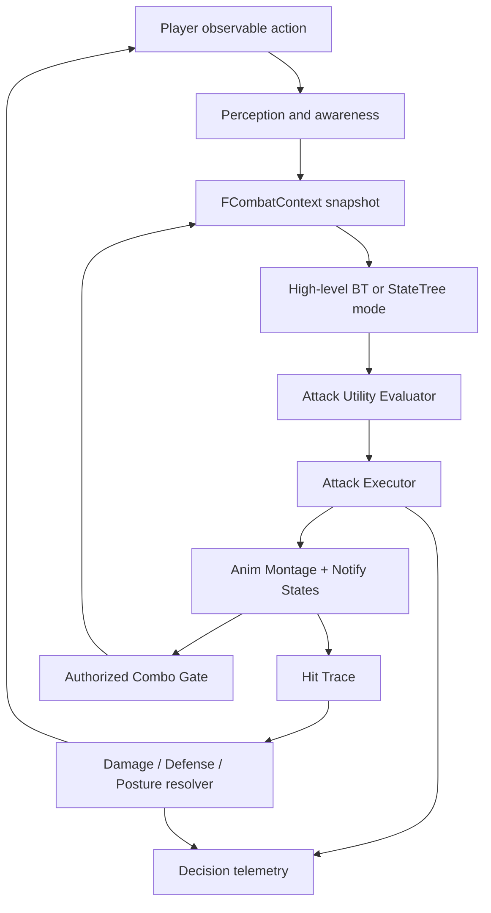
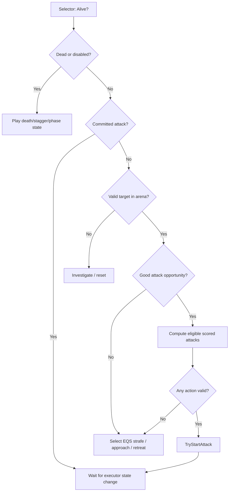
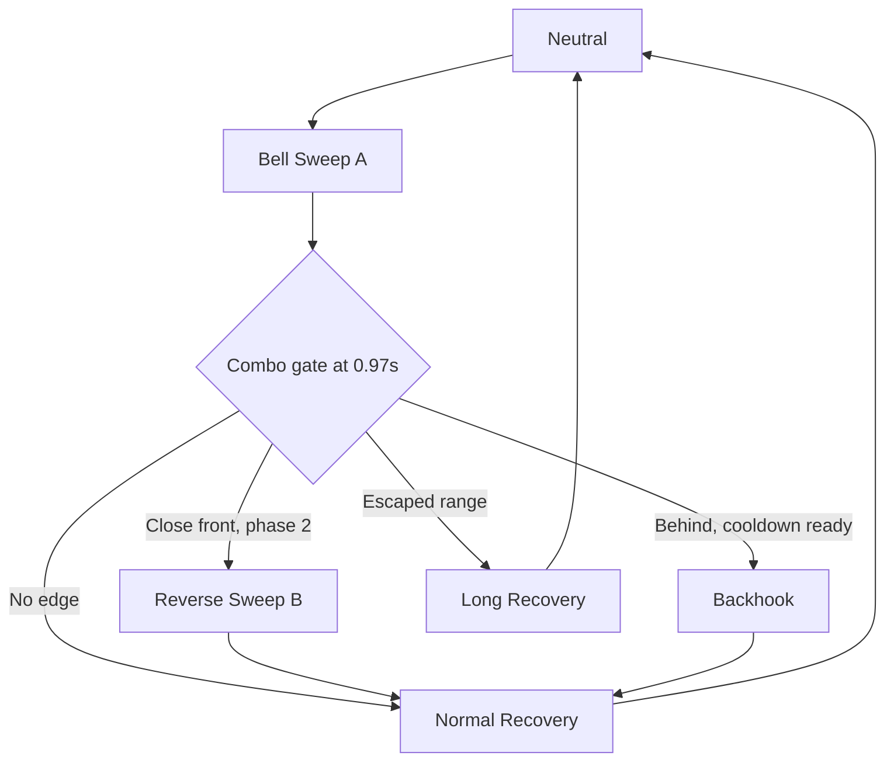
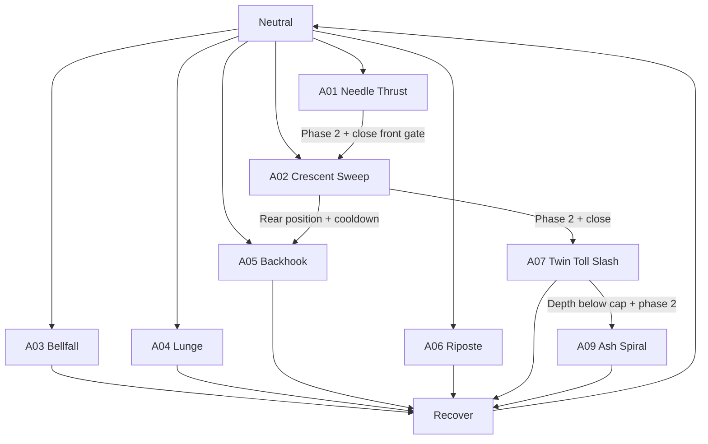
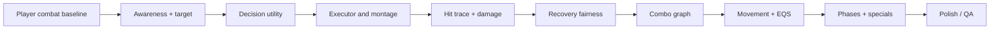

# COMPLETE GUIDE — Soulslike Boss Combat Engineering in Unreal Engine 5.5

**Original combat design kit** | Blueprint-first + C++ architecture | Original Ashen Bellwarden example | All numeric tuning values are illustrative and are **not** Elden Ring internals.


## Contents

1. [00 — Combat Design Goals, Fairness Contract, Definitions](#01-00-design-goals-and-definitions)
2. [01 — Runtime Architecture and Ownership](#02-01-system-architecture)
3. [02 — Player Awareness, Context, and Action Reactions](#03-02-player-model-and-awareness)
4. [03 — Attack Selection via Eligibility + Utility + Memory](#04-03-attack-selection-utility-ai)
5. [04 — Combo Graph, Legal Decision Gates, Branch Conditions](#05-04-combo-branching-and-decision-tree)
6. [05 — Timelines, Delayed Strikes, Telegraphs, Rhythm, Neutral Pauses](#06-05-attack-timing-telegraphs-and-pacing)
7. [06 — Animation, Rotation Limits, Root Motion, Motion Warping](#07-06-animation-rootmotion-and-tracking)
8. [07 — Hit Detection, Weapon Sweeps, Point Damage, AoE and Special Attacks](#08-07-hit-detection-damage-geometry)
9. [08 — Punish Windows, Attack Commitment, Player Agency](#09-08-punish-windows-and-fairness)
10. [09 — Movement, Strafing, Distance Management, Arena Awareness](#10-09-movement-spacing-and-arena)
11. [10 — Damage Reactions, Stance/Poise, Hyperarmor, Parries, Guard, Grabs](#11-10-defense-stagger-poise-and-interruptions)
12. [11 — Phases, Heal Punishes, Adaptation, Anti-Cheese](#12-11-phases-reactions-and-behavior-adaptation)
13. [12 — UE 5.5/5.5.4 Blueprint Implementation (Practical Editor Build Guide)](#13-12-unreal-55-blueprint-implementation)
14. [13 — C++ Scaffolding: Types, Components, Interfaces, Ownership](#14-13-cpp-scaffolding)
15. [14 — Original Boss Case Study: ASHEN BELLWARDEN](#15-14-ashen-bellwarden-boss-spec)
16. [15 — Attack Catalogue, Timing Table, Balancing Procedure](#16-15-attack-catalogue-and-balance-sheet)
17. [16 — Debug Views, Automated Tests, Telemetry, Profiling](#17-16-debug-telemetry-and-qa)
18. [17 — Production Roadmap, Roles, Milestones, Acceptance Gates](#18-17-production-roadmap-and-deliverables)
19. [18 — VFX, Sound, Camera, Readability, Accessibility](#19-18-polish-vfx-sfx-camera-accessibility)
20. [19 — Multiplayer Extension and Network Authority (Optional)](#20-19-multiplayer-and-replication)
21. [20 — References, Terminology and Accuracy Boundaries](#21-20-references-glossary-and-caveats)
22. [21 — Animation Production: Rig, Root Motion, Montages and Notifies](#22-21-animation-authoring-and-asset-pipeline)
23. [22 — Anti-patterns, Symptoms, Root Causes and Corrections](#23-22-failure-modes-and-anti-patterns)

---


<a id="01-00-design-goals-and-definitions"></a>

# 00 — Combat Design Goals, Fairness Contract, Definitions

## Desired experience

The Ashen Bellwarden should feel intelligent **because of contextual moves and believable commitment**, not because it cheats. The player should be able to infer patterns and then consciously manipulate range, angle, animation state, and recovery to generate openings.

### Design pillars

1. **Legible threat:** every dangerous active window has perceivable anticipation with a recognizable attack signature; deliberately difficult timing is allowed but invisible arbitrary damage is not.
2. **Committed moves:** targeting may update in neutral and early wind-up. Late wind-up and active damage have explicit rotation caps or hard lock.
3. **Player-responsive, not button-reading:** target selection may use committed visible player action states. Counter moves are gated by line-of-sight, distance, cost, and cooldown.
4. **Differentiated geometry:** thrust ≠ sweep ≠ localized impact ≠ radial expanding ring ≠ lingering hazard ≠ grab.
5. **Learnable uncertainty:** limited weighted variety across eligible attacks, with anti-repeat weighting; not pure uniform random selection.
6. **Recovery has value:** players who recognize the correct position can land a measurable punish; not every recovery guarantees a heavy hit.
7. **Production visibility:** every state transition, hit window, selected candidate, and branch is debuggable.
8. **Stable gameplay:** difficulty must survive 30/60/120 FPS tests and animation-rate/lag edge cases.

## Core definitions

- **Neutral:** boss is free to evaluate locomotion, reorientation or initiating an attack.
- **Wind-up:** early attack animation. Can include target tracking; usually still telegraphs move type.
- **Hold/delay:** distinctive pause before strike; may be purely authored or an explicitly bounded variable-time animation section. Must not pause indefinitely.
- **Commit/lock:** point after which movement or facing is intentionally constrained.
- **Active window:** exact interval in which one or more attack collision volumes can deal damage.
- **Follow-through:** weapon completes movement; sometimes collision has already ended.
- **Recovery:** time after active window while the boss is unable to initiate most actions.
- **Combo gate:** legal moment to choose a specified follow-up, evaluated against current context.
- **Punish window:** player-action opportunity computed from remaining boss lock minus travel, startup, and safety buffer.
- **Hit confirm:** evaluation whether an attack physically contacted a target (not to be confused with being allowed to branch).
- **Whiff:** attack misses; may have separate follow-up or recovery tuning if authored and fair.
- **Posture/stance:** accumulation that may cause stance break independently of health.
- **Hyperarmor:** interruption resistance on specified attacks or windows; not global invulnerability.
- **Telegraph:** audiovisual and movement cue that communicates an upcoming threat.

## Baseline scenario / non-goals

- First release: **single-player third-person melee**, 60 FPS target, keyboard/controller combat, 1 human boss opponent.
- A player prototype must support light attack, heavy attack, dodge i-frames, optional guard, heal, hurt/knockback, stamina, and death.
- Boss design is unusable without a functioning player defense/hit reaction system; implement a small test character first.
- First release deliberately excludes multiplayer, procedural generation, ML policy training, 50+ attacks, and complex animation-matching. Separate extension docs cover multiplayer.

## Observable fairness invariants (automatable)

- No hit outside an active window except persistent AoE with its own active state.
- A **single-hit** attack damages a particular victim no more than once per activation ID.
- Track lock never exceeds attack-specified angular velocity cap after commitment.
- Any attack's damage onset is after its minimum telegraph time (unless specifically classified as close-range quick punish with its own short cue).
- Every legal combat state has a timeout/fallback; no unending `Attack` state if a Montage interrupt event is missed.
- A phase transition may interrupt an attack only when its transition policy allows it.
- Player dodge invulnerability, block, posture and death states resolve **before** final health damage in a documented order.
- A blocked grab is not treated as a normal sword hit; it has custom guard interaction.

## What makes a move strategically different?

At least two of: (a) timing profile, (b) reach, (c) angular coverage, (d) tracking profile, (e) damage type, (f) punish option, (g) movement displacement, (h) guard/stance consequence, (i) position required for activation, (j) combo branch possibilities. Merely renaming animation clips does not add gameplay depth.

## Sample encounter loop

1. Boss neutral, at 450 cm distance from player.
2. Utility evaluator rejects close thrust and rear sweep, considers advancing lunge vs approach/strafe.
3. Lunge chosen, target point captured; early animation faces the player.
4. Commit event locks facing; authored root motion drives leap.
5. `ANS_AttackWindow` creates a continuous swept trace for the weapon.
6. Player dodges sideways; no hit is registered.
7. At an authored combo gate, if player is inside the lateral zone and branch cooldown passes, follow-up sweep occurs; otherwise recovery starts.
8. Boss is locked for 0.55s. Player reaches flank in 0.20s, light attack startup 0.24s: an approximately 0.11s margin remains — narrow but achievable.
9. Telemetry records the observed result for tuning; boss doesn't secretly read controller inputs.


---

<a id="02-01-system-architecture"></a>

# 01 — Runtime Architecture and Ownership


## Recommended topology

**`BP_AshenBellwarden` / `ABossCharacter`** owns life, mesh, movement, collision capsule, components, ASC optional, and attack animation interface. **`BP_BossAIController`** owns perception, blackboard/BT and target selection. **`UCombatAwarenessComponent`** computes context snapshots. **`UAttackDecisionComponent`** filters/scores actions. **`UAttackExecutorComponent`** manages current attack, montage events and cancel policies. **`UHitTraceComponent`** owns per-swing collision sweeps. **`UPostureComponent`** owns stance thresholds and regeneration. **`UPhaseComponent`** owns transitions and phase data. **`ABossArenaBounds`** constrains spacing/navigation. **`UBossDebugComponent`** records replayable decisions.

### Engine/tool mapping

| Responsibility | Prefer in UE 5.5 | Why |
|---|---|---|
| Target perception | `UAIPerceptionComponent` on AIController | Event-based stimuli, sight, damage |
| High-level modes | Behavior Tree + Blackboard **or** StateTree | Understandable encounter flow; choose one |
| Destination search | EQS queries with score tests | Evaluates reposition candidates |
| Attack choice | Custom utility evaluator component | Fine-grained, auditable choices |
| Attack execution | Anim Montages/Sections + Notify States | Precisely timed attack windows |
| Root motion for lunges | Root-motion Montages + Motion Warping selectively | Authored displacement; bounded target adjustment |
| Damage | Custom hit-resolver or GAS GameplayEffects | Centralized damage/defense rules |
| VFX | Niagara events on notify timeline | Sync with animation |
| Sound | MetaSounds / Sound Cue; gameplay event scheduling | Readable cues |
| Debug | Gameplay Debugger, AI Debugging, Rewind Debugger, Visual Logger, Unreal Insights | Diagnosis of decisions/timings |

## Single source of truth: attack execution

**Do not let the BT, AnimBP and hit component all decide which attack is currently active.** The executor owns `{AttackInstanceID, AttackAsset, Phase, Section, AttackRuntimeState, StartedTime, TargetSnapshot, HitVictims}`. The BT asks `StartAttack`, but it does not manually set hitboxes or end the animation. Anim Notifies report timed signals **into** the executor; they do not choose the entire next behavior independently.

### Proposed interface

```text
CombatAwareness:
  BuildSnapshot(Target, Now) -> FCombatContext
AttackDecision:
  ChooseAttack(Context, AllowedAttackIds, Seed) -> FDecisionTrace
AttackExecutor:
  TryStartAttack(AttackId, Context) -> bool
  OnAttackCommit()
  OnHitWindowBegin(WindowIndex)
  OnHitWindowEnd(WindowIndex)
  OnComboGate(GateId)
  OnMontageBlendingOut(Montage, Interrupted)
  OnMontageEnded(Montage, Interrupted)
  AbortAttack(Reason)
HitTrace:
  BeginWindow(InstanceId, WindowId)
  SampleWeaponSweep(PreviousSocketTransforms, CurrentSocketTransforms)
  EndWindow(InstanceId, WindowId)
DamageResolver:
  ResolveHit(AttackInstanceId, Victim, Hit, DamageSpec)
```

## Update scheduling

| Operation | Typical schedule | Critical note |
|---|---|---|
| Perception | Events + update when target changes | Perception events do **not** mean attack immediately |
| Context snapshot | At every decision gate + optional 5–10 Hz cache | Use timestamped, consistent reads |
| Attack scoring | Neutral or authorized combo gate only | Not every Tick |
| High-level locomotion | BT service / movement component | Avoid constantly restarting `Move To` |
| Montage animation | Engine animation update | Don't override it with competing Tick rotation |
| Hit traces | Every frame during active window; sub-step as needed | Prevent tunneling at low frame rates |
| UI/VFX | As required | Cosmetic events must not own authoritative damage |
| Telemetry | Buffered event log | Avoid per-frame disk I/O |

## Data flow and event ownership



## Data assets and runtime separation

- `PDA_BossConfig`: max health, phase assets, locomotion speeds, global neutral delay, posture settings.
- `PDA_Attack_*`: distance/angle/phase gates, attack montage, base weight, cooldown, hit window data, trajectory, cancel/branch windows.
- `PDA_AttackGraph`: directed follow-up edges with gate conditions and weight modifiers.
- `PDA_BossPhase_01/02`: allowed attacks, score modifiers, delay range, movement policy.
- Runtime context: computed, **not** serialized in assets.
- Runtime attack instance: unique instance ID, cached target, trace history, hit victims.

## Failure recovery and event order

1. `TryStartAttack` validates `Neutral` and selected asset; sets runtime state `Windup` and unique instance ID before starting montage.
2. Montage play failure -> rollback immediately and log.
3. Notify calls must check the expected `AttackInstanceID` and current state.
4. Hit windows shut down on normal end, interruption, stagger, death, phase transition, teleport, or mesh destruction.
5. Montage blend-out is not always equivalent to successful completion; handle `Interrupted` explicitly.
6. A watchdog checks maximum expected duration + blend margin and aborts stale attacks.
7. `OnAttackEnded` allows neutral choice only after collision has been disabled and recovery policy resolved.

## Competing architectures: choose intentionally

- **Blueprint-first vertical slice:** Behavior Tree + BPs + Data Assets + custom Notify States. Fast iteration; profile per-frame traces.
- **Hybrid production:** BT and montage authoring in editor; utility, hit sweep, damage and telemetry in C++ exposed to Blueprint. Recommended here.
- **GAS-centric:** useful if existing player/enemies have ASC, GameplayEffects, GameplayTags, GameplayCues. Costs setup complexity; not required for one boss.
- **StateTree-centric:** good alternative for explicit hierarchical states; avoid running the StateTree and BT as independent authoritative combat planners.

## Invariant: player movement never directly sets boss animation

Target position affects decisions and bounded tracking; animation execution remains authoritative. Abandoning this separation creates unfair midair snapping, constant attack cancellation, and untestable hit timing.


---

<a id="03-02-player-model-and-awareness"></a>

# 02 — Player Awareness, Context, and Action Reactions

## A boss needs a model of the player, not psychic access

Observation should come from **game-world state**: visible location, velocity, facing, current committed attack montage, healing animation, guard state, dodge state, collision response, last-known position. Do not consult future inputs or choose a perfect counter before the player has made an observable commitment.

## Minimum `FCombatContext`

| Field | How obtained | Use |
|---|---|---|
| `TargetActor` | Perception + current threat target | Evaluate validity |
| `DistanceCm` | XY center-to-center or attack origin-to-target | Range gates |
| `SignedYawDeg` | Actor forward vs planar target direction | Front/side/rear gates |
| `HasLineOfSight` | Perception + trace as needed | React to casts, target |
| `TargetVelocity` | Movement component, smoothed | Leading/projectile choice |
| `TargetActivity` | Publicly observable action tags | Heal/cast/attack punish |
| `TargetRecoveryRemaining` | Current animation state if known | Opportunistic attack |
| `TargetGuardState` | Character state | Guard-break choices |
| `TargetDodge` | Dodge montage / dodge state | Readability, don't auto-counter every roll |
| `BossHealthFraction` | Combat stats | Phase gates |
| `BossPostureFraction` | Posture component | Risk/defensive score |
| `TimeSinceLastAttack` | Executor | Pace/cooldown |
| `AttackHistory` | Circular last N IDs | Repeat penalty |
| `CurrentPhase` | Phase component | Allowed moves |
| `ArenaSafeZones` | Navmesh & arena actor | Avoid hazards/walls |

### Computing angle (planar)

```cpp
FVector ToTarget = TargetLocation - BossLocation;
ToTarget.Z = 0.0;
ToTarget.Normalize();
const FVector Forward = BossForward.GetSafeNormal2D();
const float Dot = FVector::DotProduct(Forward, ToTarget);
const float CrossZ = FVector::CrossProduct(Forward, ToTarget).Z;
const float SignedYawDeg = FMath::RadiansToDegrees(FMath::Atan2(CrossZ, Dot));
```

Angles are world-relative to **boss facing**, not camera position. E.g. front = abs(yaw) ≤ 55°, side = 55–135°, rear = >135°. Include hysteresis to prevent jitter at boundaries.

## Distances and collision size

For huge enemies, center-to-center distance is misleading. Choose one convention per attack: XY capsule surface gap, nearest weapon reach point, or root-to-root center distance, and label it. `DistanceCm=250` uses **Unreal centimeters**. Character scaling affects entire move catalog; rebake or normalize reach if the mesh scale changes.

## How to model player actions safely

Use a `EPlayerCombatActivity` state exposed by the player combat component: `Idle, Moving, AttackingWindup, AttackingActive, AttackingRecovery, HealingCommitted, CastingCommitted, Dodging, Blocking, Staggered`. Mark transitions using the player's montage notifies or ability state. The boss should **only** react after a committed observable start event plus a reaction delay; in-world sight/awareness still required.

**Heal punish gating example:** healing committed; line of sight; player 300–850cm away; boss neutral; reaction ready; attack cooldown ready; probability or score threshold passed; projected travel time shorter than heal recovery; selected attack animation has real travel. If any condition fails, do not force counter.

## Memory and uncertainty

Use last-seen transform, last-seen timestamp, observed repeated patterns, and a short memory horizon to allow believable searching without perfect awareness. If target teleports or becomes invisible, reacquire instead of tracking hidden location. Player pattern counters should be *soft preferences*, not guaranteed hard counters.

Example history features: `BackRollRateLast8s`, `HealAttemptsLast30s`, `TimeNearRearArc`, `GuardHoldDuration`. Smooth with decay and cap their contribution. Avoid permanent punishment for one mistake.

## Target validity and robustness

Before each new decision: check valid actor, not dead, reachable range, arena membership, max vertical delta, not same owner; handle target destroyed mid-swing. Use original attack aim snapshot after commitment rather than `GetPlayerCharacter` every trace frame. The hit resolver can still collide with any valid victim in the active trace.

## Perception setup in UE

1. Add AI Perception to `BP_BossAIController`; configure Sight and optional Damage. Register player stimuli if needed.
2. On Target Perception Updated: update target candidate/last seen and timestamps; no direct montage play.
3. Drive `BB_TargetActor`, `BB_HasLOS`, and `BB_LastSeenLocation`.
4. Context component queries current actor movement and exported combat action state only at decision gates.
5. Use a custom `BPI_CombatObservable` interface to decouple AI from player implementation.
6. Record false-positive perception and occlusion cases in telemetry.

## Testing

- Player stands front/side/back at 1m, 3m, 6m: correct region labels and hysteresis.
- Player starts heal *after* boss commits: no retroactive attack swapping.
- Player breaks line-of-sight: boss does not choose ranged precision punish.
- Player dodges across front/rear threshold: no rapid oscillation between reactions.
- Target dies during wind-up: finish committed motion safely or move to recover/defeat state per design.


---

<a id="04-03-attack-selection-utility-ai"></a>

# 03 — Attack Selection via Eligibility + Utility + Memory


## Three separate stages — do not conflate

1. **Eligibility filters:** impossible choices are removed. An attack should never be scored if it violates phase/range/angle/resource/cooldown/state constraints.
2. **Utility scores:** valid attacks receive comparable desirability scores (distance fit, position, player recovery, preferred pace, variety, ability to connect).
3. **Selection:** choose max score with bounded noise, or a temperature-controlled weighted draw among sufficiently good candidates. Log the top N with rejection reasons.

## Hard gates

- Attack present in phase's allowed attack set.
- Boss executor is at `Neutral` or correct `ComboGate`.
- Target valid and within attack-defined 2D range plus vertical tolerance.
- Signed target yaw within allowed sector.
- Cooldown expired, resource/posture restrictions satisfied.
- The action is compatible with current attack branch (if gate).
- Montage and required sockets exist; nav destination reachable if required.
- If attack requires line of sight, it must be currently true.
- Animation action requirements (e.g. front-facing only) satisfied.

## Soft utility model (proposed)

Let every term be normalized into `[0,1]`:

```text
Utility(a,c) = BaseWeight(a) *
  [0.28*RangeFit(a,c) +
   0.20*AngleFit(a,c) +
   0.20*Opportunity(c) +
   0.12*SpacingValue(a,c) +
   0.10*PhaseStyle(a,c) +
   0.10*Variety(a,c)]
  - RepeatPenalty(a) - RiskPenalty(a,c)
```

The coefficients are **illustrative designer starting points, not Elden Ring internals**. Normalize score scales and graph score histograms before shipping. Add deterministic noise `[-0.05,+0.05]` or use weighted softmax only on close-scoring candidates, not all eligible moves.

### Range/angle fit

A range gate can allow 100–500 cm, but desirability may peak at 275 cm; e.g. `max(0, 1 - abs(distance - preferredDistance)/tolerance)`. Angle fit should account for whether a move rotates during wind-up; do not silently imply infinite turning.

### Variety memory

Track recent attack IDs with timestamps. Apply decaying repeat penalties and same-family penalties (e.g., two overheads in short succession). Rare signature attacks can have a guaranteed minimum spacing interval. Allow repeated signature attacks if repeated player behavior makes them logical, but tune repetition to avoid stagnation.

### Weighted choice

```text
Candidates = phase.allowedAttacks
Eligible = [a for a in Candidates if HardGates(a, context)]
if empty: return PositionOrWait
Scores = [(a, Utility(a, context)) for a in Eligible]
NearBest = candidates with score >= maxScore - 0.12
Selected = SoftmaxSample(NearBest, temperature=0.18, deterministicRNG)
return Selected plus rejection/score trace
```

Fallback hierarchy: valid guard response > spacing move > purposeful wait > retry; never infinite loop on no attacks.

## Why scoring should run only at legal gates

Suppose the boss begins a heavy slam, then player dodges behind it. If `ChooseAttack()` is called every frame and immediately swaps the montage, the boss becomes unreadable and appears supernatural. Instead choose the next action at an authored combo gate after the first active window, or at neutral after recovery. Independently allow limited early-wind-up aim tracking.

## Behavior Tree approach



Recommended Blackboard keys: `TargetActor`, `LastKnownLocation`, `HasLOS`, `CombatMode`, `SelectedMoveGoal`, `ExecutorBusy`, `DesiredRangeBand`, `BossPhase`. Scores live in C++ component or service, not a giant collection of Blackboard floats.

## Decision trace format (essential for debugging)

```json
{
  "time": 132.815,
  "gate": "Neutral",
  "distance_cm": 320,
  "signed_yaw_deg": 44,
  "player_action": "AttackingRecovery",
  "phase": 2,
  "candidates": [
    {"id": "PikeLunge", "score": 0.79, "eligible": true},
    {"id": "CrescentSweep", "score": 0.68, "eligible": true},
    {"id": "RearBellCrash", "eligible": false, "reject": "RearAngleRequired"}
  ],
  "chosen": "PikeLunge",
  "rng_seed": 12735
}
```

## Fair selection principles

- Limit maximum reaction cadence. A player must be able to see the counter begin.
- Never score an animation unavailable to execute.
- Split defensive reactions (emergency dodge or block) from normal attack selection, and give them budgets/cooldowns.
- Use pressure history to avoid endless forced attacks and perpetual recovery canceling.
- Do not silently buff attack speed depending on player health unless clearly part of phase rules.
- Do not dynamically choose an arbitrary untelegraphed hit geometry after an attack has become visually committed.


---

<a id="05-04-combo-branching-and-decision-tree"></a>

# 04 — Combo Graph, Legal Decision Gates, Branch Conditions


## A combo graph is not a random animation chain

Each **node** represents an authored move section; each **edge** represents a legal transition requiring a **branch gate** and conditions. Edge outcomes include `FollowUpMove`, `RecoveryVariant`, `Retreat`, or `End`. The boss cannot branch from arbitrary points in the middle of a live hitbox.

### Example combo: `BellSweep_A`

- `0.00–0.50s`: wind-up; tracking allowed up to 180°/s.
- `0.50s`: rotation commitment, cap 18°/s.
- `0.68–0.91s`: active sweep (swept socket collision).
- `0.92s`: close hitboxes.
- `0.97s`: combo decision gate; evaluate snapshot once.
- Branch A: target close and front/side, boss phase 2 -> `BellSweep_B` (quick reversing slash).
- Branch B: target behind, rear-counter available -> `Backhook` (distinct tell).
- Branch C: target escaped -> end combo, `Recovery_Long`.
- Branch D: none eligible -> `Recovery_Normal`.

**Beware:** choose whether a branch is allowed **independent** of hit confirm. Some bosses extend when whiffing, some only if the player stays close, some stop after a guarded strike. Tag every edge with its policy.

## Branch condition schema

```text
FComboEdge:
  FromMoveId, GateName, ToMoveId
  MinDistance, MaxDistance, MinAngle, MaxAngle
  RequiresHitConfirm (optional)
  RequiresTargetActionTag (optional)
  PhaseMask, Cooldown, MinimumDelay
  WeightModifier, Priority
  MaxUsesPerCombo, CancelPolicy
```

## Runtime algorithm

1. `ANS_ComboGate` calls executor with `GateName` and attack instance ID.
2. Executor validates state, ensures gate not consumed, turns off ended hit window.
3. Build **fresh** combat context now (not first-attack cached state).
4. Look up outgoing edges for `(CurrentNode, GateName)`.
5. Apply hard gates, edge weights and combo depth limit.
6. Choose one edge; if none eligible follow default recovery.
7. Use `Montage_SetNextSection` *where the montage structure permits*, or start the next montage with an explicit blend/transition policy. Test branch frame accuracy in UE 5.5.
8. Log gate time, chosen edge, scores and reasons.

## Interruption and cancel priority

`Death > ForcedPhaseTransition(if authorized) > StanceBreak > Parry/Grab special > ComboGate > NormalCompletion` is one possible ordering. Define it explicitly; do not depend on which Blueprint event happened first in a frame. Hyperarmor may prevent certain stagger actions, but death should still terminate cleanly.

## Anti-infinite-combo safeguards

- Maximum combo depth (e.g. 3 in phase 1, 4 in phase 2).
- Every edge has cooldown or per-combo use count if it can loop.
- Global `MaxPressureDuration` budget to guarantee eventual neutral/recovery.
- `AttackInstanceID` changes per move, and a `ComboID` links the entire sequence for analytics.
- Any failed montage section or invalid target routes into reliable recovery.

## Branching and player learning

A boss is challenging when the player learns **conditions**, not just a single fixed pattern. If a close dodge consistently triggers a reverse slash, skilled players can avoid it by leaving range or by attacking from another angle. Conversely, if the graph branches arbitrarily every time with no visible setup, learning becomes guessing.

## Useful authoring pattern: graph in data asset, execution in one place

`PDA_AttackGraph_Bellwarden` should hold nodes/edges. The AnimBP never queries player distance; it emits a gate event. The decision component scores edges, and executor drives montage transitions. This avoids branching logic hidden across many montages.

## Example graph (Mermaid)




---

<a id="06-05-attack-timing-telegraphs-and-pacing"></a>

# 05 — Timelines, Delayed Strikes, Telegraphs, Rhythm, Neutral Pauses


## Segment each attack explicitly

`Anticipation/Wind-up → Optional Hold → Commit/Tracking Lock → Active Hit(s) → Follow-Through → Recovery → Neutral`

All values in the provided example are **designer-authored**, not sourced from Elden Ring. The animation can be one montage with annotated notifies, or multiple labeled sections. Prefer the actual animation play position as timing authority instead of timers that drift from playback rate.

### Telegraph phases

- **Early pose:** communicates attack family (overhead vs thrust vs radial blast).
- **Direction clue:** shoulders, weapon path, stance, step direction communicate geometry.
- **Release cue:** acceleration, sound accent or VFX spike communicates imminent damage.
- **Active hit:** weapon/ground/projectile volume is damaging — only when authorized.
- **Aftermath:** follow-through communicates safe or conditional recovery.

### Delayed attacks without cheating

A fixed long wind-up is different from a dynamically variable hold. Dynamic holds are fair only when (1) their min/max durations are bounded, (2) release has a reliable observable cue, (3) release timing is not chosen after reading the player's dodge input in an impossible way, and (4) their duration does not make player action futile. Recommended first prototype: **fixed** authored hold variants selected before commitment.

Example: attack has `HoldShort 0.35s`, `HoldLong 0.75s`; choice made at wind-up start and visibly communicated by pose/audio. Never directly truncate the hold to hit an already-rolled player unless move design deliberately includes an intelligible release trigger.

## Timing budget at 60 FPS

Frame duration is ~16.67 ms. An attack that has an 80 ms active window spans roughly 5 frames at 60 FPS; it may be missed if collision detection relies on a single overlap sample per frame. Use swept traces and/or sub-sampled socket path; test at 30 FPS. Animation notifies can cross over multiple frames with different blend behavior; log actual fired events.

### Illustrative durations

| Move | Wind-up | Hold | Active | Recovery | Feel |
|---|---:|---:|---:|---:|---|
| Quick poke | 0.25s | 0 | 0.13s | 0.38s | Pressure, low reward |
| Heavy overhead | 0.68s | 0.38s | 0.18s | 0.95s | Read, dodge, punish |
| Delayed hook | 0.42s | 0.65s | 0.15s | 0.62s | Roll timing test |
| Wide sweep | 0.55s | 0 | 0.25s | 0.60s | Position test |
| Radial bell shock | 1.05s | 0 | 0.40s ring traversal | 1.00s | Area recognition |

The true time to hit is wind-up + hold + time to first contact within active window; the exact contact time depends on geometry and victim position.

## Neutral and pacing

Neutral should not mean brain-dead idling. The boss can circle, feint position, walk, face the player, defend, or briefly reset. Use aggression tokens: a long combo spends budget, recovery and positioning replenish it. Caps prevent continuous pressure. In phase 2, budget and replenish rates can change without deleting punish windows.

### Proposed pressure budget

`PressureBudget max=100`: quick poke costs 12; sweep 22; heavy 35; advancing lunge 28; shockwave 45. Replenish 18/s in neutral, 5/s while recovering, 0 during active. Attack eligible only if enough budget; always reserve enough capacity for a safe emergency disengage action. Numbers are examples.

### Rhythm motifs

- **Short-short-long** combo challenges fast double-roll habits.
- **Long-fast** teaches not to dodge on first movement alone.
- **Heavy recover** invites a charged attack.
- **Quiet positioning** makes the next move legible and avoids animation noise.
- **Fast pressure followed by obvious reset** rewards mastery and prevents exhaustion.

## Animation damage timing

Weapon contact time is not necessarily the montage notify start. Analyze the actual bone path and place active spans at the physical overlap. For a large weapon, sweep may last ~0.3s with the player's contact instant varying with side and distance. Damage should be resolved against traced intersection time, not a global moment of animation.

## Slow motion, hitstop, and time dilation

If hitstop pauses animation, pause trace sampling safely and avoid repeated overlap damage during the freeze. Time dilation can scale montage and timer systems differently if implemented inconsistently. QA must test pause/resume, play rate 0.75x/1.25x, and low FPS. Keep cooldown time base explicit: game time vs unscaled real time.


---

<a id="07-06-animation-rootmotion-and-tracking"></a>

# 06 — Animation, Rotation Limits, Root Motion, Motion Warping


## Authoritative motion sources

- **Neutral locomotion:** `CharacterMovementComponent` and turn-in-place/strafe animation BlendSpace.
- **Committed melee attacks:** prefer authored root motion for directional travel and body mass, with carefully bounded movement if required.
- **Special gap closers:** root-motion montage + **Motion Warping** in a specific early window only; clamp displacement and rotation.
- **Reaction and stagger:** montage or animation state with explicit movement/cancel policy.

**Avoid simultaneously** calling `AI MoveTo`, setting actor location, rotating on Tick, and playing a root-motion attack. Movement authority should switch cleanly by state.

## Rotation tracking profile per move

| Stage | Proposed rule |
|---|---|
| Neutral | Aim at target at up to movement-defined max turn speed |
| Early wind-up | Up to 120–220°/s for a tracked attack |
| Late wind-up | Up to 10–35°/s depending on heaviness |
| Active | 0–15°/s, often zero for fully committed slash |
| Recovery | No arbitrary snap; turn-in-place after unlock |

These are **design parameters**, not engine defaults. Use `DeltaYawClamped = Clamp(DeltaYaw, -MaxDegreesPerSecond * DeltaSeconds, +...)` applied through the authoritative movement controller. Do not call `FindLookAtRotation → SetActorRotation` unconditionally each Tick while an attacking montage plays.

## Motion Warping: when and when not

Motion Warping can modify root motion to align to a named target during a Notify State window. UE's Motion Warping plugin provides Skew Warp and Scale strategies. Use it for controlled lunges/steps; stop warping at the commitment boundary. Never refresh warp target every frame across a fully committed active attack if that erases dodging skill.

### Practical recipe

1. Enable **Motion Warping** plugin, restart UE if requested.
2. Add Motion Warping component to boss Character.
3. Confirm animation has meaningful root-bone motion and Root Motion enabled.
4. Create `AM_Lunge` Montage, add Motion Warping Notify State from time `0.10–0.48s`, target name `AttackTarget`.
5. On move start sample desired target transform within the legal warp radius; call **Add or Update Warp Target** once or at specifically authorized early gate.
6. After `TrackingLock` event, freeze target update or let warping window end before active damage.
7. Test target strafing perpendicular, dodging behind, moving onto stairs, and being outside navmesh; cap warp translation and vertical displacement.

## Montage authoring

For each attack create tracks:

- `Timing`: `AN_AttackCommit`, `ANS_TrackingWindow`, `ANS_AttackActive`, `AN_ComboGate`, `AN_RecoveryBegin`, `AN_AttackComplete`.
- `Motion`: optional `ANS_MotionWarping`, root motion configuration, movement/rotation constraints.
- `Feedback`: audio preparation cue, weapon whoosh, impact cue, Niagara ground or weapon FX, camera impulse (local player only).
- `Gameplay`: posture armor start/end, i-frame if specifically intended, grab attachment window.

Use montage sections such as `Start`, `Hold`, `Release`, `ComboB`, `Recover` with explicit Next Section behavior. `Montage_SetNextSection` only makes sense when the current montage/section authoring supports it. Don't assume every blend or interruption will preserve notifies.

## Animation Blueprint design

- `Locomotion State Machine`: Idle, Walk, Run, Strafe, Turn, Stagger, Death.
- `Slot 'DefaultGroup.CombatFullBody'`: full-body attack Montages with carefully configured blend-in/out.
- Layered blend per bone only for actions explicitly designed as upper-body attacks; massive full-body polearm sweeps should not independently play strafing lower body.
- `DistanceMatching`/`StrideWarping` optional polish, not prerequisites.
- Control-rig IK/foot placement allowed during movement but turn off or reduce weight on violent airborne frames to avoid fighting root motion.

## Synchronizing hitboxes

Use `UAnimNotifyState` begin/end to open/close a **named hit window**. Each frame while open perform weapon socket sweeps between previous and current locations. If montage skips frames or ends abnormally, executor must close the window on interruption. Track unique attack ID to prevent stale notifies from old montages enabling damage.

## Animation production requirements

Require the animator to provide: root-bone axis and forward direction convention, contact times, target facing lock time, capsule displacement, release cue, weapon socket paths, grab alignment, recovery lock, cancel authorization, loop/section boundaries, phase variant, and optional camera-readable silhouette poses. See doc 21 for asset workflow.

## Edge case tests

- 30 FPS; montage timescale altered; heavy swing still hits once.
- Player crosses behind during commit; boss does **not** rotate 180° instantly.
- Warp target moves off ledge; attack uses bounded fallback or declines start.
- Montage interrupted during active trace; no phantom collision remains.
- `AnimBP` blend-out doesn't fire expected end event; watchdog repairs state.


---

<a id="08-07-hit-detection-damage-geometry"></a>

# 07 — Hit Detection, Weapon Sweeps, Point Damage, AoE and Special Attacks


## One centralized damage policy, many collision mechanisms

An attack **shape** determines where/when contact can occur; the damage resolver determines what contact means. Keep them separate. A hit should carry `{AttackID, InstanceID, WindowID, Victim, HitPoint, HitNormal, HitBone, Instigator, DamageType, StanceDamage, Timestamp}`.

### Six geometry families

1. **Thrust / point-target strike:** weapon-tip sphere or small capsule swept along its path; concentrated reach, minimal lateral coverage.
2. **Sweeping arc:** a blade defined by `WeaponBase/WeaponMid/WeaponTip` socket segments; sweep overlapping capsules/spheres through the frame interval; no instant giant wedge unless intentionally magical.
3. **Slam / localized impact:** direct weapon trace plus impact-centered sphere/capsule at ground contact; separately flag direct and splash zones.
4. **Radial expanding ring:** independently simulated expanding radius band `abs(distanceFromOrigin - CurrentRadius) <= RingWidth/2`; ensure active duration, LOS/height checks, and damage only once per wave.
5. **Beam / line hazard:** sphere/capsule trace or box along a forward lane, potentially repeating ticks at configured intervals if persistent.
6. **Grab:** dedicated capture collider and grab eligibility checks; transition attacker and victim to synchronized paired animation only after valid overlap, guard/iframe adjudication and robust warp alignment.

## Swept weapon sampling

At every animation update while the active window is open:

```text
PrevBase, PrevMid, PrevTip = cached world socket transforms
CurrBase, CurrMid, CurrTip = new world socket transforms
For each segment endpoint or several samples along blade:
    Sweep sphere from previous to current position
    Optionally additional sub-steps if angular change/translation > limits
    Collect hits, sort by collision time, resolve per-attack rules
Cache current transforms
```

**Important:** endpoint sweeps alone can miss an object when a long blade rotates in place! Sample multiple points *along the blade* or represent it using a series of swept capsules; adaptive temporal sub-steps help. Use collision channel `ECC_GameTraceChannel...` configured as e.g. `BossWeapon`. QueryOnly; ignore owner and allies. Debug-draw trajectories and actual contact points.

### Sweep pseudocode

```cpp
for (int32 SampleIndex = 0; SampleIndex < BladeSampleCount; ++SampleIndex)
{
    const FVector From = PreviousSamples[SampleIndex];
    const FVector To   = CurrentSamples[SampleIndex];
    TArray<FHitResult> Hits;
    World->SweepMultiByChannel(
        Hits, From, To, FQuat::Identity,
        BossWeaponTraceChannel,
        FCollisionShape::MakeSphere(TraceRadiusCm), QueryParams);
    for (const FHitResult& Hit : Hits)
        Resolver.TryResolveContact(ActiveAttackInstanceId, WindowId, Hit);
}
```

This is intentional **reference pseudocode**, not a drop-in compiled module. Configure correct collision response, world availability, and query params in real code.

## Multi-hit rules

Define `HitPolicy` on each attack:

- `OncePerAttack`: victim may be damaged once across all windows of a move.
- `OncePerWindow`: each window may damage target once (e.g. spin slash hit A, then hit B).
- `Periodic`: damaging zone ticks at `TickInterval`, with max number hits per victim and strict accumulation rules.
- `ImpactPlusExplosion`: direct-hit and AoE cannot double-dip unless authored; explicit precedence.

Maintain `TSet<TWeakObjectPtr<AActor>> HitActors` per instance/window as appropriate; reset **only** at legal new attack/window start. Distinguish damage for initial blade impact versus lingering ground fire.

## Priority of defense adjudication

Proposed ordering: valid target/target team → valid active attack ID/window → target invulnerable/dodge rules → parry/deflect if eligible → guard/block → armor/poise interaction → health/elemental damage → stagger/knockback → gameplay feedback. Keep the exact order documented and test it. Invulnerability should never merely hide damage numbers while posture still receives unintended hits.

## Damage volumes and falloff

**Direct hit:** 100% authored damage and defined posture damage. **Splash:** attenuation by planar/3D distance and cover tests; sample formula `Damage = Base * max(MinFraction, 1 - Pow(r/R, Exponent))`. **Persistent zone:** fixed time cadence and per-target cooldown. **Ring wave:** collision band at each timestep; use `previousRadius → currentRadius` span so fast expansion doesn't tunnel through player. **Ground wave:** decide jump dodge eligibility using player collision/grounded state; don't use screen-space height.

## Collision details to resolve early

- Boss mesh/capsule should not block its own attack queries.
- Multiple skeletal mesh hit bodies on player count as **one logical victim** for single-hit attacks.
- Query on `Actor` damage component and use first relevant component's hit result; don't apply damage once per skeletal body.
- Weapon impact with scenery can trigger sparks/audio independently of target damage, with throttling.
- Distinguish `hit registered` from `damage applied`; invulnerable roll counts contact but not health loss.
- If using `ApplyPointDamage` / `ApplyRadialDamage`, review the engine's parameter conventions, falloff, occlusion and damage receiver callbacks; custom resolver is often easier for special posture/guard behavior.
- Gravity/vertical attacks must include Z tolerance; a planar wedge must not damage a player on another floor.
- Do not rely on overlap event ordering under low frame rates for an extremely fast blade.

## Hit feedback

One attack can send multiple **cosmetic** messages: weapon trail begins, blade whoosh, local blood/sparks, camera impulse, force reaction, sound, hitstop. Health-changing damage occurs exactly once in the authoritative hit resolver. VFX timing should support readability, not mask the hit shape.

## Essential debug modes

1. Show weapon samples and swept paths (green no hit/red hit).
2. Show AoE center, current ring radius, lifetime and LOS blockers.
3. Overlay victim dodge/guard/iframes over the boss active interval.
4. Show hit actor set count, window ID and `AttackInstanceID`.
5. Run 30/60/120 FPS tests and time dilation + interruptions.


---

<a id="09-08-punish-windows-and-fairness"></a>

# 08 — Punish Windows, Attack Commitment, Player Agency

## What a punish window really is

It is not just the boss montage's recovery duration. The **usable** player punish window varies by player travel and attack startup:

```text
UsablePunish = GuaranteedBossLockRemaining
             - PlayerTravelTime
             - PlayerAttackStartup
             - SafetyBuffer
```

Example after a slam: 0.95s recovery, 0.18s travel, 0.34s light startup, 0.12s safety buffer ⇒ **0.31s remaining**. A heavier move with 0.72s startup yields **-0.07s** and is not reliably punishable from that same position. This encourages position selection instead of memorizing timing alone.

## Four opening types

1. **Guaranteed:** boss is in unrecoverable follow-through long enough for a defined player response (usually after heavy committed move).
2. **Conditional:** an apparent recovery can turn into a follow-up when player remains in a defined zone; a patient player confirms the branch first.
3. **Spacing-created:** move whiffs due to good positioning, allowing an attack even if the nominal recovery is short.
4. **Resource-created:** boss is posture-broken, guard broken or has spent a pressure budget and temporarily cannot retaliate.

**Avoid false punish windows** where the boss appears grounded and vulnerable but can instantly turn/attack without any animation cue. If a counter exists, communicate it consistently.

## Risk/reward targets

| Player choice | Desired boss design property |
|---|---|
| Roll toward flank | Outmaneuver a committed thrust, gain position |
| Roll backward | Avoid short range strike but risk catch-up gap closer |
| Guard | Survive specific sweeps but spend stamina / posture |
| Jump | Counter carefully tagged low ground waves, not arbitrary melee |
| Heavy attack | Only safe during specific long openings or after stance break |
| Heal | Safe when spacing, obstacle, or long boss recovery permits |

A player should have **multiple** valid responses to many attacks, not one invisible magic answer. Difficulty can come from recognizing the best of several choices.

## Recovery design policies

- Fixed early recovery starts when active hit ends, not when weapon visually comes to rest unless animation supports it.
- Keep `RecoveryMinimumLock` separate from cinematic animation length; boss cannot transition before that minimum.
- If phase changes recovery lengths, communicate altered rhythm.
- Combo gates must occur at an understandable interval so players can identify an actual finisher.
- Add a long guaranteed opening to at least some high-commitment high-damage moves.
- Don't make every dodge punishable; that negates core player defense mechanics.

## Tracking limits make punishes possible

Facing lock at 0.65s permits player to step behind before active strike. Without tracking lock, a large overhead swing that rotates with the player can hit anywhere and generate no spatial solution. Conversely, a truly radial shockwave should provide a temporal, vertical or distance-based solution rather than positional blind spot.

## Evaluation metrics

- Successful punishes per boss attack by attack type and player skill band.
- Posture/HP damage earned during recovery vs traded hits.
- Average `seconds_between_valid_player_offense_opportunities`.
- Rate of player deaths within 0.3s after attacking an apparent opening.
- Time player spends in neutral retreat without a reachable opening.
- Win rates by player build; avoid making slow weapons disproportionately invalid.

## Fairness tests

- Can a player bait a targeted thrust to create a side punish? **Yes**, reliably with learned spacing.
- Does a backward dodge into lunge range produce an understandable chase punish? **Yes**, if telegraphed.
- Can the boss rotate unlimited degrees after active starts? **No**, unless attack is explicitly an AoE spin and visually supports it.
- Can every big attack cancel into an instant fast counter? **No**. Reserve meaningful guaranteed openings.
- Does staying far away cause endless unpunishable projectiles? **No**. Add cooldowns, approach windows and positional solutions.


---

<a id="10-09-movement-spacing-and-arena"></a>

# 09 — Movement, Strafing, Distance Management, Arena Awareness


## Distinguish navigation from combat locomotion

Long-range travel can use NavMesh and `AI MoveTo`. Combat strafe, orbit, small pivots, retreats and commitment movement need tighter animation-aware control. Do not issue new `MoveTo` constantly while root motion attacks play.

### Desired range bands (original Bellwarden values)

- `0–160 cm` — danger close; poke, backhook, retreat. Avoid all attacks being long telegraphs.
- `160–380 cm` — ideal halberd range; sweep/overhead/feint.
- `380–700 cm` — approach, lunge or guarded advance.
- `700–1100 cm` — sprint/gap closer or projectile in phase 2.
- `>1100 cm` — reacquire/approach; avoid endless boss ranged spam.

## Movement decisions

| Position | Possible action | Why |
|---|---|---|
| Too far / LOS good | Chase / sprint | Re-enter gameplay range |
| Too close, straight ahead | Retreat step or short thrust | Recover weapon leverage |
| Close side | Pivot / side sweep | Manage vulnerable flank |
| Close rear | Rear hook / step-out | Counter permanent rear camping |
| Ideal range | Strafe clockwise/counterclockwise | Probe player space, vary approach |
| Near wall | Reverse strafe, move inward | Avoid clipping into arena edge |
| Player pinned at wall | Approach with safeguards | Avoid unfair inescapable contact |
| Player elevated | Reposition to valid terrain | No melee damage through floor |

## Choosing positions with EQS

Generate candidate points on a ring around the player or boss. Score by navigation reachability, desired distance, visibility, arena wall clearance, hazard avoidance, approach vector, player facing, and recent movement history. Reject unreachable points. Move to the highest candidate using a short action commitment; don't re-query each animation frame.

Proposed scoring: `0.30*DistanceScore + 0.25*NavReachable + 0.15*Sight + 0.15*WallClearance + 0.10*PreferredFlank + 0.05*Variety`. This is a tuneable start, not an Epic default.

## Feet and root motion

- Maintain foot placement and floor projection during pivots; snap-to-ground must not create visible skating.
- Attack Montages with root motion should handle translation; stop AI requested velocity before play.
- Long moves that hit arena wall need collision-aware correction and authored fallback animation.
- Stop boss movement if the player enters invalid arena/death state; reset encounter after rule-defined leash time.

## Arena shape impacts attack balance

Measure effective diameter, obstacles, edges, stairs, line-of-sight occluders, and safe recovery zones. A radial shockwave requiring movement out of a 500cm radius is unfair in a 700cm-wide arena if its wind-up is too short. Validate any place the player can stand, jump, climb or clip, and how camera behaves at the edge.

## Telemetry

Log `playerDistance`, `bossWallDistance`, `idealRangeError`, `EQSScore`, `movementMode`, `rootMotionActive`, `wallCollisionDuringAttack`, and how long boss took to reacquire after whiff. A high percentage of wall hits usually means poor arena movement selection, not necessarily a bad attack animation.


---

<a id="11-10-defense-stagger-poise-and-interruptions"></a>

# 10 — Damage Reactions, Stance/Poise, Hyperarmor, Parries, Guard, Grabs

## Distinguish health, stagger and posture

- **Health:** determines death/phase thresholds.
- **Hit reaction:** immediate response depending on attack damage class, animation window, armor and current state.
- **Posture:** hidden or exposed break meter that accumulates posture damage, may recover after quiet time, and triggers a special break state.
- **Hyperarmor:** temporary interruption resistance for certain committed moves; health and posture may still be affected depending on policy.
- **Super armor:** sometimes used more broadly; define terminology in team and be consistent.

## Sample posture design

`MaxPosture = 100`, regular slash = 12, heavy = 28, charged = 38; regeneration starts after `4s` without posture damage at `8 units/s`. On reaching 100, enter `StanceBroken`, disable active attack windows, play a specific break montage, expose critical hit for e.g. `2.2s`, then reset posture to a chosen value. Numbers are illustrative and need build-specific balance.

## Interruption matrix (design example)

| Boss state | Light hit | Heavy hit | Parry | Posture threshold | Death |
|---|---|---|---|---|---|
| Neutral | Small flinch maybe | Strong stagger | N/A | Stance break | Always |
| Wind-up normal | Flinch/cancel eligible | Interrupt | Some moves | Break | Always |
| Heavy hyperarmor active | Damage, no flinch | Damage, maybe no flinch | Only tagged parry | Delay break or break per rule | Always |
| Active committed | Usually no flinch if armor | Depends on move | Very specific windows | Usually break if armor absent | Always |
| Recovery | Flinch if allowed | Stagger | N/A | Break | Always |
| Stance-broken | No repeated endless flinches | Critical if eligible | N/A | Already broken | Always |

A different matrix is valid, but it **must be consistent**.

## Guard, block, parry and dodge

- Define shield-facing cone and stamina cost; guard penetration may be partial.
- Perfect parry windows are short, clearly tagged on attacks and should trigger a dedicated response.
- Dodge i-frames use explicit timer/montage tags from the player; avoid simply checking movement speed.
- AoE, grabs and normal blade strikes can each have separate guard/parry/dodge response.
- If boss can dodge, grant reaction startup and recovery; never let it perfectly evade every player hit.

## Interrupt safety

`AbortAttack` must close trace, clear scheduled AoEs if linked to boss commitment (unless persistently spawned by design), end warping, stop/transition Montage, restore movement modes, clear stale combo gates and unlock decision after suitable hit reaction. Preserve provenance in telemetry: InterruptedByStance, Parry, Death, Phase, TargetLoss, MontageError, ArenaReset.

## Grab mechanics

Synchronized grabs are technically difficult: capture, valid directional contact, authority, warp align both actors, temporary input restrictions, damage moment, throw trajectory, release to valid nav/collision position, interrupted/death recovery. Never disable input permanently if the paired montage gets interrupted.


---

<a id="12-11-phases-reactions-and-behavior-adaptation"></a>

# 11 — Phases, Heal Punishes, Adaptation, Anti-Cheese

## Phase transition is a rule-set change, not only more damage

Each phase owns allowed attack IDs, movement range profile, utility multipliers, combo-depth caps, recovery modifiers, pressure budget, special effects, and transition animation policy. A phase change should visibly alter combat and remain learnable.

### Phase proposal

| Property | Phase 1 (100%–55% HP) | Phase 2 (below 55%) |
|---|---|---|
| Common combos | up to 2 hit sections | up to 3 sections |
| Pressure budget max | 90 | 110 |
| Neutral pause | 0.35–0.85s | 0.25–0.70s |
| New geometry | Basic thrust/sweep/slam | Bell shockwave, delayed reverse sweep |
| Anti-heal | Conditional advancing lunge | Same, somewhat higher utility |
| Tracking | Stable at early telegraph | Select moves have slightly higher early tracking; no instant lock-breaking |
| Guaranteed punish | Heavy overhead/impact recoveries | Still present, maybe reposition-dependent |

HP thresholds are exemplary. Phase changes should avoid leaving boss permanently uninterruptible or eliminating all player openings.

## Transition policy

Choose one:
- **Deferred:** when HP threshold is crossed, queue phase transition after current combo/recovery. Very safe for consistency.
- **Interruptible transition:** threshold forces montage transition but reliably closes traces, cancels old timeline and provides a tell.
- **Cinematic transition:** dedicated scene with invulnerability; avoid collision and player-control traps.

The guide recommends **deferred** for the first version.

## Player action reaction decision gates

A boss can observe a heal and *prefer* a lunge if it is neutral, within sight, in reach and not on cooldown. It should not replace a committed swing midair to punish a heal. Use `ReactionLatency >= 0.20s` as a starting design value and tune it by move length. If using GAS tags, tag `Player.Action.HealingCommitted` and remove when action ends.

## Soft adaptation: limited, not omniscient

Adaptation can shift preferences based on the player's last 5–10 seconds:

- Excessive backward rolls: slightly increase advancing lunge weight.
- Constant shield guard: increase guard-break mixups.
- Close rear camping: increase rear sweep weight when rear condition is satisfied.
- Ranged spam: approach with intermittent cover/defensive responses.
- Repeated attacks during a bait animation: prefer quick counter when neutral.

Clamp each adaptation bonus; decay over time; provide minimum chance of neutral movement and ordinary attacks. A test should verify the boss is still beatable by each main player build.

## Player fairness safeguards

- Visible player action state, not raw input press, is the reactive trigger.
- Reaction must fit boss attack range, steering budget, cooldown and startup time.
- At a gate the boss may change **which attack starts next**, not rewrite which hit is currently in flight.
- Stale sightings cannot initiate pinpoint counters through walls.
- Defensive AI has reaction failures, opportunity costs and cooldown.

## Anti-exploit checklist

- Kiting boss beyond arena → leash reset rather than infinite projectile chase.
- Staying on boss rear axis → rear hook with cooldown, not omnidirectional invisible attack.
- Trapping boss in wall → safe reposition or reset via authored move (not teleport onto player mid-combat).
- Attacking during every recovery → differentiated guaranteed and conditional punish categories.
- Continuous guard → guard-break option that itself has clear punish on miss.
- Infinite parry → mix only explicitly unparryable attacks with clear different tells.
- Player unreachable on geometry → path validation and encounter reset.

## Phase regression cases

Cross threshold during wind-up, active hit, grab, stagger, death and AoE lifetime. Confirm no duplicated attack ID and no stale hitbox. All phase transitions emit one telemetry event and one change of allowed move set, not alternating between two phases due to HP healing.


---

<a id="13-12-unreal-55-blueprint-implementation"></a>

# 12 — UE 5.5/5.5.4 Blueprint Implementation (Practical Editor Build Guide)

This guide builds a **functional vertical slice** with `QuickThrust`, `WideSweep`, `OverheadSlam`, then scales to all twelve moves. Names are prescribed so you can follow the documents exactly. The exact editor UI may differ between UE 5.5 and more recent documentation versions.

## A. Project setup

1. Start a **Games > Third Person** template in UE 5.5.4, Blueprint or C++ project. Set a known 60 FPS testing target.
2. Enable plugins: **AI Perception** is engine functionality; **Motion Warping** plugin; **Environment Query Editor** if you plan EQS; **Gameplay Debugger**, **Animation Insights** as needed. Only enable GAS if using the GAS branch.
3. Create collision presets: `BossBody`, `BossWeaponQuery` (Query Only, ignored by owner; overlaps/hits Pawn hit components), `BossAOEQuery`, and `PlayerHurtbox`. Verify profiles by drawing collisions in PIE.
4. Create `/Game/Bosses/AshenBellwarden/{Blueprints,AI,Data,Montages,Animations,Notifies,FX,Audio,Debug}`.
5. Prepare player combat Blueprint with `IsDodging`, `IsInvulnerable`, `IsHealingCommitted`, `IsAttackCommitted`, `IsBlocking`, health/stamina, and damage receiver function/interface. Avoid purely decorative booleans with no actual state transitions.

## B. Character and controller

6. Create `BP_Bellwarden` derived from `Character`; assign mesh, correct capsule, socket names `weapon_base`, `weapon_mid`, `weapon_tip`, and `AI Controller Class = BP_BellwardenController`. Set `Auto Possess AI` for placed/spawned use.
7. Add component BPs: `BPC_CombatAwareness`, `BPC_AttackDecision`, `BPC_AttackExecutor`, `BPC_WeaponTrace`, `BPC_Posture`, `BPC_Phase` (or equivalent functionality in C++).
8. Add `MotionWarping` component. In Character Movement, configure rotation so it cannot compete with authored montage facing. Test root motion movement before AI attacks.
9. Create `BP_BellwardenController` from `AIController`; add `AI Perception` with Sight. On Perception Updated, set `TargetActor` in `BB_Bellwarden`. Use `Run Behavior Tree` on BeginPlay / OnPossess after ensuring controller, pawn and BB initialize correctly.
10. Create `BB_Bellwarden` keys: `TargetActor` (Object/Actor), `HasLOS` (Bool), `DesiredMoveLocation` (Vector), `CombatMode` (Enum/Name), `ExecutorBusy` (Bool), `LastSeenPosition` (Vector).

## C. High-level Behavior Tree

11. Create `BT_Bellwarden`: Selector -> `Dead/Stagger/Phase` branch; `ExecutorBusy` branch (wait for completion); `Combat` branch. Combat branch: if target invalid -> Reset; else `BTT_SelectCombatAction` -> attack or positioning.
12. Create BT Task `BTT_SelectCombatAction`. Obtain actor `BPC_CombatAwareness.BuildSnapshot` -> `BPC_AttackDecision.ChooseMove`. If resulting `Attack`: call `BPC_AttackExecutor.TryStartAttack`, return succeeded if started. If resulting `Position`: write destination to BB and use `MoveTo` or shorter combat locomotion task. **Do not tick continuous attack choices during montage**.
13. Add service to refresh target/position cache every `0.1–0.2s`; final attack context recomputed at legal decision gate.

## D. Attack data assets

14. Create Blueprint `PDA_BossAttack` derived from `PrimaryDataAsset` (or `DataAsset`). Suggested fields: AttackTag/ID, Montage, RangeMin, RangeMax, IdealRange, AngleMin/Max, BaseWeight, Cooldown, ActiveWindowProfiles, Damage, PoiseDamage, TrackingConfig, AllowedPhases, ComboEdges, RecoveryClass.
15. Make `DA_QuickThrust`, `DA_WideSweep`, `DA_OverheadSlam` with values from the CSV. Add all to `DA_Bellwarden_Phase1` array.
16. Create Blueprint Function Library helpers: `GetSignedYawToTarget`, `IsAttackEligible`, `RangeFit`, `AngleFit`, `ComputeAttackScore`, `WeightedSelection`. Ensure no weight is NaN, no negative sum, and fallback when no candidate.

## E. Montage and Notify States

17. Create attack Montage `AM_QuickThrust`, `AM_WideSweep`, `AM_OverheadSlam` on the boss skeleton. Include root motion where appropriate.
18. On each montage, add notifies: `AN_Commit`, `ANS_AttackWindow` (specifies WindowId), `AN_ComboGate` (if supported), `AN_RecoveryBegin`, `AN_AttackFinished`. Add `ANS_TrackingAllowed` early; `ANS_HyperArmor` for only configured moves.
19. `BPC_AttackExecutor.TryStartAttack`: verify executor state Neutral, valid asset, correct controller state, cooldown; set **new** AttackInstanceID and selected attack; disable AI steering; start Montage; if Montage Play fails, rollback.
20. `AN_Commit` passes timing to executor, which sets rotation cap/target freeze. `ANS_AttackWindow` Begin/End enables/disables BPC_WeaponTrace; NotifyTick (or executor Tick during active) performs traces.
21. Use Montage Blend Out / End delegates to close windows and transition to recovery/neutral; interruption path is separate. Add watchdog fallback if expected notify fails. `AN_AttackFinished` alone must not be your only cleanup mechanism.

## F. Blueprint weapon tracing, exact node flow

22. On BeginWindow, sample socket transforms of `weapon_base`, `weapon_mid`, `weapon_tip`, store `PreviousSamples`; set `IsActive` and clear damaged actors according to HitPolicy.
23. Each Tick **only while active**: for each socket point and intermediate blade points -> `Sphere Trace Multi By Channel` from previous to current world position; `Actors to Ignore` includes Boss; accumulate unique candidate actors.
24. For each hit: validate player `BPI_Damageable`, ignore already hit if single-hit, check dodge i-frame, guard/parry, apply damage through `BPC_DamageResolver` or interface, update hit list. Spawn cosmetic contact FX.
25. Cache current weapon samples for next frame. When window closes or montage aborts, set inactive and clear trace state.
26. For AoE slam, use a **separate impact notify** that spawns a radial burst actor; ring waves update outward radius each frame and test the **swept annulus** from previous radius to current radius.

## G. First combo gate

27. Add a `AN_ComboGate` after Sweep active window. At gate, evaluate target proximity/angle and select only linked follow-ups, otherwise Montage transitions to authored recovery section.
28. Require `MaxComboDepth` and edge cooldown; do not use an unrestricted `Play Montage` call from every branch.
29. Add `AttackGraphDebug` output to screen/log showing chosen edge, distance, angle and rejecting conditions.

## H. Movement + warping

30. Create `EQS_BellwardenSpacing` (ring points, nav reachable, distance/visibility/wall clearance tests). Trigger only when choosing a move action; save chosen goal.
31. Add `ANS_MotionWarping` window on `AM_Lunge` and `AttackTarget` named warp target. Capture target transform only while tracking is allowed, then freeze it before commit; clamp large warp distances.
32. Implement strafe direction selection with low-frequency decisions, explicit cooldown and minimum commitment period (e.g. 0.5s).

## I. Defense and phase

33. Implement `BPC_Posture`: take poise damage, timer to recovery, `OnPostureBroken` -> executor interruption + stance break montage + critical vulnerability.
34. Implement boss damage reception and health. When health goes under threshold, queue phase transition; defer until executor neutral for first release.
35. On phase transition, change allowed attack assets/weights and play transition montage. Ensure active hitbox is closed before new state is entered.

## J. Debugging and first validation

36. Press PIE. Verify attack menu with `QuickThrust`, `WideSweep`, `OverheadSlam`. Force each attack using a debug key or console command to test independent of AI.
37. Draw enemy forward vector, target yaw, range bands, active trace path, warp point, last 5 decision scores, combo gate states.
38. Set 30 FPS cap, then 60, then 120. Confirm no skipped/duplicated damage; perform high-speed sword swing to expose tunneling.
39. Verify `Interrupted` Montage path leaves zero active windows, no movement stuck state, no target freeze leak.
40. Run tests from `tests/qa_scenarios.csv` before adding more animation assets.

## Common editor implementation traps

- Root motion ignored because AnimBP/root motion mode is incompatible with Montage setup.
- `Set Actor Rotation` on Tick fights movement component/controller and Motion Warping.
- `AnimNotifyState` can fire over blended montages; validate instance identity.
- Timelines using fixed seconds drift when Montage Play Rate changes.
- Querying the skeletal mesh overlap yields duplicate hits on different bones.
- Gameplay Tags must be actually exported/set by player action state to be observable.
- `AI MoveTo` and Montage compete for positional authority.

## Milestone: vertical slice definition of done

The boss chooses among three actions based on range/angle, exposes at least one conditional follow-up, stops turning at attack commitment, traces the actual blade for damage, has one fair punish, takes posture damage, can be killed, handles montage interruption, and shows debug decisions on screen.


---

<a id="14-13-cpp-scaffolding"></a>

# 13 — C++ Scaffolding: Types, Components, Interfaces, Ownership

`code/` contains reference starting points. **These are implementation sketches / schemas; they have not been compiled against a local UE 5.5.4 editor**. Replace the placeholder `YOURGAME_API`, integrate modules/UPROPERTY settings, verify includes and gameplay code.

## Suggested source tree

```text
Source/YourGame/
  Boss/
    BossCharacter.h/.cpp
    BossAIController.h/.cpp
    BossCombatTypes.h
    BossAttackData.h/.cpp
    BossAttackDecisionComponent.h/.cpp
    BossAttackExecutorComponent.h/.cpp
    BossHitTraceComponent.h/.cpp
    BossPostureComponent.h/.cpp
    BossPhaseComponent.h/.cpp
    BossCombatDebugComponent.h/.cpp
    BossDamageReceiverInterface.h
    Notifies/
      AN_BossAttackCommit.h/.cpp
      ANS_BossHitWindow.h/.cpp
      AN_BossComboGate.h/.cpp
```

## Build.cs proposed modules

```csharp
PublicDependencyModuleNames.AddRange(new string[] {
    "Core", "CoreUObject", "Engine", "InputCore", "AIModule",
    "GameplayTasks", "NavigationSystem", "GameplayTags",
    "AnimGraphRuntime", "MotionWarping"
});
// Only if GAS is used: GameplayAbilities, GameplayTags, GameplayTasks.
```

Ensure UE 5.5 project's plugin configuration includes MotionWarping if referenced in C++.

## Types and responsibilities

**`FBossCombatContext`** snapshot generated once per decision gate. Timestamp, target weak ref, distance, signed yaw, line of sight, player observable activity tag, boss phase, repeated action memory, posture. Never cache raw target pointers indefinitely without validation.

**`UBossAttackData`** designer-owned asset. Field lists in `code/BossAttackData.h`, `data/attack_catalogue.csv`; references to montage, windows, hit spec, steering, cooldown, prerequisites and branches.

**`UBossAttackDecisionComponent`** provides `SelectAttack(Context, AttackSet, Seed, OutDebugTrace)` using an eligibility pass then utility scoring; never triggers animation directly.

**`UBossAttackExecutorComponent`** is state machine and event endpoint. `TryStart`, `Commit`, `BeginHitWindow`, `OnComboGate`, `EndHitWindow`, `Interrupt`, `Finalize`. Owns `InstanceId`, `CurrentAttack`, authoritative state, cooldown commits and timeout.

**`UBossHitTraceComponent`** only traces while window active; keeps `PreviousBladeSamples`, `HitActors`, `WindowId` and hit policy. Never directly chooses attack.

## Attack decision pseudocode

```cpp
FBossDecision UBossAttackDecisionComponent::Choose(const FBossCombatContext& Ctx)
{
    TArray<FAttackCandidate> Candidates;
    for (const UBossAttackData* A : CurrentPhase->Attacks)
    {
        FText RejectReason;
        if (!PassesHardGates(A, Ctx, RejectReason)) { LogReject(A, RejectReason); continue; }
        float Score = EvaluateUtility(A, Ctx) - GetRepeatPenalty(A);
        Candidates.Add({A, Score});
    }
    if (Candidates.IsEmpty()) return FBossDecision::Reposition();
    SortByScore(Candidates);
    return SampleNearBest(Candidates, Seed, /*temperature*/ 0.18f);
}
```

## Executor event and watchdog pseudocode

```text
TryStartAttack(A):
    if State != Neutral or A null: false
    InstanceID++; CurrentAttack=A; State=Windup
    Freeze/commit movement ownership
    If !PlayMontage(A->Montage): Abort(PlayFailed); false
    ArmWatchdog(A->MaxDuration + margin); true
OnAttackCommit(instance):
    if wrong ID or wrong state: return
    State=Committed; cache target aim transform; set turn cap
OnHitWindowBegin(instance,window):
    validate instance && window is legal; hitTrace.Begin(instance,window)
OnHitWindowEnd(instance,window):
    hitTrace.End(instance,window)
OnComboGate(instance,gate):
    validate, choose linked edge ONCE using fresh context
    transition only if montage/section supports it
OnInterrupted(reason):
    close all windows; cancel warping/latent tasks
    reset movement authority; transition to proper reaction
OnMontageEnded(interrupted):
    ensure cleanup; apply recovery policy or neutral
```

## Collision pseudocode and safe pointers

`UWorld::SweepMultiByChannel` does socket-path queries. Handle `TWeakObjectPtr<AActor>`, mesh invalidation, actors destroyed midtrace, skip `PendingKill`/dead targets, account for server authority if net enabled, and use strong temporary references only during resolution. `TSet` membership is per attack instance or window as configured.

## Gameplay Tags taxonomy example

```text
Boss.State.Neutral
Boss.State.Windup
Boss.State.Committed
Boss.State.Recovering
Boss.State.Staggered
Boss.State.PhaseTransition
Boss.Attack.Thrust / Sweep / Slam / AOE / Grab
Boss.Window.HitActive / CanTrack / HasHyperarmor / CanCombo
Player.Action.HealingCommitted / CastingCommitted / Rolling / Guarding
Damage.Type.Physical / Fire / Shockwave / Grab
```

**Do not introduce GAS solely to gain GameplayTags**; GameplayTags can be used outside GAS. If using ASC/attributes already, integrate attack abilities and GameplayEffects consistently and maintain executor ownership of timing.

## Threading and determinism

Gameplay state, movement and animation operations should remain on Unreal's game thread. Heavy offline analysis may be background work, but never access `UObject`s from raw worker threads without appropriate engine coordination. For debugging use deterministic RNG per encounter/decision (do not reseed every Tick); store seed and attack trace. Consistency across FPS still requires animation/event testing.

## Interfaces

`IBossDamageable` or `BPI_Damageable` should receive a single `FResolvedAttackHit`, never a dozen bespoke parameters from every attack Blueprint. `IBossCombatObservable` exposes committed player action state, guard, iframe and recovery information. `IBossAttackEventSink` routes montage notify events into the executor.

## Do not create these architectural mistakes

- No per-attack Blueprint deals health damage directly via raw overlap while another component also traces.
- No parallel BT + StateTree both authorizing `PlayMontage`.
- No hidden direct player-health check inside hit trace to choose combo.
- No unbounded timer loops or stale callbacks referencing destroyed boss.
- No action-state replication assumptions in a single-player prototype.


---

<a id="15-14-ashen-bellwarden-boss-spec"></a>

# 14 — Original Boss Case Study: ASHEN BELLWARDEN


> **Original design:** an armored, bell-bearing sentinel wielding a long hooked halberd. All names, attacks and data in this pack are original design proposals, not reconstructed proprietary game data.

## One-sentence combat fantasy

The Bellwarden is a deliberate, frightening polearm duelist: wide weapon arcs dominate side space; narrow thrusts threaten greedy approach; a huge overhead crush creates the most satisfying punish; phase two adds bell-driven radial hazards and more conditional combo pressure.

## Boss silhouette and player readability

- Long halberd defines front reach and arc coverage.
- Weighted hanging bells vibrate/toll before radial abilities.
- Shoulders open visibly before a crescent sweep.
- Low halberd point plus rear-leg loading precedes thrust/lunge.
- Two-handed high weapon posture telegraphs overhead crush.
- A distinct low pivot silhouette communicates rear hook.
- Crimson ground markings distinguish harmful AoE from non-harmful embers and weapon trails.

## Arena

Flat-to-gently-sloped circular courtyard, inner combat radius **1500 cm**, readable boundary, limited pillars near edges. Avoid small obstacles inside root-motion path. Phase-two radial ring has a mechanically verified jump or gap-escape answer. Use `diagrams/09_arena_and_spacing.png`.

## Player and boss assumptions

Boss roughly 2.6m tall; polearm visual reach 300–430 cm depending on move. The third-person player has 0.25s light startup, 0.55s heavy startup, 0.38s dodge duration with a tuned i-frame sub-window; these are **placeholder assumptions** for timing analysis, not universal Soulslike parameters.

## Health/poise (initial targets)

- HP = 10,000 (illustrative tuning stat, not absolute balance).
- Posture = 100; regen delay 4s and rate 8 points/s.
- Phase 2 queued below 55% HP and applied at safe transition.
- Player attack damage light ~250, heavy ~520 as a preliminary dummy so fight length can be tested, not shipped untuned.
- Intended battle duration roughly 2–5 minutes by build/skill level, to be verified rather than forced with hidden scaling.

## Attack portfolio — 12 moves

| ID | Name | Geometry | Role | Punish class |
|---|---|---|---|---|
| A01 | Needle Thrust | Short narrow thrust | Close poke | Short |
| A02 | Crescent Sweep | Wide moving blade arc | Flank/front control | Conditional |
| A03 | Bellfall Overhead | Committed impact + small splash | Main punish opportunity | Long guaranteed |
| A04 | Procession Lunge | Forward rooted travel thrust | Gap closer | Medium |
| A05 | Backhook | Rear/side hooked sweep | Rear camping counter | Short-medium |
| A06 | Crossguard Riposte | Defensive short counter | Punish greedy close attack | Short |
| A07 | Twin Toll Slash | Two hit combo | Mixed timing | Conditional |
| A08 | False Mercy | Long delayed overhead | Premature roll check | Long |
| A09 | Ash Spiral | Multi-hit spinning arc | Crowd/side control | Medium |
| A10 | Funeral Bell Ring | Expanding radial annulus | Space/vertical solution | Long |
| A11 | Ember Fissure | Forward lane ground wave | Zoning | Medium |
| A12 | Oathbreaker Grab | Local narrow grab volume | Guard discipline | Long on miss |

**Phase 1:** A01–A07 plus A08 at reduced weight. **Phase 2:** A01–A12 with three-hit branches, bell ring and fissure special mixups. That is a design proposal; avoid introducing all at once.

## Attack-by-attack tactical design

### A01 Needle Thrust

Face target at <240cm, fast wind-up 0.25s, narrow blade path. Useful against a player approaching without observing boss stance. Short recovery means light counter reward only if close/flank; quick attack should not do catastrophic damage. Phase 2 may connect to A02 if target remains close and front.

### A02 Crescent Sweep

Wide attack with left-to-right tip travel. Medium anticipation; commitment before release. A player can dodge through the blade into the exposed side, but a quick reverse slash may branch if they remain too close at the gate. One victim receives only one damage event in the main sweep. The player can escape follow-up by repositioning rather than guessing.

### A03 Bellfall Overhead

Two-hand lift, 0.70s anticipation + 0.28s hold, rapid vertical release and localized impact. Facing locks before active contact. Narrow direct path, small impact splash. **Guaranteed long recovery** is the boss's clearest heavy-attack opening. No emergency instant counter during its main recovery.

### A04 Procession Lunge

Boss plants rear foot then lunges ~350–600cm under bounded motion warp. Aim updated only in early wind-up; stop tracking before displacement becomes committed. On whiff, forward travel means the player can reach a flank. If player simply retreats backward, the long thrust can still connect.

### A05 Backhook

Rear-zone move only when close behind or flank; visible pivot precedes hooked sweep. Cooldown prevents permanent 360° defense. Allows deliberate bait-and-dodge; not an instantly triggered rear damage pulse.

### A06 Crossguard Riposte

Defensive counter available in neutral when nearby player has a *committed* melee swing, and boss has reaction budget. Distinct guard raise (telegraph); not guaranteed to counter every player attack. Block/riposte needs stamina or cooldown.

### A07 Twin Toll Slash

Two-hit cadence with longer beat between hit 1 and hit 2. On first hit end, gate evaluates range/angle; may end after one if player escapes. Visually clear whether an additional blade path is incoming.

### A08 False Mercy

Prolonged, fixed authored hold or pre-selected short/long hold variant. The boss raises weapon and deliberately delays release. Require legible release cue; no hidden per-frame roll detector that changes attack timing after it has been telegraphed. When landed/whiffed, long recovery remains.

### A09 Ash Spiral

Phase-two multi-hit rotating attack with explicit per-window hit policies and outer-radius safe option. Avoid near-permanent hitbox. Travel and rotation must be visually matched to collision. Recovery at end lets player approach.

### A10 Funeral Bell Ring

Ringing metal pose + ground light ring + expanding annulus. One wave damage per victim; ring moves from origin with speed and width defined by data. Allow jump/dodge/spacing and communicate the correct response. Player must not be damaged merely for standing inside ring after wave has moved past.

### A11 Ember Fissure

Halberd point punches ground; forward ground crack travels as a lane hazard. Each segment checks reachable floor/height and LOS. Forces lateral reposition while boss is stationary for a punish opportunity.

### A12 Oathbreaker Grab

Short-range guard-breaking capture with strongly differentiated winding grip animation. Narrow grab volume and capture gate; on miss long recovery. Paired animation alignment must avoid wall/edge softlocks; disable move until alignment and interruption handling are reliable.

## Attack graph (authored)



Specials A08/A10/A11/A12 can start from neutral based on phase and weight; first version excludes chaining from these specials so that each has a clear recovery.

## Tactical matchup examples

- **Player rolls backward repeatedly:** A04 likelihood increases; thrust speed fixed, no retarget after commit.
- **Player stays on side:** A02 becomes eligible. If they choose a good through-roll, receive flank punish unless conditional branch remains active.
- **Player guards indefinitely:** A12 becomes more likely but long miss recovery provides counterplay.
- **Player uses slow heavy during boss recovery:** possible punish if travel and startup fit the window; otherwise boss may recover and counter.
- **Player heals far away:** A04 may be eligible if reaction latency + travel still gives meaningful threat; no teleport or instant ranged magic.
- **Player exploits rear camera blind zone:** A05 exists but with an audible/visual windup and cooldown.

## Vertical slice plan

1. Mannequin + three authored placeholder montages (A01/A02/A03).
2. Correct enemy targeting, context and attack utility with debug scores.
3. Collision shapes and trace for point thrust, sweep and ground impact.
4. Two recoveries and one conditional A02 follow-up to A01 if target close.
5. Poise break and phase toggle.
6. Replace placeholders with Bellwarden animations and geometry only after mechanics prove readable.


---

<a id="16-15-attack-catalogue-and-balance-sheet"></a>

# 15 — Attack Catalogue, Timing Table, Balancing Procedure

The authoritative machine-readable tuning example is `data/attack_catalogue.csv`. Distances in **centimeters**, times in **seconds**, angles in **degrees**, damage in illustrative gameplay points. This is an **initial tuning design**, not a claim about any commercial game's frame data.


## Recommended per-move fields

**Identity:** ID, gameplay tag, family, phase, animation, section. **Eligibility:** range min/max, ideal distance, front/side/rear yaw sectors, LOS, cooldown, player action tags, resources. **Animation:** anticipation, pre-selected hold variant, turn lock time, active windows, recovery, root motion, warp window, armor window, sound cues. **Damage:** geometry type, weapon samples, reach, hit policy, direct damage, splash damage, stance damage, knockback, guard effect, element, dodge/parry policy. **Branching:** legal gates, target sectors, hit-confirm policy, max depth, family repetition. **UX:** telegraph clarity, expected player response, punish type.

## Validating timing

Suppose `A03` has 0.70s wind-up, 0.28s hold, 0.19s active, 0.98s recovery. Duration from start through recovery ≈ **2.15s** (plus any distinct follow-through overlap). The first active contact begins around **0.98s** before victim-specific collision timing. At 60fps the active span is about 11 frames, but actual player contact may be much narrower. Test collision at 30fps anyway.

## Damage principles

- Damage scales with commitment, reach, avoidability and phase expectations, not merely visual size.
- A sweep may do moderate damage with large angular coverage; a narrow thrust may do higher posture damage.
- A radial wave with limited escape space needs longer telegraph or lower damage.
- Grab damage can be high if narrow, telegraphed and very punishable on miss; never make it camera-obscured and unavoidable.
- Posture damage to boss should reward charged and well-timed offense; avoid excessive regen that invalidates slower weapon builds.

## Per-move measurements to capture (from your prototype)

1. `TimeToFirstActive` measured from montage start in Unreal Insights/Rewind.
2. `ActiveDuration` as actually fired by Notify State.
3. `PeakTipSpeedCmPerSec` and maximum swept angle.
4. `PostLockRotationDeg` over rest of move.
5. `WhiffRecoveryTime` and `HitRecoveryTime` if variants exist.
6. `PunishAvailableToLight`, `PunishAvailableToHeavy` at 0/1/2m response positions.
7. `PlayerHitRate` per move and distance, separated by novices/veterans.
8. `MoveUseFrequency` and `SameFamilyRepeatRate`.
9. `ContactOutsideVisibleVolume` counts (should be near zero).
10. `InterruptionCleanupLeaks` (must be zero).

## Balance tuning order

1. Fix **camera visibility and hitbox mismatch** before modifying damage.
2. Fix teleport-like tracking before extending dodge i-frames.
3. Ensure correct safe responses before decreasing reaction time.
4. Tune recovery for slow/light player weapons, not only your test character's fastest attack.
5. Reduce excessive attack frequency by neutral pacing and cooldown rather than globally slowing all animation.
6. Change one attribute group at a time: geometry → telegraph → damage → utility weights → phase pressure.
7. Run QA matrix and compare event logs after every significant change.

## Spreadsheet formulas designers can reuse

```text
AttackStartToFirstHit = WindupS + HoldS
TotalApproxDuration = WindupS + HoldS + ActiveS + RecoveryS
FramesAt60 = round(DurationSeconds * 60)
PotentialPunishMargin = RecoveryS - TravelS - PlayerStartupS - SafetyS
RecommendedUtilityWeight = DesignerBaseWeight * ContextMultipliers - RepeatPenalty
```

Use `data/combat_settings.json` for initial constants. Do not use attack catalogue values as exact Montage timings until the actual assets are measured; the **Montage timeline and notify positions** must match gameplay data.


---

<a id="17-16-debug-telemetry-and-qa"></a>

# 16 — Debug Views, Automated Tests, Telemetry, Profiling

## Build debug tools before adding difficult AI

An unexplainable boss cannot be balanced reliably. The debugging interface should show *why* the boss attacked, *why* the hit connected, and *why* player retaliation succeeded or failed.

## Debug overlay: always-readable

```text
ASHEN BELLWARDEN | Phase 2 | HP 44% | Posture 56/100
MODE: Attack | State: Committed | Instance: 175 | ComboDepth: 2
TARGET: 285 cm | SignedYaw: +39deg | LOS: yes | Player: Rolling
ATTACK: A02 Crescent Sweep | Section: SlashA | MontagePos: 0.71s
TRACKING: locked at 0.50s | Rotation cap 12 deg/sec
HIT WINDOW: Sweep01 OPEN | Victims Hit: 0
NEXT GATE: Branch01 at 0.97s
LAST CHOICE: A02=0.78, A01=0.64, A05=REJECT(RearAngle)
PRESSURE: 41/100 | REACTION CD: 1.7s | REGULAR COMBO CD: 0.6s
```

Allow debug toggles by category, e.g. `Boss.Debug.Decisions`, `Boss.Debug.Traces`, `Boss.Debug.Timing`, `Boss.Debug.Navigation`, `Boss.Debug.Cooldowns`. Names are example user-defined commands, not built-in UE console commands.

## Key event schema

```json
{"encounter_id":"test_seed_123", "t":11.253, "type":"decision", "distance_cm":282, "yaw_deg":40, "gate":"Neutral", "chosen":"A02", "candidates":[{"id":"A02","score":0.78},{"id":"A01","score":0.64}]}
{"encounter_id":"test_seed_123", "t":11.753, "type":"attack_commit", "attack":"A02", "instance":175, "rotation_cap_deg_s":12}
{"encounter_id":"test_seed_123", "t":11.943, "type":"hit_window_open", "attack":"A02", "instance":175, "window":"Sweep01"}
{"encounter_id":"test_seed_123", "t":12.013, "type":"contact", "attack":"A02", "instance":175, "victim":"Player", "damage_applied":0, "reason":"DodgeIFrames"}
{"encounter_id":"test_seed_123", "t":12.221, "type":"combo_gate", "attack":"A02", "chosen":"Recovery", "reason":"OutOfFollowupRange"}
```

## Test matrix

`tests/qa_scenarios.csv` contains concrete pass/fail scenarios. Mandatory tests cover:

- 0°, 45°, 100°, 170° target positions around boss.
- Player move behind during *early* wind-up vs *after* commit.
- Player dodge during early, middle, last frames of active window.
- 30/60/120 FPS; high animation play rate; hitstop; latency simulated if networking.
- Attack interrupted at first active frame; montage blend-out; hit window no longer exists.
- Two simultaneous overlapping weapon collision samples resolve one logical hit.
- Phase trigger mid-swing; attack graph remains legal.
- Player heals beyond sight; no impossible counter.
- Boss near edge, wall, staircase and moving ramp.
- QA for slow player weapon startup and shortened recoveries.

## Analytics for balancing

| Metric | What it diagnoses |
|---|---|
| `UseRate(Axx)` | Dead attacks vs spam |
| `HitRatePerAttackAndRange` | Geometry, timing and fairness |
| `UnpunishableDuration` | Excessive aggression / no recovery |
| `DamageBeforeReadableCue` | Broken telegraph sync |
| `RepeatSameFamilyPct` | Low move variety |
| `CommitRotationOvershootDeg` | Midair tracking cheating |
| `PlayerDeathsWithin0_3sOfPunishAttempt` | Fake openings |
| `NoEligibleAttackEvents` | Bad attack coverage / gates |
| `HitTraceTunnelingEvents` | Collision update too sparse |
| `ArenaWallClips` | Bad movement/warp targets |

## Tools

- **AI Debugging / Gameplay Debugger:** inspect BT, perception, nav and selected actors.
- **Visual Logger:** store position and diagnostic records spatially.
- **Rewind Debugger:** replay montage/animation state transitions around bugs.
- **Animation Insights:** inspect montage and animation evaluation costs.
- **Unreal Insights:** frame timing, events, long trace/game thread spikes.
- **Automation Tests:** write gameplay functional tests for collision once/iframes and interrupted montage cleanup.

## Performance

Aim for low-frequency utility reevaluation at neutral/branch gates; don't evaluate full list every frame. Bound sweep sample count (e.g., 4–8 blade locations plus adaptive substeps) and query only active windows. Pool cosmetic effects. Precache montages/FX before arena entry. Profile in packaged builds as well as PIE.

## Reproducibility

Record RNG seed, starting positions, player activity script, game time, phase and attack IDs. A repeatable encounter replay is more useful than a video alone for debugging decision problems. Capture GPU/CPU FPS and input latency separately; animation events occur in engine time and player perception occurs on rendered frames.


---

<a id="18-17-production-roadmap-and-deliverables"></a>

# 17 — Production Roadmap, Roles, Milestones, Acceptance Gates

## Milestone 0: combat testbed

**Deliver:** third-person player with attack/dodge/health, empty arena with navmesh, damageable dummy, debug actor. **Exit gate:** player defensive states and hits are reliable at 30/60 FPS.

## Milestone 1: first 3 boss attacks

**Build:** boss Character/Controller, awareness snapshot, attack scoring, three test animations, hit traces, two recoveries, AI debug output. **Exit gate:** chooses poke/sweep/slam appropriately by distance+angle, no teleport tracking, no duplicate hits, guaranteed punish on slam.

## Milestone 2: branching combat

**Build:** attack graph, one conditional follow-up, visible decision gate, anti-repeat, cooldowns, pressure budget. **Exit gate:** player can intentionally bait or avoid a branch; graph has no infinite loops; interrupt cleanup is complete.

## Milestone 3: spacing, reaction and poise

**Build:** arena wall tests, strafe, EQS positioning, heal punish limited reaction, boss posture and stagger. **Exit gate:** all 360° zones reachable; counter reaction gated and readable; stance break doesn't leave active hits.

## Milestone 4: full move catalog

**Build:** all 12 montages, spatial hit geometries, wave AoE, grab, phase-two graph. **Exit gate:** each move satisfies quality criteria, all phase thresholds tested, graphics don't cover essential cues.

## Milestone 5: polish and balancing

**Build:** SFX/VFX, adaptive recovery polish, stable camera, parameter balancing, performance checks, accessibility, QA scenarios. **Exit gate:** novice/veteran playtests support learnability and fair deaths, low-FPS parity.

## Suggested dependency order



## Roles and assets required

- **Gameplay programmer:** state machine, decision utility, damage, collision, posture, instrumentation.
- **Technical animator:** rig/root orientation, sockets, montage structure, warping, contact times and notifies.
- **Combat designer:** move catalogue, telegraphs, risk reward, branch conditions, balance tables.
- **VFX/SFX artist:** anticipation and impact readability, spatial audio and camera cues.
- **Technical QA:** reproducible automation, high/low FPS, camera and geometry edge cases.
- **Environment designer:** valid combat navigation, collision-safe and camera-safe arena.

## Asset checklist per attack

- [ ] `DA_Attack` authored, correct cooldown and range.
- [ ] Montages/skeleton verified; root motion correctly configured.
- [ ] Socket trajectory and damage volume visualized.
- [ ] Timing and rotation-lock notifies placed.
- [ ] Sound and VFX cue distinguish move family.
- [ ] Contact works at 30/60/120 FPS with one hit policy.
- [ ] If branchable, gate and default recovery tested.
- [ ] Recovery is meaningfully punishable according to classification.
- [ ] Interruption/death/phase cleanup works.
- [ ] Balance telemetry capture is readable.

## Integration risks

The riskiest work is **animation-to-hit precision**, **root-motion-vs-AI movement conflicts**, **conditional combo timing**, **camera behavior near a giant boss**, and **unfair heal detection**. Prototype them before modeling the final boss at high fidelity.

## Production sizing

Do not interpret this kit as a one-click process. An effective boss requires bespoke animations, iteration, playable character mechanics, audio, VFX, QA, and authored combat. A three-move greybox is a realistic first output; a polished dozen-move encounter is a substantially larger production effort.


---

<a id="19-18-polish-vfx-sfx-camera-accessibility"></a>

# 18 — VFX, Sound, Camera, Readability, Accessibility

## Visual signals are part of combat rules

VFX cannot be treated as a final decorative layer. If weapon geometry is narrow, the trail should not visually imply a massive hit wedge. If a ground ring damages at an expanding perimeter, emissive markings need to correspond to the moving ring — not a static full disk.

### Telegraph channels

- **Pose:** low thrust vs high smash vs side arc.
- **Weapon material:** quick glint at release; don't use same light flash for 12 attack types.
- **Sound:** chain movement for backhook, deep bell for radial ring, steel crack for thrust.
- **Ground preview:** warn about localized slam/fissure with shape accurate to damaging region.
- **Animation acceleration:** release cue should coincide with movement onset, not arbitrary camera shake.

## Sound timeline

`Preparation Foley → Warning Accent → Swing Whoosh → Contact or Miss → Aftermath` with optional silence/hold. Different attacks need distinctive rhythms. Sound cues should remain readable at low dynamic range and not vanish during loud global music.

## Camera

- Avoid lock-on target points too high on a tall boss; aim at a stable chest offset.
- Ensure whole weapon threat generally enters view, especially overhead or long lateral sweep.
- Implement camera collision/shoulder adjustment near wall.
- Limit shake duration to impact moments and reduce shake for accessibility.
- Avoid cuts away from the player during any active attack unless temporarily cinematic/invulnerable and clearly safe.
- At very close range, verify boss doesn't completely obscure the incoming blade.

## Lumen / expensive visual effects

UE 5.5 with Lumen enabled can be costly with many translucent Niagara emitters and dynamic lights. Use local emissive/glow carefully, cap spawn rates and overdraw, and test packaged performance. Never let a frame-time spike systematically change attack collision reliability. Light the boss so wind-up silhouettes are readable against the environment.

## Accessibility

Offer optional camera shake reduction, high contrast telegraph alternatives for color vision differences, readable audio cues, hit direction indicators if desired, configurable lock-on distance, and effects intensity slider. Do not rely on red alone to distinguish ground AoE.

## VFX correctness test

For each move capture three images at `BeforeActive`, `FirstContact`, `EndActive`; outline gameplay collision and compare VFX. If player is damaged visibly outside trail, fix geometry or animation rather than enlarging particle effects to disguise the mismatch.


---

<a id="20-19-multiplayer-and-replication"></a>

# 19 — Multiplayer Extension and Network Authority (Optional)

The kit's prototype is single-player. Adding co-op changes target selection, attack authority, collision, stagger synchronization and readable latency. Do not assume single-player Blueprint montage behavior automatically becomes network safe.

## Ownership

- **Server authoritative:** encounter state, AI attack decision, selected move/seed, phase transition, damage, posture, hit resolution, cooldowns.
- **Client cosmetic:** animation presentation, sound, VFX, camera shake, UI, predicted local defensive feedback when appropriate.
- **Replicated signals:** selected attack ID, attack instance ID, start server time, phase, target snapshot/warp target if needed, montage section, interrupt/stance events.

## Montages and root motion

Unreal supports replicating root-motion movement from montages under supported Character Movement configurations, but **Montage playback and section events still require deliberate synchronization and may require RPC/replicated state**. Test server-client montage timeline differences; don't assume a manually called `PlayAnimMontage` on server automatically displays the intended montage everywhere. Consult Epic Montage documentation in references.

## Sweeps and lag compensation

Authoritative server performs traces; client hit sparks are cosmetic until server confirmation. For PvE a short forgiveness window may be acceptable if accompanied by consistent rules; don't blindly trust clients' `HitActor` reports. Multi-player party positioning changes rear-attack and radial AoE frequency; all players must get reliable tells.

## Multiplayer-specific fairness

- Every player should see boss commitment and tracking limits similarly.
- Attack target switching is only allowed at authored retarget gates.
- Boss shouldn't instantly 180° redirect in active attack because another player healed.
- Per-victim `HitActors` tracked server-side, including rings/multi-hit windows.
- Client-side dodge iframes must be reconciled with server movement and time; test simulated 80–150ms latency.
- Ensure death/disconnect of targeted player safely closes or reselects next legal target.

## Test plan

Listen server + two clients; dedicated server; simulated 80ms/150ms round trip; packet loss; host migration only if actually supported; player join/leave mid-fight; simultaneous grabs; player death during warp; AoE damage once per wave per victim; server log event IDs match client presentation within defined tolerances.


---

<a id="21-20-references-glossary-and-caveats"></a>

# 20 — References, Terminology and Accuracy Boundaries

## Official Unreal Engine documentation

These are links to Epic Developer Community documentation. They may currently default to a newer UE documentation branch; this kit targets **UE 5.5/5.5.4** and individual node/plugin availability should be verified in that editor before implementation.

- [Behavior Tree quick start](https://dev.epicgames.com/documentation/en-us/unreal-engine/behavior-tree-in-unreal-engine---quick-start-guide)
- [Environment Query System quick start](https://dev.epicgames.com/documentation/en-us/unreal-engine/environment-query-system-quick-start-in-unreal-engine)
- [AI Perception](https://dev.epicgames.com/documentation/en-us/unreal-engine/ai-perception-in-unreal-engine)
- [StateTree overview](https://dev.epicgames.com/documentation/en-us/unreal-engine/overview-of-state-tree-in-unreal-engine)
- [Animation Montages](https://dev.epicgames.com/documentation/en-us/unreal-engine/animation-montage-in-unreal-engine)
- [Animation Notifies / Notify States](https://dev.epicgames.com/documentation/en-us/unreal-engine/animation-notifies-in-unreal-engine)
- [Root Motion](https://dev.epicgames.com/documentation/en-us/unreal-engine/root-motion-in-unreal-engine)
- [Motion Warping](https://dev.epicgames.com/documentation/en-us/unreal-engine/motion-warping-in-unreal-engine)
- [Gameplay Ability System overview](https://dev.epicgames.com/documentation/en-us/unreal-engine/understanding-the-unreal-engine-gameplay-ability-system)
- [Animation debugging and optimization](https://dev.epicgames.com/documentation/en-us/unreal-engine/animation-debugging-and-optimization-in-unreal-engine)
- [Rewind Debugger](https://dev.epicgames.com/documentation/en-us/unreal-engine/animation-rewind-debugger-in-unreal-engine)
- [Animation Insights](https://dev.epicgames.com/documentation/en-us/unreal-engine/animation-insights-in-unreal-engine)
- [Networking and replication](https://dev.epicgames.com/documentation/en-us/unreal-engine/networking-and-multiplayer-in-unreal-engine)

## Critical accuracy distinction

We can *observe* attack timing, enemy reaction, combo branches and facing behaviors in published games. We cannot establish exact private proprietary decision algorithms, source code, exact frame tables or internal thresholds without authoritative disclosures. All formulae, exact seconds, score weights, Bellwarden moves and unreal programming architecture in this kit are **design recommendations / examples**, not claims about Elden Ring internals.

## Terminology

| Term | Meaning |
|---|---|
| BT | Behavior Tree (high-level modes/actions) |
| Blackboard | Key-value world/AI state shared with BT |
| StateTree | Alternative hierarchical state selection system |
| EQS | Samples and scores possible world positions |
| Utility AI | Compares desirability of eligible actions |
| LOS | Line of sight |
| Montage | Sequence/section-based animation control asset |
| Notify | Event at a specific animation point |
| Notify State | Duration event with Begin/Tick/End |
| Root Motion | Character displacement extracted from animation root bone |
| Motion Warping | Bounded root-motion adjustment during warp window |
| Hitbox | Collision volume capable of detecting an attack contact |
| Hurtbox | Target collision volume used by combat damage |
| i-frames | Window in which specified attacks cannot damage actor |
| Wind-up | Anticipation before active damage |
| Active frames | Time when an attack can make damaging contact |
| Recovery | Commitment after attack's danger ends |
| Hit confirm | Verified contact/collision result |
| Whiff | Missed attack |
| Poise/posture | Accumulated break metric, typically independent of health |
| Hyperarmor | Interrupt resistance in specific state/window |
| Commit | No longer permitted to retarget freely |
| Pressure budget | Optional balancing resource preventing endless offense |
| Seed | Stored RNG value for reproducible decisions |

## Recommended build philosophy

**Observe → prototype → profile → tune.** Avoid reverse-engineering claims, copyrighted asset extraction and attempting to reproduce a specific game's boss identically. The original Ashen Bellwarden exists to illustrate how to make a combat experience with comparable *design depth*, not to copy an existing commercial character.


---

<a id="22-21-animation-authoring-and-asset-pipeline"></a>

# 21 — Animation Production: Rig, Root Motion, Montages and Notifies

## Animator handoff standard

Every move must arrive with a `MoveCard`:

- Unique attack ID and move family.
- Source FBX/animation asset name and skeleton compatibility.
- Forward axis, root bone, export scale = Unreal centimeters, source FPS.
- Expected attack origin and capsule displacement in centimeters.
- Wind-up, hold, tracking lock, first/last active and recovery times.
- Weapon socket geometry and impact points.
- Root motion preference, Motion Warping window, target maximum warp distance.
- If paired grab: alignment and escape/release points.
- Distinct earliest release cue visible to player.
- Contact tests at 30 FPS, 60 FPS, 120 FPS.

## Authoring checkpoints

**Blockout:** rough body key poses, broad weapon path, true physical reach. **Combat pass:** lock timing, hit windows and recovery. **Polish pass:** shoulder/hips lead, weapon weight, follow-through and settle, anticipation hold. **Integration pass:** animation import, notify placement, root motion and socket path verification. **Release pass:** camera/readability and QA.

## Root rotation and alignment

An animation that contains root travel should not also have baked world offsets that cause unexpected start teleport. Test animation on an isolated Character in an empty map before hooking AI. Use consistent pelvis-root hierarchy. Fix axis issues in DCC/import pipeline rather than compensate with arbitrary boss rotation every Tick.

## Required montage markers

```text
[0.00] Start / MoveStarted
[0.08..0.48] TrackingAllowed / optional MotionWarping
[0.49] CommitLockFacing
[0.65..0.89] HitWindow / Sweep 01
[0.91] HitWindow close (Notify State End)
[0.96] ComboGate if available
[1.01] RecoveryBegin (if branch rejected)
[1.61] AttackComplete / Montage End
```

These are *example times only*; match actual animation frames. On interrupted montage, close hit state even if `AttackComplete` never fires.

## Weapon socket authoring

At least: `weapon_base`, `weapon_mid`, `weapon_tip` attached to the weapon's mesh/skeleton; sockets can live on a separate weapon mesh as long as owner retrieves correct component. Add `impact_reference` for slam and optional `grab_attach` for paired sequences. At attack start record world-space sample points and never assume static mesh weapon length without comparing contact trajectory.

## Animation quality tests

- Key silhouette distinguishable at telegraph time from 10m camera distance.
- The first actual contact matches authoring timestamps.
- Turning stops/limits as described after commitment.
- Root motion does not drift through arena walls or slide excessively.
- Weapon trail and actual trace geometry match.
- Montage sections blend without foot pop or phantom attack notifies.
- Interruption produces believable reaction and never leaves root-motion movement mode stuck.
- Guard/grab reactions align both characters without shoulder clipping that obscures hit shape.

## Retargeting external animation packs

Third-party animation packs may use different scale, skeleton proportions, root orientation and timing. Do not drop them into the attack data unmodified. Retarget, adjust reach, evaluate root movement, author new attack-hit windows, and re-measure punish timing. Animation visual quality alone does not make combat reliable.


---

<a id="23-22-failure-modes-and-anti-patterns"></a>

# 22 — Anti-patterns, Symptoms, Root Causes and Corrections

| Symptom | Likely underlying problem | Corrective action |
|---|---|---|
| Boss seems to read every roll | Reaction selected after player input, zero delay | React only to visible committed state and at legal gates; add cooldown/latency |
| Boss rotates 180° during heavy swing | Target-facing Tick fights root motion | Freeze/limit turn after attack commit and disable competing orientation |
| Player hit outside visible blade | Broad overlap collider or lagging socket | Use swept multi-sample trace; visualize and tune geometry |
| Blade passes through player without hit | Low FPS/tunneling, trace only at socket endpoints | Sweep between frames with blade interior samples and adaptive substeps |
| Two damage events per swing | Multiple mesh body overlaps | Per-instance victim dedupe and resolver ownership |
| Boss stuck attacking after stagger | Montage interrupted before end notify | Central cleanup on interrupt/OnMontageEnded + watchdog |
| Boss attacks forever | Unlimited branch graph, no pressure budget | Max combo depth, recovery guarantees, cooldown, aggression budget |
| Boss stands doing nothing at distance | All attacks invalid and no fallback | Reposition, approach, or controlled neutral wait when no candidates |
| Weak builds can't punish | Recovery tested only with fast weapon | Compute punish margins for multiple player startups and distances |
| Boss swings through wall repeatedly | EQS/warp not checked against arena | Predict path, cap warp, collision-safe fallback |
| Healing always punished across arena | Context uses raw input/ignores LOS or reach | Require visible heal state, travel/reaction budget and cooldown |
| Attack suddenly becomes different hit shape | Mid-animation branch without tell | Only branch at explicit authored gates with visible transition |
| Radial AoE damages while wave has passed | Whole disk collision instead of annulus | Test swept annulus and per-victim hit once |
| Missed grabbed player remains frozen | Capture montage interrupted and control not restored | Paired grab state cleanup and release/fallback position |
| Root motion and NavMesh fight | `MoveTo` continues during attack montage | Switch movement authority at attack start/end |
| Phase 2 interrupts every attack strangely | Immediate HP event overrides active state | Queue transition and apply after safe neutral gate |
| CPU spikes during weapon use | Huge traces every tick / expensive object queries | Trace only while active, cap samples, profile packaged build |
| Montage notify fires twice | Blends / duplicate Montage tracks / old attack instance | Validate instance + event state; log all notify calls |
| Hit FX but zero damage unexplained | Cosmetic traces differ from authoritative resolver | Centralize contact trace and explicitly log defense outcome |
| Attack data unused | Hardcoded Blueprint constants override assets | Centralize tuning values, inspect in debug overlay |

## Diagnostic loop

1. Reproduce with fixed player location and RNG seed.
2. Inspect boss state, selected move and last rejection trace.
3. Scrub Rewind Debugger around animation commitment.
4. Overlay collision against animation sockets.
5. Check active window, hit policy, target i-frames and damage resolver outcome.
6. Verify phase/branch/cooldown and movement authority.
7. Fix one root cause; rerun regression test matrix.

## Principle

Never 'fix' a fundamentally unfair attack by merely adding more VFX or raising boss HP. First correct the event, geometry or decision timing that causes the unfairness.


---
