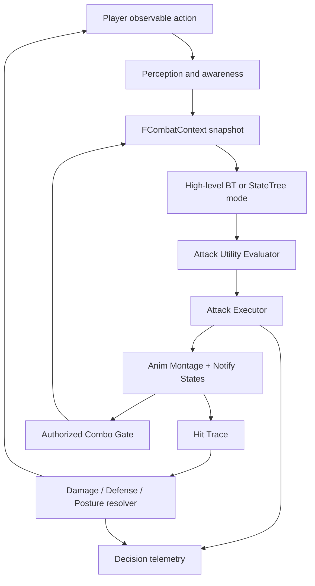

# 01 — Runtime Architecture and Ownership


## Recommended topology

**`BP_AshenBellwarden` / `ABossCharacter`** owns life, mesh, movement, collision capsule, components, ASC optional, and attack animation interface. **`BP_BossAIController`** owns perception, blackboard/BT and target selection. **`UCombatAwarenessComponent`** computes context snapshots. **`UAttackDecisionComponent`** filters/scores actions. **`UAttackExecutorComponent`** manages current attack, montage events and cancel policies. **`UHitTraceComponent`** owns per-swing collision sweeps. **`UPostureComponent`** owns stance thresholds and regeneration. **`UPhaseComponent`** owns transitions and phase data. **`ABossArenaBounds`** constrains spacing/navigation. **`UBossDebugComponent`** records replayable decisions.

### Engine/tool mapping

| Responsibility | Prefer in UE 5.5 | Why |
|---|---|---|
| Target perception | `UAIPerceptionComponent` on AIController | Event-based stimuli, sight, damage |
| High-level modes | Behavior Tree + Blackboard **or** StateTree | Understandable encounter flow; choose one |
| Destination search | EQS queries with score tests | Evaluates reposition candidates |
| Attack choice | Custom utility evaluator component | Fine-grained, auditable choices |
| Attack execution | Anim Montages/Sections + Notify States | Precisely timed attack windows |
| Root motion for lunges | Root-motion Montages + Motion Warping selectively | Authored displacement; bounded target adjustment |
| Damage | Custom hit-resolver or GAS GameplayEffects | Centralized damage/defense rules |
| VFX | Niagara events on notify timeline | Sync with animation |
| Sound | MetaSounds / Sound Cue; gameplay event scheduling | Readable cues |
| Debug | Gameplay Debugger, AI Debugging, Rewind Debugger, Visual Logger, Unreal Insights | Diagnosis of decisions/timings |

## Single source of truth: attack execution

**Do not let the BT, AnimBP and hit component all decide which attack is currently active.** The executor owns `{AttackInstanceID, AttackAsset, Phase, Section, AttackRuntimeState, StartedTime, TargetSnapshot, HitVictims}`. The BT asks `StartAttack`, but it does not manually set hitboxes or end the animation. Anim Notifies report timed signals **into** the executor; they do not choose the entire next behavior independently.

### Proposed interface

```text
CombatAwareness:
  BuildSnapshot(Target, Now) -> FCombatContext
AttackDecision:
  ChooseAttack(Context, AllowedAttackIds, Seed) -> FDecisionTrace
AttackExecutor:
  TryStartAttack(AttackId, Context) -> bool
  OnAttackCommit()
  OnHitWindowBegin(WindowIndex)
  OnHitWindowEnd(WindowIndex)
  OnComboGate(GateId)
  OnMontageBlendingOut(Montage, Interrupted)
  OnMontageEnded(Montage, Interrupted)
  AbortAttack(Reason)
HitTrace:
  BeginWindow(InstanceId, WindowId)
  SampleWeaponSweep(PreviousSocketTransforms, CurrentSocketTransforms)
  EndWindow(InstanceId, WindowId)
DamageResolver:
  ResolveHit(AttackInstanceId, Victim, Hit, DamageSpec)
```

## Update scheduling

| Operation | Typical schedule | Critical note |
|---|---|---|
| Perception | Events + update when target changes | Perception events do **not** mean attack immediately |
| Context snapshot | At every decision gate + optional 5–10 Hz cache | Use timestamped, consistent reads |
| Attack scoring | Neutral or authorized combo gate only | Not every Tick |
| High-level locomotion | BT service / movement component | Avoid constantly restarting `Move To` |
| Montage animation | Engine animation update | Don't override it with competing Tick rotation |
| Hit traces | Every frame during active window; sub-step as needed | Prevent tunneling at low frame rates |
| UI/VFX | As required | Cosmetic events must not own authoritative damage |
| Telemetry | Buffered event log | Avoid per-frame disk I/O |

## Data flow and event ownership



## Data assets and runtime separation

- `PDA_BossConfig`: max health, phase assets, locomotion speeds, global neutral delay, posture settings.
- `PDA_Attack_*`: distance/angle/phase gates, attack montage, base weight, cooldown, hit window data, trajectory, cancel/branch windows.
- `PDA_AttackGraph`: directed follow-up edges with gate conditions and weight modifiers.
- `PDA_BossPhase_01/02`: allowed attacks, score modifiers, delay range, movement policy.
- Runtime context: computed, **not** serialized in assets.
- Runtime attack instance: unique instance ID, cached target, trace history, hit victims.

## Failure recovery and event order

1. `TryStartAttack` validates `Neutral` and selected asset; sets runtime state `Windup` and unique instance ID before starting montage.
2. Montage play failure -> rollback immediately and log.
3. Notify calls must check the expected `AttackInstanceID` and current state.
4. Hit windows shut down on normal end, interruption, stagger, death, phase transition, teleport, or mesh destruction.
5. Montage blend-out is not always equivalent to successful completion; handle `Interrupted` explicitly.
6. A watchdog checks maximum expected duration + blend margin and aborts stale attacks.
7. `OnAttackEnded` allows neutral choice only after collision has been disabled and recovery policy resolved.

## Competing architectures: choose intentionally

- **Blueprint-first vertical slice:** Behavior Tree + BPs + Data Assets + custom Notify States. Fast iteration; profile per-frame traces.
- **Hybrid production:** BT and montage authoring in editor; utility, hit sweep, damage and telemetry in C++ exposed to Blueprint. Recommended here.
- **GAS-centric:** useful if existing player/enemies have ASC, GameplayEffects, GameplayTags, GameplayCues. Costs setup complexity; not required for one boss.
- **StateTree-centric:** good alternative for explicit hierarchical states; avoid running the StateTree and BT as independent authoritative combat planners.

## Invariant: player movement never directly sets boss animation

Target position affects decisions and bounded tracking; animation execution remains authoritative. Abandoning this separation creates unfair midair snapping, constant attack cancellation, and untestable hit timing.
