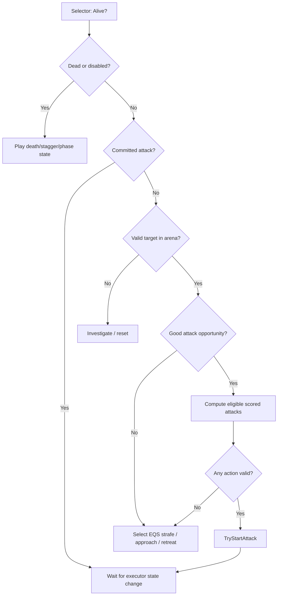

# 03 — Attack Selection via Eligibility + Utility + Memory


## Three separate stages — do not conflate

1. **Eligibility filters:** impossible choices are removed. An attack should never be scored if it violates phase/range/angle/resource/cooldown/state constraints.
2. **Utility scores:** valid attacks receive comparable desirability scores (distance fit, position, player recovery, preferred pace, variety, ability to connect).
3. **Selection:** choose max score with bounded noise, or a temperature-controlled weighted draw among sufficiently good candidates. Log the top N with rejection reasons.

## Hard gates

- Attack present in phase's allowed attack set.
- Boss executor is at `Neutral` or correct `ComboGate`.
- Target valid and within attack-defined 2D range plus vertical tolerance.
- Signed target yaw within allowed sector.
- Cooldown expired, resource/posture restrictions satisfied.
- The action is compatible with current attack branch (if gate).
- Montage and required sockets exist; nav destination reachable if required.
- If attack requires line of sight, it must be currently true.
- Animation action requirements (e.g. front-facing only) satisfied.

## Soft utility model (proposed)

Let every term be normalized into `[0,1]`:

```text
Utility(a,c) = BaseWeight(a) *
  [0.28*RangeFit(a,c) +
   0.20*AngleFit(a,c) +
   0.20*Opportunity(c) +
   0.12*SpacingValue(a,c) +
   0.10*PhaseStyle(a,c) +
   0.10*Variety(a,c)]
  - RepeatPenalty(a) - RiskPenalty(a,c)
```

The coefficients are **illustrative designer starting points, not Elden Ring internals**. Normalize score scales and graph score histograms before shipping. Add deterministic noise `[-0.05,+0.05]` or use weighted softmax only on close-scoring candidates, not all eligible moves.

### Range/angle fit

A range gate can allow 100–500 cm, but desirability may peak at 275 cm; e.g. `max(0, 1 - abs(distance - preferredDistance)/tolerance)`. Angle fit should account for whether a move rotates during wind-up; do not silently imply infinite turning.

### Variety memory

Track recent attack IDs with timestamps. Apply decaying repeat penalties and same-family penalties (e.g., two overheads in short succession). Rare signature attacks can have a guaranteed minimum spacing interval. Allow repeated signature attacks if repeated player behavior makes them logical, but tune repetition to avoid stagnation.

### Weighted choice

```text
Candidates = phase.allowedAttacks
Eligible = [a for a in Candidates if HardGates(a, context)]
if empty: return PositionOrWait
Scores = [(a, Utility(a, context)) for a in Eligible]
NearBest = candidates with score >= maxScore - 0.12
Selected = SoftmaxSample(NearBest, temperature=0.18, deterministicRNG)
return Selected plus rejection/score trace
```

Fallback hierarchy: valid guard response > spacing move > purposeful wait > retry; never infinite loop on no attacks.

## Why scoring should run only at legal gates

Suppose the boss begins a heavy slam, then player dodges behind it. If `ChooseAttack()` is called every frame and immediately swaps the montage, the boss becomes unreadable and appears supernatural. Instead choose the next action at an authored combo gate after the first active window, or at neutral after recovery. Independently allow limited early-wind-up aim tracking.

## Behavior Tree approach



Recommended Blackboard keys: `TargetActor`, `LastKnownLocation`, `HasLOS`, `CombatMode`, `SelectedMoveGoal`, `ExecutorBusy`, `DesiredRangeBand`, `BossPhase`. Scores live in C++ component or service, not a giant collection of Blackboard floats.

## Decision trace format (essential for debugging)

```json
{
  "time": 132.815,
  "gate": "Neutral",
  "distance_cm": 320,
  "signed_yaw_deg": 44,
  "player_action": "AttackingRecovery",
  "phase": 2,
  "candidates": [
    {"id": "PikeLunge", "score": 0.79, "eligible": true},
    {"id": "CrescentSweep", "score": 0.68, "eligible": true},
    {"id": "RearBellCrash", "eligible": false, "reject": "RearAngleRequired"}
  ],
  "chosen": "PikeLunge",
  "rng_seed": 12735
}
```

## Fair selection principles

- Limit maximum reaction cadence. A player must be able to see the counter begin.
- Never score an animation unavailable to execute.
- Split defensive reactions (emergency dodge or block) from normal attack selection, and give them budgets/cooldowns.
- Use pressure history to avoid endless forced attacks and perpetual recovery canceling.
- Do not silently buff attack speed depending on player health unless clearly part of phase rules.
- Do not dynamically choose an arbitrary untelegraphed hit geometry after an attack has become visually committed.
