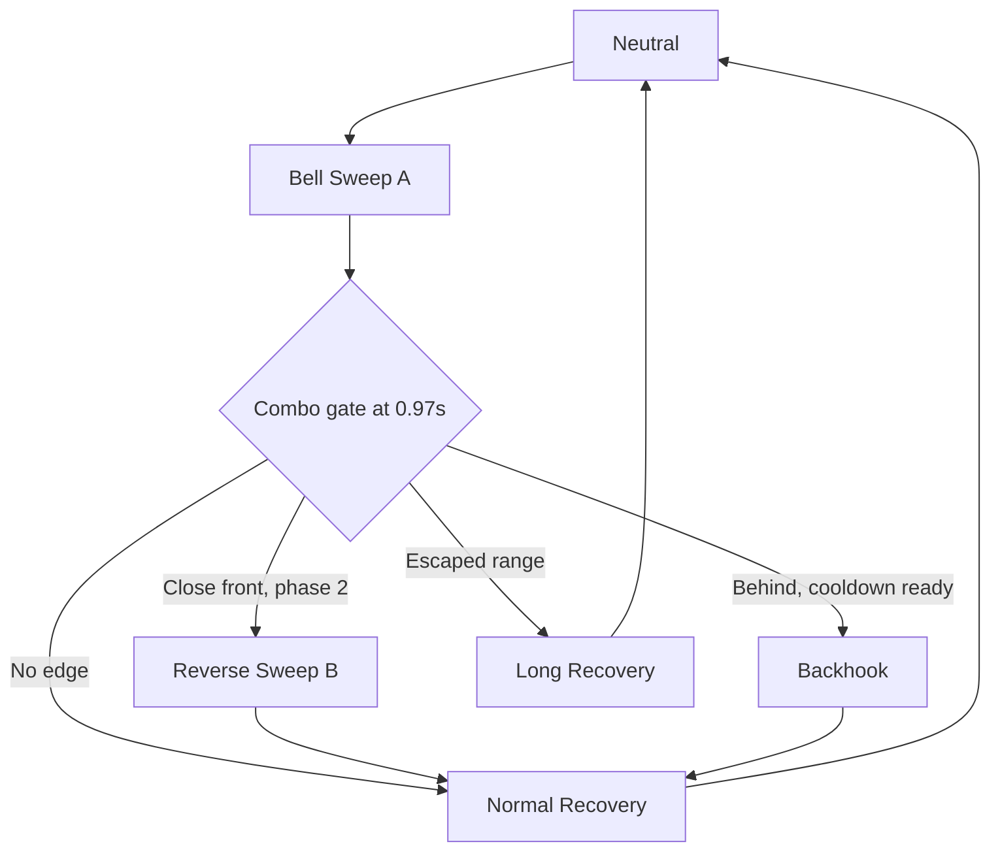

# 04 — Combo Graph, Legal Decision Gates, Branch Conditions


## A combo graph is not a random animation chain

Each **node** represents an authored move section; each **edge** represents a legal transition requiring a **branch gate** and conditions. Edge outcomes include `FollowUpMove`, `RecoveryVariant`, `Retreat`, or `End`. The boss cannot branch from arbitrary points in the middle of a live hitbox.

### Example combo: `BellSweep_A`

- `0.00–0.50s`: wind-up; tracking allowed up to 180°/s.
- `0.50s`: rotation commitment, cap 18°/s.
- `0.68–0.91s`: active sweep (swept socket collision).
- `0.92s`: close hitboxes.
- `0.97s`: combo decision gate; evaluate snapshot once.
- Branch A: target close and front/side, boss phase 2 -> `BellSweep_B` (quick reversing slash).
- Branch B: target behind, rear-counter available -> `Backhook` (distinct tell).
- Branch C: target escaped -> end combo, `Recovery_Long`.
- Branch D: none eligible -> `Recovery_Normal`.

**Beware:** choose whether a branch is allowed **independent** of hit confirm. Some bosses extend when whiffing, some only if the player stays close, some stop after a guarded strike. Tag every edge with its policy.

## Branch condition schema

```text
FComboEdge:
  FromMoveId, GateName, ToMoveId
  MinDistance, MaxDistance, MinAngle, MaxAngle
  RequiresHitConfirm (optional)
  RequiresTargetActionTag (optional)
  PhaseMask, Cooldown, MinimumDelay
  WeightModifier, Priority
  MaxUsesPerCombo, CancelPolicy
```

## Runtime algorithm

1. `ANS_ComboGate` calls executor with `GateName` and attack instance ID.
2. Executor validates state, ensures gate not consumed, turns off ended hit window.
3. Build **fresh** combat context now (not first-attack cached state).
4. Look up outgoing edges for `(CurrentNode, GateName)`.
5. Apply hard gates, edge weights and combo depth limit.
6. Choose one edge; if none eligible follow default recovery.
7. Use `Montage_SetNextSection` *where the montage structure permits*, or start the next montage with an explicit blend/transition policy. Test branch frame accuracy in UE 5.5.
8. Log gate time, chosen edge, scores and reasons.

## Interruption and cancel priority

`Death > ForcedPhaseTransition(if authorized) > StanceBreak > Parry/Grab special > ComboGate > NormalCompletion` is one possible ordering. Define it explicitly; do not depend on which Blueprint event happened first in a frame. Hyperarmor may prevent certain stagger actions, but death should still terminate cleanly.

## Anti-infinite-combo safeguards

- Maximum combo depth (e.g. 3 in phase 1, 4 in phase 2).
- Every edge has cooldown or per-combo use count if it can loop.
- Global `MaxPressureDuration` budget to guarantee eventual neutral/recovery.
- `AttackInstanceID` changes per move, and a `ComboID` links the entire sequence for analytics.
- Any failed montage section or invalid target routes into reliable recovery.

## Branching and player learning

A boss is challenging when the player learns **conditions**, not just a single fixed pattern. If a close dodge consistently triggers a reverse slash, skilled players can avoid it by leaving range or by attacking from another angle. Conversely, if the graph branches arbitrarily every time with no visible setup, learning becomes guessing.

## Useful authoring pattern: graph in data asset, execution in one place

`PDA_AttackGraph_Bellwarden` should hold nodes/edges. The AnimBP never queries player distance; it emits a gate event. The decision component scores edges, and executor drives montage transitions. This avoids branching logic hidden across many montages.

## Example graph (Mermaid)


