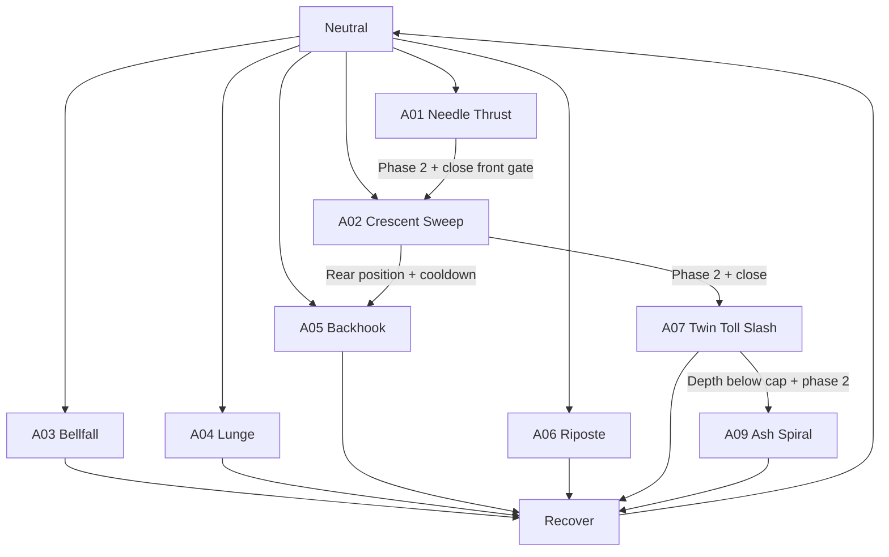

# 14 — Original Boss Case Study: ASHEN BELLWARDEN

> **Original design:** an armored, bell-bearing sentinel wielding a long hooked halberd. All names, attacks and data in this pack are original design proposals, not reconstructed proprietary game data.

## One-sentence combat fantasy

The Bellwarden is a deliberate, frightening polearm duelist: wide weapon arcs dominate side space; narrow thrusts threaten greedy approach; a huge overhead crush creates the most satisfying punish; phase two adds bell-driven radial hazards and more conditional combo pressure.

## Boss silhouette and player readability

- Long halberd defines front reach and arc coverage.
- Weighted hanging bells vibrate/toll before radial abilities.
- Shoulders open visibly before a crescent sweep.
- Low halberd point plus rear-leg loading precedes thrust/lunge.
- Two-handed high weapon posture telegraphs overhead crush.
- A distinct low pivot silhouette communicates rear hook.
- Crimson ground markings distinguish harmful AoE from non-harmful embers and weapon trails.

## Arena

Flat-to-gently-sloped circular courtyard, inner combat radius **1500 cm**, readable boundary, limited pillars near edges. Avoid small obstacles inside root-motion path. Phase-two radial ring has a mechanically verified jump or gap-escape answer. Use `diagrams/09_arena_and_spacing.png`.

## Player and boss assumptions

Boss roughly 2.6m tall; polearm visual reach 300–430 cm depending on move. The third-person player has 0.25s light startup, 0.55s heavy startup, 0.38s dodge duration with a tuned i-frame sub-window; these are **placeholder assumptions** for timing analysis, not universal Soulslike parameters.

## Health/poise (initial targets)

- HP = 10,000 (illustrative tuning stat, not absolute balance).
- Posture = 100; regen delay 4s and rate 8 points/s.
- Phase 2 queued below 55% HP and applied at safe transition.
- Player attack damage light ~250, heavy ~520 as a preliminary dummy so fight length can be tested, not shipped untuned.
- Intended battle duration roughly 2–5 minutes by build/skill level, to be verified rather than forced with hidden scaling.

## Attack portfolio — 12 moves

| ID | Name | Geometry | Role | Punish class |
|---|---|---|---|---|
| A01 | Needle Thrust | Short narrow thrust | Close poke | Short |
| A02 | Crescent Sweep | Wide moving blade arc | Flank/front control | Conditional |
| A03 | Bellfall Overhead | Committed impact + small splash | Main punish opportunity | Long guaranteed |
| A04 | Procession Lunge | Forward rooted travel thrust | Gap closer | Medium |
| A05 | Backhook | Rear/side hooked sweep | Rear camping counter | Short-medium |
| A06 | Crossguard Riposte | Defensive short counter | Punish greedy close attack | Short |
| A07 | Twin Toll Slash | Two hit combo | Mixed timing | Conditional |
| A08 | False Mercy | Long delayed overhead | Premature roll check | Long |
| A09 | Ash Spiral | Multi-hit spinning arc | Crowd/side control | Medium |
| A10 | Funeral Bell Ring | Expanding radial annulus | Space/vertical solution | Long |
| A11 | Ember Fissure | Forward lane ground wave | Zoning | Medium |
| A12 | Oathbreaker Grab | Local narrow grab volume | Guard discipline | Long on miss |

**Phase 1:** A01–A07 plus A08 at reduced weight. **Phase 2:** A01–A12 with three-hit branches, bell ring and fissure special mixups. That is a design proposal; avoid introducing all at once.

## Attack-by-attack tactical design

### A01 Needle Thrust

Face target at <240cm, fast wind-up 0.25s, narrow blade path. Useful against a player approaching without observing boss stance. Short recovery means light counter reward only if close/flank; quick attack should not do catastrophic damage. Phase 2 may connect to A02 if target remains close and front.

### A02 Crescent Sweep

Wide attack with left-to-right tip travel. Medium anticipation; commitment before release. A player can dodge through the blade into the exposed side, but a quick reverse slash may branch if they remain too close at the gate. One victim receives only one damage event in the main sweep. The player can escape follow-up by repositioning rather than guessing.

### A03 Bellfall Overhead

Two-hand lift, 0.70s anticipation + 0.28s hold, rapid vertical release and localized impact. Facing locks before active contact. Narrow direct path, small impact splash. **Guaranteed long recovery** is the boss's clearest heavy-attack opening. No emergency instant counter during its main recovery.

### A04 Procession Lunge

Boss plants rear foot then lunges ~350–600cm under bounded motion warp. Aim updated only in early wind-up; stop tracking before displacement becomes committed. On whiff, forward travel means the player can reach a flank. If player simply retreats backward, the long thrust can still connect.

### A05 Backhook

Rear-zone move only when close behind or flank; visible pivot precedes hooked sweep. Cooldown prevents permanent 360° defense. Allows deliberate bait-and-dodge; not an instantly triggered rear damage pulse.

### A06 Crossguard Riposte

Defensive counter available in neutral when nearby player has a *committed* melee swing, and boss has reaction budget. Distinct guard raise (telegraph); not guaranteed to counter every player attack. Block/riposte needs stamina or cooldown.

### A07 Twin Toll Slash

Two-hit cadence with longer beat between hit 1 and hit 2. On first hit end, gate evaluates range/angle; may end after one if player escapes. Visually clear whether an additional blade path is incoming.

### A08 False Mercy

Prolonged, fixed authored hold or pre-selected short/long hold variant. The boss raises weapon and deliberately delays release. Require legible release cue; no hidden per-frame roll detector that changes attack timing after it has been telegraphed. When landed/whiffed, long recovery remains.

### A09 Ash Spiral

Phase-two multi-hit rotating attack with explicit per-window hit policies and outer-radius safe option. Avoid near-permanent hitbox. Travel and rotation must be visually matched to collision. Recovery at end lets player approach.

### A10 Funeral Bell Ring

Ringing metal pose + ground light ring + expanding annulus. One wave damage per victim; ring moves from origin with speed and width defined by data. Allow jump/dodge/spacing and communicate the correct response. Player must not be damaged merely for standing inside ring after wave has moved past.

### A11 Ember Fissure

Halberd point punches ground; forward ground crack travels as a lane hazard. Each segment checks reachable floor/height and LOS. Forces lateral reposition while boss is stationary for a punish opportunity.

### A12 Oathbreaker Grab

Short-range guard-breaking capture with strongly differentiated winding grip animation. Narrow grab volume and capture gate; on miss long recovery. Paired animation alignment must avoid wall/edge softlocks; disable move until alignment and interruption handling are reliable.

## Attack graph (authored)

Specials A08/A10/A11/A12 can start from neutral based on phase and weight; first version excludes chaining from these specials so that each has a clear recovery.

## Tactical matchup examples

- **Player rolls backward repeatedly:** A04 likelihood increases; thrust speed fixed, no retarget after commit.
- **Player stays on side:** A02 becomes eligible. If they choose a good through-roll, receive flank punish unless conditional branch remains active.
- **Player guards indefinitely:** A12 becomes more likely but long miss recovery provides counterplay.
- **Player uses slow heavy during boss recovery:** possible punish if travel and startup fit the window; otherwise boss may recover and counter.
- **Player heals far away:** A04 may be eligible if reaction latency + travel still gives meaningful threat; no teleport or instant ranged magic.
- **Player exploits rear camera blind zone:** A05 exists but with an audible/visual windup and cooldown.

## Vertical slice plan

1. Mannequin + three authored placeholder montages (A01/A02/A03).
2. Correct enemy targeting, context and attack utility with debug scores.
3. Collision shapes and trace for point thrust, sweep and ground impact.
4. Two recoveries and one conditional A02 follow-up to A01 if target close.
5. Poise break and phase toggle.
6. Replace placeholders with Bellwarden animations and geometry only after mechanics prove readable.
